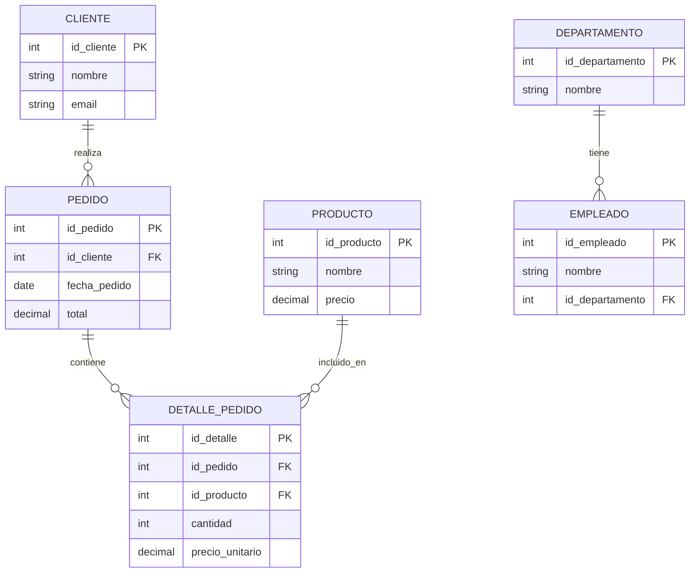

# Fundamentos de Bases de Datos - Integridad

## 8.3 Integridad de Referencial.

---

La integridad referencial es un concepto fundamental en bases de datos relacionales que garantiza la consistencia de las relaciones entre tablas. Esta restricción asegura que las referencias entre datos sean válidas y consistentes, manteniendo la calidad y confiabilidad de la información.

### Definición de Integridad Referencial

Según Elmasri y Navathe (2006), la **integridad referencial** es una restricción que especifica que cualquier valor de un atributo (o conjunto de atributos) que forma una clave foránea en una relación R1, debe coincidir con el valor de la clave primaria de alguna tupla en la relación R2, o debe ser completamente nulo.

Matemáticamente, si tenemos una relación R1 con clave foránea FK que referencia la clave primaria PK de la relación R2, entonces:

$$∀ t₁ ∈ R₁, t₁[FK] = NULL ∨ ∃ t₂ ∈ R₂ \text{ tal que } t₂[PK] = t₁[FK]$$

Donde:

- R₁: Relación que contiene la clave foránea
- R₂: Relación referenciada que contiene la clave primaria
- FK: Clave foránea en R₁
- PK: Clave primaria en R₂
- t₁: Tupla en R₁
- t₂: Tupla en R₂

### Conceptos Clave

#### Clave Foránea (Foreign Key)

Atributo o conjunto de atributos en una tabla que referencia la clave primaria de otra tabla.

#### Relación Referenciada y Referenciadora

- **Tabla referenciada (padre)**: Contiene la clave primaria
- **Tabla referenciadora (hija)**: Contiene la clave foránea

#### Acciones de Integridad Referencial

- **RESTRICT**: Rechaza la operación que violaría la integridad
- **CASCADE**: Propaga la operación a las filas relacionadas
- **SET NULL**: Establece NULL en la clave foránea
- **SET DEFAULT**: Establece el valor por defecto en la clave foránea
- **NO ACTION**: Similar a RESTRICT pero con diferencias en el momento de verificación

### Implementación en SQL

#### Creación de Claves Foráneas

```sql
-- Sintaxis básica
CREATE TABLE Pedido (
    id_pedido INT PRIMARY KEY,
    id_cliente INT,
    fecha_pedido DATE,
    total DECIMAL(10,2),
    FOREIGN KEY (id_cliente) REFERENCES Cliente(id_cliente)
);

-- Con acciones específicas
CREATE TABLE DetallePedido (
    id_detalle INT PRIMARY KEY,
    id_pedido INT,
    id_producto INT,
    cantidad INT,
    precio DECIMAL(10,2),
    FOREIGN KEY (id_pedido) REFERENCES Pedido(id_pedido)
        ON DELETE CASCADE
        ON UPDATE CASCADE,
    FOREIGN KEY (id_producto) REFERENCES Producto(id_producto)
        ON DELETE RESTRICT
        ON UPDATE CASCADE
);
```

#### Modificación de Tablas Existentes

```sql
-- Agregar clave foránea a tabla existente
ALTER TABLE Empleado
ADD CONSTRAINT fk_empleado_departamento
FOREIGN KEY (id_departamento)
REFERENCES Departamento(id_departamento)
ON DELETE SET NULL
ON UPDATE CASCADE;

-- Eliminar una clave foránea
ALTER TABLE Empleado
DROP CONSTRAINT fk_empleado_departamento;
```

### Diagrama de Relaciones Referenciales



### Ejemplos Prácticos

#### Ejemplo 1: Restricción Básica de Integridad Referencial

```sql
CREATE TABLE Departamento (
    id_departamento INT PRIMARY KEY,
    nombre VARCHAR(100) NOT NULL
);

CREATE TABLE Empleado (
    id_empleado INT PRIMARY KEY,
    nombre VARCHAR(100) NOT NULL,
    id_departamento INT,
    FOREIGN KEY (id_departamento) REFERENCES Departamento(id_departamento)
);

-- Inserción válida
INSERT INTO Departamento VALUES (1, 'Ventas');
INSERT INTO Empleado VALUES (101, 'Juan Pérez', 1);

-- Inserción inválida (viola integridad referencial)
INSERT INTO Empleado VALUES (102, 'María López', 2); -- Error: departamento 2 no existe
```

#### Ejemplo 2: Acciones en Cascada

```sql
CREATE TABLE Categoria (
    id_categoria INT PRIMARY KEY,
    nombre VARCHAR(100) NOT NULL
);

CREATE TABLE Producto (
    id_producto INT PRIMARY KEY,
    nombre VARCHAR(100) NOT NULL,
    id_categoria INT,
    precio DECIMAL(10,2),
    FOREIGN KEY (id_categoria) REFERENCES Categoria(id_categoria)
        ON DELETE CASCADE
        ON UPDATE CASCADE
);

-- Insertar datos
INSERT INTO Categoria VALUES (1, 'Electrónicos');
INSERT INTO Producto VALUES (101, 'Laptop', 1, 1200.00);

-- Actualización en cascada
UPDATE Categoria SET id_categoria = 10 WHERE id_categoria = 1;
-- El producto se actualiza automáticamente: id_categoria = 10

-- Eliminación en cascada
DELETE FROM Categoria WHERE id_categoria = 10;
-- El producto se elimina automáticamente
```

### Ejercicios Propuestos

#### Ejercicio 1: Diseño de Esquema con Integridad Referencial

Diseña un esquema para un sistema universitario con las siguientes tablas:

- Estudiante (id_estudiante, nombre, email)
- Curso (id_curso, nombre, créditos)
- Matricula (id_matricula, id_estudiante, id_curso, semestre, calificación)

Define las claves primarias, foráneas y las acciones apropiadas.

```sql
-- Escribe tu solución aquí
```

#### Ejercicio 2: Análisis de Operaciones

Dado el siguiente esquema:

```sql
CREATE TABLE Proveedor (
    id_proveedor INT PRIMARY KEY,
    nombre VARCHAR(100)
);

CREATE TABLE Producto (
    id_producto INT PRIMARY KEY,
    nombre VARCHAR(100),
    id_proveedor INT,
    FOREIGN KEY (id_proveedor) REFERENCES Proveedor(id_proveedor)
        ON DELETE SET NULL
        ON UPDATE CASCADE
);
```

Analiza qué sucede en las siguientes operaciones:

1. `DELETE FROM Proveedor WHERE id_proveedor = 1;`
2. `UPDATE Proveedor SET id_proveedor = 100 WHERE id_proveedor = 1;`
3. `INSERT INTO Producto VALUES (500, 'Producto X', 999);`

#### Ejercicio 3: Corrección de Integridad Referencial

Identifica y corrige los problemas en el siguiente esquema:

```sql
CREATE TABLE Autor (
    id_autor INT,
    nombre VARCHAR(100)
);

CREATE TABLE Libro (
    id_libro INT PRIMARY KEY,
    titulo VARCHAR(200),
    id_autor INT,
    FOREIGN KEY (id_autor) REFERENCES Autor(id_autor)
        ON DELETE RESTRICT
);
```

### Casos Especiales y Consideraciones

#### Claves Foráneas que Referencian Claves Únicas

```sql
CREATE TABLE Persona (
    id_persona INT PRIMARY KEY,
    email VARCHAR(255) UNIQUE NOT NULL,
    nombre VARCHAR(100)
);

CREATE TABLE Mensaje (
    id_mensaje INT PRIMARY KEY,
    remitente_email VARCHAR(255),
    contenido TEXT,
    FOREIGN KEY (remitente_email) REFERENCES Persona(email)
        ON UPDATE CASCADE
);
```

#### Integridad Referencial con Múltiples Columnas

```sql
CREATE TABLE Equipo (
    id_equipo INT,
    id_proyecto INT,
    nombre VARCHAR(100),
    PRIMARY KEY (id_equipo, id_proyecto)
);

CREATE TABLE MiembroEquipo (
    id_miembro INT PRIMARY KEY,
    id_equipo INT,
    id_proyecto INT,
    nombre VARCHAR(100),
    FOREIGN KEY (id_equipo, id_proyecto)
        REFERENCES Equipo(id_equipo, id_proyecto)
        ON DELETE CASCADE
);
```

#### Restricciones de Integridad Referencial Circular

```sql
-- Ejemplo de referencia circular (requiere manejo especial)
CREATE TABLE Empleado (
    id_empleado INT PRIMARY KEY,
    nombre VARCHAR(100),
    id_supervisor INT,
    FOREIGN KEY (id_supervisor) REFERENCES Empleado(id_empleado)
);

-- Para insertar el primer empleado (sin supervisor)
INSERT INTO Empleado (id_empleado, nombre, id_supervisor)
VALUES (1, 'CEO', NULL);

-- Insertar empleados subordinados
INSERT INTO Empleado (id_empleado, nombre, id_supervisor)
VALUES (2, 'Gerente', 1);
```

### Buenas Prácticas

1. **Siempre definir claves foráneas** para mantener la integridad referencial
2. **Elegir acciones apropiadas** (CASCADE, SET NULL, RESTRICT) según la semántica del negocio
3. **Evitar referencias circulares** o manejarlas con cuidado
4. **Considerar el impacto en el rendimiento** de las restricciones de integridad
5. **Documentar las relaciones** entre tablas en el esquema de la base de datos

### Referencias

#### Bibliografía Básica

1. Elmasri and Navathe. _Fundamentals of Database Systems_. Addison-Wesley. Cuarta Edición. 2006. (Capítulo 3: The Relational Data Model and Relational Database Constraints)
2. Silberschatz A., Kort H. y Sudarshan S. _Fundamentos de BD_. McGraw Hill. Quinta edición. 2006. (Capítulo 6: Integridad y Seguridad)
3. Ullman J.D. and Widom J. _A First Course in Data Base System_. Prentice Hall. Tercera edición. 2008. (Capítulo 2: The Relational Model of Data)

#### Bibliografía Complementaria

1. Harrington J. _Relational Database Design and Implementation_. Tercera edición. Morgan Kaufmann. 2009. (Capítulo 7: Database Constraints)
2. Kline K., Kline D., and Hunt B. _SQL in a nutshell_. O'Reilly. 2008. (Capítulo 2: Foundational Concepts)

### Autoevaluación

1. ¿Qué es la integridad referencial y por qué es importante en bases de datos?
2. Explica la diferencia entre RESTRICT y CASCADE en las acciones de integridad referencial
3. ¿Cómo se manejan los valores NULL en las claves foráneas?
4. Describe una situación donde sería apropiado usar SET NULL en lugar de CASCADE
5. ¿Qué problemas pueden surgir con las referencias circulares y cómo se pueden resolver?
