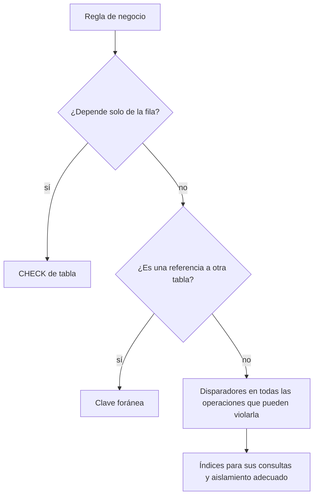

# Fundamentos de Bases de Datos - Integridad

## 8.4 Integridad del Usuario.

---

Las restricciones de entidad, de dominio y referenciales son genéricas: valen para cualquier base de datos. Las **restricciones de usuario**, también llamadas **semánticas** o **reglas de negocio**, son las propias de cada organización: un empleado no trabaja en más de tres proyectos activos, un usuario con multas pendientes no recibe préstamos, un proyecto completado tiene fecha de fin. Este tema presenta los tres mecanismos que ofrece SQL para expresarlas (restricciones `CHECK` de tabla, aserciones y disparadores), cuándo usar cada uno y los cuidados que exigen los disparadores.

### Mecanismos

**Restricciones `CHECK` de tabla.** Expresan reglas que dependen de una sola fila, aunque relacionen varias columnas: que la fecha de inicio preceda a la de fin, o que un proyecto completado tenga fecha de fin. Son declarativas, el SMBD las verifica siempre, el optimizador puede aprovecharlas, y no tienen problemas de concurrencia. Son la primera opción siempre que alcanzan.

**Aserciones.** `CREATE ASSERTION nombre CHECK (condición)` declara una condición sobre toda la base de datos, que puede usar subconsultas sobre varias tablas:

```sql
CREATE ASSERTION max_tres_proyectos CHECK (NOT EXISTS (
    SELECT a.id_empleado FROM asignacion a JOIN proyecto p USING (id_proyecto)
    WHERE p.estado IN ('Planificado', 'En Progreso')
    GROUP BY a.id_empleado HAVING COUNT(*) > 3));
```

Es la forma más clara de escribir una regla general, pero, como se vio en el tema 3.3, ningún SMBD de uso común la implementa, porque verificar una condición arbitraria después de cada cambio es costoso y difícil de hacer de forma incremental.

**Disparadores.** Un **disparador** (*trigger*) es un procedimiento que el SMBD ejecuta automáticamente antes o después de un `INSERT`, `UPDATE` o `DELETE` sobre una tabla, por cada fila o por cada sentencia, opcionalmente solo si se cumple una condición (`WHEN`). Para una regla de negocio, el disparador verifica la condición y, si se violaría, aborta la operación con un error. Es el mecanismo con que en la práctica se implementan las aserciones.

| Mecanismo     | Alcance                           | Ventajas                                   | Riesgos                                                     |
| ------------- | --------------------------------- | ------------------------------------------ | ----------------------------------------------------------- |
| `CHECK`       | Una fila                          | Declarativo, simple, siempre correcto      | No puede consultar otras filas                              |
| Aserción      | Toda la base                      | Declarativa, completa                      | No implementada en la práctica                              |
| Disparador    | Lo que el código consulte         | Expresa cualquier regla                    | Hay que cubrir todas las operaciones; concurrencia; costo   |

### Cuidados con los disparadores

- **Cubrir todas las operaciones que pueden violar la regla.** "A lo más tres proyectos activos por empleado" se viola al asignar un empleado a un proyecto activo, pero también al **reactivar** un proyecto completado al que ya estaba asignado, y al cambiar la asignación de un proyecto a otro. Un disparador solo en `INSERT` deja abiertas las otras rutas.
- **Concurrencia.** Un disparador que cuenta y luego permite la inserción puede fallar si dos transacciones cuentan a la vez, ambas ven 2 y ambas insertan. Con el nivel de aislamiento `SERIALIZABLE` (tema 9.3), o bloqueando la fila del empleado con `SELECT ... FOR UPDATE` en PostgreSQL, el problema desaparece. SQLite no lo tiene, porque serializa todas las escrituras.
- **Costo.** El disparador se ejecuta en cada fila afectada; si su consulta recorre una tabla grande, cada inserción se vuelve lenta. Las consultas del disparador deben usar índices: un índice parcial sobre los préstamos no devueltos hace que contar los de un usuario sea una búsqueda.
- **Cascadas y ciclos.** Un disparador que modifica otra tabla puede activar los disparadores de esa tabla; hay que evitar ciclos y efectos sorpresa.
- **Mensajes claros.** El error debe decir qué regla se violó, porque es lo que verá el usuario.



### Implementación en Python

El programa implementa en SQLite las restricciones de los tres ejercicios: la tabla de proyectos con cuatro `CHECK` con nombre; dos disparadores para el límite de proyectos activos, uno en la asignación y otro en la reactivación de un proyecto, y un disparador con las tres reglas de la biblioteca, apoyado en un índice parcial. Prueba cada regla con operaciones válidas e inválidas y muestra el plan de la consulta que cuenta los préstamos abiertos.

```python
import sqlite3

db = sqlite3.connect(":memory:", isolation_level=None)
db.execute("PRAGMA foreign_keys = ON")

def intenta(sql, etiqueta):
    try:
        db.execute(sql); print(f"   aceptado: {etiqueta}")
    except sqlite3.Error as e:
        print(f"   rechazado: {etiqueta} -> {e}")

# --- Ejercicio 1 ---
db.execute("""
CREATE TABLE proyecto (
    id_proyecto  INTEGER PRIMARY KEY,
    nombre       TEXT NOT NULL,
    fecha_inicio TEXT NOT NULL,
    fecha_fin    TEXT,
    presupuesto  NUMERIC NOT NULL,
    estado       TEXT NOT NULL DEFAULT 'Planificado',
    CONSTRAINT ck_fechas      CHECK (fecha_fin IS NULL OR fecha_inicio < fecha_fin),
    CONSTRAINT ck_presupuesto CHECK (presupuesto > 0 AND presupuesto < 1000000),
    CONSTRAINT ck_estado      CHECK (estado IN ('Planificado', 'En Progreso', 'Completado', 'Cancelado')),
    CONSTRAINT ck_completado  CHECK (estado <> 'Completado' OR fecha_fin IS NOT NULL)
)""")
print("ejercicio 1:")
for sql, et in (("(1, 'Portal', '2026-01-10', '2026-06-30', 250000, 'Completado')", "completado con fecha de fin"),
                ("(2, 'App', '2026-03-01', NULL, 400000, 'En Progreso')", "en progreso sin fecha de fin"),
                ("(3, 'CRM', '2026-05-01', '2026-04-01', 90000, 'Planificado')", "fin antes del inicio"),
                ("(4, 'ERP', '2026-02-01', NULL, 1500000, 'Planificado')", "presupuesto de 1.5 millones"),
                ("(5, 'BI', '2026-02-01', NULL, 50000, 'Terminado')", "estado no permitido"),
                ("(6, 'Datos', '2026-02-01', NULL, 50000, 'Completado')", "completado sin fecha de fin")):
    intenta(f"INSERT INTO proyecto VALUES {sql}", et)
intenta("UPDATE proyecto SET estado = 'Completado' WHERE id_proyecto = 2", "marcar la App como completada sin fecha")

# --- Ejercicio 2: a lo más 3 proyectos activos por empleado ---
db.executescript("""
CREATE TABLE empleado (id_empleado INTEGER PRIMARY KEY, nombre TEXT NOT NULL);
CREATE TABLE asignacion (id_empleado INTEGER REFERENCES empleado, id_proyecto INTEGER REFERENCES proyecto,
                         PRIMARY KEY (id_empleado, id_proyecto));
INSERT INTO empleado VALUES (1, 'Ana'), (2, 'Beto');
INSERT INTO proyecto VALUES (10, 'P10', '2026-01-01', NULL, 1000, 'En Progreso'), (11, 'P11', '2026-01-01', NULL, 1000, 'En Progreso'),
                            (12, 'P12', '2026-01-01', NULL, 1000, 'Planificado'), (13, 'P13', '2026-01-01', NULL, 1000, 'En Progreso'),
                            (14, 'P14', '2025-01-01', '2025-12-01', 1000, 'Completado');
CREATE VIEW proyectos_activos AS
    SELECT a.id_empleado, COUNT(*) AS n FROM asignacion a JOIN proyecto p USING (id_proyecto)
    WHERE p.estado IN ('Planificado', 'En Progreso') GROUP BY a.id_empleado;
CREATE TRIGGER max_tres_ins BEFORE INSERT ON asignacion
WHEN (SELECT estado FROM proyecto WHERE id_proyecto = NEW.id_proyecto) IN ('Planificado', 'En Progreso')
 AND (SELECT COUNT(*) FROM asignacion a JOIN proyecto p USING (id_proyecto)
      WHERE a.id_empleado = NEW.id_empleado AND p.estado IN ('Planificado', 'En Progreso')) >= 3
BEGIN SELECT RAISE(ABORT, 'el empleado ya tiene 3 proyectos activos'); END;
-- la regla también se viola si un proyecto vuelve a estar activo
CREATE TRIGGER max_tres_estado BEFORE UPDATE OF estado ON proyecto
WHEN NEW.estado IN ('Planificado', 'En Progreso') AND OLD.estado NOT IN ('Planificado', 'En Progreso')
 AND EXISTS (SELECT 1 FROM asignacion a JOIN proyectos_activos pa USING (id_empleado)
             WHERE a.id_proyecto = NEW.id_proyecto AND pa.n >= 3)
BEGIN SELECT RAISE(ABORT, 'reactivarlo daría a un empleado más de 3 proyectos activos'); END;
""")
print("ejercicio 2:")
for p in (10, 11, 12, 14, 13):
    intenta(f"INSERT INTO asignacion VALUES (1, {p})", f"Ana en P{p}")
print("   activos de Ana:", db.execute("SELECT n FROM proyectos_activos WHERE id_empleado = 1").fetchone()[0])
intenta("UPDATE proyecto SET estado = 'En Progreso', fecha_fin = NULL WHERE id_proyecto = 14", "reactivar P14")
intenta("UPDATE proyecto SET estado = 'Completado', fecha_fin = '2026-10-31' WHERE id_proyecto = 10", "completar P10")
intenta("INSERT INTO asignacion VALUES (1, 13)", "Ana en P13, ahora que P10 terminó")

# --- Ejercicio 3: biblioteca ---
db.executescript("""
CREATE TABLE usuario (id_usuario INTEGER PRIMARY KEY, nombre TEXT NOT NULL);
CREATE TABLE libro (id_libro INTEGER PRIMARY KEY, titulo TEXT NOT NULL, es_referencia INTEGER NOT NULL DEFAULT 0
                    CHECK (es_referencia IN (0, 1)));
CREATE TABLE prestamo (id_prestamo INTEGER PRIMARY KEY, id_usuario INTEGER NOT NULL REFERENCES usuario,
                       id_libro INTEGER NOT NULL REFERENCES libro, salida TEXT NOT NULL, devolucion TEXT);
CREATE TABLE multa (id_multa INTEGER PRIMARY KEY, id_usuario INTEGER NOT NULL REFERENCES usuario,
                    monto NUMERIC NOT NULL CHECK (monto > 0), pagada INTEGER NOT NULL DEFAULT 0);
CREATE INDEX idx_prestamo_abierto ON prestamo(id_usuario) WHERE devolucion IS NULL;
CREATE TRIGGER reglas_prestamo BEFORE INSERT ON prestamo
BEGIN
    SELECT RAISE(ABORT, 'los libros de referencia no se prestan')
    WHERE (SELECT es_referencia FROM libro WHERE id_libro = NEW.id_libro) = 1;
    SELECT RAISE(ABORT, 'el usuario tiene multas pendientes')
    WHERE EXISTS (SELECT 1 FROM multa WHERE id_usuario = NEW.id_usuario AND pagada = 0);
    SELECT RAISE(ABORT, 'el usuario ya tiene 5 libros prestados')
    WHERE (SELECT COUNT(*) FROM prestamo WHERE id_usuario = NEW.id_usuario AND devolucion IS NULL) >= 5;
END;
INSERT INTO usuario VALUES (1, 'Iris'), (2, 'Noé');
INSERT INTO libro (id_libro, titulo, es_referencia) VALUES (1, 'Diccionario', 1);
INSERT INTO libro (titulo) VALUES ('L2'), ('L3'), ('L4'), ('L5'), ('L6'), ('L7');
INSERT INTO multa (id_usuario, monto) VALUES (2, 40);
""")
print("ejercicio 3:")
intenta("INSERT INTO prestamo (id_usuario, id_libro, salida) VALUES (1, 1, '2026-11-03')", "Iris pide el diccionario")
for libro in range(2, 8):
    intenta(f"INSERT INTO prestamo (id_usuario, id_libro, salida) VALUES (1, {libro}, '2026-11-03')", f"Iris pide L{libro}")
intenta("INSERT INTO prestamo (id_usuario, id_libro, salida) VALUES (2, 7, '2026-11-03')", "Noé, con una multa de 40")
db.execute("UPDATE multa SET pagada = 1 WHERE id_usuario = 2")
intenta("INSERT INTO prestamo (id_usuario, id_libro, salida) VALUES (2, 7, '2026-11-03')", "Noé, tras pagar")
print("   plan de la verificación de los 5 libros:", [r[3] for r in db.execute(
    "EXPLAIN QUERY PLAN SELECT COUNT(*) FROM prestamo WHERE id_usuario = 1 AND devolucion IS NULL")])
```

Salida:

```text
ejercicio 1:
   aceptado: completado con fecha de fin
   aceptado: en progreso sin fecha de fin
   rechazado: fin antes del inicio -> CHECK constraint failed: ck_fechas
   rechazado: presupuesto de 1.5 millones -> CHECK constraint failed: ck_presupuesto
   rechazado: estado no permitido -> CHECK constraint failed: ck_estado
   rechazado: completado sin fecha de fin -> CHECK constraint failed: ck_completado
   rechazado: marcar la App como completada sin fecha -> CHECK constraint failed: ck_completado
ejercicio 2:
   aceptado: Ana en P10
   aceptado: Ana en P11
   aceptado: Ana en P12
   aceptado: Ana en P14
   rechazado: Ana en P13 -> el empleado ya tiene 3 proyectos activos
   activos de Ana: 3
   rechazado: reactivar P14 -> reactivarlo daría a un empleado más de 3 proyectos activos
   aceptado: completar P10
   aceptado: Ana en P13, ahora que P10 terminó
ejercicio 3:
   rechazado: Iris pide el diccionario -> los libros de referencia no se prestan
   aceptado: Iris pide L2
   aceptado: Iris pide L3
   aceptado: Iris pide L4
   aceptado: Iris pide L5
   aceptado: Iris pide L6
   rechazado: Iris pide L7 -> el usuario ya tiene 5 libros prestados
   rechazado: Noé, con una multa de 40 -> el usuario tiene multas pendientes
   aceptado: Noé, tras pagar
   plan de la verificación de los 5 libros: ['SEARCH prestamo USING INDEX idx_prestamo_abierto (id_usuario=?)']
```

### Ejercicios Propuestos

1. **Restricciones de tabla.** Diseña una tabla `Proyecto` en la que la fecha de inicio sea anterior a la de fin, el presupuesto sea positivo y menor que 1,000,000, el estado sea Planificado, En Progreso, Completado o Cancelado, y un proyecto completado tenga fecha de fin.

2. **Disparadores.** Escribe un disparador que impida asignar a un empleado a más de 3 proyectos simultáneamente.

3. **Biblioteca.** Implementa estas reglas: un usuario tiene a lo más 5 libros prestados, los libros de referencia no se prestan y los usuarios con multas pendientes no reciben préstamos.

4. **Repaso.** ¿Qué distingue a la integridad de usuario de las otras? ¿Qué diferencia hay entre `CHECK`, aserciones y disparadores? ¿Cuándo usar un disparador en lugar de un `CHECK`? ¿Qué consideraciones de rendimiento tienen los disparadores?

### Soluciones

**Ejercicio 1.** Es la tabla del programa. La regla "completado implica fecha de fin" es una **implicación**, $\text{estado} = \text{'Completado'} \Rightarrow \text{fecha\_fin}$ no nula, que se escribe como $\lnot p \lor q:$ `CHECK (estado <> 'Completado' OR fecha_fin IS NOT NULL)`. La de las fechas admite `fecha_fin` nula, para los proyectos en curso; sin `fecha_fin IS NULL OR`, el `CHECK` sería desconocido con una fecha nula y se aceptaría de todos modos, pero escribirlo explícito documenta la intención. El programa rechaza cada violación y también el cambio de un proyecto a Completado sin fecha, porque un `CHECK` se verifica en las actualizaciones igual que en las inserciones.

**Ejercicio 2.** "Simultáneamente" se interpreta como proyectos en estado Planificado o En Progreso; con fechas, sería "proyectos cuyos intervalos se traslapan". El disparador `BEFORE INSERT` cuenta los proyectos activos del empleado y aborta si ya tiene 3, pero solo cuando el proyecto nuevo es activo: asignar a Ana a un proyecto completado, P14, se acepta. Un segundo disparador cubre la otra ruta, la **reactivación** de un proyecto: reactivar P14 daría a Ana 4 proyectos activos y se rechaza. Al completar P10, Ana queda con 2 y la asignación a P13 se acepta. Un sistema completo cubriría también el `UPDATE` de `asignacion` que cambia de proyecto. En PostgreSQL, el disparador es una función en PL/pgSQL que hace `RAISE EXCEPTION`, y para que dos asignaciones simultáneas no superen el límite debe bloquear la fila del empleado o ejecutarse con aislamiento serializable.

**Ejercicio 3.** La regla de los libros de referencia depende de otra tabla, `libro`, y por eso no cabe en un `CHECK` sobre `prestamo`; si el atributo estuviera en la misma fila, sí. Las tres reglas se reúnen en un disparador `BEFORE INSERT` sobre `prestamo`, en orden: el libro no es de referencia, el usuario no tiene multas pendientes, el usuario tiene menos de 5 préstamos abiertos. Otras rutas que conviene cubrir: marcar como de referencia un libro prestado, y reabrir un préstamo devuelto. El índice parcial `prestamo(id_usuario) WHERE devolucion IS NULL` hace que contar los préstamos abiertos sea una búsqueda, como confirma el plan. En el programa, Iris no puede llevarse el diccionario ni un sexto libro, y Noé recibe el préstamo solo después de pagar su multa.

**Ejercicio 4.** Las otras restricciones son genéricas del modelo relacional; las de usuario expresan reglas propias del negocio. `CHECK` verifica una condición sobre una fila; una aserción, sobre toda la base, y no se implementa en la práctica; un disparador ejecuta código en respuesta a una operación y puede verificar cualquier cosa. Se usa un disparador cuando la regla necesita consultar otras filas u otras tablas, como un conteo o un límite. Su costo es la consulta que ejecuta en cada fila afectada, que debe apoyarse en índices, y en concurrencia hay que garantizar que dos transacciones no verifiquen la regla a la vez sobre datos que la otra está cambiando.

### Referencias

1. Elmasri, R., and Navathe, S. B., _Fundamentals of Database Systems_. Pearson, 2016. Capítulos 7 y 26.
2. Silberschatz, A., Korth, H. F., and Sudarshan, S., _Database System Concepts_. McGraw-Hill, 2019. Capítulos 4 y 5.
3. Widom, J., and Ceri, S. (eds.), _Active Database Systems: Triggers and Rules for Advanced Database Processing_. Morgan Kaufmann, 1996.
4. SQLite, _CREATE TRIGGER_ y _Partial Indexes_. Documentación en línea, sqlite.org.
5. PostgreSQL Global Development Group, _Triggers_ y _Transaction Isolation_. Documentación en línea, postgresql.org.
