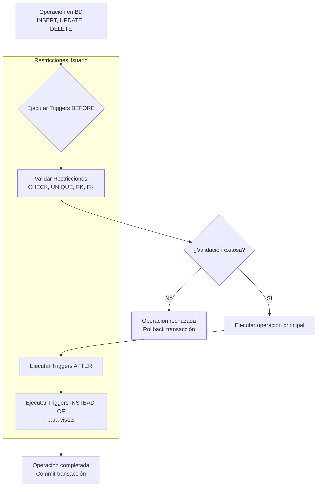

# Fundamentos de Bases de Datos - Integridad

## 8.4 Integridad del Usuario.

---

La integridad del usuario se refiere a las restricciones y reglas específicas definidas por los usuarios o diseñadores de bases de datos para garantizar que los datos cumplan con requisitos particulares del negocio o aplicación. A diferencia de las integridades inherentes al modelo relacional (entidad, referencial y de dominio), la integridad del usuario es personalizable y específica para cada sistema.

### Definición de Integridad del Usuario

Según Silberschatz et al. (2006), la **integridad del usuario** comprende todas aquellas restricciones específicas que no están cubiertas por los tres tipos de integridad predefinidos en el modelo relacional. Estas restricciones reflejan reglas de negocio particulares y deben ser definidas explícitamente por el diseñador de la base de datos.

Matemáticamente, si tenemos una relación R con atributos A₁, A₂, ..., Aₙ, una restricción de usuario C puede expresarse como:

$$∀ t ∈ R, C(t[A₁], t[A₂], ..., t[Aₙ]) = verdadero$$

Donde:

- R: Relación (tabla)
- t: Tupla (fila)
- C: Función booleana que representa la restricción personalizada

### Tipos de Restricciones de Usuario

#### Restricciones de Tabla (CHECK)

Restricciones que involucran múltiples columnas de una tabla.

#### Aserciones (Assertions)

Restricciones que involucran múltiples tablas y condiciones complejas.

#### Disparadores (Triggers)

Código que se ejecuta automáticamente cuando ocurren eventos específicos en la base de datos.

### Implementación en SQL

#### Restricciones CHECK a Nivel de Tabla

```sql
CREATE TABLE Empleado (
    id_empleado INT PRIMARY KEY,
    nombre VARCHAR(100) NOT NULL,
    salario DECIMAL(10,2) CHECK (salario > 0),
    fecha_contratacion DATE,
    fecha_terminacion DATE,
    departamento VARCHAR(50),
    -- Restricción de usuario que involucra múltiples columnas
    CONSTRAINT chk_fechas_empleado
        CHECK (fecha_terminacion IS NULL OR fecha_terminacion > fecha_contratacion),
    CONSTRAINT chk_salario_departamento
        CHECK (NOT (departamento = 'Practicante' AND salario > 10000))
);

CREATE TABLE Producto (
    id_producto INT PRIMARY KEY,
    nombre VARCHAR(100) NOT NULL,
    precio DECIMAL(10,2),
    costo DECIMAL(10,2),
    stock INT,
    -- El precio debe ser al menos 10% mayor que el costo
    CONSTRAINT chk_margen_ganancia
        CHECK (precio >= costo * 1.1),
    -- Restricción compleja con múltiples condiciones
    CONSTRAINT chk_precio_stock
        CHECK (NOT (stock > 1000 AND precio < 10))
);
```

#### Aserciones (Assertions)

```sql
-- Aunque el estándar SQL define aserciones, muchos SGBD no las implementan directamente
-- Ejemplo teórico de aserción
CREATE ASSERTION limite_presupuesto_departamento
CHECK (
    NOT EXISTS (
        SELECT d.id_departamento
        FROM Departamento d
        JOIN Empleado e ON d.id_departamento = e.id_departamento
        GROUP BY d.id_departamento, d.presupuesto
        HAVING SUM(e.salario) > d.presupuesto
    )
);

-- Implementación alternativa usando triggers (común en la práctica)
CREATE OR REPLACE FUNCTION verificar_presupuesto()
RETURNS TRIGGER AS $$
BEGIN
    IF EXISTS (
        SELECT 1
        FROM Departamento d
        JOIN Empleado e ON d.id_departamento = e.id_departamento
        WHERE d.id_departamento = NEW.id_departamento
        GROUP BY d.presupuesto
        HAVING SUM(e.salario) > d.presupuesto
    ) THEN
        RAISE EXCEPTION 'El presupuesto del departamento ha sido excedido';
    END IF;
    RETURN NEW;
END;
$$ LANGUAGE plpgsql;

CREATE TRIGGER trg_verificar_presupuesto
AFTER INSERT OR UPDATE ON Empleado
FOR EACH ROW EXECUTE FUNCTION verificar_presupuesto();
```

#### Disparadores (Triggers) para Integridad Compleja

```sql
-- Trigger para validar reglas de negocio complejas
CREATE OR REPLACE FUNCTION validar_venta()
RETURNS TRIGGER AS $$
DECLARE
    stock_actual INT;
    limite_credito DECIMAL(10,2);
    saldo_actual DECIMAL(10,2);
BEGIN
    -- Verificar stock disponible
    SELECT stock INTO stock_actual FROM Producto WHERE id_producto = NEW.id_producto;
    IF stock_actual < NEW.cantidad THEN
        RAISE EXCEPTION 'Stock insuficiente para el producto %', NEW.id_producto;
    END IF;

    -- Verificar límite de crédito del cliente
    IF NEW.metodo_pago = 'Credito' THEN
        SELECT limite_credito, saldo INTO limite_credito, saldo_actual
        FROM Cliente WHERE id_cliente = NEW.id_cliente;

        IF saldo_actual + NEW.total > limite_credito THEN
            RAISE EXCEPTION 'Límite de crédito excedido para el cliente %', NEW.id_cliente;
        END IF;
    END IF;

    RETURN NEW;
END;
$$ LANGUAGE plpgsql;

CREATE TRIGGER trg_validar_venta
BEFORE INSERT ON Venta
FOR EACH ROW EXECUTE FUNCTION validar_venta();
```

### Diagrama de Restricciones de Usuario



### Ejemplos Prácticos

#### Ejemplo 1: Restricción de Horario Comercial

```sql
CREATE TABLE Pedido (
    id_pedido INT PRIMARY KEY,
    id_cliente INT NOT NULL,
    fecha_pedido TIMESTAMP DEFAULT CURRENT_TIMESTAMP,
    total DECIMAL(10,2) CHECK (total > 0),
    estado VARCHAR(20) CHECK (estado IN ('Pendiente', 'Procesando', 'Enviado', 'Entregado')),
    -- Restricción de usuario: solo permitir pedidos en horario comercial
    CONSTRAINT chk_horario_comercial
        CHECK (EXTRACT(HOUR FROM fecha_pedido) BETWEEN 8 AND 18),
    -- Restricción: no pedidos los domingos
    CONSTRAINT chk_no_domingos
        CHECK (EXTRACT(DOW FROM fecha_pedido) BETWEEN 1 AND 6),
    FOREIGN KEY (id_cliente) REFERENCES Cliente(id_cliente)
);

-- Inserción válida (dentro del horario comercial)
INSERT INTO Pedido (id_pedido, id_cliente, total, estado, fecha_pedido)
VALUES (1, 101, 150.00, 'Pendiente', '2024-03-15 10:30:00');

-- Inserción inválida (fuera del horario comercial)
INSERT INTO Pedido (id_pedido, id_cliente, total, estado, fecha_pedido)
VALUES (2, 102, 200.00, 'Pendiente', '2024-03-15 20:45:00');
-- Error: viola restricción CHECK chk_horario_comercial
```

#### Ejemplo 2: Regla de Negocio Compleja con Trigger

```sql
CREATE TABLE CuentaBancaria (
    id_cuenta INT PRIMARY KEY,
    id_cliente INT NOT NULL,
    saldo DECIMAL(10,2) DEFAULT 0,
    tipo_cuenta VARCHAR(20) CHECK (tipo_cuenta IN ('Ahorros', 'Corriente')),
    fecha_apertura DATE DEFAULT CURRENT_DATE,
    FOREIGN KEY (id_cliente) REFERENCES Cliente(id_cliente)
);

CREATE TABLE Transaccion (
    id_transaccion SERIAL PRIMARY KEY,
    id_cuenta INT NOT NULL,
    tipo VARCHAR(10) CHECK (tipo IN ('Deposito', 'Retiro')),
    monto DECIMAL(10,2) CHECK (monto > 0),
    fecha TIMESTAMP DEFAULT CURRENT_TIMESTAMP,
    descripcion VARCHAR(200),
    FOREIGN KEY (id_cuenta) REFERENCES CuentaBancaria(id_cuenta)
);

-- Trigger para mantener la integridad del saldo
CREATE OR REPLACE FUNCTION actualizar_saldo()
RETURNS TRIGGER AS $$
BEGIN
    IF TG_OP = 'INSERT' THEN
        IF NEW.tipo = 'Deposito' THEN
            UPDATE CuentaBancaria
            SET saldo = saldo + NEW.monto
            WHERE id_cuenta = NEW.id_cuenta;
        ELSIF NEW.tipo = 'Retiro' THEN
            -- Verificar fondos suficientes
            IF (SELECT saldo FROM CuentaBancaria WHERE id_cuenta = NEW.id_cuenta) < NEW.monto THEN
                RAISE EXCEPTION 'Fondos insuficientes en la cuenta %', NEW.id_cuenta;
            END IF;
            UPDATE CuentaBancaria
            SET saldo = saldo - NEW.monto
            WHERE id_cuenta = NEW.id_cuenta;
        END IF;
    END IF;
    RETURN NEW;
END;
$$ LANGUAGE plpgsql;

CREATE TRIGGER trg_actualizar_saldo
AFTER INSERT ON Transaccion
FOR EACH ROW EXECUTE FUNCTION actualizar_saldo();
```

### Ejercicios Propuestos

#### Ejercicio 1: Diseño de Restricciones de Usuario

Diseña una tabla "Proyecto" con las siguientes restricciones de usuario:

- La fecha de inicio debe ser anterior a la fecha de fin
- El presupuesto debe ser positivo y menor a 1,000,000
- El estado debe ser uno de: 'Planificado', 'En Progreso', 'Completado', 'Cancelado'
- Si el estado es 'Completado', la fecha de fin debe estar establecida

```sql
-- Escribe tu solución aquí
CREATE TABLE Proyecto (
    -- Completa la definición de la tabla
);
```

#### Ejercicio 2: Implementación con Triggers

Crea un trigger que impida que un empleado sea asignado a más de 3 proyectos simultáneamente.

```sql
-- Escribe tu solución aquí
```

#### Ejercicio 3: Análisis de Restricciones Complejas

Dado el siguiente escenario:

- Una biblioteca quiere limitar los préstamos a 5 libros por usuario
- Los libros de referencia no pueden ser prestados
- Los usuarios con multas pendientes no pueden tomar nuevos préstamos

Implementa las restricciones necesarias usando combinaciones de CHECK constraints y triggers.

```sql
-- Escribe tu solución aquí
```

### Casos Especiales y Consideraciones

#### Validación de Reglas de Negocio Complejas

```sql
-- Ejemplo de validación compleja usando funciones
CREATE OR REPLACE FUNCTION validar_edad_empleado(fecha_nacimiento DATE)
RETURNS BOOLEAN AS $$
BEGIN
    RETURN EXTRACT(YEAR FROM AGE(fecha_nacimiento)) BETWEEN 18 AND 70;
END;
$$ LANGUAGE plpgsql;

CREATE TABLE Empleado (
    id_empleado INT PRIMARY KEY,
    nombre VARCHAR(100),
    fecha_nacimiento DATE,
    -- Usando una función en la restricción CHECK
    CONSTRAINT chk_edad_empleado
        CHECK (validar_edad_empleado(fecha_nacimiento))
);
```

#### Mantenimiento de Datos Históricos

```sql
-- Trigger para mantener histórico de cambios
CREATE TABLE Empleado_historial (
    id_historial SERIAL PRIMARY KEY,
    id_empleado INT,
    salario_anterior DECIMAL(10,2),
    salario_nuevo DECIMAL(10,2),
    fecha_cambio TIMESTAMP DEFAULT CURRENT_TIMESTAMP,
    usuario_cambio VARCHAR(100)
);

CREATE OR REPLACE FUNCTION registrar_cambio_salario()
RETURNS TRIGGER AS $$
BEGIN
    IF OLD.salario IS DISTINCT FROM NEW.salario THEN
        INSERT INTO Empleado_historial
        (id_empleado, salario_anterior, salario_nuevo, usuario_cambio)
        VALUES (NEW.id_empleado, OLD.salario, NEW.salario, CURRENT_USER);
    END IF;
    RETURN NEW;
END;
$$ LANGUAGE plpgsql;

CREATE TRIGGER trg_registrar_cambio_salario
AFTER UPDATE OF salario ON Empleado
FOR EACH ROW EXECUTE FUNCTION registrar_cambio_salario();
```

### Buenas Prácticas

1. **Documentar todas las restricciones de usuario** explicando la regla de negocio que implementan
2. **Usar nombres descriptivos** para constraints y triggers
3. **Considerar el impacto en el rendimiento** de triggers complejos
4. **Validar restricciones a nivel de aplicación** además de la base de datos
5. **Mantener un registro de cambios** en las restricciones de negocio

### Referencias

#### Bibliografía Básica

1. Elmasri and Navathe. _Fundamentals of Database Systems_. Addison-Wesley. Cuarta Edición. 2006. (Capítulo 5: The Relational Data Model and Relational Database Constraints)
2. Silberschatz A., Kort H. y Sudarshan S. _Fundamentos de BD_. McGraw Hill. Quinta edición. 2006. (Capítulo 6: Integridad y Seguridad)
3. Ullman J.D. and Widom J. _A First Course in Data Base System_. Prentice Hall. Tercera edición. 2008. (Capítulo 6: Constraints and Triggers)

#### Bibliografía Complementaria

1. Harrington J. _Relational Database Design and Implementation_. Tercera edición. Morgan Kaufmann. 2009. (Capítulo 8: Implementing Business Rules)
2. Kline K., Kline D., and Hunt B. _SQL in a nutshell_. O'Reilly. 2008. (Capítulo 10: Stored Programming)

### Autoevaluación

1. ¿Qué es la integridad del usuario y en qué se diferencia de otros tipos de integridad?
2. Explica la diferencia entre restricciones CHECK, aserciones y triggers
3. ¿Cuándo sería apropiado usar un trigger en lugar de una restricción CHECK?
4. Describe un escenario donde necesitarías implementar una restricción de usuario compleja
5. ¿Qué consideraciones de rendimiento deben tenerse en cuenta al implementar triggers?
