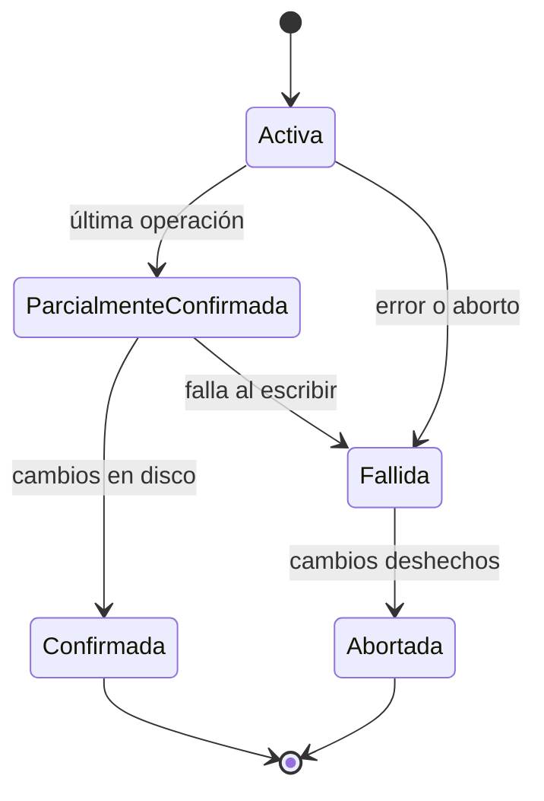

# Fundamentos de Bases de Datos - Procesamiento de transacciones

## 9.1 Concepto, problemas.

---

Una **transacción** es una secuencia de operaciones sobre la base de datos que forma una unidad lógica de trabajo: una transferencia bancaria consiste en retirar de una cuenta y depositar en otra, y no tiene sentido que ocurra solo la mitad. Un SMBD ejecuta muchas transacciones a la vez, de muchos usuarios, y debe además sobrevivir a fallas. Este tema define el concepto, presenta los problemas que aparecen cuando las transacciones se intercalan sin control, el criterio de corrección, la **serializabilidad**, y los dos enfoques clásicos de control: bloqueo en dos fases y marcas de tiempo, que el tema 9.3 desarrolla.

### Concepto

Para el SMBD, una transacción es una secuencia de lecturas $R(X)$ y escrituras $W(X)$ de elementos de datos, que termina con **confirmación** (`COMMIT`), que hace permanentes sus cambios, o con **aborto** (`ROLLBACK`), que los deshace. Sus garantías se resumen en las propiedades **ACID** (tema 9.2):

- **Atomicidad:** se ejecuta completa o no se ejecuta.
- **Consistencia:** si empieza en un estado válido, termina en uno válido.
- **Aislamiento:** su resultado no depende de las demás transacciones que se ejecutan a la vez.
- **Durabilidad:** sus efectos confirmados sobreviven a las fallas.



### Problemas de concurrencia

Ejecutar las transacciones una tras otra sería correcto, pero desperdiciaría el procesador mientras cada una espera al disco o a la red. Intercalarlas mejora el rendimiento, pero sin control produce anomalías:

- **Actualización perdida:** T1 y T2 leen el mismo saldo de 100; T1 escribe 150 y T2 escribe 130, sobrescribiendo el cambio de T1. El depósito de 50 se pierde.
- **Lectura sucia:** T2 lee un valor escrito por T1 que aún no se confirma; si T1 aborta, T2 trabajó con un dato que nunca existió.
- **Lectura no repetible:** T1 lee un valor, T2 lo modifica y confirma, y T1 vuelve a leerlo y obtiene otro.
- **Fantasma:** T1 consulta las filas que cumplen una condición, T2 inserta una nueva que la cumple, y la misma consulta de T1 devuelve una fila más.
- **Anomalía de escritura sesgada** (*write skew*): dos transacciones leen datos que se traslapan, cada una modifica una parte distinta y juntas violan una restricción que cada una respetaba; por ejemplo, dos médicos de guardia que se dan de baja a la vez porque cada uno vio que el otro seguía.

### Serializabilidad

Un **historial** o **plan** es un orden de las operaciones de varias transacciones que respeta el orden de cada una. Es **serial** si las transacciones no se intercalan, y es **serializable** si su efecto es igual al de algún plan serial. Ese es el criterio de corrección: un plan serializable no tiene anomalías, porque equivale a ejecutar las transacciones una tras otra.

Decidir la serializabilidad en general es difícil, y se usa una condición suficiente. Dos operaciones están **en conflicto** si son de transacciones distintas, acceden al mismo elemento y al menos una es escritura: $R_i(X)$ con $W_j(X),$ $W_i(X)$ con $R_j(X),$ o $W_i(X)$ con $W_j(X).$ Intercambiar dos operaciones adyacentes que no están en conflicto no cambia el resultado; un plan es **serializable por conflictos** si se puede llevar a uno serial con esos intercambios.

**Teorema.** Un plan es serializable por conflictos si y solo si su **grafo de precedencia** es acíclico. El grafo tiene un nodo por transacción y una arista $T_i \to T_j$ si una operación de $T_i$ precede y está en conflicto con una de $T_j.$ Cualquier orden topológico del grafo es un plan serial equivalente.

*Demostración.* Si el grafo es acíclico, se toma un orden topológico; cada par de operaciones en conflicto aparece en el plan en el mismo orden que sus transacciones en ese orden, así que las demás operaciones se pueden intercambiar hasta agrupar cada transacción, y el plan serial resultante tiene los mismos conflictos en el mismo orden. Si hay un ciclo $T_1 \to T_2 \to \dots \to T_1,$ cualquier plan serial equivalente tendría que poner $T_1$ antes y después de $T_2,$ lo cual es imposible. $\blacksquare$

### Control de concurrencia

- **Bloqueo en dos fases** (2PL): cada transacción pide un candado compartido para leer y uno exclusivo para escribir, y no pide ningún candado después de soltar alguno. Tiene una fase de **crecimiento**, en la que solo adquiere, y una de **decrecimiento**, en la que solo libera. Todo plan producido por 2PL es serializable por conflictos. Su versión **estricta**, que retiene los candados exclusivos hasta el final, evita además las lecturas sucias.
- **Marcas de tiempo:** cada transacción recibe una marca al empezar, y el sistema garantiza que los conflictos ocurran en el orden de las marcas, abortando a la transacción que llegaría tarde.
- **Multiversión** (MVCC): las lecturas ven una instantánea consistente sin bloquear a las escrituras. La usan PostgreSQL, Oracle, MySQL con InnoDB y SQLite en modo WAL.

El bloqueo trae su propio problema: el **interbloqueo**, cuando T1 espera un candado de T2 y T2 uno de T1. Se detecta con un **grafo de espera**, que tiene un ciclo si y solo si hay interbloqueo, y se resuelve abortando a una de las transacciones del ciclo; o se previene ordenando las solicitudes de candados.

### Implementación en Python

El programa simula las seis intercalaciones posibles de las dos transacciones del ejercicio 1 y reproduce la actualización perdida con dos conexiones reales a una base SQLite; después la evita de dos maneras. Para el ejercicio 2 construye el grafo de precedencia y busca un orden serial; para el ejercicio 3 verifica si una secuencia cumple 2PL y muestra cuántos candados retiene en cada paso; para el ejercicio 4 busca ciclos en el grafo de espera.

```python
import os, sqlite3, tempfile
from itertools import permutations

# --- Ejercicio 1: actualización perdida, simulada paso a paso ---
def ejecuta(plan, saldo=100):
    local = {}
    for t, op in plan:
        if op == "R": local[t] = saldo
        else: saldo = local[t] + {"T1": 50, "T2": 30}[t]
    return saldo
intercalada = [("T1", "R"), ("T2", "R"), ("T1", "W"), ("T2", "W")]
print("ejercicio 1: R1 R2 W1 W2 deja", ejecuta(intercalada), "| R1 W1 R2 W2 deja", ejecuta([("T1", "R"), ("T1", "W"), ("T2", "R"), ("T2", "W")]))
resultados = {}
ops = [("T1", "R"), ("T1", "W"), ("T2", "R"), ("T2", "W")]
for orden in permutations(range(4)):
    plan = [ops[i] for i in orden]
    if plan.index(("T1", "R")) < plan.index(("T1", "W")) and plan.index(("T2", "R")) < plan.index(("T2", "W")):
        resultados.setdefault(ejecuta(plan), []).append(" ".join(o + t[1] for t, o in plan))
print("   las 6 intercalaciones posibles:", resultados)

# lo mismo con dos conexiones reales a SQLite: leer fuera de la transacción y escribir después pierde la actualización
ruta = os.path.join(tempfile.mkdtemp(), "banco.db")
a = sqlite3.connect(ruta, isolation_level=None, timeout=0); b = sqlite3.connect(ruta, isolation_level=None, timeout=0)
a.executescript("CREATE TABLE cuenta (id INTEGER PRIMARY KEY, saldo INTEGER); INSERT INTO cuenta VALUES (1, 100);")
s1 = a.execute("SELECT saldo FROM cuenta WHERE id = 1").fetchone()[0]
s2 = b.execute("SELECT saldo FROM cuenta WHERE id = 1").fetchone()[0]
a.execute("UPDATE cuenta SET saldo = ? WHERE id = 1", (s1 + 50,))
b.execute("UPDATE cuenta SET saldo = ? WHERE id = 1", (s2 + 30,))
print("   en SQLite, leyendo y escribiendo por separado:", a.execute("SELECT saldo FROM cuenta").fetchone()[0])
a.execute("UPDATE cuenta SET saldo = 100")
# con control de concurrencia: la transacción que escribe toma el candado antes de leer
a.execute("BEGIN IMMEDIATE"); s1 = a.execute("SELECT saldo FROM cuenta").fetchone()[0]
try:
    b.execute("BEGIN IMMEDIATE")
except sqlite3.OperationalError as e:
    print("   con BEGIN IMMEDIATE, T2 debe esperar:", e)
a.execute("UPDATE cuenta SET saldo = ?", (s1 + 50,)); a.execute("COMMIT")
b.execute("BEGIN IMMEDIATE"); s2 = b.execute("SELECT saldo FROM cuenta").fetchone()[0]
b.execute("UPDATE cuenta SET saldo = ?", (s2 + 30,)); b.execute("COMMIT")
print("   y el resultado es", a.execute("SELECT saldo FROM cuenta").fetchone()[0])
a.execute("UPDATE cuenta SET saldo = 100")
a.execute("UPDATE cuenta SET saldo = saldo + 50"); b.execute("UPDATE cuenta SET saldo = saldo + 30")
print("   o con UPDATE saldo = saldo + x, que lee y escribe en una sola operación atómica:",
      a.execute("SELECT saldo FROM cuenta").fetchone()[0])

# --- Ejercicio 2: grafo de precedencia ---
def conflictos(historial):
    aristas = set()
    for i, (ti, oi, xi) in enumerate(historial):
        for tj, oj, xj in historial[i + 1:]:
            if ti != tj and xi == xj and "W" in (oi, oj):
                aristas.add((ti, tj))
    return aristas
def orden_topologico(nodos, aristas):
    for p in permutations(sorted(nodos)):
        if all(p.index(u) < p.index(v) for u, v in aristas): return p
    return None
h = [("T1", "W", "X"), ("T2", "R", "X"), ("T3", "W", "Y"), ("T2", "W", "Y"), ("T1", "R", "Y")]
ar = conflictos(h)
print("ejercicio 2: aristas", sorted(ar), "| orden serial equivalente:", orden_topologico({"T1", "T2", "T3"}, ar))
h2 = [("T1", "W", "X"), ("T2", "R", "X"), ("T3", "W", "Y"), ("T2", "W", "Y")]
print("   sin el último R1(Y):", sorted(conflictos(h2)), "| orden:", orden_topologico({"T1", "T2", "T3"}, conflictos(h2)))

# --- Ejercicio 3: 2PL, con la fase de crecimiento y la de decrecimiento ---
def es_2pl(ops):
    soltó = {}
    for t, op, x in ops:
        if op.startswith("L") and soltó.get(t): return False
        if op == "U": soltó[t] = True
    return True
t1 = [("T1", "LX", "A"), ("T1", "R", "A"), ("T1", "W", "A"), ("T1", "LX", "B"), ("T1", "U", "A"),
      ("T1", "R", "B"), ("T1", "W", "B"), ("T1", "U", "B")]
no2pl = [("T1", "LX", "A"), ("T1", "W", "A"), ("T1", "U", "A"), ("T1", "LX", "B"), ("T1", "W", "B"), ("T1", "U", "B")]
print("ejercicio 3: la secuencia propuesta es 2PL:", es_2pl(t1), "| soltar A antes de pedir B no lo es:", es_2pl(no2pl))
cuantos = [sum(1 for t, o, x in t1[:k + 1] if o == "LX") - sum(1 for t, o, x in t1[:k + 1] if o == "U") for k in range(len(t1))]
print("   candados retenidos tras cada paso:", cuantos)

# --- Ejercicio 4: grafo de espera ---
def ciclo(espera):
    for inicio in espera:
        visto, nodo = [], inicio
        while nodo in espera and nodo not in visto:
            visto.append(nodo); nodo = espera[nodo]
        if nodo == inicio: return visto + [inicio]
    return None
print("ejercicio 4: T1 espera a T2 y T2 a T1 ->", ciclo({"T1": "T2", "T2": "T1"}))
print("   T1 espera a T2, T2 a T3, T3 a nadie ->", ciclo({"T1": "T2", "T2": "T3"}))
```

Salida:

```text
ejercicio 1: R1 R2 W1 W2 deja 130 | R1 W1 R2 W2 deja 180
   las 6 intercalaciones posibles: {180: ['R1 W1 R2 W2', 'R2 W2 R1 W1'], 130: ['R1 R2 W1 W2', 'R2 R1 W1 W2'], 150: ['R1 R2 W2 W1', 'R2 R1 W2 W1']}
   en SQLite, leyendo y escribiendo por separado: 130
   con BEGIN IMMEDIATE, T2 debe esperar: database is locked
   y el resultado es 180
   o con UPDATE saldo = saldo + x, que lee y escribe en una sola operación atómica: 180
ejercicio 2: aristas [('T1', 'T2'), ('T2', 'T1'), ('T3', 'T1'), ('T3', 'T2')] | orden serial equivalente: None
   sin el último R1(Y): [('T1', 'T2'), ('T3', 'T2')] | orden: ('T1', 'T3', 'T2')
ejercicio 3: la secuencia propuesta es 2PL: True | soltar A antes de pedir B no lo es: False
   candados retenidos tras cada paso: [1, 1, 1, 2, 1, 1, 1, 0]
ejercicio 4: T1 espera a T2 y T2 a T1 -> ['T1', 'T2', 'T1']
   T1 espera a T2, T2 a T3, T3 a nadie -> None
```

### Ejercicios Propuestos

1. **Actualización perdida.** T1 lee un saldo de 100, le suma 50 y escribe 150; T2 lee el saldo de 100, le suma 30 y escribe 130. ¿Cuál es el resultado sin control de concurrencia? ¿Y con él?

2. **Serializabilidad.** Determina si el historial $W_1(X),$ $R_2(X),$ $W_3(Y),$ $W_2(Y),$ $R_1(Y)$ es serializable y, si lo es, en qué orden.

3. **2PL.** Diseña una secuencia de operaciones que muestre las dos fases del bloqueo en dos fases.

4. **Interbloqueo.** T1 tiene un candado sobre X y pide uno sobre Y; T2 tiene un candado sobre Y y pide uno sobre X. ¿Hay interbloqueo?

### Soluciones

**Ejercicio 1.** Sin control, el resultado depende de la intercalación, y el programa enumera las seis posibles: si las transacciones no se traslapan, el saldo final es 180, el correcto; si ambas leen antes de que alguna escriba, gana la última en escribir y el saldo queda en 130 o en 150, perdiéndose una de las dos actualizaciones. Con dos conexiones a SQLite que leen y luego escriben por separado, el resultado es 130. Con control de concurrencia el resultado es siempre 180: con 2PL, la transacción que lee para escribir toma un candado exclusivo antes de leer, y la otra espera hasta que la primera confirme; en SQLite, `BEGIN IMMEDIATE` reserva la escritura, y la segunda conexión recibe "database is locked" hasta que la primera termina. La solución más simple es no separar la lectura de la escritura: `UPDATE cuenta SET saldo = saldo + 50` es una sola operación, y el SMBD la ejecuta de forma atómica.

**Ejercicio 2.** Los conflictos son $W_1(X)$ antes de $R_2(X),$ que da $T_1 \to T_2;$ $W_3(Y)$ antes de $W_2(Y),$ que da $T_3 \to T_2;$ $W_3(Y)$ antes de $R_1(Y),$ que da $T_3 \to T_1,$ y $W_2(Y)$ antes de $R_1(Y),$ que da $T_2 \to T_1.$ El grafo tiene el ciclo $T_1 \to T_2 \to T_1,$ así que **no es serializable por conflictos**. Tampoco lo es en el sentido más amplio de equivalencia de vistas: $T_2$ lee la $X$ escrita por $T_1,$ así que $T_1$ debería ir antes, y $T_1$ lee la $Y$ escrita por $T_2,$ así que $T_2$ debería ir antes. Sin la última operación, el grafo es acíclico y el orden equivalente es $T_1, T_3, T_2.$

**Ejercicio 3.** Una secuencia en 2PL es $LX_1(A),$ $R_1(A),$ $W_1(A),$ $LX_1(B),$ $U_1(A),$ $R_1(B),$ $W_1(B),$ $U_1(B).$ La fase de crecimiento termina con el último candado adquirido, $LX_1(B);$ la de decrecimiento empieza con la primera liberación, $U_1(A).$ El programa muestra el número de candados retenidos, que sube a 2 y luego baja a 0 sin volver a subir. La secuencia que suelta A antes de pedir B **no** es 2PL: entre la liberación de A y la adquisición de B, otra transacción podría modificar A y B y producir un plan no serializable. En la práctica se usa la variante estricta, que solo suelta los candados exclusivos al confirmar.

**Ejercicio 4.** Sí. El grafo de espera tiene las aristas $T_1 \to T_2$ y $T_2 \to T_1,$ que forman un ciclo: ninguna de las dos puede avanzar. El SMBD lo detecta y aborta a una de ellas, la **víctima**, normalmente la que ha hecho menos trabajo o la más joven, con lo que la otra obtiene su candado. Se podría haber prevenido pidiendo los candados en un orden fijo, por ejemplo siempre X antes que Y.

### Referencias

1. Eswaran, K. P., Gray, J. N., Lorie, R. A., and Traiger, I. L., The notions of consistency and predicate locks in a database system. _Communications of the ACM_ 19(11), 1976.
2. Bernstein, P. A., Hadzilacos, V., and Goodman, N., _Concurrency Control and Recovery in Database Systems_. Addison-Wesley, 1987.
3. Silberschatz, A., Korth, H. F., and Sudarshan, S., _Database System Concepts_. McGraw-Hill, 2019. Capítulos 17 y 18.
4. Elmasri, R., and Navathe, S. B., _Fundamentals of Database Systems_. Pearson, 2016. Capítulos 20 y 21.
