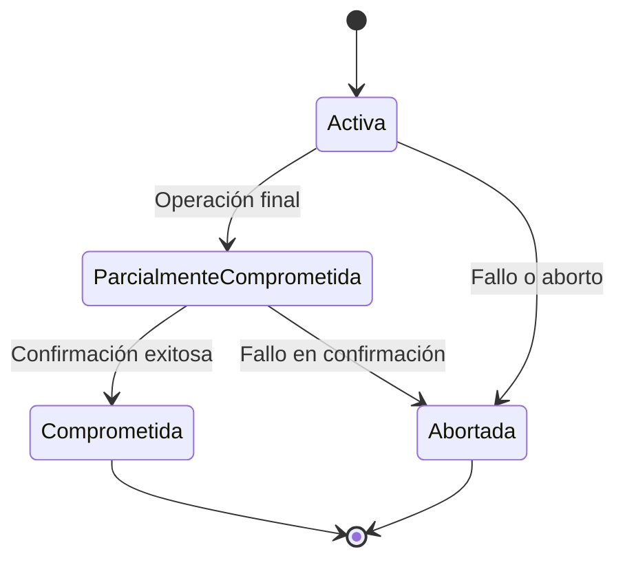

# Fundamentos de Bases de Datos - Procesamiento de transacciones

## 9.1 Concepto, problemas.

---

El procesamiento de transacciones es un aspecto fundamental en los sistemas de bases de datos que garantiza la integridad y consistencia de los datos, especialmente en entornos donde múltiples usuarios acceden concurrentemente a la información.

### Concepto de Transacción

Una transacción es una **unidad lógica de trabajo** que comprende una secuencia de operaciones que transforman la base de datos de un estado consistente a otro. Según Elmasri y Navathe (2006), una transacción es "una unidad de programa que accede y posiblemente actualiza varios elementos de datos".

#### Propiedades ACID

Las transacciones deben cumplir con las propiedades ACID:

- **Atomicidad**: La transacción se ejecuta por completo o no se ejecuta nada
- **Consistencia**: La transacción preserva la consistencia de la base de datos
- **Aislamiento**: Las transacciones concurrentes no interfieren entre sí
- **Durabilidad**: Los cambios de una transacción confirmada persisten permanentemente

### Problemas en el Procesamiento de Transacciones

#### Problemas de Concurrencia

Cuando múltiples transacciones se ejecutan concurrentemente sin un control adecuado, pueden surgir varios problemas:

##### 1. Problema de Actualización Perdida (Lost Update)

Ocurre cuando dos transacciones leen el mismo dato y lo actualizan basándose en el valor leído, resultando en la pérdida de una de las actualizaciones.

**Ejemplo**:

```
Transacción T1: lee X (X=100)
Transacción T2: lee X (X=100)
T1: escribe X = X + 50 (X=150)
T2: escribe X = X + 30 (X=130) ← Se pierde la actualización de T1
```

##### 2. Problema de Lectura Sucia (Dirty Read)

Ocurre cuando una transacción lee datos que han sido modificados por otra transacción que aún no ha sido confirmada.

**Ejemplo**:

```
Transacción T1: actualiza X = 200 (no confirmado)
Transacción T2: lee X (X=200)
T1: se aborta y deshace los cambios (X vuelve a su valor original)
T2: ha leído un valor que nunca existió oficialmente
```

##### 3. Problema de Lectura No Repetible (Non-repeatable Read)

Ocurre cuando una transacción lee el mismo dato dos veces y obtiene valores diferentes porque otra transacción modificó el dato entre las dos lecturas.

**Ejemplo**:

```
Transacción T1: lee X (X=100)
Transacción T2: actualiza X = 200 y confirma
Transacción T1: lee X nuevamente (X=200) ← Valor diferente en la misma transacción
```

##### 4. Problema de Lectura Fantasma (Phantom Read)

Ocurre cuando una transacción ejecuta la misma consulta dos veces y obtiene un número diferente de tuplas debido a que otra transacción ha insertado o eliminado registros.

### Control de Concurrencia

Para prevenir estos problemas, se utilizan protocolos de control de concurrencia basados en técnicas de bloqueo (locking) y marcas de tiempo (timestamping).

#### Protocolos de Bloqueo de Dos Fases (2PL)

El protocolo de bloqueo de dos fases asegura la serialización de transacciones:

1. **Fase de crecimiento**: La transacción puede adquirir bloqueos pero no liberarlos
2. **Fase de reducción**: La transacción puede liberar bloqueos pero no adquirir nuevos

**Fórmula para verificar serialización**:

$$
Si\ T_i\ →\ T_j\ entonces\ ts(T_i)\ <\ ts(T_j)
$$

#### Esquemas de Marcas de Tiempo

Cada transacción recibe una marca de tiempo única al iniciar. El protocolo asegura que las transacciones se ejecuten en orden de marca de tiempo.

**Reglas básicas**:

- Si una transacción T intenta leer un dato X:
  - Si ts(T) < write_timestamp(X), se rechaza la lectura
  - En otro caso, se permite la lectura y se actualiza read_timestamp(X)
- Si una transacción T intenta escribir un dato X:
  - Si ts(T) < read_timestamp(X), se rechaza la escritura
  - Si ts(T) < write_timestamp(X), se rechaza la escritura
  - En otro caso, se permite la escritura

### Diagrama de Estados de una Transacción



### Ejemplos de Código

#### Ejemplo de Transacción en SQL

```sql
BEGIN TRANSACTION;

-- Operaciones de la transacción
UPDATE Cuentas SET saldo = saldo - 100 WHERE id = 1;
UPDATE Cuentas SET saldo = saldo + 100 WHERE id = 2;

-- Confirmar o deshacer la transacción
COMMIT;
-- O en caso de error: ROLLBACK;
```

#### Ejemplo de Control de Concurrencia

```java
// Ejemplo simplificado de control de concurrencia con bloqueos
public class GestorTransacciones {
    private Map<Object, Lock> bloqueos = new HashMap<>();

    public void adquirirBloqueo(Object dato, Transaccion transaccion, TipoBloqueo tipo) {
        // Lógica para adquirir bloqueos según protocolo 2PL
    }

    public void liberarBloqueos(Transaccion transaccion) {
        // Lógica para liberar todos los bloqueos de una transacción
    }
}
```

### Ejercicios Propuestos

1. **Problema de Actualización Perdida**:
   Dadas dos transacciones que intentan actualizar el mismo saldo bancario:
   - T1: Lee saldo (100), suma 50, escribe 150
   - T2: Lee saldo (100), suma 30, escribe 130

   ¿Cuál será el resultado final sin control de concurrencia? ¿Y con control de concurrencia?

2. **Análisis de Serialización**:
   Dado el siguiente historial de operaciones:

   ```
   T1: W(X)
   T2: R(X)
   T3: W(Y)
   T2: W(Y)
   T1: R(Y)
   ```

   Determina si el historial es serializable y en qué orden.

3. **Implementación de Protocolo 2PL**:
   Diseña una secuencia de operaciones que demuestre las dos fases del protocolo 2PL.

4. **Detección de Bloqueos**:
   Identifica si existe un bloqueo mortal (deadlock) en el siguiente escenario:
   - T1 tiene bloqueo sobre X y solicita bloqueo sobre Y
   - T2 tiene bloqueo sobre Y y solicita bloqueo sobre X

### Referencias

#### Bibliografía Básica

1. Elmasri and Navathe. Fundamentals of Database Systems. Addison-Wesley. Cuarta Edición. 2006. (Capítulo 17)
2. Silberschatz A., Kort H. y Sudarshan S. Fundamentos de BD. McGraw Hill. Quinta edición. 2006. (Capítulo 13)
3. Ullman J.D. and Widom J. A First Course in Data Base System. Prentice Hall. Tercera edición. 2008. (Capítulo 6)

#### Bibliografía Complementaria

1. Harrington J. Relational Database Design and Implementation. Tercera edición. Morgan Kaufmann. 2009. (Capítulo 9)

### Recursos Adicionales

- Práctica con sistemas de gestión de bases de datos reales como MySQL, PostgreSQL u Oracle
- Implementación de transacciones en lenguajes de programación con JDBC o ODBC
- Análisis de casos de estudio de problemas de concurrencia en aplicaciones reales
