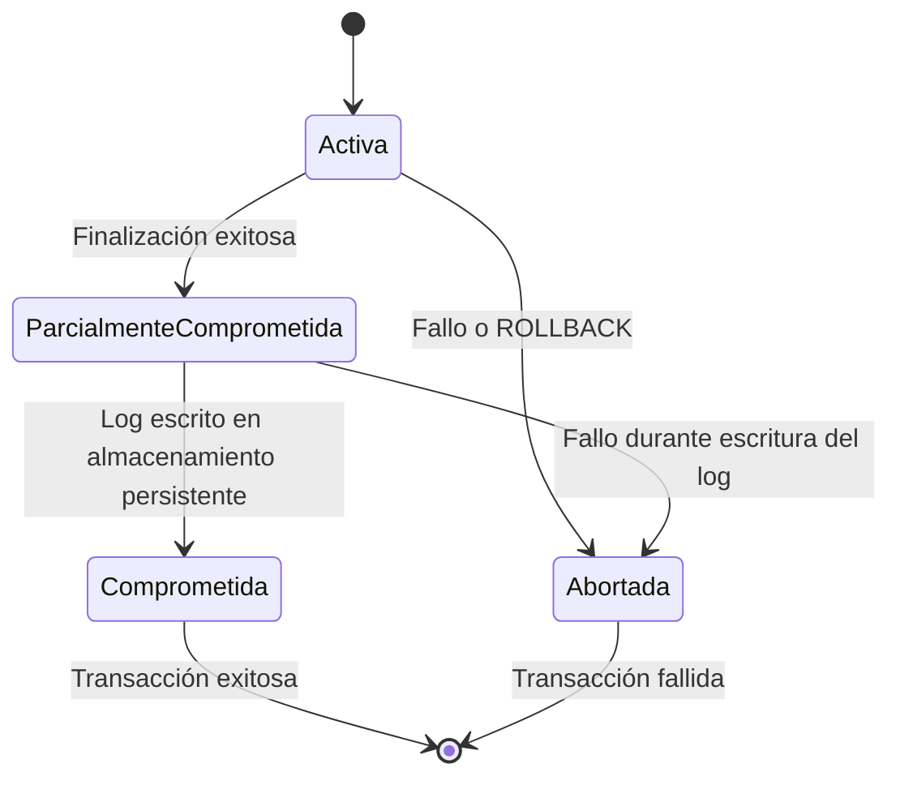

# Fundamentos de Bases de Datos - Procesamiento de transacciones

## 9.2 Propiedades de una transacción.

---

Las propiedades ACID son el conjunto de características que garantizan la fiabilidad y consistencia de las transacciones en sistemas de bases de datos. Este concepto fue formalizado por Theo Härder y Andreas Reuter en 1983.

### Las Propiedades ACID

#### Atomicidad (Atomicity)

**Definición**: La atomicidad garantiza que una transacción se trata como una unidad indivisible de trabajo. O todas las operaciones de la transacción se completan con éxito, o en caso de fallo, ninguna de sus operaciones tendrá efecto.

**Explicación**: Si cualquier parte de la transacción falla, toda la transacción falla y la base de datos permanece sin cambios. El sistema debe garantizar que en caso de fallo, se pueden deshacer todas las operaciones realizadas hasta el momento del fallo.

**Ejemplo**:

```sql
BEGIN TRANSACTION;
-- Operación 1: Debitar $100 de la cuenta A
UPDATE cuentas SET saldo = saldo - 100 WHERE id = 'A';
-- Operación 2: Acreditar $100 a la cuenta B
UPDATE cuentas SET saldo = saldo + 100 WHERE id = 'B';
-- Si alguna operación falla, ambas se deshacen
COMMIT;
```

#### Consistencia (Consistency)

**Definición**: La propiedad de consistencia asegura que una transacción lleva la base de datos de un estado consistente a otro estado consistente, preservando todas las reglas de integridad definidas.

**Explicación**: Las transacciones deben cumplir con todas las reglas definidas (restricciones de integridad, triggers, etc.). Si una transacción viola alguna de estas reglas, será abortada y la base de datos volverá a su estado anterior.

**Fórmula**:

$$
\text{Si } DB_{\text{inicial}} \text{ es consistente y } T \text{ es una transacción, entonces } DB_{\text{final}} \text{ después de } T \text{ también es consistente}
$$

**Ejemplo**:

```sql
-- Transacción que mantiene la integridad referencial
BEGIN TRANSACTION;
-- Insertar un nuevo pedido
INSERT INTO pedidos (id, cliente_id, fecha) VALUES (1001, 501, '2023-05-15');
-- Insertar items del pedido (dependen del pedido)
INSERT INTO items_pedido (pedido_id, producto_id, cantidad) VALUES (1001, 2001, 2);
-- Si el cliente_id 501 no existe, la transacción fallará por restricción de clave foránea
COMMIT;
```

#### Aislamiento (Isolation)

**Definición**: El aislamiento asegura que la ejecución concurrente de transacciones produzca el mismo resultado que una ejecución secuencial de las mismas.

**Explicación**: Las transacciones ejecutadas concurrentemente no deben interferir entre sí. Cada transacción debe operar como si fuera la única que se está ejecutando en el sistema.

**Niveles de aislamiento**:

- Read Uncommitted
- Read Committed
- Repeatable Read
- Serializable

**Ejemplo**:

```sql
-- Transacción 1 (T1)
BEGIN TRANSACTION;
SELECT saldo FROM cuentas WHERE id = 'A'; -- Lectura inicial

-- Transacción 2 (T2) se ejecuta concurrentemente
BEGIN TRANSACTION;
UPDATE cuentas SET saldo = saldo - 50 WHERE id = 'A';
COMMIT;

-- T1 continúa
SELECT saldo FROM cuentas WHERE id = 'A'; -- Resultado depende del nivel de aislamiento
COMMIT;
```

#### Durabilidad (Durability)

**Definición**: La propiedad de durabilidad garantiza que una vez que una transacción ha sido confirmada (committed), sus efectos permanecen en la base de datos incluso en caso de fallos del sistema.

**Explicación**: Los cambios realizados por transacciones confirmadas deben persistir permanentemente. Los sistemas implementan esta propiedad mediante técnicas como el write-ahead logging (WAL).

**Fórmula**:

$$
\text{Si } T \text{ es confirmada, entonces } \forall \text{ cambio } c \in T, c \text{ persiste tras cualquier fallo}
$$

### Diagrama de Estados de una Transacción ACID



### Implementación de las Propiedades ACID

#### Mecanismos de Soporte

1. **Gestión de Logs (Write-Ahead Logging - WAL)**

   ```sql
   -- Ejemplo simplificado de registro en log
   BEGIN TRANSACTION;
   -- Registrar operación en log antes de ejecutarla
   INSERT INTO log_table (transaccion_id, operacion, tabla, registro_id, valor_anterior)
   VALUES (123, 'UPDATE', 'cuentas', 'A', 1000);
   -- Ejecutar operación
   UPDATE cuentas SET saldo = 900 WHERE id = 'A';
   COMMIT;
   ```

2. **Protocolos de Control de Concurrencia**
   ```java
   // Ejemplo simplificado de control de concurrencia
   public class TransactionManager {
       private Map<Object, Lock> locks = new ConcurrentHashMap<>();

       public void acquireLock(Object resource, Transaction transaction, LockType type) {
           // Lógica para adquirir bloqueos según protocolo 2PL
       }

       public void releaseLocks(Transaction transaction) {
           // Liberar todos los bloqueos de una transacción
       }
   }
   ```

### Ejemplos Prácticos

#### Ejemplo 1: Transferencia Bancaria

```sql
BEGIN TRANSACTION;

-- Verificar fondos (Consistencia)
SELECT saldo INTO @saldo_actual FROM cuentas WHERE id = 'A' FOR UPDATE;

IF @saldo_actual >= 100 THEN
    -- Debitar cuenta A
    UPDATE cuentas SET saldo = saldo - 100 WHERE id = 'A';

    -- Acreditar cuenta B
    UPDATE cuentas SET saldo = saldo + 100 WHERE id = 'B';

    -- Registrar la transacción
    INSERT INTO transacciones (origen, destino, monto, fecha)
    VALUES ('A', 'B', 100, NOW());

    COMMIT; -- Atomicidad y Durabilidad
ELSE
    ROLLBACK; -- Atomicidad (ningún cambio si falla)
END IF;
```

#### Ejemplo 2: Reserva de Asientos

```sql
-- Nivel de aislamiento Serializable para prevenir condiciones de carrera
SET TRANSACTION ISOLATION LEVEL SERIALIZABLE;
BEGIN TRANSACTION;

-- Verificar asientos disponibles
SELECT COUNT(*) INTO @asientos_ocupados
FROM reservas
WHERE vuelo_id = 101 AND fecha = '2023-06-15';

SELECT capacidad INTO @capacidad_avion
FROM vuelos
WHERE id = 101;

IF @asientos_ocupados < @capacidad_avion THEN
    -- Reservar asiento
    INSERT INTO reservas (vuelo_id, fecha, pasajero_id, asiento)
    VALUES (101, '2023-06-15', 501, @asientos_ocupados + 1);

    COMMIT;
ELSE
    ROLLBACK;
    SIGNAL SQLSTATE '45000' SET MESSAGE_TEXT = 'No hay asientos disponibles';
END IF;
```

### Ejercicios Propuestos

1. **Identificación de Propiedades ACID**:
   Para cada escenario, identifica qué propiedad ACID está siendo violada:
   - a) Una transacción de transferencia se interrumpe después de debitar la primera cuenta pero antes de acreditar la segunda.
   - b) Dos transacciones leen el mismo dato y basan sus cálculos en ese valor, resultando en una actualización incorrecta.
   - c) Después de un fallo del sistema, los cambios de una transacción confirmada se pierden.
   - d) Una transacción lee datos que otra transacción ha modificado pero no confirmado.

2. **Diseño de Transacciones**:
   Diseña una transacción para un sistema de reservas de hotel que debe:
   - Verificar disponibilidad
   - Reservar una habitación
   - Registrar los datos del huésped
   - Procesar el pago
     Asegúrate de que cumple con todas las propiedades ACID.

3. **Análisis de Niveles de Aislamiento**:
   Dadas las siguientes transacciones ejecutándose concurrentemente:

   ```
   T1: BEGIN; SELECT * FROM productos WHERE id = 100; UPDATE productos SET stock = stock - 1 WHERE id = 100; COMMIT;
   T2: BEGIN; SELECT * FROM productos WHERE id = 100; UPDATE productos SET stock = stock - 1 WHERE id = 100; COMMIT;
   ```

   Explica qué podría ocurrir bajo diferentes niveles de aislamiento.

4. **Recuperación ante Fallos**:
   Describe cómo se recuperaría el sistema después de un fallo durante una transacción que:
   - Ha actualizado 3 registros en diferentes tablas
   - No ha llegado a confirmarse (COMMIT)

### Referencias

#### Bibliografía Básica

1. Elmasri and Navathe. Fundamentals of Database Systems. Addison-Wesley. Cuarta Edición. 2006. (Capítulo 17)
2. Silberschatz A., Kort H. y Sudarshan S. Fundamentos de BD. McGraw Hill. Quinta edición. 2006. (Capítulo 13)
3. Ullman J.D. and Widom J. A First Course in Data Base System. Prentice Hall. Tercera edición. 2008. (Capítulo 6)

#### Bibliografía Complementaria

1. Harrington J. Relational Database Design and Implementation. Tercera edición. Morgan Kaufmann. 2009. (Capítulo 9)

### Recursos Adicionales

- Práctica con diferentes niveles de aislamiento en MySQL o PostgreSQL
- Implementación de transacciones en aplicaciones usando JDBC o ORMs
- Análisis de logs de transacciones para entender los mecanismos de recuperación
