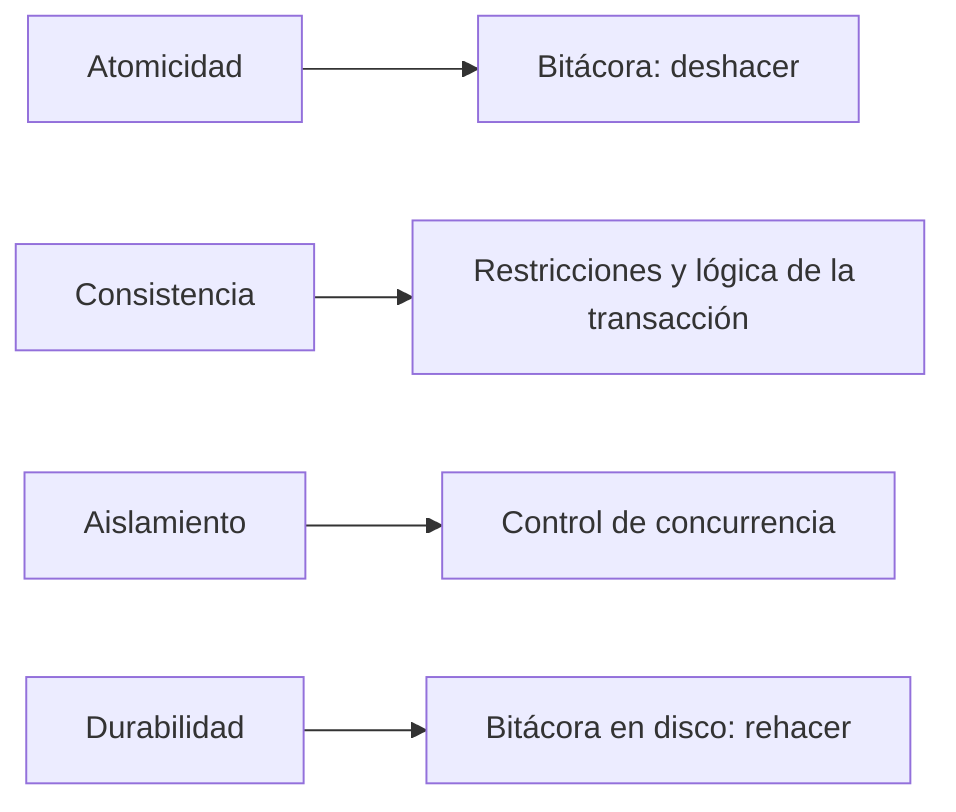

# Fundamentos de Bases de Datos - Procesamiento de transacciones

## 9.2 Propiedades de una transacción.

---

Las cuatro propiedades **ACID**, nombradas así por Härder y Reuter en 1983 a partir del trabajo de Gray, son la promesa que un SMBD transaccional hace a las aplicaciones: atomicidad, consistencia, aislamiento y durabilidad. Cada una la garantiza un componente distinto del sistema. Este tema define cada propiedad con precisión, describe los mecanismos que la implementan (la bitácora, el control de concurrencia, la recuperación) y muestra con SQLite qué ocurre cuando un proceso se cae a mitad de una transacción.

### Atomicidad

Una transacción se ejecuta **completa o no se ejecuta**: si falla en cualquier punto, por un error, un aborto explícito, una restricción violada o una caída del sistema, todos sus cambios se deshacen. No existe un estado intermedio visible.

**Mecanismo:** el **gestor de recuperación** registra en una **bitácora** (*log*) la información necesaria para deshacer cada cambio, el valor anterior, antes de aplicarlo. Al abortar, o al reiniciar tras una caída, recorre la bitácora hacia atrás y restaura los valores anteriores de las transacciones no confirmadas. SQLite usa un **diario de reversión** (*rollback journal*), que copia las páginas originales antes de modificarlas, o una bitácora de escritura anticipada (*write-ahead log*, WAL).

### Consistencia

Si una transacción empieza en un estado que cumple todas las restricciones de integridad, termina en un estado que también las cumple. Las restricciones intermedias pueden violarse dentro de la transacción, como el total de dinero del banco, que entre el retiro y el depósito es menor, pero no al confirmar.

**Mecanismo:** es responsabilidad compartida. El SMBD verifica las restricciones declaradas (claves, `CHECK`, claves foráneas, disparadores) y aborta la transacción que las violaría; las reglas no declaradas son responsabilidad del programador de la transacción. Por eso la consistencia es la única propiedad que no depende solo del SMBD.

### Aislamiento

Aunque muchas transacciones se ejecuten a la vez, cada una se comporta como si estuviera sola: el resultado es el de alguna ejecución serial (tema 9.1). Ninguna ve los cambios no confirmados de otra.

**Mecanismo:** el **control de concurrencia**: bloqueo en dos fases, marcas de tiempo o multiversión (tema 9.3). Como el aislamiento completo, la **serializabilidad**, cuesta rendimiento, SQL define **niveles de aislamiento** más débiles que permiten algunas anomalías:

| Nivel              | Lectura sucia | Lectura no repetible | Fantasma        |
| ------------------ | ------------- | -------------------- | --------------- |
| `READ UNCOMMITTED` | Posible       | Posible              | Posible         |
| `READ COMMITTED`   | No            | Posible              | Posible         |
| `REPEATABLE READ`  | No            | No                   | Posible         |
| `SERIALIZABLE`     | No            | No                   | No              |

El nivel por omisión es `READ COMMITTED` en PostgreSQL, Oracle y SQL Server, y `REPEATABLE READ` en MySQL. SQLite ofrece en la práctica aislamiento serializable, porque solo permite un escritor a la vez.

### Durabilidad

Una vez que el SMBD responde que la transacción se confirmó, sus cambios sobreviven a cualquier falla posterior: una caída del proceso, un corte de luz, un reinicio.

**Mecanismo:** antes de responder al `COMMIT`, el gestor de recuperación escribe en almacenamiento persistente la bitácora con los cambios de la transacción y un registro de confirmación, y obliga al sistema operativo a llevarla al disco (`fsync`). Es la regla de **escritura anticipada**: la bitácora va al disco antes que los datos, y con ella se pueden **rehacer** los cambios confirmados que no alcanzaron a escribirse en sus páginas. Contra la pérdida del disco se usan réplicas y respaldos.



### Recuperación tras una caída

Al reiniciar, el SMBD examina la bitácora, por ejemplo con el algoritmo **ARIES** (Mohan y otros, 1992):

1. **Análisis:** determina qué transacciones estaban activas en el momento de la caída y qué páginas podían estar desactualizadas.
2. **Rehacer:** repite los cambios registrados, confirmados o no, para llevar la base al estado exacto del momento de la caída.
3. **Deshacer:** revierte los cambios de las transacciones que no se confirmaron, de la más reciente a la más antigua.

Con eso, las confirmadas quedan completas (durabilidad) y las no confirmadas desaparecen (atomicidad).

### Implementación en Python

El programa implementa en SQLite la transacción de reserva del ejercicio 2, que verifica la disponibilidad, registra al huésped, crea la reserva y el pago, y se revierte completa si la habitación está ocupada o el pago se rechaza. Para los ejercicios 1 y 4 lanza otro proceso de Python que modifica la base y termina abruptamente, sin cerrar la conexión, una vez antes y otra después del `COMMIT`, y comprueba qué quedó. Para el ejercicio 3 reproduce con dos conexiones la diferencia entre escribir un valor leído y usar `stock = stock - 1`.

```python
import os, sqlite3, subprocess, sys, tempfile

ruta = os.path.join(tempfile.mkdtemp(), "hotel.db")
db = sqlite3.connect(ruta, isolation_level=None)
db.executescript("""
CREATE TABLE habitacion (numero INTEGER PRIMARY KEY, tarifa NUMERIC NOT NULL);
CREATE TABLE huesped (id INTEGER PRIMARY KEY, nombre TEXT NOT NULL, correo TEXT UNIQUE);
CREATE TABLE reserva (id INTEGER PRIMARY KEY, numero INTEGER NOT NULL REFERENCES habitacion, id_huesped INTEGER NOT NULL REFERENCES huesped,
                      entrada TEXT NOT NULL, salida TEXT NOT NULL, CHECK (salida > entrada));
CREATE TABLE pago (id INTEGER PRIMARY KEY, id_reserva INTEGER NOT NULL UNIQUE REFERENCES reserva, monto NUMERIC NOT NULL CHECK (monto > 0));
INSERT INTO habitacion VALUES (101, 900), (102, 1300);
""")

# --- Ejercicio 2: reserva, huésped y pago como una sola transacción ---
def reservar(nombre, correo, numero, entrada, salida, pago_ok=True):
    try:
        db.execute("BEGIN IMMEDIATE")          # nadie más puede reservar entre la verificación y la inserción
        ocupada = db.execute("""SELECT 1 FROM reserva WHERE numero = ? AND entrada < ? AND ? < salida""",
                             (numero, salida, entrada)).fetchone()
        if ocupada: raise ValueError("habitación ocupada")
        db.execute("INSERT INTO huesped (nombre, correo) VALUES (?, ?) ON CONFLICT (correo) DO NOTHING", (nombre, correo))
        id_h = db.execute("SELECT id FROM huesped WHERE correo = ?", (correo,)).fetchone()[0]
        id_r = db.execute("INSERT INTO reserva (numero, id_huesped, entrada, salida) VALUES (?, ?, ?, ?)",
                          (numero, id_h, entrada, salida)).lastrowid
        noches = db.execute("SELECT julianday(?) - julianday(?)", (salida, entrada)).fetchone()[0]
        monto = noches * db.execute("SELECT tarifa FROM habitacion WHERE numero = ?", (numero,)).fetchone()[0]
        if not pago_ok: raise ValueError("pago rechazado por el banco")
        db.execute("INSERT INTO pago (id_reserva, monto) VALUES (?, ?)", (id_r, monto))
        db.execute("COMMIT"); return f"confirmada, reserva {id_r}, cobro {monto:.0f}"
    except (ValueError, sqlite3.Error) as e:
        db.execute("ROLLBACK"); return f"revertida ({e})"
def cuenta(): return {t: db.execute(f"SELECT COUNT(*) FROM {t}").fetchone()[0] for t in ("huesped", "reserva", "pago")}
print("ejercicio 2:")
print("   Carmen, 101 del 20 al 24:", reservar("Carmen", "carmen@ejemplo.mx", 101, "2026-12-20", "2026-12-24"), cuenta())
print("   Raúl, 101 del 22 al 26:", reservar("Raúl", "raul@ejemplo.mx", 101, "2026-12-22", "2026-12-26"), cuenta())
print("   Raúl, 102, con pago rechazado:", reservar("Raúl", "raul@ejemplo.mx", 102, "2026-12-22", "2026-12-26", pago_ok=False), cuenta())

# --- Ejercicios 1 y 4: atomicidad y durabilidad ante una caída del proceso ---
def proceso(codigo):                           # otro proceso que abre la base y "se cae" con os._exit, sin cerrar nada
    subprocess.run([sys.executable, "-c", f"import os, sqlite3\ndb = sqlite3.connect({ruta!r}, isolation_level=None)\n{codigo}\nos._exit(1)"])
db.close()
proceso("""db.execute('BEGIN')
db.execute("UPDATE habitacion SET tarifa = 0")
db.execute("DELETE FROM pago")
db.execute("INSERT INTO huesped (nombre) VALUES ('Fantasma')")""")
db = sqlite3.connect(ruta, isolation_level=None)
print("ejercicio 4: caída tras modificar 3 tablas sin COMMIT -> tarifas", db.execute("SELECT tarifa FROM habitacion").fetchall(),
      "| filas", cuenta())
db.close()
proceso("""db.execute('BEGIN')
db.execute("UPDATE habitacion SET tarifa = ROUND(tarifa * 1.1, 2)")
db.execute('COMMIT')""")
db = sqlite3.connect(ruta, isolation_level=None)
print("ejercicio 1c: caída justo después del COMMIT -> tarifas", db.execute("SELECT tarifa FROM habitacion").fetchall())

# --- Ejercicio 3: dos compras del mismo producto ---
db.executescript("CREATE TABLE productos (id INTEGER PRIMARY KEY, stock INTEGER CHECK (stock >= 0)); INSERT INTO productos VALUES (100, 10);")
otra = sqlite3.connect(ruta, isolation_level=None, timeout=0)
v1 = db.execute("SELECT stock FROM productos WHERE id = 100").fetchone()[0]
v2 = otra.execute("SELECT stock FROM productos WHERE id = 100").fetchone()[0]
db.execute("UPDATE productos SET stock = ? WHERE id = 100", (v1 - 1,)); otra.execute("UPDATE productos SET stock = ? WHERE id = 100", (v2 - 1,))
print("ejercicio 3: escribiendo el valor leído:", db.execute("SELECT stock FROM productos").fetchone()[0], "(se vendieron 2)")
db.execute("UPDATE productos SET stock = 10")
db.execute("UPDATE productos SET stock = stock - 1 WHERE id = 100"); otra.execute("UPDATE productos SET stock = stock - 1 WHERE id = 100")
print("   con stock = stock - 1:", db.execute("SELECT stock FROM productos").fetchone()[0])
db.execute("UPDATE productos SET stock = 1")
r1 = db.execute("UPDATE productos SET stock = stock - 1 WHERE id = 100 AND stock >= 1").rowcount
r2 = otra.execute("UPDATE productos SET stock = stock - 1 WHERE id = 100 AND stock >= 1").rowcount
print("   con la última unidad y la condición stock >= 1: filas afectadas", r1, "y", r2, "-> la segunda compra se rechaza")
```

Salida:

```text
ejercicio 2:
   Carmen, 101 del 20 al 24: confirmada, reserva 1, cobro 3600 {'huesped': 1, 'reserva': 1, 'pago': 1}
   Raúl, 101 del 22 al 26: revertida (habitación ocupada) {'huesped': 1, 'reserva': 1, 'pago': 1}
   Raúl, 102, con pago rechazado: revertida (pago rechazado por el banco) {'huesped': 1, 'reserva': 1, 'pago': 1}
ejercicio 4: caída tras modificar 3 tablas sin COMMIT -> tarifas [(900,), (1300,)] | filas {'huesped': 1, 'reserva': 1, 'pago': 1}
ejercicio 1c: caída justo después del COMMIT -> tarifas [(990,), (1430,)]
ejercicio 3: escribiendo el valor leído: 9 (se vendieron 2)
   con stock = stock - 1: 8
   con la última unidad y la condición stock >= 1: filas afectadas 1 y 0 -> la segunda compra se rechaza
```

### Ejercicios Propuestos

1. **Propiedades.** Identifica la propiedad ACID que se viola en cada caso: (a) una transferencia se interrumpe después de debitar la primera cuenta y antes de acreditar la segunda; (b) dos transacciones leen el mismo dato, basan sus cálculos en él y producen una actualización incorrecta; (c) tras una falla, se pierden los cambios de una transacción confirmada; (d) una transacción lee datos que otra modificó y no ha confirmado.

2. **Diseño.** Diseña una transacción de reserva de hotel que verifique la disponibilidad, reserve una habitación, registre los datos del huésped y procese el pago, cumpliendo las propiedades ACID.

3. **Aislamiento.** Explica qué puede ocurrir, según el nivel de aislamiento, con dos transacciones concurrentes que hacen `SELECT * FROM productos WHERE id = 100` y luego `UPDATE productos SET stock = stock - 1 WHERE id = 100`.

4. **Recuperación.** Describe cómo se recupera el sistema tras una falla durante una transacción que actualizó 3 registros en tablas distintas y no llegó a confirmarse.

### Soluciones

**Ejercicio 1.**

- **(a) Atomicidad:** quedó aplicada la mitad de la transacción. También se rompe la consistencia, porque desaparece dinero, pero la causa es la falta de atomicidad.
- **(b) Aislamiento:** es la actualización perdida; con aislamiento, una de las dos habría visto el resultado de la otra.
- **(c) Durabilidad:** el sistema confirmó algo que no garantizó en disco. El programa muestra el caso correcto: el proceso que se cae justo después del `COMMIT` deja sus tarifas actualizadas.
- **(d) Aislamiento:** es una lectura sucia, que solo permite `READ UNCOMMITTED`.

**Ejercicio 2.** Es la función `reservar` del programa:

1. `BEGIN IMMEDIATE`, para que ninguna otra transacción pueda reservar la misma habitación entre la verificación y la inserción.
2. Verificar que no haya una reserva que se traslape.
3. Insertar o recuperar al huésped.
4. Crear la reserva y calcular el monto.
5. Registrar el pago.
6. `COMMIT`. Ante cualquier error, `ROLLBACK`.

La reserva traslapada de Raúl y la del pago rechazado se revierten **completas**: no queda ni el huésped nuevo ni una reserva sin pago, como muestran los conteos. Con un SMBD con multiversión, en lugar del candado de SQLite se usaría `SERIALIZABLE`, o un `SELECT ... FOR UPDATE` sobre la habitación, o una restricción de exclusión de PostgreSQL que impide declarativamente los intervalos traslapados. Un detalle real: el cargo a la tarjeta lo hace un sistema externo, que no participa en la transacción de la base; si el pago se cobra y luego la transacción falla, hace falta una operación compensatoria, como un reembolso.

**Ejercicio 3.** El `UPDATE ... SET stock = stock - 1` es atómico en todos los niveles: lee y escribe la fila con un candado, así que dos compras concurrentes descuentan 2. En `READ COMMITTED`, la segunda espera a que la primera confirme y luego aplica su resta sobre el valor nuevo; en `REPEATABLE READ` o `SERIALIZABLE` de PostgreSQL, la segunda falla con un error de serialización y hay que reintentarla. El problema aparece si la aplicación usa el valor del `SELECT` para calcular el nuevo, `SET stock = 9`: en `READ COMMITTED` ambas leen 10 y escriben 9, y se pierde una venta, como muestra el programa con dos conexiones; en `REPEATABLE READ` de PostgreSQL, la segunda se aborta. Para no vender lo que no hay, la condición debe ir en la sentencia: `UPDATE ... SET stock = stock - 1 WHERE id = 100 AND stock >= 1`, y comprobar que afectó una fila. Con la última unidad, la segunda compra no afecta ninguna.

**Ejercicio 4.** La transacción no confirmó, así que la recuperación debe **deshacer** sus tres cambios. Al reiniciar, el análisis de la bitácora encuentra la transacción sin registro de confirmación; si alguno de los cambios llegó a escribirse en las páginas de datos, la bitácora tiene el valor anterior y se restaura, de la última modificación a la primera. Si ningún cambio llegó al disco, no hay nada que deshacer. En SQLite, el diario de reversión contiene las páginas originales, y al abrir la base después de la caída se detecta un diario "caliente" y se restauran. El programa lo comprueba: el proceso que modificó tarifas, pagos y huéspedes y se cayó sin `COMMIT` no dejó ningún cambio.

### Referencias

1. Härder, T., and Reuter, A., Principles of transaction-oriented database recovery. _ACM Computing Surveys_ 15(4), 1983.
2. Gray, J., and Reuter, A., _Transaction Processing: Concepts and Techniques_. Morgan Kaufmann, 1992.
3. Mohan, C., et al., ARIES: a transaction recovery method supporting fine-granularity locking and partial rollbacks using write-ahead logging. _ACM Transactions on Database Systems_ 17(1), 1992.
4. Silberschatz, A., Korth, H. F., and Sudarshan, S., _Database System Concepts_. McGraw-Hill, 2019. Capítulos 17 y 19.
5. SQLite, _Atomic Commit In SQLite_. Documentación en línea, sqlite.org.
