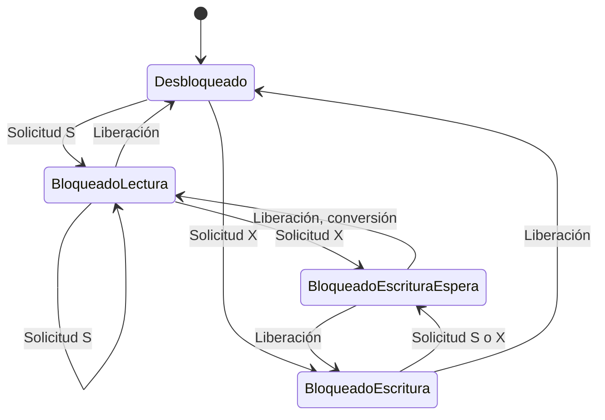

# Fundamentos de Bases de Datos - Procesamiento de transacciones

## 9.3 Control de concurrencia.

---

El control de concurrencia es el conjunto de técnicas que permiten que múltiples transacciones se ejecuten simultáneamente sin interferir entre sí, manteniendo la consistencia de la base de datos. Según Silberschatz et al. (2006), "el control de concurrencia asegura la ejecución serializable de transacciones".

### Problemas de Concurrencia

#### Problemas Principales

1. **Lectura Sucia (Dirty Read)**
   - Ocurre cuando una transacción lee datos modificados por otra transacción no confirmada.

2. **Lectura No Repetible (Non-repeatable Read)**
   - Ocurre cuando una transacción lee el mismo dato dos veces y obtiene valores diferentes.

3. **Lectura Fantasma (Phantom Read)**
   - Ocurre cuando una transacción ejecuta la misma consulta dos veces y obtiene un número diferente de tuplas.

4. **Actualización Perdida (Lost Update)**
   - Ocurre cuando dos transacciones leen y actualizan el mismo dato, perdiéndose una de las actualizaciones.

### Protocolos de Control de Concurrencia

#### Protocolos Basados en Bloqueos (Lock-based)

##### Bloqueos Compartidos y Exclusivos

- **Bloqueo Compartido (S)**: Para operaciones de lectura
- **Bloqueo Exclusivo (X)**: Para operaciones de escritura

**Matriz de Compatibilidad**:

| Bloqueo solicitado →<br>Bloqueo existente ↓ | S   | X   |
| ------------------------------------------- | --- | --- |
| S                                           | ✓   | ✗   |
| X                                           | ✗   | ✗   |

##### Protocolo de Bloqueo de Dos Fases (2PL)

**Definición**: Protocolo que garantiza serialización donde las transacciones siguen dos fases:

1. **Fase de crecimiento**: Adquieren todos los bloqueos necesarios
2. **Fase de reducción**: Liberan los bloqueos adquiridos

**Reglas**:

1. Una transacción debe solicitar un bloqueo antes de acceder a un elemento
2. Una vez que libera un bloqueo, no puede solicitar más bloqueos

**Variantes**:

- **2PL Estricto**: Libera bloqueos exclusivos solo al final
- **2PL Riguroso**: Libera todos los bloqueos solo al final

#### Protocolos Basados en Marcas de Tiempo

Cada transacción recibe una marca de tiempo única al iniciar.

**Reglas**:

- Para lectura del elemento X:
  - Si TS(T) < write_timestamp(X): rechazar lectura
  - Sino: permitir lectura y actualizar read_timestamp(X)
- Para escritura del elemento X:
  - Si TS(T) < read_timestamp(X): rechazar escritura
  - Si TS(T) < write_timestamp(X): rechazar escritura (regla de Thomas)
  - Sino: permitir escritura y actualizar write_timestamp(X)

#### Control de Concurrencia Multiversión (MVCC)

Mantiene múltiples versiones de los datos para permitir lecturas consistentes.

### Niveles de Aislamiento

| Nivel            | Dirty Read | Non-repeatable Read | Phantom Read |
| ---------------- | ---------- | ------------------- | ------------ |
| Read Uncommitted | ✓          | ✓                   | ✓            |
| Read Committed   | ✗          | ✓                   | ✓            |
| Repeatable Read  | ✗          | ✗                   | ✓            |
| Serializable     | ✗          | ✗                   | ✗            |

### Diagrama de Estados de Bloqueos



### Implementación en SQL

#### Sintaxis de Transacciones

```sql
-- Establecer nivel de aislamiento
SET TRANSACTION ISOLATION LEVEL READ COMMITTED;

-- Iniciar transacción
BEGIN TRANSACTION;

-- Operaciones
UPDATE Cuentas SET saldo = saldo - 100 WHERE id = 1;
UPDATE Cuentas SET saldo = saldo + 100 WHERE id = 2;

-- Confirmar o deshacer
COMMIT;
-- ROLLBACK;
```

#### Ejemplo con Control de Concurrencia

```sql
-- Transacción para transferencia con control de concurrencia
BEGIN TRANSACTION;

-- Bloqueo explícito para prevenir condiciones de carrera
SELECT * FROM Cuentas WHERE id = 1 FOR UPDATE;

-- Verificar saldo
SELECT saldo INTO @saldo_actual FROM Cuentas WHERE id = 1;

IF @saldo_actual >= 100 THEN
    UPDATE Cuentas SET saldo = saldo - 100 WHERE id = 1;
    UPDATE Cuentas SET saldo = saldo + 100 WHERE id = 2;
    COMMIT;
ELSE
    ROLLBACK;
    SELECT 'Error: Saldo insuficiente';
END IF;
```

### Algoritmos de Control de Concurrencia

#### Algoritmo de Prevención de Bloqueos

```python
class LockManager:
    def __init__(self):
        self.lock_table = {}  # Tabla de bloqueos

    def request_lock(self, transaction_id, data_item, lock_type):
        if data_item not in self.lock_table:
            # Sin bloqueos existentes, conceder
            self.lock_table[data_item] = {'type': lock_type, 'holders': {transaction_id}}
            return True

        current_lock = self.lock_table[data_item]

        # Verificar compatibilidad
        if self.is_compatible(lock_type, current_lock['type']):
            current_lock['holders'].add(transaction_id)
            # Actualizar tipo si es necesario
            if lock_type == 'X' or current_lock['type'] == 'X':
                current_lock['type'] = 'X'
            else:
                current_lock['type'] = 'S'
            return True

        return False  # Bloqueo no disponible

    def is_compatible(self, requested, existing):
        compatibility_matrix = {
            'S': {'S': True, 'X': False},
            'X': {'S': False, 'X': False}
        }
        return compatibility_matrix[requested][existing]

    def release_lock(self, transaction_id, data_item):
        if data_item in self.lock_table:
            lock = self.lock_table[data_item]
            if transaction_id in lock['holders']:
                lock['holders'].remove(transaction_id)
                if not lock['holders']:
                    del self.lock_table[data_item]
```

### Ejercicios Propuestos

1. **Análisis de Escenarios de Concurrencia**:
   Dado el siguiente programa de transacciones:

   ```
   T1: R(A), W(A), R(B), W(B)
   T2: R(A), W(A), R(C), W(C)
   ```

   Muestra todos los conflictos posibles y determina si el programa es conflictoserializable.

2. **Implementación de 2PL**:
   Para las transacciones:

   ```
   T1: Lock-S(A), R(A), Lock-X(B), W(B), Unlock(A), Unlock(B)
   T2: Lock-S(B), R(B), Lock-X(A), W(A), Unlock(B), Unlock(A)
   ```

   ¿Se produce interbloqueo? Explica por qué y cómo se resolvería.

3. **Problema de Marcas de Tiempo**:
   Dadas las transacciones con marcas de tiempo TS(T1)=100, TS(T2)=150:

   ```
   T1: W(X)
   T2: R(X), W(X)
   ```

   Aplica las reglas de control por marcas de tiempo y determina qué operaciones se rechazan.

4. **Diseño de Sistema de Concurrencia**:
   Diseña un sistema simple de reservas de asientos que:
   - Prevenga condiciones de carrera
   - Mantenga la consistencia de datos
   - Permita máxima concurrencia posible

### Referencias

#### Bibliografía Básica

1. Elmasri and Navathe. Fundamentals of Database Systems. Addison-Wesley. Cuarta Edición. 2006. (Capítulo 17)
2. Silberschatz A., Kort H. y Sudarshan S. Fundamentos de BD. McGraw Hill. Quinta edición. 2006. (Capítulo 13)
3. Ullman J.D. and Widom J. A First Course in Data Base System. Prentice Hall. Tercera edición. 2008. (Capítulo 6)

#### Bibliografía Complementaria

1. Harrington J. Relational Database Design and Implementation. Tercera edición. Morgan Kaufmann. 2009. (Capítulo 9)

### Recursos Adicionales

- Práctica con diferentes niveles de aislamiento en MySQL/PostgreSQL
- Implementación de algoritmos de control de concurrencia
- Análisis de planos de ejecución para entender el bloqueo en bases de datos reales
