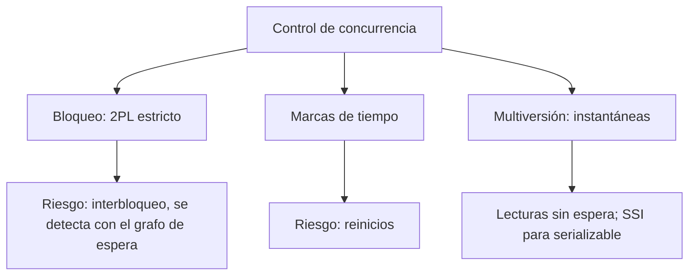

# Fundamentos de Bases de Datos - Procesamiento de transacciones

## 9.3 Control de concurrencia.

---

El **control de concurrencia** es el componente del SMBD que permite ejecutar muchas transacciones a la vez sin que se interfieran: garantiza que el resultado sea el de alguna ejecución serial, o el que permita el nivel de aislamiento elegido, y lo hace con la menor espera posible. Este tema presenta los tres enfoques principales (bloqueo, marcas de tiempo y multiversión), el problema del interbloqueo y su relación con los niveles de aislamiento de SQL.

### Bloqueo

Cada elemento de datos (una fila, una página, una tabla) tiene un **candado** que una transacción debe obtener antes de usarlo:

- **Compartido** (S): para leer. Varias transacciones pueden tenerlo a la vez.
- **Exclusivo** (X): para escribir. Excluye a cualquier otro candado sobre el elemento.

| Tiene \ Pide   | S          | X          |
| -------------- | ---------- | ---------- |
| S              | Compatible | Espera     |
| X              | Espera     | Espera     |

Tomar y soltar candados alrededor de cada operación no basta para la serializabilidad. El protocolo de **bloqueo en dos fases** (2PL) exige que ninguna transacción pida un candado después de haber soltado alguno. **Teorema** (Eswaran y otros, 1976): todo plan que cumple 2PL es serializable por conflictos. La idea de la demostración es que el **punto de bloqueo** de cada transacción, el momento en que obtiene su último candado, define un orden serial equivalente: si $T_i \to T_j$ en el grafo de precedencia, $T_i$ soltó un candado que $T_j$ obtuvo después, así que el punto de bloqueo de $T_i$ es anterior al de $T_j,$ y un ciclo es imposible.

2PL básico permite **abortos en cascada**: si $T_2$ lee un valor que $T_1$ escribió y soltó antes de confirmar, y $T_1$ aborta, $T_2$ también debe abortar. La variante **estricta** retiene los candados exclusivos hasta el final de la transacción, y la **rigurosa**, todos; son las que implementan los SMBD.

### Interbloqueo

Con candados, dos transacciones pueden esperarse mutuamente. Se manejan de tres formas:

- **Detección:** el SMBD mantiene un **grafo de espera**, con una arista $T_i \to T_j$ si $T_i$ espera un candado de $T_j;$ hay interbloqueo si y solo si el grafo tiene un ciclo. Se aborta una **víctima** y se reintenta. Es lo que hacen PostgreSQL, MySQL y SQL Server.
- **Prevención:** pedir los candados en un **orden global** fijo, o usar marcas de tiempo para decidir quién espera: en **esperar-morir**, una transacción más vieja espera a una más joven y una más joven se aborta; en **herir-esperar**, una más vieja aborta a una más joven y una más joven espera.
- **Tiempo de espera:** abortar a una transacción que lleva demasiado esperando; es simple pero puede abortar sin necesidad.

### Marcas de tiempo

Cada transacción recibe al iniciar una marca $TS(T)$ creciente, y el sistema exige que los conflictos ocurran en el orden de las marcas. Para cada elemento $X$ guarda $RTS(X)$ y $WTS(X),$ las mayores marcas de las transacciones que lo leyeron y lo escribieron.

- $T$ quiere **leer** $X:$ si $TS(T) \lt WTS(X),$ una transacción más joven ya lo sobrescribió y $T$ se reinicia; si no, lee y $RTS(X) \leftarrow \max(RTS(X), TS(T)).$
- $T$ quiere **escribir** $X:$ si $TS(T) \lt RTS(X),$ una más joven ya leyó el valor anterior y $T$ se reinicia; si $TS(T) \lt WTS(X),$ una más joven ya escribió, y $T$ se reinicia o, con la **regla de escritura de Thomas**, su escritura se ignora porque de todos modos quedaría sobrescrita; si no, escribe y $WTS(X) \leftarrow TS(T).$

No hay esperas, así que no hay interbloqueos; a cambio, hay más reinicios cuando los conflictos son frecuentes. Una transacción reiniciada recibe una marca nueva.

### Multiversión

En el control **multiversión** (MVCC), cada escritura crea una nueva versión de la fila en lugar de sobrescribirla, y cada transacción lee la versión que corresponde a su **instantánea**, el estado confirmado al iniciar la transacción o la sentencia. Las lecturas nunca esperan a las escrituras ni las bloquean, lo que favorece las cargas con muchas lecturas. Dos escrituras sobre la misma fila sí entran en conflicto, y una espera o aborta. El **aislamiento por instantáneas** que se obtiene así evita las lecturas sucias, las no repetibles y los fantasmas, pero no la **escritura sesgada**; PostgreSQL implementa `SERIALIZABLE` con la técnica **SSI** (Cahill y otros, 2008), que detecta las dependencias peligrosas entre transacciones concurrentes y aborta una.



### Niveles de aislamiento

Los niveles de SQL (tema 9.2) se implementan relajando estos mecanismos. Con bloqueo: `READ UNCOMMITTED` no toma candados de lectura; `READ COMMITTED` los suelta al terminar cada lectura; `REPEATABLE READ` los retiene hasta el final; `SERIALIZABLE` además bloquea rangos para evitar fantasmas. Con multiversión: `READ COMMITTED` toma una instantánea por sentencia, y `REPEATABLE READ`, una por transacción.

### Implementación en Python

El programa enumera las 70 intercalaciones posibles de las transacciones del ejercicio 1 y cuenta cuántas son serializables por conflictos. Implementa un gestor de candados compartidos y exclusivos con 2PL para el ejercicio 2, lo ejecuta con distintos órdenes de las operaciones y muestra el interbloqueo y su prevención con un orden global. Para el ejercicio 3 aplica el protocolo de marcas de tiempo, con y sin la regla de Thomas, a todas las intercalaciones. Para el ejercicio 4 simula en SQLite 40 clientes que compiten por 10 asientos de dos en dos, con una implementación ingenua y con una segura.

```python
import os, random, sqlite3, tempfile
from itertools import combinations

# --- Ejercicio 1: todas las intercalaciones de T1 y T2 ---
T1 = [("T1", "R", "A"), ("T1", "W", "A"), ("T1", "R", "B"), ("T1", "W", "B")]
T2 = [("T2", "R", "A"), ("T2", "W", "A"), ("T2", "R", "C"), ("T2", "W", "C")]
def intercalaciones(a, b):
    n = len(a) + len(b)
    for pos in combinations(range(n), len(a)):
        ia, ib, plan = iter(a), iter(b), []
        for k in range(n): plan.append(next(ia) if k in pos else next(ib))
        yield plan
def aristas(plan):
    return {(p[0], q[0]) for i, p in enumerate(plan) for q in plan[i + 1:]
            if p[0] != q[0] and p[2] == q[2] and "W" in (p[1], q[1])}
total, serializables, pares = 0, 0, set()
for plan in intercalaciones(T1, T2):
    total += 1; e = aristas(plan)
    if not ({("T1", "T2"), ("T2", "T1")} <= e): serializables += 1
    for i, p in enumerate(plan):
        for q in plan[i + 1:]:
            if p[0] != q[0] and p[2] == q[2] and "W" in (p[1], q[1]): pares.add(tuple(sorted([f"{p[1]}{p[0][1]}({p[2]})", f"{q[1]}{q[0][1]}({q[2]})"])))
print("ejercicio 1: pares de operaciones en conflicto:", sorted(pares))
print("   intercalaciones:", total, "| serializables por conflictos:", serializables)
ejemplo = [T1[0], T2[0], T1[1], T2[1], T1[2], T1[3], T2[2], T2[3]]
print("   R1(A) R2(A) W1(A) W2(A) ... tiene aristas", sorted(aristas(ejemplo)), "-> no serializable")

# --- Ejercicio 2: 2PL con un gestor de candados ---
def ejecutar_2pl(programas, orden):
    candados, pc, log = {}, {t: 0 for t in programas}, []          # candados: elemento -> (modo, {transacciones})
    def compatible(t, modo, x):
        if x not in candados: return True
        m, dueños = candados[x]
        return dueños == {t} or (m == "S" and modo == "S")
    for t in orden:
        if pc[t] >= len(programas[t]): continue
        op, x = programas[t][pc[t]]
        if op in ("S", "X"):
            if not compatible(t, op, x):
                log.append(f"{t} espera {op}({x})"); continue
            m, d = candados.get(x, (op, set())); candados[x] = ("X" if "X" in (m, op) else "S", d | {t})
        elif op == "U":
            candados[x][1].discard(t)
            if not candados[x][1]: del candados[x]
        log.append(f"{t}: {op}({x})"); pc[t] += 1
    bloqueadas = [t for t in programas if pc[t] < len(programas[t])]
    return log, bloqueadas
p1 = [("S", "A"), ("R", "A"), ("X", "B"), ("W", "B"), ("U", "A"), ("U", "B")]
p2 = [("S", "B"), ("R", "B"), ("X", "A"), ("W", "A"), ("U", "B"), ("U", "A")]
log, bloq = ejecutar_2pl({"T1": p1, "T2": p2}, ["T1", "T1", "T2", "T2"] + ["T1", "T2"] * 4)
print("ejercicio 2, alternando:", log[:6], "... | sin terminar:", bloq)
log, bloq = ejecutar_2pl({"T1": p1, "T2": p2}, ["T1"] * 6 + ["T2"] * 6)
print("   si T1 termina antes de que T2 empiece:", "sin terminar" if bloq else "ambas terminan")
p2_ordenado = [("X", "A"), ("S", "B"), ("R", "B"), ("W", "A"), ("U", "B"), ("U", "A")]   # pide A antes que B, como T1
log, bloq = ejecutar_2pl({"T1": [("S", "A"), ("X", "B"), ("R", "A"), ("W", "B"), ("U", "A"), ("U", "B")], "T2": p2_ordenado},
                         ["T1", "T2"] * 12)
print("   con orden global de candados (A antes que B):", "sin terminar: " + str(bloq) if bloq else "ambas terminan",
      "| esperas:", sum("espera" in l for l in log))

# --- Ejercicio 3: ordenamiento por marcas de tiempo ---
def marcas(plan, ts, thomas=False):
    rts, wts, res, abortadas = {}, {}, [], set()
    for t, op, x in plan:
        if t in abortadas: continue                      # una transacción reiniciada vuelve después con otra marca
        etiqueta = f"{op}{t[1]}({x})"
        if op == "R":
            if ts[t] < wts.get(x, 0): res.append(etiqueta + " rechazada"); abortadas.add(t); continue
            rts[x] = max(rts.get(x, 0), ts[t])
        else:
            if ts[t] < rts.get(x, 0): res.append(etiqueta + " rechazada"); abortadas.add(t); continue
            if ts[t] < wts.get(x, 0):
                if thomas: res.append(etiqueta + " ignorada (regla de Thomas)"); continue
                res.append(etiqueta + " rechazada"); abortadas.add(t); continue
            wts[x] = ts[t]
        res.append(etiqueta)
    return res
ts = {"T1": 100, "T2": 150}
for plan in intercalaciones([("T1", "W", "X")], [("T2", "R", "X"), ("T2", "W", "X")]):
    print("ejercicio 3:", " ".join(o + t[1] + "(X)" for t, o, x in plan), "->", marcas(plan, ts))
plan = [("T2", "W", "X"), ("T1", "W", "X")]
print("   W2(X) W1(X):", marcas(plan, ts), "| con Thomas:", marcas(plan, ts, thomas=True))

# --- Ejercicio 4: reservas de asientos con 40 clientes para 10 asientos ---
ruta = os.path.join(tempfile.mkdtemp(), "funcion.db")
c1 = sqlite3.connect(ruta, isolation_level=None, timeout=0); c2 = sqlite3.connect(ruta, isolation_level=None, timeout=0)
c1.executescript("CREATE TABLE asiento (id INTEGER PRIMARY KEY, cliente TEXT); CREATE TABLE intento (cliente TEXT, asiento INTEGER);")
rng = random.Random(5393)
def ronda(segura):
    c1.execute("DELETE FROM intento"); c1.execute("DELETE FROM asiento")
    c1.executemany("INSERT INTO asiento VALUES (?, NULL)", [(i,) for i in range(1, 11)])
    vendidos = 0
    for k in range(0, 40, 2):                         # dos clientes a la vez, uno por conexión
        pedidos = [(c, f"cliente{k + j}", rng.randint(1, 10)) for j, c in enumerate((c1, c2))]
        if segura:
            for c, quien, s in pedidos:                 # verificación y asignación en una sola sentencia
                vendidos += c.execute("UPDATE asiento SET cliente = ? WHERE id = ? AND cliente IS NULL", (quien, s)).rowcount
        else:
            libres = [c.execute("SELECT cliente IS NULL FROM asiento WHERE id = ?", (s,)).fetchone()[0] for c, _, s in pedidos]
            for (c, quien, s), libre in zip(pedidos, libres):           # ambos leyeron antes de que alguno escribiera
                if libre:
                    c.execute("UPDATE asiento SET cliente = ? WHERE id = ?", (quien, s))
                    c.execute("INSERT INTO intento VALUES (?, ?)", (quien, s)); vendidos += 1
    return vendidos, c1.execute("SELECT COUNT(*) FROM asiento WHERE cliente IS NOT NULL").fetchone()[0]
v, o = ronda(segura=False)
print("ejercicio 4, leer y luego escribir:", v, "boletos vendidos para", o, "asientos ocupados")
print("   asientos vendidos dos veces:", c1.execute("SELECT asiento, COUNT(*) FROM intento GROUP BY asiento HAVING COUNT(*) > 1").fetchall())
v, o = ronda(segura=True)
print("   con UPDATE ... WHERE cliente IS NULL:", v, "boletos vendidos para", o, "asientos ocupados")
```

Salida:

```text
ejercicio 1: pares de operaciones en conflicto: [('R1(A)', 'W2(A)'), ('R2(A)', 'W1(A)'), ('W1(A)', 'W2(A)')]
   intercalaciones: 70 | serializables por conflictos: 30
   R1(A) R2(A) W1(A) W2(A) ... tiene aristas [('T1', 'T2'), ('T2', 'T1')] -> no serializable
ejercicio 2, alternando: ['T1: S(A)', 'T1: R(A)', 'T2: S(B)', 'T2: R(B)', 'T1 espera X(B)', 'T2 espera X(A)'] ... | sin terminar: ['T1', 'T2']
   si T1 termina antes de que T2 empiece: ambas terminan
   con orden global de candados (A antes que B): ambas terminan | esperas: 4
ejercicio 3: W1(X) R2(X) W2(X) -> ['W1(X)', 'R2(X)', 'W2(X)']
ejercicio 3: R2(X) W1(X) W2(X) -> ['R2(X)', 'W1(X) rechazada', 'W2(X)']
ejercicio 3: R2(X) W2(X) W1(X) -> ['R2(X)', 'W2(X)', 'W1(X) rechazada']
   W2(X) W1(X): ['W2(X)', 'W1(X) rechazada'] | con Thomas: ['W2(X)', 'W1(X) ignorada (regla de Thomas)']
ejercicio 4, leer y luego escribir: 10 boletos vendidos para 9 asientos ocupados
   asientos vendidos dos veces: [(2, 2)]
   con UPDATE ... WHERE cliente IS NULL: 10 boletos vendidos para 10 asientos ocupados
```

### Ejercicios Propuestos

1. **Conflictos.** Para $T_1: R(A), W(A), R(B), W(B)$ y $T_2: R(A), W(A), R(C), W(C),$ muestra todos los conflictos posibles y determina cuándo un plan es serializable por conflictos.

2. **2PL.** Para $T_1: S(A), R(A), X(B), W(B), U(A), U(B)$ y $T_2: S(B), R(B), X(A), W(A), U(B), U(A),$ donde $S$ y $X$ piden candados y $U$ los suelta, ¿se produce interbloqueo? ¿Cómo se resolvería?

3. **Marcas de tiempo.** Con $TS(T_1) = 100$ y $TS(T_2) = 150,$ $T_1: W(X)$ y $T_2: R(X), W(X),$ aplica las reglas de marcas de tiempo y determina qué operaciones se rechazan.

4. **Reservas.** Diseña un sistema de reservas de asientos que prevenga condiciones de carrera, mantenga la consistencia y permita la mayor concurrencia posible.

### Soluciones

**Ejercicio 1.** Las transacciones solo comparten $A,$ así que los conflictos son $R_1(A)$ con $W_2(A),$ $W_1(A)$ con $R_2(A)$ y $W_1(A)$ con $W_2(A).$ $B$ y $C$ no generan conflictos, porque cada uno lo usa una sola transacción. Un plan es serializable por conflictos si y solo si todas las operaciones sobre $A$ de una transacción preceden a todas las de la otra; si no, por ejemplo con $R_1(A), R_2(A), W_1(A), W_2(A),$ aparecen las aristas $T_1 \to T_2$ y $T_2 \to T_1.$ Como las operaciones sobre $A$ son las dos primeras de cada transacción, los planes serializables son los que empiezan con $R_1(A), W_1(A)$ o con $R_2(A), W_2(A);$ en cada caso las 6 operaciones restantes se intercalan de $\binom{6}{2} = 15$ formas, y el total es 30 de las 70 intercalaciones, como cuenta el programa. El "programa" del enunciado, sin un orden de intercalación, no es ni serializable ni no serializable: depende de cómo se intercalen.

**Ejercicio 2.** Sí, si se intercalan: $T_1$ obtiene $S(A)$ y $T_2$ obtiene $S(B);$ luego $T_1$ pide $X(B),$ incompatible con el $S(B)$ de $T_2,$ y espera, y $T_2$ pide $X(A),$ incompatible con el $S(A)$ de $T_1,$ y espera. El grafo de espera tiene el ciclo $T_1 \to T_2 \to T_1.$ Si $T_1$ termina antes de que $T_2$ empiece, no hay interbloqueo: depende de la intercalación. Se resuelve abortando a una de las dos y reintentándola, o se previene: con un orden global de candados en que $A$ va antes que $B,$ ambas piden primero $A,$ la segunda espera a que la primera termine y no se forma ningún ciclo. El programa muestra los tres casos. Ambas transacciones cumplen 2PL, que garantiza la serializabilidad pero no evita los interbloqueos.

**Ejercicio 3.** Hay tres intercalaciones:

- En el orden $W_1(X), R_2(X), W_2(X)$ todo se acepta, porque las operaciones llegan en el orden de las marcas.
- En el orden $R_2(X), W_1(X), W_2(X),$ la escritura $W_1(X)$ se rechaza, porque $TS(T_1) = 100 \lt RTS(X) = 150:$ $T_2,$ más joven, ya leyó el valor que $T_1$ iba a cambiar. $T_1$ se reinicia con una marca nueva, y $W_2(X)$ se acepta.
- En el orden $R_2(X), W_2(X), W_1(X),$ la escritura $W_1(X)$ se rechaza por la misma razón.

En los dos últimos casos la regla de Thomas no ayuda, porque el rechazo se debe a una lectura, no a una escritura. Solo ignoraría $W_1(X)$ en un plan como $W_2(X), W_1(X)$ sin lecturas intermedias, donde la escritura de $T_1$ quedaría sobrescrita de todos modos en el orden serial $T_1, T_2.$

**Ejercicio 4.** El error típico es **leer y luego escribir**: consultar si el asiento está libre y, si lo está, asignarlo con otra sentencia. Dos clientes pueden leer "libre" antes de que alguno escriba, y el asiento se vende dos veces. En la simulación del programa se venden 10 boletos para 9 asientos. La solución segura combina la verificación y la asignación en una sentencia atómica,

```sql
UPDATE asiento SET cliente = :cliente WHERE id = :asiento AND cliente IS NULL;
```

y considera vendido el asiento solo si la sentencia afectó una fila; con ella, 10 boletos corresponden a 10 asientos. Además:

- Una restricción `UNIQUE` sobre `(funcion, asiento)` en la tabla de boletos es una segunda defensa declarativa.
- Las transacciones deben ser **cortas**: el pago, que tarda, no debe hacerse con el asiento bloqueado; se **aparta** el asiento con un estado y una hora de vencimiento, se cobra fuera de la transacción y se confirma o se libera después.
- Para la máxima concurrencia, el bloqueo debe ser por **fila**, no por tabla: dos clientes que compran asientos distintos no deben esperarse. PostgreSQL y MySQL bloquean por fila; SQLite bloquea toda la base para escribir, lo que es correcto pero limita la concurrencia.
- Para "el mejor asiento disponible", `SELECT ... FOR UPDATE SKIP LOCKED` en PostgreSQL o MySQL permite que cada cliente tome un asiento distinto sin esperar.

### Referencias

1. Eswaran, K. P., Gray, J. N., Lorie, R. A., and Traiger, I. L., The notions of consistency and predicate locks in a database system. _Communications of the ACM_ 19(11), 1976.
2. Bernstein, P. A., Hadzilacos, V., and Goodman, N., _Concurrency Control and Recovery in Database Systems_. Addison-Wesley, 1987.
3. Thomas, R. H., A majority consensus approach to concurrency control for multiple copy databases. _ACM Transactions on Database Systems_ 4(2), 1979.
4. Cahill, M. J., Röhm, U., and Fekete, A. D., Serializable isolation for snapshot databases. _Proceedings of ACM SIGMOD_, 2008.
5. Silberschatz, A., Korth, H. F., and Sudarshan, S., _Database System Concepts_. McGraw-Hill, 2019. Capítulo 18.
