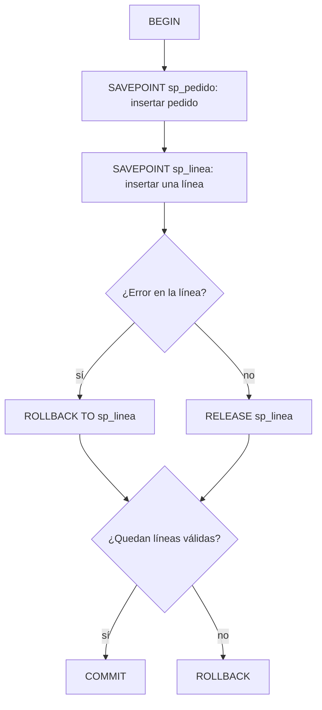

# Fundamentos de Bases de Datos - Procesamiento de transacciones

## 9.4 Manejo de transacciones en SQL.

---

SQL da a las aplicaciones un pequeño conjunto de sentencias para delimitar transacciones, elegir su nivel de aislamiento y deshacer parte de su trabajo. Usarlas bien exige además conocer cómo se comporta el SMBD concreto y cómo interactúa con la biblioteca de acceso de cada lenguaje, que a veces abre y cierra transacciones sin que el programador lo note. Este tema presenta esas sentencias, los puntos de guardado, el manejo de errores y las buenas prácticas, con ejemplos ejecutados en SQLite y las diferencias con otros SMBD.

### Sentencias

| Sentencia                                        | Efecto                                                          |
| ------------------------------------------------ | --------------------------------------------------------------- |
| `BEGIN` o `START TRANSACTION`                    | Inicia una transacción explícita                                |
| `COMMIT`                                         | Confirma: los cambios se vuelven permanentes y visibles         |
| `ROLLBACK`                                       | Aborta: deshace todos los cambios de la transacción             |
| `SAVEPOINT nombre`                               | Marca un punto dentro de la transacción                         |
| `ROLLBACK TO [SAVEPOINT] nombre`                 | Deshace lo hecho desde ese punto; la transacción sigue abierta  |
| `RELEASE [SAVEPOINT] nombre`                     | Descarta el punto, conservando sus cambios                      |
| `SET TRANSACTION ISOLATION LEVEL nivel`          | Elige el nivel de aislamiento de la transacción                 |

Fuera de una transacción explícita, la mayoría de los SMBD trabajan en modo **autocommit**: cada sentencia es su propia transacción. En SQLite, `BEGIN` puede ser `DEFERRED`, que no toma candados hasta la primera lectura o escritura, `IMMEDIATE`, que reserva la escritura desde el principio, o `EXCLUSIVE`. Para las transacciones que van a escribir conviene `IMMEDIATE`: si dos transacciones diferidas leen y luego intentan escribir, una de ellas falla al intentar la escritura.

Las bibliotecas de acceso agregan su propia capa. El módulo `sqlite3` de Python, con su configuración por omisión, abre una transacción implícita antes de cada `INSERT`, `UPDATE` o `DELETE` y espera un `commit()` explícito; con `isolation_level=None`, como en el programa, no abre ninguna y las transacciones se controlan con sentencias SQL. JDBC y la mayoría de los controladores empiezan en autocommit. Mezclar ambos estilos es una fuente común de transacciones que nunca se confirman o que se confirman antes de tiempo.

### Niveles de aislamiento en la práctica

```sql
SET TRANSACTION ISOLATION LEVEL SERIALIZABLE;      -- en PostgreSQL, después de BEGIN; en MySQL, antes
BEGIN TRANSACTION ISOLATION LEVEL REPEATABLE READ;  -- PostgreSQL
```

En PostgreSQL, con `REPEATABLE READ` y `SERIALIZABLE`, una transacción puede abortarse con el error de **serialización** (SQLSTATE `40001`), y la aplicación debe **reintentarla** completa. Con bloqueos, el error equivalente es el de **interbloqueo** (`40P01`). Toda aplicación que use niveles altos necesita un ciclo de reintentos. SQLite no tiene niveles configurables: con WAL, cada transacción lee una instantánea y las escrituras se serializan.

### Manejo de errores

Un error dentro de una transacción no siempre la aborta. En PostgreSQL, cualquier error deja la transacción en estado **abortado**, y todas las sentencias siguientes fallan hasta un `ROLLBACK`; en SQLite y MySQL, el error deshace solo la sentencia que falló, y la transacción sigue abierta. Por eso el patrón seguro es el mismo en todos:

```text
try:
    BEGIN
    ... sentencias ...
    COMMIT
except error:
    ROLLBACK
    registrar el error, reintentar si es de serialización o de interbloqueo
```

En los lenguajes procedimentales del SMBD, como PL/pgSQL y T-SQL, se usan sus bloques de excepción (`BEGIN ... EXCEPTION WHEN ... END` y `TRY ... CATCH`). Una auditoría de los intentos fallidos debe escribirse **después** del `ROLLBACK`, o en una transacción autónoma: si se escribe dentro de la transacción que se aborta, el aborto la borra.

### Puntos de guardado

Un `SAVEPOINT` permite deshacer una parte de la transacción sin perder el resto: si una línea de un pedido es inválida, se deshace solo esa línea y se continúa. Los puntos se anidan: `ROLLBACK TO b` deshace todo lo hecho después de `b`, incluidos los puntos posteriores, y conserva lo anterior. PostgreSQL implementa con ellos las **subtransacciones**, y es la forma de continuar después de un error dentro de una transacción. SQL no tiene transacciones anidadas propiamente dichas: un `COMMIT` interior no existe, y los puntos de guardado son su sustituto.



### Buenas prácticas

- **Transacciones cortas.** Una transacción abierta retiene candados o versiones antiguas; nunca debe esperar una respuesta del usuario ni una llamada a un servicio externo.
- **Verificar dentro de la sentencia.** `UPDATE ... WHERE saldo >= :monto` y revisar las filas afectadas es más simple y más seguro que leer, decidir y escribir.
- **Orden consistente de acceso** a las tablas y filas, para reducir los interbloqueos.
- **El nivel de aislamiento mínimo correcto**, y reintentos si es alto.
- **Restricciones declarativas** como última defensa: un `CHECK (saldo >= 0)` rechaza el error que el código no previó.

### Implementación en Python

El programa usa SQLite en modo WAL, con transacciones explícitas. Implementa la transferencia del ejercicio 1 con verificaciones, auditoría de los intentos exitosos y fallidos, y reversión ante cualquier error. Para el ejercicio 4 abre una segunda sesión y muestra qué ve mientras la primera tiene un cambio sin confirmar, y que dentro de una transacción de lectura las lecturas se repiten. Para el ejercicio 2 reserva lugares en un vuelo con `BEGIN IMMEDIATE` y una restricción de capacidad. Para el ejercicio 3 arma un pedido con un punto de guardado por operación, deshace las que fallan y decide al final si confirma.

```python
import os, sqlite3, tempfile

ruta = os.path.join(tempfile.mkdtemp(), "banco.db")
db = sqlite3.connect(ruta, isolation_level=None)                 # sin transacciones implícitas: BEGIN y COMMIT explícitos
db.executescript("""
PRAGMA journal_mode = WAL;
CREATE TABLE cuenta (numero TEXT PRIMARY KEY, titular TEXT, saldo NUMERIC NOT NULL CHECK (saldo >= 0));
CREATE TABLE auditoria (id INTEGER PRIMARY KEY, origen TEXT, destino TEXT, monto NUMERIC, resultado TEXT, detalle TEXT);
INSERT INTO cuenta VALUES ('A-1', 'Ana', 1000), ('B-2', 'Beto', 300);
""")

# --- Ejercicio 1: transferencia con verificación, auditoría y manejo de errores ---
def transferir(origen, destino, monto):
    try:
        if monto <= 0: raise ValueError("el monto debe ser positivo")
        db.execute("BEGIN IMMEDIATE")
        saldo = db.execute("SELECT saldo FROM cuenta WHERE numero = ?", (origen,)).fetchone()
        if saldo is None: raise ValueError(f"no existe la cuenta {origen}")
        if saldo[0] < monto: raise ValueError(f"saldo insuficiente: {saldo[0]}")
        db.execute("UPDATE cuenta SET saldo = saldo - ? WHERE numero = ?", (monto, origen))
        if db.execute("UPDATE cuenta SET saldo = saldo + ? WHERE numero = ?", (monto, destino)).rowcount != 1:
            raise ValueError(f"no existe la cuenta {destino}")
        db.execute("INSERT INTO auditoria (origen, destino, monto, resultado) VALUES (?, ?, ?, 'ok')", (origen, destino, monto))
        db.execute("COMMIT"); return "ok"
    except (ValueError, sqlite3.Error) as e:
        if db.in_transaction: db.execute("ROLLBACK")
        # el intento fallido también se audita, en su propia transacción, para que el ROLLBACK no lo borre
        db.execute("INSERT INTO auditoria (origen, destino, monto, resultado, detalle) VALUES (?, ?, ?, 'error', ?)",
                   (origen, destino, monto, str(e)))
        return f"error: {e}"
for o, d, m in (("A-1", "B-2", 250), ("B-2", "A-1", 900), ("A-1", "Z-9", 50), ("A-1", "B-2", -5)):
    print(f"1. {o} -> {d} {m}:", transferir(o, d, m))
print("   saldos:", db.execute("SELECT numero, saldo FROM cuenta ORDER BY numero").fetchall(),
      "| auditoría:", db.execute("SELECT resultado, COUNT(*) FROM auditoria GROUP BY resultado ORDER BY resultado").fetchall())

# --- Ejercicio 4: qué ve una segunda sesión mientras la primera no confirma ---
db.executescript("CREATE TABLE productos (id INTEGER PRIMARY KEY, stock INTEGER); INSERT INTO productos VALUES (100, 10);")
s2 = sqlite3.connect(ruta, isolation_level=None, timeout=0)
db.execute("BEGIN"); db.execute("UPDATE productos SET stock = stock - 1 WHERE id = 100")
print("4. sesión 1 ve", db.execute("SELECT stock FROM productos").fetchone()[0], "dentro de su transacción",
      "| sesión 2 ve", s2.execute("SELECT stock FROM productos").fetchone()[0], "(sin lectura sucia y sin esperar)")
try:
    s2.execute("UPDATE productos SET stock = stock - 1 WHERE id = 100")
except sqlite3.OperationalError as e:
    print("   sesión 2 intenta escribir:", e)
db.execute("COMMIT")
print("   tras el COMMIT, sesión 2 ve", s2.execute("SELECT stock FROM productos").fetchone()[0])
s2.execute("BEGIN"); antes = s2.execute("SELECT stock FROM productos").fetchone()[0]
db.execute("UPDATE productos SET stock = 5")                     # otra sesión cambia el dato y confirma
print("   lectura repetible dentro de una transacción de lectura:", antes, "y luego",
      s2.execute("SELECT stock FROM productos").fetchone()[0], "| fuera de ella:", db.execute("SELECT stock FROM productos").fetchone()[0])
s2.execute("COMMIT")

# --- Ejercicio 2: reservas sin sobreventa ---
db.executescript("CREATE TABLE vuelo (id INTEGER PRIMARY KEY, capacidad INTEGER, vendidos INTEGER DEFAULT 0, CHECK (vendidos <= capacidad));"
                 "INSERT INTO vuelo (id, capacidad) VALUES (1, 3);")
def reservar(con, n):
    try:
        con.execute("BEGIN IMMEDIATE")
        con.execute("UPDATE vuelo SET vendidos = vendidos + ? WHERE id = 1", (n,))
        con.execute("COMMIT"); return "reservado"
    except sqlite3.IntegrityError as e:
        con.execute("ROLLBACK"); return f"rechazado ({e})"
    except sqlite3.OperationalError as e:
        if con.in_transaction: con.execute("ROLLBACK")
        return f"ocupado, reintentar ({e})"
s2.execute("BEGIN IMMEDIATE")                                    # la sesión 2 está a mitad de una reserva
print("2. sesión 1 mientras la 2 tiene la escritura:", reservar(db, 1)); s2.execute("COMMIT")
print("   sesión 1, 2 lugares:", reservar(db, 2), "| sesión 2, 2 lugares:", reservar(s2, 2),
      "| vendidos:", db.execute("SELECT vendidos FROM vuelo").fetchone()[0], "de 3")

# --- Ejercicio 3: tres puntos de guardado ---
db.executescript("""CREATE TABLE pedido (id INTEGER PRIMARY KEY, cliente TEXT);
                    CREATE TABLE linea (pedido INTEGER, producto TEXT, cantidad INTEGER CHECK (cantidad > 0));
                    CREATE TABLE envio (pedido INTEGER, direccion TEXT NOT NULL);""")
def paso(nombre, sql, params=()):
    db.execute(f"SAVEPOINT {nombre}")
    try:
        db.execute(sql, params); db.execute(f"RELEASE {nombre}"); return f"{nombre} ok"
    except sqlite3.IntegrityError as e:
        db.execute(f"ROLLBACK TO {nombre}"); db.execute(f"RELEASE {nombre}"); return f"{nombre} deshecho ({e})"
db.execute("BEGIN")
print("3.", paso("sp_pedido", "INSERT INTO pedido VALUES (1, 'Rosa')"),
      "|", paso("sp_linea1", "INSERT INTO linea VALUES (1, 'Teclado', 2)"),
      "|", paso("sp_linea2", "INSERT INTO linea VALUES (1, 'Ratón', 0)"),
      "|", paso("sp_envio", "INSERT INTO envio VALUES (1, NULL)"))
hay_lineas = db.execute("SELECT COUNT(*) FROM linea WHERE pedido = 1").fetchone()[0]
db.execute("COMMIT" if hay_lineas else "ROLLBACK")
print("   confirmado con", hay_lineas, "línea(s):", db.execute("SELECT * FROM pedido").fetchall(), db.execute("SELECT * FROM linea").fetchall(),
      "| envío pendiente:", db.execute("SELECT COUNT(*) FROM envio").fetchone()[0] == 0)
# deshacer hasta un punto anterior descarta todo lo posterior
db.execute("BEGIN"); db.execute("SAVEPOINT a"); db.execute("INSERT INTO pedido VALUES (2, 'Iván')")
db.execute("SAVEPOINT b"); db.execute("INSERT INTO linea VALUES (2, 'Monitor', 1)"); db.execute("SAVEPOINT c")
db.execute("INSERT INTO linea VALUES (2, 'Cable', 3)"); db.execute("ROLLBACK TO b"); db.execute("COMMIT")
print("   ROLLBACK TO b deshace b y c, conserva a:", db.execute("SELECT * FROM pedido WHERE id = 2").fetchall(),
      db.execute("SELECT * FROM linea WHERE pedido = 2").fetchall())
```

Salida:

```text
1. A-1 -> B-2 250: ok
1. B-2 -> A-1 900: error: saldo insuficiente: 550
1. A-1 -> Z-9 50: error: no existe la cuenta Z-9
1. A-1 -> B-2 -5: error: el monto debe ser positivo
   saldos: [('A-1', 750), ('B-2', 550)] | auditoría: [('error', 3), ('ok', 1)]
4. sesión 1 ve 9 dentro de su transacción | sesión 2 ve 10 (sin lectura sucia y sin esperar)
   sesión 2 intenta escribir: database is locked
   tras el COMMIT, sesión 2 ve 9
   lectura repetible dentro de una transacción de lectura: 9 y luego 9 | fuera de ella: 5
2. sesión 1 mientras la 2 tiene la escritura: ocupado, reintentar (database is locked)
   sesión 1, 2 lugares: reservado | sesión 2, 2 lugares: rechazado (CHECK constraint failed: vendidos <= capacidad) | vendidos: 2 de 3
3. sp_pedido ok | sp_linea1 ok | sp_linea2 deshecho (CHECK constraint failed: cantidad > 0) | sp_envio deshecho (NOT NULL constraint failed: envio.direccion)
   confirmado con 1 línea(s): [(1, 'Rosa')] [(1, 'Teclado', 2)] | envío pendiente: True
   ROLLBACK TO b deshace b y c, conserva a: [(2, 'Iván')] []
```

### Ejercicios Propuestos

1. **Transferencia.** Escribe una transacción que transfiera fondos entre cuentas verificando el saldo, actualice ambas cuentas, registre la operación en una tabla de auditoría y maneje los errores.

2. **Reservas.** Diseña una transacción para un sistema de reservas que use el nivel de aislamiento apropiado, prevenga la sobreventa y maneje los conflictos de concurrencia.

3. **Puntos de guardado.** Escribe una transacción con al menos 3 puntos de guardado, uno por operación principal, en la que se pueda deshacer hasta distintos puntos y se manejen los errores de cada sección.

4. **Comportamiento.** Para cada nivel de aislamiento, predice qué ve la sesión 2 en:

    ```sql
    -- Sesión 1
    BEGIN TRANSACTION;
    UPDATE productos SET stock = stock - 1 WHERE id = 100;
    -- Sesión 2, mientras la sesión 1 no confirma
    BEGIN TRANSACTION;
    SELECT stock FROM productos WHERE id = 100;
    COMMIT;
    ```

### Soluciones

**Ejercicio 1.** Es la función `transferir` del programa. Valida el monto antes de abrir la transacción, la abre con `BEGIN IMMEDIATE`, verifica que la cuenta de origen exista y tenga saldo, resta, suma y comprueba que la cuenta destino existía, por las filas afectadas, registra la auditoría y confirma. Ante cualquier error, revierte, y registra el intento fallido **después** del `ROLLBACK`, para que no se borre con él. En el programa, la primera transferencia se hace; las otras tres fallan por saldo insuficiente, cuenta inexistente y monto negativo, los saldos no cambian y la auditoría tiene 1 registro exitoso y 3 fallidos. El `CHECK (saldo >= 0)` respalda la verificación del código. En PostgreSQL, el mismo esquema se escribe como una función en PL/pgSQL con `RAISE EXCEPTION` y un bloque `EXCEPTION`, o en la aplicación con el mismo patrón.

**Ejercicio 2.** Con la verificación en la sentencia y una restricción de capacidad, `READ COMMITTED` basta: `UPDATE vuelo SET vendidos = vendidos + :n WHERE id = :v` bloquea la fila, y el `CHECK (vendidos <= capacidad)` rechaza la reserva que excedería la capacidad, de modo que dos sesiones concurrentes nunca venden de más. Si la transacción lee para decidir, por ejemplo para elegir asientos, se necesita `SELECT ... FOR UPDATE` sobre la fila del vuelo o `SERIALIZABLE` con reintentos. En el programa, una reserva que llega mientras otra sesión tiene la escritura recibe "database is locked" y debe reintentarse; cuando se vendieron 2 de 3 lugares, la petición de otros 2 se rechaza por la restricción. Los conflictos se manejan reintentando los errores de concurrencia, con un número máximo de intentos y una espera creciente entre ellos, y reportando al usuario los de capacidad, que no se resuelven reintentando.

**Ejercicio 3.** Es la transacción del pedido del programa: un punto de guardado para el pedido, uno para cada línea y uno para el envío. Cada operación que falla se deshace hasta su propio punto, sin afectar a las anteriores: la línea con cantidad 0 y el envío sin dirección se deshacen, y el pedido y la línea válida se conservan. Al final, la transacción se confirma si quedó al menos una línea y se revierte completa si no. El segundo ejemplo muestra el anidamiento: con los puntos `a`, `b` y `c`, `ROLLBACK TO b` deshace lo hecho después de `b`, incluida la inserción posterior a `c`, y conserva lo hecho entre `a` y `b`. Si el negocio exige que todo pedido tenga dirección, deshacer solo el envío sería un error, y la sección del envío debería revertir toda la transacción: los puntos de guardado sirven para las partes **opcionales** o **reintentables**, no para ignorar errores.

**Ejercicio 4.** La sesión 1 tiene un cambio sin confirmar, de 10 a 9.

- **`READ UNCOMMITTED`:** la sesión 2 puede ver 9, una lectura sucia. En PostgreSQL este nivel se comporta como `READ COMMITTED` y ve 10; SQL Server y MySQL sí pueden mostrar 9.
- **`READ COMMITTED`:** ve 10, el último valor confirmado. Con multiversión, PostgreSQL, Oracle y MySQL lo leen sin esperar; con bloqueo puro, SQL Server sin la opción de instantáneas espera a que la sesión 1 termine.
- **`REPEATABLE READ` y `SERIALIZABLE`:** ve 10, y si vuelve a leer dentro de la misma transacción, después de que la sesión 1 confirme, sigue viendo 10, porque lee su instantánea. Si intentara modificar la fila, en PostgreSQL esperaría y luego fallaría con un error de serialización.

SQLite en modo WAL se comporta como el último caso: el programa muestra que la sesión 2 ve 10 sin esperar, que no puede escribir mientras la sesión 1 tiene la escritura, que tras el `COMMIT` ve 9, y que dentro de una transacción de lectura el valor no cambia aunque otra sesión confirme un cambio.

### Referencias

1. ISO/IEC 9075-2:2023, _SQL — Part 2: Foundation_. Secciones sobre las sentencias de transacción.
2. Berenson, H., et al., A critique of ANSI SQL isolation levels. _Proceedings of ACM SIGMOD_, 1995.
3. PostgreSQL Global Development Group, _Transaction Isolation_ y _SAVEPOINT_. Documentación en línea, postgresql.org.
4. SQLite, _Transaction_, _Savepoints_ y _Write-Ahead Logging_. Documentación en línea, sqlite.org.
5. Python Software Foundation, _sqlite3: DB-API 2.0 interface for SQLite databases_, sección sobre el control de transacciones.
