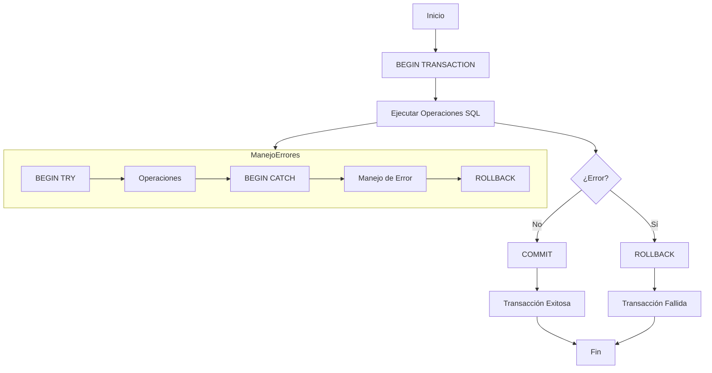

# Fundamentos de Bases de Datos - Procesamiento de transacciones

## 9.4 Manejo de transacciones en SQL.

---

El manejo de transacciones en SQL permite agrupar operaciones en unidades lógicas de trabajo que cumplen con las propiedades ACID. Según Elmasri y Navathe (2006), "SQL proporciona comandos explícitos para controlar el inicio y fin de transacciones".

### Sintaxis Básica de Transacciones en SQL

#### Comandos Fundamentales

```sql
-- Iniciar una transacción
BEGIN TRANSACTION; -- o BEGIN WORK, START TRANSACTION

-- Confirmar cambios
COMMIT;

-- Deshacer cambios
ROLLBACK;

-- Punto de guardado
SAVEPOINT nombre_punto;

-- Rollback a punto específico
ROLLBACK TO SAVEPOINT nombre_punto;
```

### Niveles de Aislamiento en SQL

#### Sintaxis para Establecer Niveles de Aislamiento

```sql
-- Sintaxis estándar SQL
SET TRANSACTION ISOLATION LEVEL nivel_aislamiento;

-- Ejemplos específicos
SET TRANSACTION ISOLATION LEVEL READ UNCOMMITTED;
SET TRANSACTION ISOLATION LEVEL READ COMMITTED;
SET TRANSACTION ISOLATION LEVEL REPEATABLE READ;
SET TRANSACTION ISOLATION LEVEL SERIALIZABLE;
```

#### Comportamiento por Nivel de Aislamiento

| Nivel            | Dirty Read | Non-repeatable Read | Phantom Read |
| ---------------- | ---------- | ------------------- | ------------ |
| READ UNCOMMITTED | Permitido  | Permitido           | Permitido    |
| READ COMMITTED   | Prevenido  | Permitido           | Permitido    |
| REPEATABLE READ  | Prevenido  | Prevenido           | Permitido    |
| SERIALIZABLE     | Prevenido  | Prevenido           | Prevenido    |

### Ejemplos Prácticos

#### Ejemplo 1: Transferencia Bancaria

```sql
-- Transacción completa de transferencia
BEGIN TRANSACTION;

-- Verificar fondos disponibles
DECLARE @saldo_origen DECIMAL(10,2);
SELECT @saldo_origen = saldo FROM cuentas WHERE id = 1001;

IF @saldo_origen >= 500.00
BEGIN
    -- Debitar cuenta origen
    UPDATE cuentas SET saldo = saldo - 500.00 WHERE id = 1001;

    -- Acreditar cuenta destino
    UPDATE cuentas SET saldo = saldo + 500.00 WHERE id = 2002;

    -- Registrar la transacción
    INSERT INTO transacciones (origen, destino, monto, fecha, tipo)
    VALUES (1001, 2002, 500.00, GETDATE(), 'transferencia');

    COMMIT TRANSACTION;
    PRINT 'Transferencia realizada exitosamente';
END
ELSE
BEGIN
    ROLLBACK TRANSACTION;
    PRINT 'Error: Saldo insuficiente';
END
```

#### Ejemplo 2: Transacción con Puntos de Guardado

```sql
-- Transacción compleja con puntos de guardado
BEGIN TRANSACTION;

-- Paso 1: Crear nuevo cliente
INSERT INTO clientes (nombre, email, telefono)
VALUES ('Juan Pérez', 'juan@email.com', '555-1234');

-- Guardar punto después de inserción
SAVEPOINT after_cliente_insert;

-- Paso 2: Crear pedido
DECLARE @nuevo_cliente_id INT = SCOPE_IDENTITY();
INSERT INTO pedidos (cliente_id, fecha_pedido, estado)
VALUES (@nuevo_cliente_id, GETDATE(), 'pendiente');

-- Guardar punto después de pedido
SAVEPOINT after_pedido_insert;

-- Paso 3: Agregar items al pedido
DECLARE @nuevo_pedido_id INT = SCOPE_IDENTITY();

BEGIN TRY
    INSERT INTO items_pedido (pedido_id, producto_id, cantidad, precio)
    VALUES
    (@nuevo_pedido_id, 101, 2, 25.00),
    (@nuevo_pedido_id, 205, 1, 45.00);

    -- Todo exitoso, confirmar
    COMMIT TRANSACTION;
    PRINT 'Pedido creado exitosamente';
END TRY
BEGIN CATCH
    -- Si hay error en items, revertir solo hasta el pedido
    ROLLBACK TRANSACTION TO SAVEPOINT after_pedido_insert;
    PRINT 'Error al agregar items, pedido creado sin items';

    -- Opcional: confirmar el pedido sin items o hacer rollback completo
    -- COMMIT TRANSACTION;
END CATCH
```

#### Ejemplo 3: Transacción con Múltiples Niveles de Aislamiento

```sql
-- Transacción con control explícito de aislamiento
SET TRANSACTION ISOLATION LEVEL SERIALIZABLE;
BEGIN TRANSACTION;

-- Bloqueo pesimista para prevenir condiciones de carrera
SELECT * FROM inventario
WHERE producto_id = 3001 AND cantidad >= 5
FOR UPDATE;

-- Verificar stock
DECLARE @stock_actual INT;
SELECT @stock_actual = cantidad FROM inventario WHERE producto_id = 3001;

IF @stock_actual >= 5
BEGIN
    -- Actualizar inventario
    UPDATE inventario SET cantidad = cantidad - 5 WHERE producto_id = 3001;

    -- Crear registro de venta
    INSERT INTO ventas (producto_id, cantidad, fecha_venta, cliente_id)
    VALUES (3001, 5, GETDATE(), 5001);

    COMMIT TRANSACTION;
    PRINT 'Venta realizada exitosamente';
END
ELSE
BEGIN
    ROLLBACK TRANSACTION;
    PRINT 'Error: Stock insuficiente';
END
```

### Manejo de Errores en Transacciones

#### Ejemplo con Manejo de Excepciones

```sql
-- Transacción con manejo robusto de errores
BEGIN TRY
    BEGIN TRANSACTION;

    -- Operación 1
    UPDATE cuentas SET saldo = saldo - 100.00 WHERE id = 1001;

    -- Operación 2
    UPDATE cuentas SET saldo = saldo + 100.00 WHERE id = 2002;

    -- Operación 3: Esto podría fallar
    INSERT INTO auditoria (accion, fecha, usuario)
    VALUES ('transferencia', GETDATE(), 'sistema');

    COMMIT TRANSACTION;
    PRINT 'Transacción completada exitosamente';
END TRY
BEGIN CATCH
    -- Revertir en caso de error
    IF @@TRANCOUNT > 0
        ROLLBACK TRANSACTION;

    -- Información del error
    PRINT 'Error: ' + ERROR_MESSAGE();
    PRINT 'Número: ' + CAST(ERROR_NUMBER() AS VARCHAR);
    PRINT 'Severidad: ' + CAST(ERROR_SEVERITY() AS VARCHAR);
    PRINT 'Estado: ' + CAST(ERROR_STATE() AS VARCHAR);
    PRINT 'Línea: ' + CAST(ERROR_LINE() AS VARCHAR);
END CATCH
```

### Transacciones Anidadas y Distribuidas

#### Ejemplo de Transacción Anidada

```sql
-- Ejemplo conceptual de transacciones anidadas
BEGIN TRANSACTION main_tran;

-- Operación principal
INSERT INTO tabla_principal (nombre) VALUES ('Registro principal');

-- Transacción anidada (simulada con savepoint)
SAVEPOINT nested_tran;

BEGIN TRY
    INSERT INTO tabla_detalle (principal_id, detalle)
    VALUES (SCOPE_IDENTITY(), 'Detalle del registro');

    -- Confirmar la parte anidada
    PRINT 'Operación anidada exitosa';
END TRY
BEGIN CATCH
    -- Revertir solo la parte anidada
    ROLLBACK TRANSACTION TO SAVEPOINT nested_tran;
    PRINT 'Error en operación anidada, continuando transacción principal';
END CATCH

-- Continuar con transacción principal
UPDATE tabla_principal SET estado = 'completo' WHERE id = SCOPE_IDENTITY();

COMMIT TRANSACTION;
```

### Diagrama de Flujo de Transacción SQL



### Ejercicios Propuestos

1. **Implementación de Transferencia Bancaria**:
   Crea una transacción SQL completa para transferir fondos entre cuentas que:
   - Verifique saldos suficientes
   - Actualice ambas cuentas
   - Registre la transacción en una tabla de auditoría
   - Maneje errores adecuadamente

2. **Control de Concurrencia**:
   Diseña una transacción para un sistema de reservas que:
   - Use el nivel de aislamiento apropiado
   - Prevenga sobreventa de asientos
   - Maneje conflictos de concurrencia

3. **Transacción con Múltiples Savepoints**:
   Crea una transacción compleja con al menos 3 puntos de guardado donde:
   - Cada operación principal tenga su savepoint
   - El rollback pueda hacerse a diferentes puntos
   - Se manejen errores específicos para cada sección

4. **Análisis de Comportamiento**:
   Para cada nivel de aislamiento, predice el comportamiento de:
   ```
   -- Sesión 1
   BEGIN TRANSACTION;
   UPDATE productos SET stock = stock - 1 WHERE id = 100;

   -- Sesión 2 (ejecutada concurrentemente)
   BEGIN TRANSACTION;
   SELECT stock FROM productos WHERE id = 100;
   COMMIT;
   ```

### Optimización y Buenas Prácticas

#### Mejores Prácticas para Transacciones SQL

1. **Mantener transacciones cortas**
2. **Seleccionar el nivel de aislamiento apropiado**
3. **Manejar errores adecuadamente**
4. **Evitar bloqueos innecesarios**
5. **Usar puntos de guardado para operaciones complejas**

#### Ejemplo de Transacción Optimizada

```sql
-- Transacción optimizada con duración mínima
BEGIN TRANSACTION;

-- Solo operaciones esenciales dentro de la transacción
UPDATE tabla SET columna = valor WHERE condición;

-- Operaciones no críticas fuera de la transacción
COMMIT TRANSACTION;

-- Ahora ejecutar operaciones no esenciales
INSERT INTO log_table (accion, fecha) VALUES ('operación', GETDATE());
```

### Referencias

#### Bibliografía Básica

1. Elmasri and Navathe. Fundamentals of Database Systems. Addison-Wesley. Cuarta Edición. 2006. (Capítulo 17, Sección 17.5)
2. Silberschatz A., Kort H. y Sudarshan S. Fundamentos de BD. McGraw Hill. Quinta edición. 2006. (Capítulo 13)
3. Ullman J.D. and Widom J. A First Course in Data Base System. Prentice Hall. Tercera edición. 2008. (Capítulo 6.6)

#### Bibliografía Complementaria

1. Kline K., Kline D., and Hunt B. SQL in a nutshell. O'Reilly. 2008. (Capítulo 7)

### Recursos Adicionales

- Práctica con diferentes sistemas de gestión de bases de datos (MySQL, PostgreSQL, SQL Server)
- Experimentación con niveles de aislamiento y observación de comportamientos
- Análisis de planes de ejecución para transacciones complejas
- Uso de herramientas de monitorización para observar bloqueos y deadlocks
