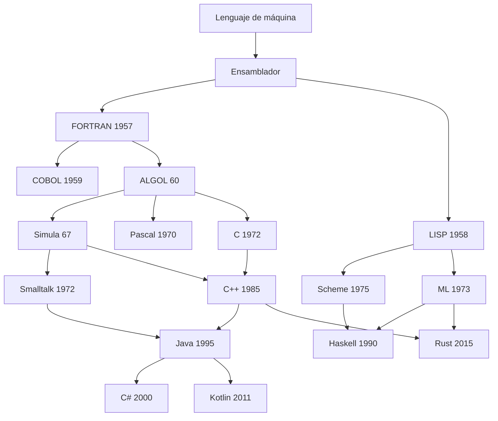

# Lenguajes de Programación - Introducción

## 1.1 Historia de los lenguajes de programación.

---

Un **lenguaje de programación** es una notación formal para describir cómputos, con una **sintaxis** que dice qué textos son programas, una **semántica** que dice qué hace cada programa y, por lo general, un **sistema de tipos** que descarta programas sin sentido antes de ejecutarlos. Los lenguajes actuales son el resultado de setenta años de ideas que aparecieron en un lenguaje, se refinaron en otros y se combinaron: el ciclo y el arreglo de FORTRAN, la recursión y la recolección de basura de LISP, el bloque y la gramática formal de ALGOL, la clase de Simula, la inferencia de tipos de ML. Este tema recorre esa historia por etapas, ilustra las ideas centrales de cada una y relaciona los lenguajes por sus influencias.

### Antes de los lenguajes de alto nivel

Las primeras computadoras electrónicas, a mediados de los años cuarenta, se programaban en **lenguaje de máquina**: secuencias de números que la unidad de control decodifica directamente. El **ensamblador**, a partir de finales de esa década, sustituyó los códigos por nombres simbólicos (`MOV`, `ADD`) y las direcciones por etiquetas, y un programa ensamblador hacía la traducción. Konrad Zuse diseñó entre 1942 y 1945 el **Plankalkül**, un lenguaje de alto nivel con estructuras de datos y aserciones, que no se implementó en su época y no tuvo influencia directa.

### Los primeros lenguajes de alto nivel, 1954 a 1960

- **FORTRAN** (1957), de John Backus y su equipo en IBM, para cálculo científico. Su compilador demostró que un programa traducido podía ser casi tan eficiente como uno escrito a mano, que era la objeción principal a los lenguajes de alto nivel. Aportó expresiones aritméticas con notación matemática, `DO` para ciclos, arreglos, subrutinas y tipos asignados por la inicial del nombre.
- **LISP** (1958), de John McCarthy en el MIT, para inteligencia artificial. Aportó las listas como estructura universal, la recursión como forma principal de control, las funciones como valores, la **recolección de basura** y la representación de los programas con la misma estructura que los datos.
- **COBOL** (1959), diseñado por el comité CODASYL a partir del FLOW-MATIC de Grace Hopper, para aplicaciones administrativas. Aportó registros con campos jerárquicos, separación entre la descripción de los datos y los procedimientos, y una sintaxis cercana al inglés.
- **ALGOL 60** (1960), de un comité internacional. Fue el primer lenguaje definido con una gramática formal, la **forma de Backus y Naur** (BNF), y aportó la estructura de **bloques** con alcance léxico, las variables locales en una pila, la recursión y el paso de parámetros por valor y por nombre. Casi no se usó en la industria, pero casi todos los lenguajes imperativos posteriores descienden de él.

### Estructuración y abstracción, 1960 a 1980

- **Simula 67**, de Ole-Johan Dahl y Kristen Nygaard, para simulación: introdujo las **clases**, los objetos, la herencia y los métodos virtuales.
- **Pascal** (1970), de Niklaus Wirth, para enseñar **programación estructurada**: tipos definidos por el usuario, registros y verificación estricta de tipos.
- **C** (1972), de Dennis Ritchie en los Laboratorios Bell, para escribir el sistema operativo Unix: acceso cercano a la máquina con punteros y aritmética de direcciones, con la estructura de un lenguaje de alto nivel.
- **Smalltalk** (1972 a 1980), de Alan Kay y su grupo en Xerox PARC: todo es un objeto y todo cómputo es el envío de un mensaje. Con él se desarrollaron las interfaces gráficas modernas.
- **Prolog** (1972), de Alain Colmerauer y Robert Kowalski: el programa es un conjunto de cláusulas lógicas y la ejecución es la búsqueda de una demostración.
- **ML** (1973), de Robin Milner, como metalenguaje de un demostrador de teoremas: **inferencia de tipos** polimórficos, tipos algebraicos y coincidencia de patrones.
- **Scheme** (1975), de Guy Steele y Gerald Sussman: un LISP minimalista con alcance léxico, funciones de primera clase y continuaciones.

### Modularidad y objetos, 1980 a 1995

**Ada** (1980, normalizado en 1983), encargado por el Departamento de Defensa de Estados Unidos, reunió paquetes, tipos abstractos, genéricos, excepciones y concurrencia. **C++** (1985), de Bjarne Stroustrup, agregó clases a C sin sacrificar su eficiencia, y luego plantillas. **Haskell** (1990), de un comité académico, unificó los lenguajes funcionales **perezosos** y resolvió la entrada y salida con mónadas. **Python** (1991), de Guido van Rossum, priorizó la legibilidad con tipado dinámico y una biblioteca extensa.

### La era de internet y de las máquinas virtuales, 1995 en adelante

En 1995 aparecieron **Java**, de James Gosling en Sun, que compila a un código intermedio para una **máquina virtual** portátil con recolección de basura, y **JavaScript**, de Brendan Eich en Netscape, para ejecutar programas en el navegador. **C#** (2000) siguió el modelo de Java en la plataforma .NET. Las décadas siguientes llevaron ideas funcionales a los lenguajes de uso general (funciones anónimas, inferencia de tipos, tipos algebraicos) y buscaron **seguridad** sin perder eficiencia: **Scala** (2004), **Go** (2009), **Kotlin** (2011), **TypeScript** (2012), que agrega tipos estáticos opcionales a JavaScript, **Swift** (2014) y **Rust** (2015), que garantiza la seguridad de la memoria sin recolector de basura mediante un sistema de **propiedad** verificado por el compilador.

### Sobre las "generaciones"

Es frecuente clasificar los lenguajes en generaciones, pero el término tiene un sentido preciso que no coincide con la cronología de los paradigmas: la **primera** generación es el lenguaje de máquina, la **segunda** el ensamblador, la **tercera** los lenguajes de alto nivel de propósito general (desde FORTRAN hasta Python o Java), la **cuarta** los lenguajes de dominio específico orientados a resultados, como SQL o los generadores de informes, y la **quinta**, en el proyecto japonés de los años ochenta, los lenguajes basados en restricciones y lógica, como Prolog. Java y Haskell, por lo tanto, son de tercera generación, aunque sean posteriores a SQL.



### Implementación en Python

El programa escribe el factorial en tres estilos para el ejercicio 2: imperativo, con un ciclo y estado mutable; recursivo, como en Scheme, y como un pliegue sobre una secuencia, como en Haskell. Para el ejercicio 3 compara el factorial con enteros de 64 bits, como en FORTRAN o C, con los enteros de precisión arbitraria de Python, y reproduce la regla de tipado implícito de FORTRAN. Para el ejercicio 5 guarda en una tabla veinte lenguajes con su año y sus influencias principales, verifica que ningún lenguaje influya en otro anterior, imprime la línea de tiempo por décadas y calcula los ancestros de algunos lenguajes.

```python
from functools import reduce
import ctypes

# --- Ejercicio 2: factorial en estilo imperativo y en estilo funcional ---
def factorial_imperativo(n):
    resultado = 1                      # estado mutable y un ciclo, como en FORTRAN, C o Java
    i = 2
    while i <= n:
        resultado *= i
        i += 1
    return resultado

def factorial_recursivo(n):            # como en Scheme: (define (fact n) (if (= n 0) 1 (* n (fact (- n 1)))))
    return 1 if n == 0 else n * factorial_recursivo(n - 1)

def factorial_pliegue(n):              # como en Haskell: product [1..n]  o  foldl (*) 1 [1..n]
    return reduce(lambda acc, k: acc * k, range(1, n + 1), 1)

print("ejercicio 2:", [(n, factorial_imperativo(n), factorial_recursivo(n), factorial_pliegue(n)) for n in (0, 1, 5, 10)])

# --- Ejercicio 3: el mismo cálculo con enteros de tamaño fijo, como en FORTRAN o C, y con enteros de precisión arbitraria ---
def factorial_int64(n):
    r = ctypes.c_int64(1)
    for k in range(2, n + 1): r = ctypes.c_int64(r.value * k)     # se trunca a 64 bits, como en C
    return r.value
for n in (20, 21, 25):
    print(f"ejercicio 3: {n}! con int64 = {factorial_int64(n)} | con enteros de Python = {factorial_pliegue(n)}")

# tipado implícito de FORTRAN: las variables que empiezan con I, J, K, L, M o N son enteras; las demás, reales
def tipo_fortran(nombre): return "INTEGER" if nombre[0].upper() in "IJKLMN" else "REAL"
print("   tipos implícitos de FORTRAN:", {v: tipo_fortran(v) for v in ("I", "N", "KONT", "X", "SUMA", "LONGITUD", "DIA")})
# un error clásico: la variable DIA es REAL; dividirla da decimales, aunque el programador pensara en enteros
print("   DIA = 7; DIA / 2 en REAL da", 7.0 / 2, "y en INTEGER daría", 7 // 2)

# --- Ejercicio 5: línea de tiempo y relaciones de influencia ---
lenguajes = {   # año de primera aparición pública, paradigma principal, influencias principales
    "FORTRAN": (1957, "imperativo", []), "LISP": (1958, "funcional", []), "COBOL": (1959, "imperativo", ["FORTRAN"]),
    "ALGOL 60": (1960, "imperativo", ["FORTRAN"]), "Simula": (1967, "orientado a objetos", ["ALGOL 60"]),
    "Pascal": (1970, "imperativo", ["ALGOL 60"]), "C": (1972, "imperativo", ["ALGOL 60"]),
    "Prolog": (1972, "lógico", []), "Smalltalk": (1972, "orientado a objetos", ["Simula", "LISP"]),
    "ML": (1973, "funcional", ["LISP"]), "Scheme": (1975, "funcional", ["LISP", "ALGOL 60"]),
    "C++": (1985, "multiparadigma", ["C", "Simula"]), "Haskell": (1990, "funcional", ["ML", "Scheme"]),
    "Python": (1991, "multiparadigma", ["C", "LISP"]), "Java": (1995, "orientado a objetos", ["C++", "Smalltalk"]),
    "JavaScript": (1995, "multiparadigma", ["Scheme", "Java"]), "C#": (2000, "orientado a objetos", ["Java", "C++"]),
    "Kotlin": (2011, "multiparadigma", ["Java", "C#"]), "TypeScript": (2012, "multiparadigma", ["JavaScript", "C#"]),
    "Rust": (2015, "multiparadigma", ["C++", "ML", "Haskell"]),
}
for nombre, (anio, _, infl) in lenguajes.items():          # coherencia: nadie influye antes de existir
    assert all(lenguajes[i][0] <= anio for i in infl), nombre
por_decada = {}
for nombre, (anio, *_ ) in sorted(lenguajes.items(), key=lambda x: x[1][0]):
    por_decada.setdefault(f"{anio // 10 * 10}s", []).append(f"{nombre} {anio}")
for d, ls in por_decada.items(): print(f"ejercicio 5, {d}:", ", ".join(ls))
def ancestros(n):
    out = set()
    for i in lenguajes[n][2]: out |= {i} | ancestros(i)
    return out
print("   ancestros de Kotlin:", sorted(ancestros("Kotlin"), key=lambda x: (lenguajes[x][0], x)))
print("   ancestros de Haskell:", sorted(ancestros("Haskell"), key=lambda x: (lenguajes[x][0], x)))
print("   lenguajes que descienden de LISP:", sorted((n for n in lenguajes if "LISP" in ancestros(n)), key=lambda x: (lenguajes[x][0], x)))
```

Salida:

```text
ejercicio 2: [(0, 1, 1, 1), (1, 1, 1, 1), (5, 120, 120, 120), (10, 3628800, 3628800, 3628800)]
ejercicio 3: 20! con int64 = 2432902008176640000 | con enteros de Python = 2432902008176640000
ejercicio 3: 21! con int64 = -4249290049419214848 | con enteros de Python = 51090942171709440000
ejercicio 3: 25! con int64 = 7034535277573963776 | con enteros de Python = 15511210043330985984000000
   tipos implícitos de FORTRAN: {'I': 'INTEGER', 'N': 'INTEGER', 'KONT': 'INTEGER', 'X': 'REAL', 'SUMA': 'REAL', 'LONGITUD': 'INTEGER', 'DIA': 'REAL'}
   DIA = 7; DIA / 2 en REAL da 3.5 y en INTEGER daría 3
ejercicio 5, 1950s: FORTRAN 1957, LISP 1958, COBOL 1959
ejercicio 5, 1960s: ALGOL 60 1960, Simula 1967
ejercicio 5, 1970s: Pascal 1970, C 1972, Prolog 1972, Smalltalk 1972, ML 1973, Scheme 1975
ejercicio 5, 1980s: C++ 1985
ejercicio 5, 1990s: Haskell 1990, Python 1991, Java 1995, JavaScript 1995
ejercicio 5, 2000s: C# 2000
ejercicio 5, 2010s: Kotlin 2011, TypeScript 2012, Rust 2015
   ancestros de Kotlin: ['FORTRAN', 'LISP', 'ALGOL 60', 'Simula', 'C', 'Smalltalk', 'C++', 'Java', 'C#']
   ancestros de Haskell: ['FORTRAN', 'LISP', 'ALGOL 60', 'ML', 'Scheme']
   lenguajes que descienden de LISP: ['Smalltalk', 'ML', 'Scheme', 'Haskell', 'Python', 'Java', 'JavaScript', 'C#', 'Kotlin', 'TypeScript', 'Rust']
```

### Ejercicios Propuestos

1. **FORTRAN y Python.** Compara FORTRAN y Python e identifica al menos tres diferencias fundamentales de diseño y propósito.

2. **Factorial.** Implementa la función factorial en estilo imperativo y en estilo funcional.

3. **Tipos.** Investiga cómo evolucionaron los sistemas de tipos desde FORTRAN hasta TypeScript.

4. **COBOL.** Identifica las características principales del siguiente fragmento:

    ```cobol
    IDENTIFICATION DIVISION.
    PROGRAM-ID. HelloWorld.
    PROCEDURE DIVISION.
    DISPLAY 'Hello, World!'.
    STOP RUN.
    ```

5. **Línea de tiempo.** Construye una línea de tiempo con al menos 10 lenguajes importantes y relaciónala con eventos tecnológicos relevantes.

### Soluciones

**Ejercicio 1.**

| Aspecto           | FORTRAN (1957)                                              | Python (1991)                                                       |
| ----------------- | ----------------------------------------------------------- | ------------------------------------------------------------------- |
| Propósito         | Cálculo numérico eficiente en máquinas escasas              | Legibilidad y productividad del programador                         |
| Ejecución         | Compilado a código máquina; la eficiencia era el objetivo   | Interpretado sobre una máquina virtual; la eficiencia es secundaria |
| Tipos             | Estáticos, implícitos por la inicial del nombre             | Dinámicos: los valores tienen tipo, las variables no                |
| Memoria           | Estática: sin recursión ni asignación dinámica hasta FORTRAN 90 | Dinámica, con recolección de basura                              |
| Estructuras       | Arreglos de números                                         | Listas, diccionarios, conjuntos, objetos                            |
| Sintaxis          | Formato fijo por columnas de tarjeta perforada              | Formato libre con la sangría como estructura de bloques             |

La diferencia de fondo es de época: en 1957 el recurso escaso era la máquina, y en 1991 el programador. FORTRAN sigue vigente, en sus versiones modernas, en el cómputo científico de alto rendimiento, y Python suele llamar a bibliotecas numéricas escritas en FORTRAN o C, como las rutinas de álgebra lineal que usa NumPy.

**Ejercicio 2.** El programa da las tres versiones. La imperativa describe **cómo** calcular, con una variable que cambia en cada iteración; la recursiva, **qué** es el factorial, con la definición matemática $0! = 1$ y $n! = n \cdot (n-1)!;$ el pliegue lo expresa como el producto de la secuencia $1, \dots, n.$ En C y Haskell:

```c
long factorial(int n) { long r = 1; for (int i = 2; i <= n; i++) r *= i; return r; }
```

```haskell
factorial :: Integer -> Integer
factorial n = product [1 .. n]
```

La versión recursiva usa una llamada por cada factor y, en Python, falla por la profundidad de la pila para valores de $n$ cercanos a 1000; los lenguajes funcionales eliminan ese problema con la **optimización de llamadas en cola**, si la función se escribe con un acumulador (tema 3.5).

**Ejercicio 3.** FORTRAN tenía pocos tipos numéricos, `INTEGER`, `REAL`, `DOUBLE PRECISION` y `COMPLEX`, asignados por la inicial del nombre salvo declaración explícita: una variable `DIA` es real sin que el programador lo note, que es la razón de la frase `IMPLICIT NONE` en el FORTRAN moderno. ALGOL 60 exigió declarar todas las variables. Pascal agregó tipos definidos por el usuario, registros, enumeraciones y subrangos, con verificación estricta. C relajó la verificación con conversiones implícitas y punteros sin tipo. ML introdujo la **inferencia** de tipos polimórficos: el compilador deduce el tipo más general sin anotaciones (tema 3.7). Java y C# añadieron genéricos en 2004 y 2005. Los lenguajes dinámicos, como Python y JavaScript, verifican los tipos al ejecutar; TypeScript y las anotaciones de Python agregaron **tipado gradual**, que permite mezclar código con y sin tipos. Rust usa el sistema de tipos para verificar también la propiedad de la memoria. La tendencia es hacia sistemas más expresivos que detectan más errores sin exigir más anotaciones. El programa muestra una consecuencia concreta de los tipos de tamaño fijo: $21!$ no cabe en 64 bits y el resultado se desborda a un número negativo sin aviso, mientras que los enteros de Python crecen lo necesario.

**Ejercicio 4.** El programa muestra las **divisiones** obligatorias de COBOL: `IDENTIFICATION DIVISION`, con el nombre del programa, y `PROCEDURE DIVISION`, con las instrucciones; un programa completo tiene también `ENVIRONMENT DIVISION`, para la configuración de la máquina y los archivos, y `DATA DIVISION`, para la descripción de los datos, que aquí se omiten porque no hay datos. Las sentencias son verbos en inglés (`DISPLAY`, `STOP RUN`) que terminan en punto, como oraciones. La separación entre datos y procedimientos, la orientación a registros y archivos y la sintaxis verbosa, pensada para que la leyeran administradores, son sus rasgos característicos. Sigue en uso en sistemas bancarios y gubernamentales.

**Ejercicio 5.** El programa imprime la línea de tiempo por décadas. Algunos eventos que la explican:

- **1957 y 1958:** la IBM 704, con aritmética de punto flotante en hardware, hizo viable FORTRAN.
- **1964:** la familia IBM System/360 unificó las máquinas comerciales y científicas, el terreno de COBOL y PL/I.
- **1969 a 1973:** Unix y la minicomputadora PDP-11 dieron origen a C.
- **1973 a 1980:** la Alto de Xerox PARC, con pantalla gráfica y ratón, se programó en Smalltalk.
- **1981:** la computadora personal de IBM, para la que se escribió mucho software en C y luego en C++.
- **1991 a 1995:** la Web llevó a Java, JavaScript y los lenguajes de guiones.
- **2007 y 2008:** los teléfonos inteligentes llevaron a Objective-C, luego a Swift y, en Android, a Kotlin.
- **Después de 2005:** los procesadores multinúcleo renovaron el interés en la programación funcional y concurrente: Scala, Go, Rust.

El programa también recorre las influencias: casi todos los lenguajes de la tabla descienden de FORTRAN, a través de ALGOL, y más de la mitad de LISP, por las funciones de primera clase y la recolección de basura.

### Referencias

1. Sebesta, R. W., _Concepts of Programming Languages_. Pearson, 2019. Capítulo 2.
2. Wexelblat, R. L. (ed.), _History of Programming Languages_. Academic Press, 1981.
3. Backus, J., The history of FORTRAN I, II, and III. _ACM SIGPLAN Notices_ 13(8), 1978.
4. McCarthy, J., History of LISP. _ACM SIGPLAN Notices_ 13(8), 1978.
5. Mitchell, J. C., _Concepts in Programming Languages_. Cambridge University Press, 2003. Capítulo 1.
