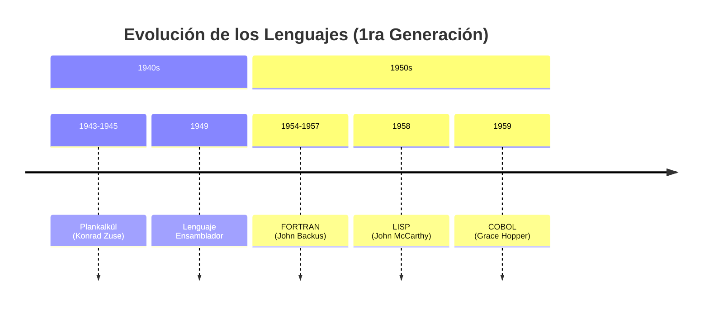
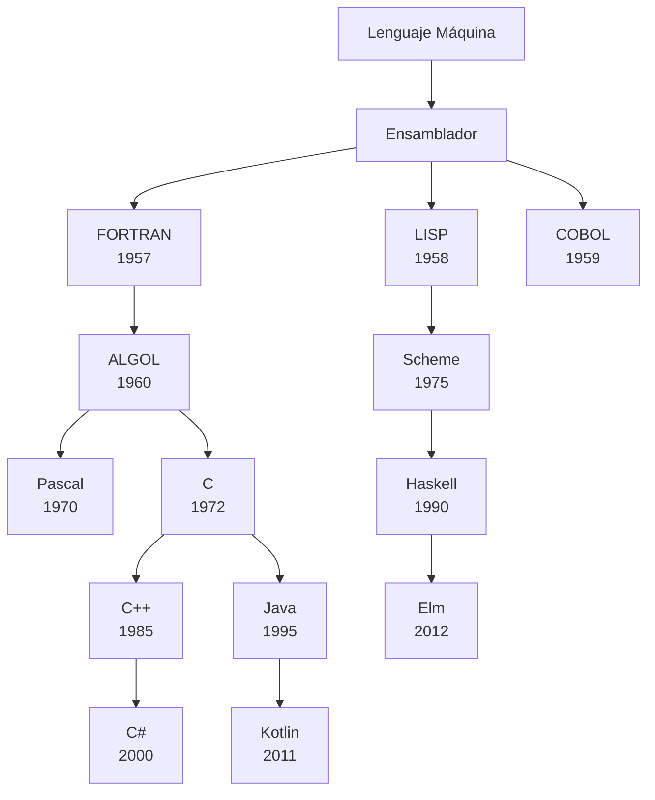

# Lenguajes de Programación - Introducción

## 1.1 Historia de los lenguajes de programación.

---

La historia de los lenguajes de programación es fundamental para comprender la evolución de los paradigmas, estructuras y conceptos que utilizamos hoy en día. Según Mitchell (2003), el estudio de los lenguajes de programación nos permite "entender las choices de diseño y sus implicaciones en la escritura de software".

### Conceptos Fundamentales

#### ¿Qué es un Lenguaje de Programación?

Un lenguaje de programación es un sistema de notación formal diseñado para comunicar instrucciones a una máquina. Pierce (2002) lo define como: "Un lenguaje formal con una semántica que especifica el comportamiento de un programa cuando se ejecuta en una máquina apropiada".

#### Elementos Clave

- **Sintaxis**: Reglas que definen la estructura gramatical
- **Semántica**: Significado de las construcciones sintácticas
- **Sistema de tipos**: Reglas que gobiernan los tipos de datos

### Evolución Histórica

#### Primera Generación (1940s-1950s)



**Lenguajes de máquina y ensamblador**: Programación directamente en código binario.

Ejemplo de código ensamblador:

```assembly
MOV AX, 05h    ; Mover el valor 5 al registro AX
ADD AX, 03h    ; Sumar 3 al registro AX
```

#### Segunda Generación (1950s-1960s)

**Lenguajes de alto nivel**: FORTRAN (1957), COBOL (1959), LISP (1958).

Fórmula matemática en FORTRAN:

$$ y = a \times x^2 + b \times x + c $$

Código FORTRAN equivalente:

```fortran
Y = A * X**2 + B * X + C
```

#### Tercera Generación (1960s-1970s)

**Lenguajes estructurados**: ALGOL, Pascal, C.

Estructura de control en Pascal:

```pascal
program Ejemplo;
var
  i, suma: integer;
begin
  suma := 0;
  for i := 1 to 10 do
    suma := suma + i;
  writeln('La suma es: ', suma);
end.
```

#### Cuarta Generación (1970s-1980s)

**Programación orientada a objetos**: Smalltalk, C++.

Concepto de clase en Smalltalk:

```smalltalk
Object subclass: #Person
  instanceVariableNames: 'nombre edad'
  classVariableNames: ''
  poolDictionaries: ''
  category: 'Ejemplos'
```

#### Quinta Generación (1980s-Presente)

**Lenguajes multiparadigma y funcionales**: Python, Java, Haskell.

Función recursiva en Haskell:

```haskell
factorial :: Integer -> Integer
factorial 0 = 1
factorial n = n * factorial (n - 1)
```

### Paradigmas de Programación

#### Programación Imperativa

Se basa en cambiar el estado del programa mediante comandos.

#### Programación Declarativa

Se describe el resultado deseado sin especificar cómo lograrlo.

#### Programación Funcional

Basada en el cálculo lambda $(\lambda\text{-cálculo})$ :

$$ (\lambda x . x + 1) 5 \rightarrow 5 + 1 \rightarrow 6 $$

#### Programación Orientada a Objetos

Organización alrededor de objetos que encapsulan datos y comportamiento.

### Ejercicios Propuestos

1. **Análisis histórico**: Compare FORTRAN y Python identificando al menos tres diferencias fundamentales en su diseño y propósito.

2. **Traducción de paradigmas**: Implemente la función factorial en estilo imperativo (C/Java) y funcional (Haskell/Scheme).

3. **Evolución de conceptos**: Investigue cómo el sistema de tipos ha evolucionado desde FORTRAN hasta TypeScript.

4. **Análisis de código**: Dado el siguiente fragmento de COBOL, identifique sus características principales:

```cobol
IDENTIFICATION DIVISION.
PROGRAM-ID. HelloWorld.
PROCEDURE DIVISION.
DISPLAY 'Hello, World!'.
STOP RUN.
```

5. **Linea de tiempo**: Cree una línea de tiempo que muestre la aparición de al menos 10 lenguajes importantes y su relación con eventos tecnológicos relevantes.

### Diagrama de Evolución



### Referencias

#### Bibliografía Básica

1. Mitchell J., Concepts in Programming Languages. Cambridge University Press 2003.
2. Pierce B.C., Types and Programming Languages. MIT Press 2002.

#### Bibliografía Complementaria

1. Harper R., Practical Foundations for Programming Languages. Working draft, 2010.
2. Mitchell J., Foundations for Programming Languages. MIT Press 1996.
3. Friedman D. P., Wand M., Essentials of Programming Languages. 3rd edition. MIT Press, 2008.
4. Krishnamurthi S., Programming Languages Application and Interpretation.

#### Recursos Adicionales

- [The History of Programming Languages](https://hopl.info/)
- [Computer History Museum](https://computerhistory.org/)
- [IEEE Computer Society](https://www.computer.org/)

### Conclusión

La historia de los lenguajes de programación muestra una evolución constante hacia mayores niveles de abstracción, expresividad y seguridad. Comprender esta evolución permite apreciar las decisiones de diseño en los lenguajes modernos y anticipar tendencias futuras. Como señala Harper (2010), "cada nuevo lenguaje incorpora lecciones aprendidas de sus predecesores".
