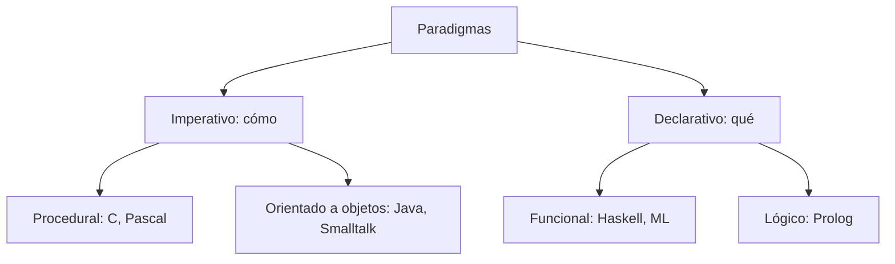

# Lenguajes de Programación - Introducción

## 1.2 Breve discusión de los paradigmas clásicos (imperativo, orientado a objetos, funcional, lógico).

---

Un **paradigma de programación** es una manera de concebir el cómputo y, con ella, una manera de organizar los programas. Los cuatro clásicos responden de forma distinta a la pregunta de qué es un programa: una secuencia de órdenes que cambian un estado (imperativo), una colección de objetos que se envían mensajes (orientado a objetos), una función que transforma valores (funcional) o un conjunto de hechos y reglas del que se deducen respuestas (lógico). Cada uno tiene un modelo formal detrás y produce programas con propiedades distintas. La mayoría de los lenguajes actuales son **multiparadigma**, pero entender cada paradigma por separado permite elegir la herramienta adecuada. Este tema presenta los cuatro con sus conceptos, su base formal y un mismo problema resuelto en cada uno.

### Paradigma imperativo

Un programa es una secuencia de **instrucciones** que modifican el **estado**: los valores guardados en las variables. Sus elementos son la **asignación**, la **secuencia**, la **selección** (`if`) y la **iteración** (`while`), más los procedimientos que agrupan instrucciones. Refleja directamente la arquitectura de von Neumann, en la que un programa modifica celdas de memoria, y por eso permite un control fino del rendimiento.

**Base formal:** las **máquinas de estados**. La semántica de una instrucción es una función que transforma un estado en otro, $[\![ c ]\!] : \Sigma \to \Sigma,$ y su corrección se razona con la **lógica de Hoare**: $\{P\}\; c \;\{Q\}$ afirma que si $P$ se cumple antes de ejecutar $c$ y $c$ termina, $Q$ se cumple después (tema 2.3). Lenguajes: FORTRAN, C, Pascal, y la parte imperativa de casi todos los demás.

### Paradigma orientado a objetos

Un programa es una colección de **objetos**, cada uno con un estado propio y un comportamiento, que se comunican mediante **mensajes**. Sus conceptos son el **encapsulamiento** (el estado solo se modifica a través de los métodos del objeto), la **herencia** (una clase se define a partir de otra), el **polimorfismo de subtipos** (un mensaje se responde según la clase del receptor, elegida al ejecutar) y la **abstracción** de interfaces. Organiza bien los programas grandes cuyos conceptos corresponden a entidades del dominio.

**Base formal:** cálculos de objetos, como el de Abadi y Cardelli, o núcleos de lenguajes, como Featherweight Java (tema 5.5). Lenguajes: Smalltalk, C++, Java, C#.

### Paradigma funcional

Un programa es una **expresión** que se evalúa a un valor, construida con **funciones** en el sentido matemático: el resultado depende solo de los argumentos, sin efectos secundarios. Sus conceptos son la **transparencia referencial** (una expresión se puede sustituir por su valor sin cambiar el programa), las **funciones de orden superior** (que reciben o devuelven funciones), la **inmutabilidad**, la **recursión** en lugar de la iteración, los **tipos algebraicos** y la **coincidencia de patrones**. Sin estado compartido, los programas son más fáciles de razonar, probar y paralelizar.

**Base formal:** el **cálculo lambda** de Church (tema 3.1), con la regla de reducción $(\lambda x.\, e)\; v \to e[x := v];$ con tipos, el cálculo lambda tipado y la inferencia de Hindley y Milner. Lenguajes: LISP, Scheme, ML, Haskell, OCaml, F#, Elixir.

### Paradigma lógico

Un programa es un conjunto de **hechos** y **reglas** en lógica, y ejecutar es hacer una **consulta**: el sistema busca valores de las variables que la hagan verdadera. Sus mecanismos son la **unificación**, que encuentra la sustitución más general que iguala dos términos, y el **retroceso** (*backtracking*), que explora las alternativas. Una misma relación puede usarse en varias direcciones: `concatenar(X, Y, [1, 2])` enumera todas las formas de partir una lista.

**Base formal:** la lógica de primer orden restringida a **cláusulas de Horn**, $H \leftarrow B_1 \land \dots \land B_n,$ con la regla de **resolución SLD** de Kowalski, que es correcta y completa para ellas. Lenguajes: Prolog, Datalog y la programación con restricciones.

### Comparación

| Aspecto          | Imperativo                 | Orientado a objetos            | Funcional                       | Lógico                           |
| ---------------- | -------------------------- | ------------------------------ | ------------------------------- | -------------------------------- |
| Unidad           | Instrucción                | Objeto y mensaje               | Función y expresión             | Relación y cláusula             |
| Estado           | Variables mutables         | Encapsulado en objetos         | Ausente o explícito             | Ausente: sustituciones           |
| Control          | Secuencia, ciclos          | Envío de mensajes              | Composición, recursión          | Búsqueda con retroceso           |
| Base formal      | Máquinas de estados, Hoare | Cálculos de objetos            | Cálculo lambda                  | Lógica de Horn, resolución       |
| Fortalezas       | Rendimiento, control       | Modelado, extensión por clases | Razonamiento, composición       | Búsqueda, reglas, consultas      |
| Debilidades      | Efectos difíciles de seguir | Jerarquías rígidas            | Costo de abstracción, aprendizaje | Eficiencia, control implícito  |
| Aplicaciones     | Sistemas, embebidos        | Aplicaciones empresariales, interfaces | Compiladores, datos, concurrencia | Sistemas expertos, verificación |



### Implementación en Python

Python admite tres de los cuatro paradigmas directamente, y el cuarto se puede construir. El programa implementa la **unificación** con verificación de ocurrencia y, sobre ella, un intérprete de cláusulas de Horn con retroceso y aritmética, en unas cuarenta líneas. Con eso resuelve el ejercicio 5, escribe el factorial en los cuatro paradigmas para el ejercicio 1 y una regla de disponibilidad de habitaciones en los cuatro estilos para el ejercicio 3. Para el ejercicio 4 implementa la inferencia de tipos por unificación sobre términos del cálculo lambda y la aplica a `misterio` y a otra función.

```python
from functools import reduce
from itertools import count

# ---------- términos lógicos: variables con mayúscula inicial, compuestos como tuplas (functor, args...) ----------
class Var:
    def __init__(self, n): self.n = n
    def __repr__(self): return self.n
def es_var(t): return isinstance(t, Var)
def resolver(t, s):
    while es_var(t) and t in s: t = s[t]
    return t
def ocurre(v, t, s):
    t = resolver(t, s)
    return t is v or (isinstance(t, tuple) and any(ocurre(v, a, s) for a in t[1:]))
def unificar(a, b, s):
    a, b = resolver(a, s), resolver(b, s)
    if a is b or (not es_var(a) and not es_var(b) and not isinstance(a, tuple) and a == b): return s
    if es_var(a): return None if ocurre(a, b, s) else {**s, a: b}
    if es_var(b): return unificar(b, a, s)
    if isinstance(a, tuple) and isinstance(b, tuple) and a[0] == b[0] and len(a) == len(b):
        for x, y in zip(a[1:], b[1:]):
            s = unificar(x, y, s)
            if s is None: return None
        return s
    return None
def mostrar(t, s):
    t = resolver(t, s)
    return f"{t[0]}({', '.join(mostrar(a, s) for a in t[1:])})" if isinstance(t, tuple) else repr(t) if es_var(t) else str(t)

# --- Ejercicio 5: unificación ---
X, Y, Z, W = Var("X"), Var("Y"), Var("Z"), Var("W")
for t1, t2 in ((("p", ("f", X, Y), "a"), ("p", Z, "a")), (("p", ("f", X, Y), ("g", Z)), ("p", ("f", "a", "b"), W)),
               (("p", X, X), ("p", "a", "b")), (("p", X), ("p", ("f", X)))):
    s = unificar(t1, t2, {})
    print(f"ejercicio 5: {mostrar(t1, {})} = {mostrar(t2, {})} ->",
          "no unifican" if s is None else {repr(v): mostrar(v, s) for v in s})

# ---------- un intérprete mínimo de cláusulas de Horn con retroceso ----------
fresco = count()
def renombrar(t, m):
    if es_var(t): return m.setdefault(t, Var(f"{t.n}_{next(fresco)}"))
    return (t[0],) + tuple(renombrar(a, m) for a in t[1:]) if isinstance(t, tuple) else t
def evalua(t, s):
    t = resolver(t, s)
    if isinstance(t, tuple): return {"+": lambda a, b: a + b, "-": lambda a, b: a - b, "*": lambda a, b: a * b}[t[0]](*(evalua(a, s) for a in t[1:]))
    return t
def resuelve(metas, s, programa):
    if not metas: yield s; return
    meta, resto = resolver(metas[0], s), metas[1:]
    if meta[0] == "is":
        s2 = unificar(meta[1], evalua(meta[2], s), s)
        if s2 is not None: yield from resuelve(resto, s2, programa)
        return
    if meta[0] == ">":
        if evalua(meta[1], s) > evalua(meta[2], s): yield from resuelve(resto, s, programa)
        return
    for cabeza, cuerpo in programa:
        m = {}
        s2 = unificar(meta, renombrar(cabeza, m), s)
        if s2 is not None: yield from resuelve([renombrar(c, m) for c in cuerpo] + resto, s2, programa)

N, F, N1, F1 = Var("N"), Var("F"), Var("N1"), Var("F1")
factorial_logico = [(("fact", 0, 1), []),
                    (("fact", N, F), [(">", N, 0), ("is", N1, ("-", N, 1)), ("fact", N1, F1), ("is", F, ("*", N, F1))])]

# --- Ejercicio 1: factorial en los cuatro paradigmas ---
def fact_imperativo(n):
    r = 1
    for k in range(2, n + 1): r *= k
    return r
class Factorial:                                     # orientado a objetos: el objeto guarda estado y lo expone con métodos
    def __init__(self): self._memo = {0: 1}
    def de(self, n):
        if n not in self._memo: self._memo[n] = n * self.de(n - 1)
        return self._memo[n]
fact_funcional = lambda n: reduce(lambda a, b: a * b, range(1, n + 1), 1)
def fact_logico(n):
    R = Var("R")
    return next(resolver(R, s) for s in resuelve([("fact", n, R)], {}, factorial_logico))
print("ejercicio 1:", {n: (fact_imperativo(n), Factorial().de(n), fact_funcional(n), fact_logico(n)) for n in (0, 5, 10)})

# --- Ejercicio 4: inferencia de tipos de  misterio f g x = g (f x) ---
class TVar:
    c = count()
    def __init__(self): self.n = next(TVar.c)
def tres(t, s):
    while isinstance(t, TVar) and t in s: t = s[t]
    return t
def tunif(a, b, s):
    a, b = tres(a, s), tres(b, s)
    if a is b: return s
    if isinstance(a, TVar): return {**s, a: b}
    if isinstance(b, TVar): return {**s, b: a}
    return tunif(a[2], b[2], tunif(a[1], b[1], s))                  # ambos son ("->", dominio, codominio)
def infiere(e, amb, s):
    if isinstance(e, str): return amb[e], s
    if e[0] == "lam":
        a = TVar(); t, s = infiere(e[2], {**amb, e[1]: a}, s); return ("->", a, t), s
    tf, s = infiere(e[1], amb, s); tx, s = infiere(e[2], amb, s)       # aplicación
    r = TVar(); return r, tunif(tf, ("->", tx, r), s)
def texto(t, s, nombres):
    t = tres(t, s)
    if isinstance(t, TVar): return nombres.setdefault(t, "abcdefgh"[len(nombres)])
    izq = texto(t[1], s, nombres)
    return f"({izq}) -> {texto(t[2], s, nombres)}" if isinstance(tres(t[1], s), tuple) else f"{izq} -> {texto(t[2], s, nombres)}"
misterio = ("lam", "f", ("lam", "g", ("lam", "x", ("app", "g", ("app", "f", "x")))))
t, s = infiere(misterio, {}, {})
print("ejercicio 4: misterio ::", texto(t, s, {}))
flip = ("lam", "f", ("lam", "x", ("lam", "y", ("app", ("app", "f", "y"), "x"))))
t, s = infiere(flip, {}, {})
print("   y flip f x y = f y x ::", texto(t, s, {}))

# --- Ejercicio 3: una reserva de hotel en cuatro estilos, con la misma regla de no traslape ---
reservas = [(101, 20, 24), (102, 22, 26)]
libre = lambda hab, a, b, rs: all(not (h == hab and x < b and a < y) for h, x, y in rs)
estado = list(reservas)                                       # imperativo: una lista que se modifica
if libre(101, 24, 27, estado): estado.append((101, 24, 27))
class Hotel:                                                   # objetos: el estado detrás de una interfaz
    def __init__(self, rs): self._rs = list(rs)
    def reservar(self, h, a, b):
        if not libre(h, a, b, self._rs): return False
        self._rs.append((h, a, b)); return True
reservar_f = lambda rs, h, a, b: rs + [(h, a, b)] if libre(h, a, b, rs) else rs     # funcional: devuelve otro valor
H, A, B, Y1, Y2 = Var("H"), Var("A"), Var("B"), Var("Y1"), Var("Y2")
hechos = [(("reserva", h, a, b), []) for h, a, b in reservas]
# lógico: ocupada(H, A, B) si hay una reserva de H que se traslapa con [A, B)
reglas = hechos + [(("ocupada", H, A, B), [("reserva", H, Y1, Y2), (">", B, Y1), (">", Y2, A)])]
ocupada = lambda h, a, b: any(True for _ in resuelve([("ocupada", h, a, b)], {}, reglas))
print("ejercicio 3: 101 del 24 al 27 ->", "imperativo", len(estado) == 3, "| objetos", Hotel(reservas).reservar(101, 24, 27),
      "| funcional", len(reservar_f(reservas, 101, 24, 27)) == 3, "| lógico, ocupada:", ocupada(101, 24, 27))
print("   102 del 21 al 23 ->", "objetos", Hotel(reservas).reservar(102, 21, 23), "| lógico, ocupada:", ocupada(102, 21, 23))
```

Salida:

```text
ejercicio 5: p(f(X, Y), a) = p(Z, a) -> {'Z': 'f(X, Y)'}
ejercicio 5: p(f(X, Y), g(Z)) = p(f(a, b), W) -> {'X': 'a', 'Y': 'b', 'W': 'g(Z)'}
ejercicio 5: p(X, X) = p(a, b) -> no unifican
ejercicio 5: p(X) = p(f(X)) -> no unifican
ejercicio 1: {0: (1, 1, 1, 1), 5: (120, 120, 120, 120), 10: (3628800, 3628800, 3628800, 3628800)}
ejercicio 4: misterio :: (a -> b) -> (b -> c) -> a -> c
   y flip f x y = f y x :: (a -> b -> c) -> b -> a -> c
ejercicio 3: 101 del 24 al 27 -> imperativo True | objetos True | funcional True | lógico, ocupada: False
   102 del 21 al 23 -> objetos False | lógico, ocupada: True
```

### Ejercicios Propuestos

1. **Factorial.** Implementa el factorial en los cuatro paradigmas y compara las soluciones.

2. **Reescritura.** Toma un programa escrito en un paradigma, reescríbelo en otro y analiza cómo cambian su estructura y sus conceptos.

3. **Modelado.** Diseña una solución para un sistema de reservas de hotel en los paradigmas imperativo, orientado a objetos, funcional y lógico.

4. **Inferencia de tipos.** Deriva el tipo de `misterio f g x = g (f x)`.

5. **Unificación.** Determina si unifican, y con qué sustitución, `p(f(X, Y), a)` con `p(Z, a)`, y `p(f(X, Y), g(Z))` con `p(f(a, b), W)`.

### Soluciones

**Ejercicio 1.** Las cuatro versiones están en el programa. La **imperativa** acumula el producto en una variable que cambia en cada vuelta del ciclo. La **orientada a objetos** encapsula una tabla de valores ya calculados dentro de un objeto, de modo que llamadas posteriores la reutilizan; el estado existe, pero solo el objeto lo modifica. La **funcional** expresa el factorial como el producto de una secuencia, sin variables mutables. La **lógica** define una **relación** `fact(N, F)` con dos cláusulas, `fact(0, 1)` y `fact(N, F) :- N > 0, N1 is N - 1, fact(N1, F1), F is N * F1`, y la consulta `fact(10, R)` encuentra $R = 3628800$ por resolución. La lógica es la más alejada del modelo de la máquina: el programa no dice cómo calcular, sino qué relación existe entre $n$ y $n!,$ aunque la aritmética con `is` exige que `N` ya tenga valor, y por eso esta relación no funciona "al revés". La imperativa es la más eficiente; la funcional, la más corta; la orientada a objetos, la más fácil de extender, por ejemplo con otra estrategia de cálculo.

**Ejercicio 2.** Al reescribir de imperativo a funcional, los ciclos con acumuladores se vuelven pliegues o recursiones, las variables que cambian se vuelven parámetros, y los efectos (entrada y salida, modificación de estructuras) se separan en la frontera del programa. De funcional a orientado a objetos, los tipos algebraicos con coincidencia de patrones se vuelven jerarquías de clases con métodos redefinidos, y la operación nueva que en el estilo funcional es una función más, en el orientado a objetos obliga a modificar todas las clases; inversamente, agregar un caso nuevo es fácil con objetos y obliga a modificar todas las funciones en el estilo funcional. Esa tensión es el **problema de la expresión** (Wadler, 1998).

**Ejercicio 3.** La regla común es que dos estancias de la misma habitación no se traslapan. En el estilo **imperativo**, una lista global de reservas se consulta y se modifica. En el **orientado a objetos**, un objeto `Hotel` guarda la lista y la expone solo a través de `reservar`, que verifica la regla. En el **funcional**, `reservar` recibe la lista y devuelve una lista nueva, sin modificar la original, lo que permite, por ejemplo, deshacer o comparar estados. En el **lógico**, las reservas son hechos y la regla es `ocupada(H, A, B) :- reserva(H, Y1, Y2), B > Y1, Y2 > A`; la consulta `ocupada(101, 24, 27)` falla, así que la habitación 101 está libre del 24 al 27, y `ocupada(102, 21, 23)` se cumple. El estilo lógico expresa la regla de forma más directa; el imperativo y el de objetos son los más naturales para un sistema que recibe peticiones y cambia con el tiempo.

**Ejercicio 4.** Se asignan variables de tipo: $f : \alpha,$ $g : \beta,$ $x : \gamma.$ La aplicación $f\, x$ exige $\alpha = \gamma \to \delta$ para algún $\delta,$ y tiene tipo $\delta.$ La aplicación $g\, (f\, x)$ exige $\beta = \delta \to \varepsilon,$ y tiene tipo $\varepsilon.$ Sustituyendo,

$$\text{misterio} :: (\gamma \to \delta) \to (\delta \to \varepsilon) \to \gamma \to \varepsilon,$$

que con nombres más usuales es `(a -> b) -> (b -> c) -> a -> c`. Es la **composición** de funciones con los argumentos en el orden de aplicación: primero `f`, después `g`; en Haskell, `misterio f g = g . f`. El programa obtiene el mismo tipo con un inferidor de unas veinte líneas, y también el de `flip`, `(a -> b -> c) -> b -> a -> c`.

**Ejercicio 5.**

- **Primer par:** unifican con $\{Z \mapsto f(X, Y)\}:$ el segundo argumento `a` es igual en ambos, y $Z$ se liga al término compuesto. $X$ e $Y$ quedan libres.
- **Segundo par:** unifican con $\{X \mapsto a, Y \mapsto b, W \mapsto g(Z)\}:$ los primeros argumentos coinciden componente a componente, y $W$ se liga a $g(Z),$ con $Z$ libre.

Ambos son **unificadores más generales**: cualquier otro unificador es una instancia de ellos. El programa agrega dos casos que no unifican: `p(X, X)` con `p(a, b)`, porque $X$ no puede valer `a` y `b` a la vez, y `p(X)` con `p(f(X))`, rechazado por la **verificación de ocurrencia**, que impide ligar $X$ a un término que contiene a $X.$ Prolog estándar omite esa verificación por eficiencia y ofrece `unify_with_occurs_check/2`; SWI-Prolog da los mismos resultados que el programa.

### Referencias

1. Van Roy, P., and Haridi, S., _Concepts, Techniques, and Models of Computer Programming_. MIT Press, 2004.
2. Abelson, H., and Sussman, G. J., _Structure and Interpretation of Computer Programs_. MIT Press, 1996.
3. Kowalski, R., Predicate logic as programming language. _Proceedings of IFIP Congress_, 1974.
4. Milner, R., A theory of type polymorphism in programming. _Journal of Computer and System Sciences_ 17(3), 1978.
5. Wadler, P., The expression problem. Mensaje a la lista java-genericity, 1998.
