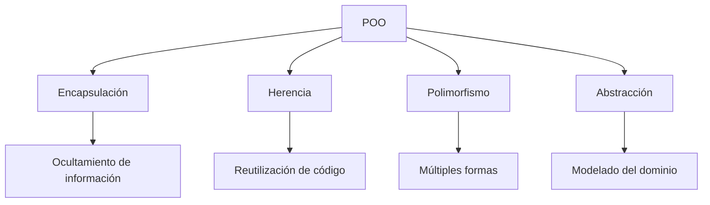
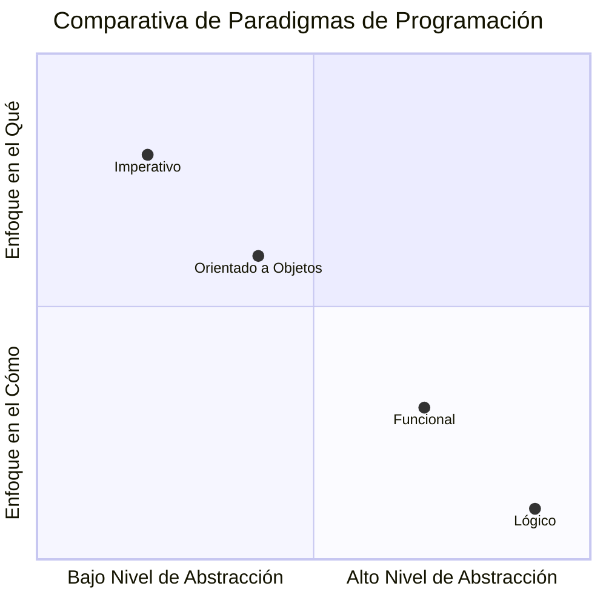

# Lenguajes de Programación - Introducción

## 1.2 Breve discusión de los paradigmas clásicos (imperativo, orientado a objetos, funcional, lógico).

---

Los paradigmas de programación representan diferentes enfoques y estilos para la construcción de software. Según Mitchell (2003), "un paradigma de programación es un estilo fundamental de programación computacional que refleja una perspectiva particular sobre lo que significa computar". Comprender estos paradigmas es esencial para seleccionar la herramienta adecuada para cada problema.

### Paradigma Imperativo

#### Definición

El paradigma imperativo describe la computación como una secuencia de comandos que cambian el estado del programa. Se basa en el **modelo de von Neumann** y utiliza asignaciones destructivas.

#### Características Principales

- Énfasis en **cómo** se realiza el cómputo
- Uso de variables, asignaciones y estructuras de control
- Efectos secundarios como mecanismo primario
- Secuencialidad explícita

#### Ejemplo en C

```c
#include <stdio.h>

int main() {
    int suma = 0;

    // Bucle imperativo
    for (int i = 1; i <= 10; i++) {
        suma += i;  // Asignación destructiva
    }

    printf("La suma es: %d\n", suma);
    return 0;
}
```

#### Base Matemática

El paradigma imperativo se relaciona con las **máquinas de estado** donde:
$$ S' = f(S, I) $$
Donde $S$ es el estado actual, $I$ es la entrada y $S'$ es el nuevo estado.

### Paradigma Orientado a Objetos

#### Definición

El paradigma orientado a objetos organiza el software alrededor de **objetos** que encapsulan datos y comportamiento. Pierce (2002) señala que "la programación orientada a objetos se caracteriza por la encapsulación, herencia y polimorfismo".

#### Principios Fundamentales



#### Ejemplo en Java

```java
// Abstracción mediante clase
public class Animal {
    // Encapsulación mediante atributos privados
    private String nombre;

    public Animal(String nombre) {
        this.nombre = nombre;
    }

    // Polimorfismo mediante método que puede ser sobrescrito
    public void hacerSonido() {
        System.out.println("Sonido genérico");
    }
}

// Herencia mediante extensión
public class Perro extends Animal {
    public Perro(String nombre) {
        super(nombre);
    }

    // Polimorfismo: sobrescritura del método
    @Override
    public void hacerSonido() {
        System.out.println("Guau guau");
    }
}
```

### Paradigma Funcional

#### Definición

El paradigma funcional trata la computación como la evaluación de funciones matemáticas, evitando estados mutables y datos mutables. Se basa en el **cálculo lambda** $(\lambda\text{-cálculo})$ formalizado por Alonzo Church.

#### Conceptos Clave

- **Funciones de primera clase**: Las funciones pueden tratarse como valores
- **Inmutabilidad**: Los datos no se modifican después de su creación
- **Transparencia referencial**: Mismas entradas siempre producen mismas salidas
- **Recursión** en lugar de iteración

#### Base Formal: λ-Cálculo

$$ (\lambda x. x + 1) 5 \rightarrow 5 + 1 \rightarrow 6 $$

$$ (\lambda f. \lambda x. f(f(x))) (\lambda y. y + 1) 5 \rightarrow 7 $$

#### Ejemplo en Haskell

```haskell
-- Función pura sin efectos secundarios
factorial :: Integer -> Integer
factorial 0 = 1  -- Caso base
factorial n = n * factorial (n - 1)  -- Recursión

-- Función de orden superior
mapCuadrados :: [Integer] -> [Integer]
mapCuadrados = map (^2)  -- (^2) es función anónima λx.x²

-- Ejemplo de uso
resultado = mapCuadrados [1, 2, 3, 4]  -- Devuelve [1, 4, 9, 16]
```

#### Sistema de Tipos

Los lenguajes funcionales suelen tener sistemas de tipos fuertes. La inferencia de tipos permite:

$$ \text{map} : (a \rightarrow b) \rightarrow [a] \rightarrow [b] $$

Esto indica que `map` toma una función de `a` a `b` y una lista de `a`, devolviendo una lista de `b`.

### Paradigma Lógico

#### Definición

El paradigma lógico se basa en la **lógica formal** y describe relaciones entre entidades rather than computational steps. El programa consiste en un conjunto de axiomas y reglas de inferencia.

#### Conceptos Fundamentales

- **Hechos**: Afirmaciones sobre relaciones
- **Reglas**: Implicaciones lógicas
- **Consultas**: Preguntas sobre las relaciones
- **Unificación**: Proceso de matching de patrones

#### Ejemplo en Prolog

```prolog
% Hechos: definen relaciones básicas
padre(juan, maria).
padre(juan, carlos).
padre(pedro, juan).

% Reglas: definen relaciones complejas
abuelo(X, Y) :- padre(X, Z), padre(Z, Y).
hermano(X, Y) :- padre(Z, X), padre(Z, Y), X \= Y.

% Consulta: ¿Quién es el abuelo de maria?
% ?- abuelo(Abuelo, maria).
% Resultado: Abuelo = pedro
```

#### Base Formal

El paradigma lógico se basa en la **lógica de primer orden**:

$$ \forall X \forall Y (\text{padre}(X, Y) \rightarrow \text{descendiente}(Y, X)) $$

$$ \exists X (\text{padre}(\text{juan}, X) \land \text{sexo}(X, \text{femenino})) $$

### Comparativa de Paradigmas



### Ejercicios Propuestos

1. **Conversión entre paradigmas**:
   - Implemente el cálculo del factorial en los cuatro paradigmas
   - Compare las soluciones analizando ventajas y desventajas de cada enfoque

2. **Análisis de código**:
   - Dado un programa en un paradigma, reescríbalo en otro paradigma
   - Analice cómo cambian la estructura y los conceptos fundamentales

3. **Problema de modelado**:
   - Diseñe una solución para un sistema de reservas de hotel usando:
     a) Paradigma imperativo
     b) Paradigma orientado a objetos
     c) Paradigma funcional
     d) Paradigma lógico

4. **Análisis formal**:
   - Para el siguiente código Haskell, derive su tipo mediante inferencia:

   ```haskell
   misterio f g x = g (f x)
   ```

5. **Unificación en lógica**:
   - Dadas las siguientes expresiones en Prolog, determine si unifican y con qué sustitución:
   ```prolog
   p(f(X, Y), a) y p(Z, a)
   p(f(X, Y), g(Z)) y p(f(a, b), W)
   ```

### Evaluación de Paradigmas

| Paradigma           | Fortalezas                            | Debilidades                                          | Aplicaciones Típicas                 |
| ------------------- | ------------------------------------- | ---------------------------------------------------- | ------------------------------------ |
| Imperativo          | Alto rendimiento, control detallado   | Complejidad en grandes sistemas, efectos secundarios | Sistemas embebidos, drivers          |
| Orientado a Objetos | Modelado natural, reutilización       | Overhead, complejidad accidental                     | Sistemas empresariales, UI           |
| Funcional           | Confiabilidad, paralelismo            | Curva de aprendizaje, rendimiento                    | Procesamiento de datos, compiladores |
| Lógico              | Expresividad, razonamiento automático | Ineficiencia, aplicabilidad limitada                 | Sistemas expertos, IA                |

### Referencias

#### Bibliografía Básica

1. Mitchell J., Concepts in Programming Languages. Cambridge University Press 2003. (Capítulos 1, 2, 5)
2. Pierce B.C., Types and Programming Languages. MIT Press 2002. (Capítulos 1, 9, 10)

#### Bibliografía Complementaria

1. Harper R., Practical Foundations for Programming Languages. (Capítulos 1, 2, 9)
2. Friedman D. P., Wand M., Essentials of Programming Languages. 3rd edition. MIT Press, 2008. (Capítulos 1-4)

#### Recursos Adicionales

- [Paradigms of Artificial Intelligence Programming](https://github.com/norvig/paip-lisp)
- [Learn Prolog Now!](http://www.learnprolognow.org/)
- [Haskell Programming](http://haskellbook.com/)

### Conclusión

Los paradigmas clásicos de programación ofrecen diferentes perspectivas para resolver problemas computacionales. Según Krishnamurthi (2007), "la maestría en programación no consiste en conocer un lenguaje, sino en comprender múltiples paradigmas y saber aplicar el apropiado para cada problema". El programador moderno debe ser multiparadigmático, seleccionando las mejores ideas de cada enfoque según las necesidades del proyecto.
