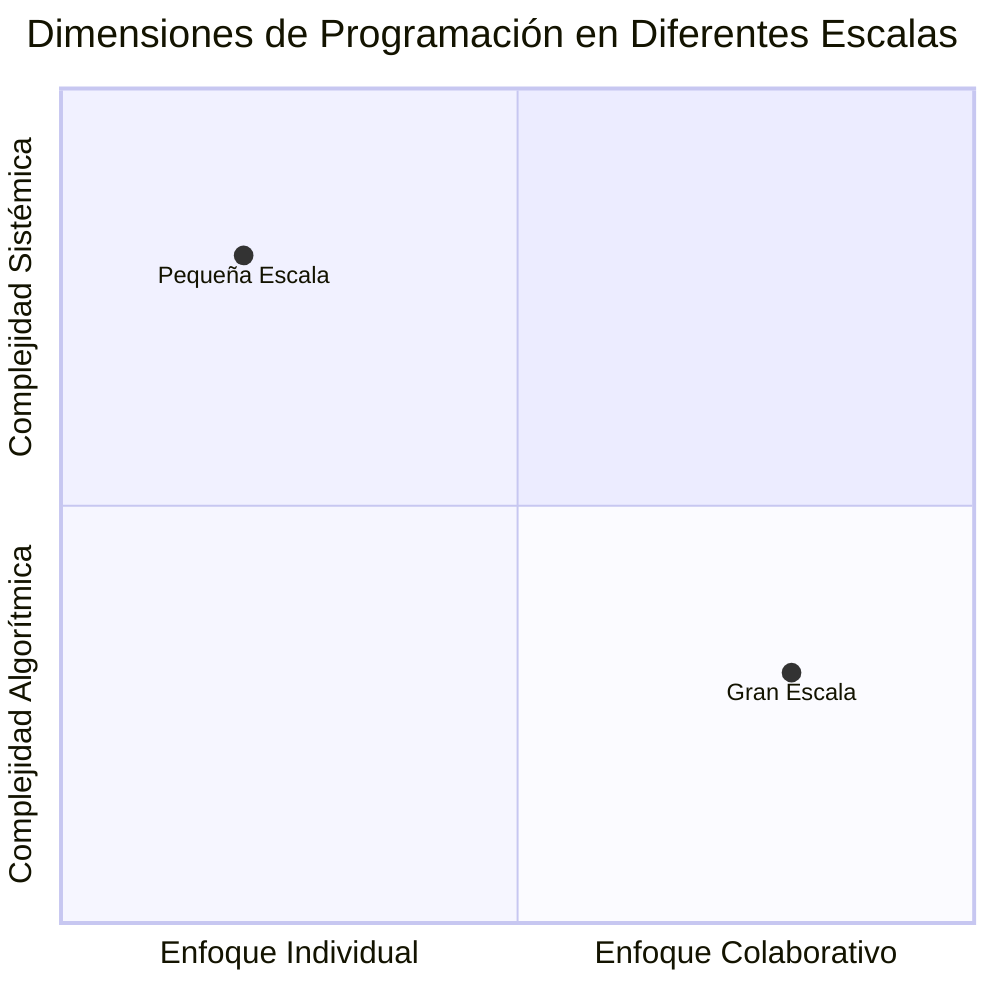
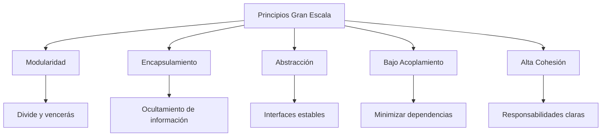
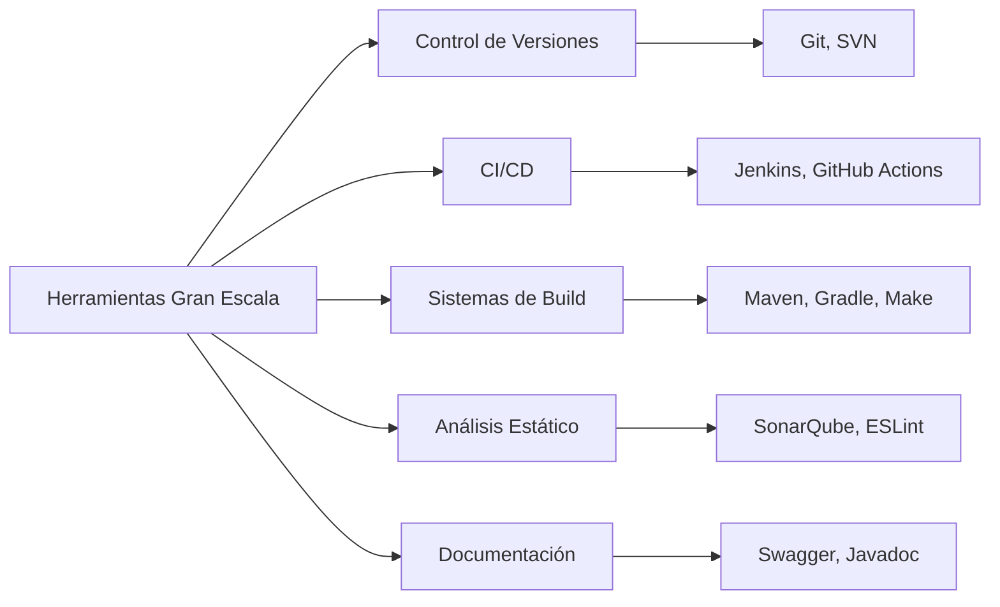
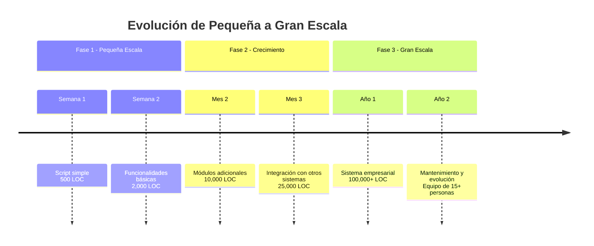

# Lenguajes de Programación - Introducción

## 1.3 Programación en pequeña y gran escala.

---

La distinción entre programación en pequeña y gran escala es fundamental para comprender cómo los lenguajes de programación y sus características responden a diferentes necesidades de desarrollo. Según Mitchell (2003), "la programación a pequeña escala se centra en la corrección algorítmica, mientras que la programación a gran escala aborda desafíos de mantenibilidad, escalabilidad y trabajo en equipo".

### Definiciones Fundamentales

#### Programación en Pequeña Escala

Se refiere al desarrollo de programas o componentes individuales donde el enfoque principal está en la **correctitud algorítmica**, eficiencia y solución de problemas específicos. Generalmente involucra:

- Programas de hasta 10,000 líneas de código
- Desarrollados por individuos o equipos muy pequeños
- Ciclos de desarrollo cortos
- Énfasis en algoritmos y estructuras de datos

#### Programación en Gran Escala

Implica el desarrollo de sistemas complejos que requieren **coordinación de múltiples componentes y desarrolladores**. Se caracteriza por:

- Sistemas de 100,000+ líneas de código
- Múltiples equipos de desarrollo
- Largos ciclos de vida
- Énfasis en arquitectura, mantenibilidad y colaboración

### Diferencias Clave



### Características de la Programación en Pequeña Escala

#### Enfoque en Correctitud Algorítmica

El énfasis está en garantizar que los algoritmos funcionen correctamente según su especificación formal.

**Ejemplo: Algoritmo de ordenamiento rápido en Python**

```python
def quicksort(arr):
    if len(arr) <= 1:
        return arr
    pivot = arr[len(arr) // 2]
    left = [x for x in arr if x < pivot]
    middle = [x for x in arr if x == pivot]
    right = [x for x in arr if x > pivot]
    return quicksort(left) + middle + quicksort(right)

# Complejidad: O(n log n) en caso promedio
```

#### Verificación Formal

En pequeña escala, podemos usar técnicas formales para verificar la correctitud:

$$ \forall \text{input } I, \text{ output } O = P(I) \Rightarrow \text{Spec}(I, O) $$

#### Medidas de Calidad en Pequeña Escala

- **Correctitud**: ¿El programa hace lo que debe hacer?
- **Eficiencia**: Complejidad temporal y espacial
- **Legibilidad**: Claridad del código para el autor

### Características de la Programación en Gran Escala

#### Gestión de Complejidad

La complejidad surge de las interacciones entre componentes. La ley de Conway establece:

$$ \text{Estructura del software} \approx \text{Estructura organizacional} $$

#### Principios de Diseño



#### Patrones Arquitectónicos

**Ejemplo: Patrón Repository en TypeScript**

```typescript
// Interfaz estable para persistencia
interface UserRepository {
  findById(id: string): Promise<User | null>;
  save(user: User): Promise<void>;
  delete(id: string): Promise<boolean>;
}

// Implementación concreta
class DatabaseUserRepository implements UserRepository {
  async findById(id: string): Promise<User | null> {
    // Implementación específica de base de datos
  }

  async save(user: User): Promise<void> {
    // Implementación específica de base de datos
  }

  async delete(id: string): Promise<boolean> {
    // Implementación específica de base de datos
  }
}

// Servicio que usa el repositorio (bajo acoplamiento)
class UserService {
  constructor(private userRepository: UserRepository) {}

  async getUser(id: string): Promise<User> {
    const user = await this.userRepository.findById(id);
    if (!user) {
      throw new Error('User not found');
    }
    return user;
  }
}
```

### Métricas y Medidas

#### Métricas para Pequeña Escala

- **Complejidad ciclomática**: $ V(G) = E - N + 2P $
  Donde $E$ es aristas, $N$ es nodos, $P$ es componentes conexos
- **Líneas de código**: Medida básica de tamaño
- **Complejidad algorítmica**: Notación O-grande

#### Métricas para Gran Escala

- **Acoplamiento**: Número de dependencias entre módulos
- **Cohesión**: Grado en que los elementos de un módulo pertenecen juntos
- **Deuda técnica**: Costo de rework necesario por atajos tomados

### Sistemas de Tipos y Escala

#### Pequeña Escala: Tipos para Correctitud

```haskell
-- Sistema de tipos fuerte ayuda a prevenir errores
data BinaryTree a = Empty | Node a (BinaryTree a) (BinaryTree a)

insert :: Ord a => a -> BinaryTree a -> BinaryTree a
insert x Empty = Node x Empty Empty
insert x (Node y left right)
    | x < y     = Node y (insert x left) right
    | x > y     = Node y left (insert x right)
    | otherwise = Node y left right
```

#### Gran Escala: Tipos para Arquitectura

Los sistemas de tipos modernos ayudan a mantener la consistencia en grandes codebases:

$$ \text{Type Safety} = \frac{\text{Errors caught at compile time}}{\text{Total possible errors}} \times 100\% $$

**Ejemplo: Tipos dependientes en investigación** (Pierce, 2002)

```idris
-- Tipo que garantiza longitud de vector
data Vect : Nat -> Type -> Type where
    Nil : Vect 0 a
    Cons : a -> Vect n a -> Vect (S n) a

-- Función type-safe para concatenar
append : Vect n a -> Vect m a -> Vect (n + m) a
append Nil ys = ys
append (Cons x xs) ys = Cons x (append xs ys)
```

### Herramientas y Prácticas

#### Pequeña Escala

- Depuradores
- Profilers
- Testing unitario

#### Gran Escala



### Ejercicios Propuestos

1. **Análisis de complejidad**:
   - Dado un algoritmo de ordenamiento, calcule su complejidad temporal y espacial
   - Compare implementaciones iterativas vs recursivas

2. **Diseño modular**:
   - Diseñe un sistema de reservas de hotel identificando módulos, interfaces y dependencias
   - Estime el acoplamiento y cohesión de su diseño

3. **Refactorización**:
   - Tome un programa monolítico y refactorícelo hacia una arquitectura modular
   - Justifique las decisiones de diseño tomadas

4. **Análisis de métricas**:
   - Calcule la complejidad ciclomática de varias funciones
   - Compare programas con alta vs baja complejidad ciclomática

5. **Gestión de dependencias**:
   - Dado un conjunto de módulos con dependencias, identifique cycles y proponga soluciones
   - Aplique el principio de inversión de dependencias (DIP)

### Estudio de Caso: Evolución de un Sistema



### Referencias

#### Bibliografía Básica

1. Mitchell J., Concepts in Programming Languages. Cambridge University Press 2003. (Capítulos 1, 9)
2. Pierce B.C., Types and Programming Languages. MIT Press 2002. (Capítulos 1, 2, 20)

#### Bibliografía Complementaria

1. Harper R., Practical Foundations for Programming Languages. (Capítulos 1, 2, 43)
2. Friedman D. P., Wand M., Essentials of Programming Languages. 3rd edition. MIT Press, 2008. (Capítulos 8, 9)

#### Recursos Adicionales

- [Code Complete: A Practical Handbook of Software Construction](https://www.stevemcconnell.com/cc/)
- [Design Patterns: Elements of Reusable Object-Oriented Software](https://en.wikipedia.org/wiki/Design_Patterns)
- [The Mythical Man-Month: Essays on Software Engineering](https://en.wikipedia.org/wiki/The_Mythical_Man-Month)

### Conclusión

La distinción entre programación en pequeña y gran escala es crucial para seleccionar las herramientas, técnicas y paradigmas apropiados. Según Mitchell (2003), "los lenguajes de programación exitosos proporcionan características que apoyan ambos modos de desarrollo, reconociendo que los programas crecen y evolucionan con el tiempo".

El programador moderno debe dominar tanto las técnicas de pequeña escala (algoritmos, estructuras de datos, correctitud) como las de gran escala (arquitectura, modularidad, colaboración), entendiendo cuándo aplicar cada conjunto de principios según el contexto del proyecto.
