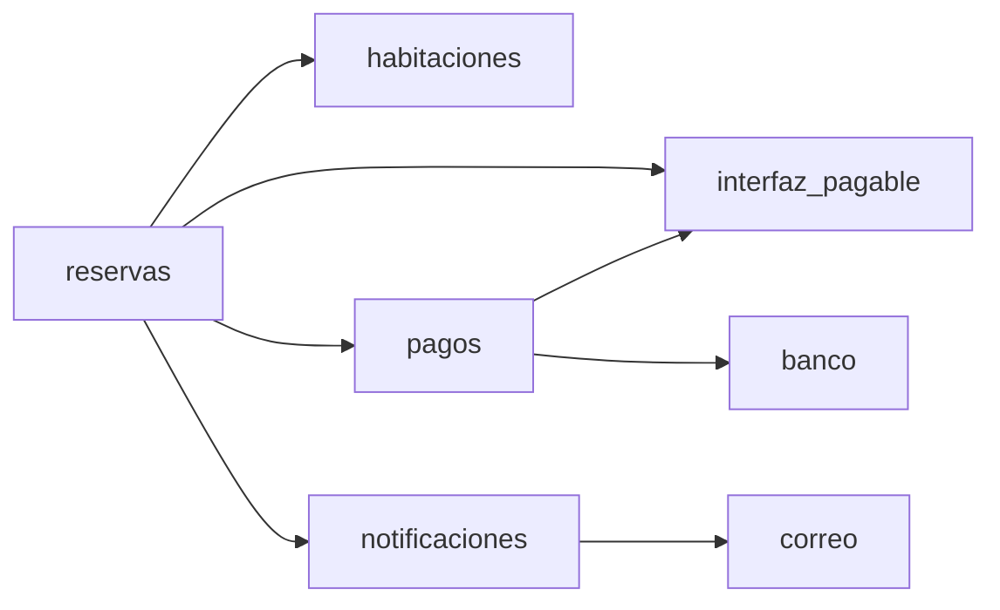

# Lenguajes de Programación - Introducción

## 1.3 Programación en pequeña y gran escala.

---

DeRemer y Kron distinguieron en 1975 la **programación en pequeña escala** (*programming in the small*), que consiste en escribir módulos individuales, de la **programación en gran escala** (*programming in the large*), que consiste en organizar muchos módulos, escritos por muchas personas a lo largo de años, en un sistema. Los problemas de una y otra son distintos: en la pequeña escala importan la corrección y la eficiencia de los algoritmos; en la gran escala, las interfaces, las dependencias, la evolución y la coordinación entre personas. Los lenguajes ofrecen mecanismos para ambas: tipos, funciones y estructuras de control para la primera, módulos, interfaces, paquetes y sistemas de construcción para la segunda. Este tema compara las dos escalas, sus métricas y los mecanismos de los lenguajes que las sostienen.

### Pequeña escala

En un módulo, la pregunta central es si cada función cumple su **especificación**: para toda entrada que satisface la precondición, el resultado satisface la poscondición. Las herramientas son:

- **Análisis de algoritmos:** el número de operaciones y la memoria en función del tamaño de la entrada, en notación asintótica.
- **Razonamiento formal:** invariantes de ciclo, inducción, lógica de Hoare (tema 2.3); para código crítico, verificadores como Dafny o asistentes de prueba como Coq.
- **Pruebas unitarias** y pruebas basadas en propiedades, que generan entradas aleatorias y verifican una propiedad, como que ordenar dos veces da lo mismo que ordenar una.
- **Legibilidad:** nombres, funciones cortas, baja complejidad ciclomática.

Los mecanismos del lenguaje que ayudan son los **tipos**, que descartan errores antes de ejecutar; las **abstracciones de control**, como iteradores y funciones de orden superior, y la **inmutabilidad**, que hace local el razonamiento.

### Gran escala

En un sistema, el problema principal es la **complejidad**: ninguna persona conoce todo el código, y cada cambio puede afectar partes lejanas. Las herramientas son las de la ingeniería de software, y los principios centrales son:

- **Ocultamiento de información** (Parnas, 1972): cada módulo esconde una decisión de diseño que puede cambiar detrás de una interfaz estable. La partición correcta es por decisiones que pueden cambiar, no por pasos del procesamiento.
- **Alta cohesión y bajo acoplamiento:** cada módulo hace una cosa, y depende de pocos otros, a través de interfaces pequeñas.
- **Dependencias acíclicas:** si A depende de B y B de A, no se pueden entender, probar ni publicar por separado.
- **Inversión de dependencias:** los módulos de alto nivel no dependen de los de bajo nivel; ambos dependen de abstracciones.
- **Ley de Conway** (1968): la estructura de un sistema tiende a reproducir la estructura de comunicación de la organización que lo construye.

Los mecanismos del lenguaje son los **módulos** y **paquetes** con control de visibilidad, las **interfaces** y los tipos abstractos, la **compilación separada**, los **genéricos**, que permiten reutilizar sin acoplar, y, alrededor del lenguaje, los gestores de paquetes con versiones semánticas, los sistemas de construcción y la integración continua.

| Aspecto              | Pequeña escala                          | Gran escala                                        |
| -------------------- | --------------------------------------- | -------------------------------------------------- |
| Unidad               | Función, clase                          | Módulo, paquete, servicio                          |
| Pregunta central     | ¿Es correcto y eficiente?               | ¿Se puede entender, cambiar y desplegar?           |
| Riesgo principal     | Error lógico                            | Acoplamiento, cambios que se propagan              |
| Métricas             | Complejidad asintótica, ciclomática     | Acoplamiento, inestabilidad, ciclos, tiempo de construcción |
| Herramientas         | Tipos, pruebas unitarias, verificación  | Interfaces, versiones, pruebas de integración, revisión |
| Personas             | Una o pocas                             | Muchos equipos durante años                        |

### Métricas

**Complejidad ciclomática** (McCabe, 1976): para el grafo de flujo de control de una función, $M = E - N + 2,$ con $E$ aristas y $N$ nodos; para código estructurado equivale al número de decisiones más uno, contando cada `if`, ciclo, caso y operador `and` u `or`. Es el número de caminos independientes, y por lo tanto el mínimo de casos de prueba para cubrir todas las ramas. Valores por encima de 10 suelen señalar una función que conviene dividir.

**Acoplamiento de un módulo** (Martin, 2002): el **acoplamiento aferente** $C_a$ es el número de módulos que dependen de él, el **eferente** $C_e$ el número de módulos de los que depende, y la **inestabilidad**

$$I = \frac{C_e}{C_a + C_e} \in [0, 1].$$

Un módulo con $I = 0$ es estable: muchos dependen de él y él de nadie, así que cambiarlo es caro y debe ser abstracto. Con $I = 1$ es inestable: nadie depende de él y se puede cambiar libremente. El **principio de dependencias estables** pide que las dependencias vayan de lo inestable a lo estable.



### Implementación en Python

El programa cuenta las comparaciones de un ordenamiento por inserción y de dos versiones del ordenamiento por mezcla, recursiva e iterativa, para el ejercicio 1. Para el ejercicio 4 calcula la complejidad ciclomática de funciones leyendo su árbol sintáctico con el módulo `ast`; las funciones son una tarifa de hotel escrita de forma monolítica y su versión dividida en funciones pequeñas, y para el ejercicio 3 comprueba en 96 casos que ambas calculan lo mismo. Para el ejercicio 5 detecta ciclos de dependencias con el algoritmo de Tarjan y los elimina con inversión de dependencias; para el ejercicio 2 calcula el acoplamiento y la inestabilidad de cada módulo.

```python
import ast, random, textwrap
from collections import defaultdict

# --- Ejercicio 1: costo medido de dos ordenamientos, iterativo y recursivo ---
def insercion(a):
    a, comps = list(a), 0
    for i in range(1, len(a)):
        x, j = a[i], i - 1
        while j >= 0:
            comps += 1
            if a[j] <= x: break
            a[j + 1] = a[j]; j -= 1
        a[j + 1] = x
    return a, comps
def mezcla(a, prof=0):
    if len(a) <= 1: return list(a), 0, prof
    m = len(a) // 2
    izq, ci, pi = mezcla(a[:m], prof + 1); der, cd, pd = mezcla(a[m:], prof + 1)
    out, c, i, j = [], ci + cd, 0, 0
    while i < len(izq) and j < len(der):
        c += 1
        if izq[i] <= der[j]: out.append(izq[i]); i += 1
        else: out.append(der[j]); j += 1
    return out + izq[i:] + der[j:], c, max(pi, pd)
def mezcla_iterativa(a):                     # de abajo hacia arriba: sin recursión
    a, c, ancho = list(a), 0, 1
    while ancho < len(a):
        nuevo = []
        for k in range(0, len(a), 2 * ancho):
            izq, der, i, j = a[k:k + ancho], a[k + ancho:k + 2 * ancho], 0, 0
            while i < len(izq) and j < len(der):
                c += 1
                if izq[i] <= der[j]: nuevo.append(izq[i]); i += 1
                else: nuevo.append(der[j]); j += 1
            nuevo += izq[i:] + der[j:]
        a, ancho = nuevo, ancho * 2
    return a, c
rng = random.Random(5413)
print("ejercicio 1, comparaciones con datos aleatorios:")
for n in (100, 1000, 4000):
    datos = [rng.random() for _ in range(n)]
    (s1, c1), (s2, c2, prof), (s3, c3) = insercion(datos), mezcla(datos), mezcla_iterativa(datos)
    assert s1 == s2 == s3 == sorted(datos)
    print(f"   n = {n:5}: inserción {c1:8} (n²/4 = {n * n // 4:8}) | mezcla recursiva {c2:6}, profundidad {prof:2} | iterativa {c3:6}")

# --- Ejercicio 4: complejidad ciclomática, M = decisiones + 1, calculada sobre el árbol sintáctico ---
def ciclomatica(fuente):
    arbol = ast.parse(textwrap.dedent(fuente))
    out = {}
    for f in ast.walk(arbol):
        if isinstance(f, ast.FunctionDef):
            d = 0
            for n in ast.walk(f):
                if isinstance(n, (ast.If, ast.For, ast.While, ast.IfExp, ast.ExceptHandler, ast.comprehension)): d += 1
                elif isinstance(n, ast.BoolOp): d += len(n.values) - 1           # cada and / or es una decisión
                elif isinstance(n, ast.match_case): d += 1
            out[f.name] = d + 1
    return out
fuente = '''
def tarifa_monolitica(tipo, noches, temporada, cliente_frecuente, codigo):
    if tipo == "sencilla":
        base = 900
    elif tipo == "doble":
        base = 1300
    elif tipo == "suite":
        base = 2500
    else:
        raise ValueError(tipo)
    total = base * noches
    if temporada == "alta" and noches < 3:
        total *= 1.25
    elif temporada == "alta":
        total *= 1.15
    if cliente_frecuente or codigo == "PROMO10":
        total *= 0.9
    if noches > 7:
        total -= 500
    return round(total, 2)

TARIFAS = {"sencilla": 900, "doble": 1300, "suite": 2500}
def base(tipo):
    if tipo not in TARIFAS:
        raise ValueError(tipo)
    return TARIFAS[tipo]
def recargo(temporada, noches):
    if temporada != "alta":
        return 1.0
    return 1.25 if noches < 3 else 1.15
def descuento(cliente_frecuente, codigo):
    return 0.9 if cliente_frecuente or codigo == "PROMO10" else 1.0
def ajuste_estancia_larga(noches):
    return -500 if noches > 7 else 0
def tarifa(tipo, noches, temporada, cliente_frecuente, codigo):
    total = base(tipo) * noches * recargo(temporada, noches) * descuento(cliente_frecuente, codigo)
    return round(total + ajuste_estancia_larga(noches), 2)
'''
print("ejercicio 4, complejidad ciclomática:", ciclomatica(fuente))

# --- Ejercicio 3: la refactorización conserva el comportamiento ---
espacio = {}; exec(fuente, espacio)
casos = [(t, n, s, f, c) for t in ("sencilla", "doble", "suite") for n in (1, 2, 3, 8) for s in ("alta", "baja")
         for f in (False, True) for c in ("", "PROMO10")]
print("ejercicio 3:", len(casos), "casos; misma tarifa en todos:",
      all(espacio["tarifa_monolitica"](*c) == espacio["tarifa"](*c) for c in casos))

# --- Ejercicio 5: ciclos de dependencias (componentes fuertemente conexas de Tarjan) ---
def tarjan(g):
    indice, bajo, pila, en_pila, comps, k = {}, {}, [], set(), [], [0]
    def visita(v):
        indice[v] = bajo[v] = k[0]; k[0] += 1; pila.append(v); en_pila.add(v)
        for w in g.get(v, []):
            if w not in indice: visita(w); bajo[v] = min(bajo[v], bajo[w])
            elif w in en_pila: bajo[v] = min(bajo[v], indice[w])
        if bajo[v] == indice[v]:
            c = []
            while True:
                w = pila.pop(); en_pila.discard(w); c.append(w)
                if w == v: break
            comps.append(sorted(c))
    for v in sorted(g):
        if v not in indice: visita(v)
    return [c for c in comps if len(c) > 1]
modulos = {"reservas": ["habitaciones", "pagos", "notificaciones"], "pagos": ["reservas", "banco"],
           "notificaciones": ["correo"], "habitaciones": [], "banco": [], "correo": []}
print("ejercicio 5: ciclos:", tarjan(modulos))
# inversión de dependencias: pagos ya no conoce a reservas, sino una interfaz que reservas implementa
modulos_dip = {"reservas": ["habitaciones", "pagos", "notificaciones", "interfaz_pagable"], "pagos": ["interfaz_pagable", "banco"],
               "interfaz_pagable": [], "notificaciones": ["correo"], "habitaciones": [], "banco": [], "correo": []}
print("   tras aplicar DIP:", tarjan(modulos_dip) or "sin ciclos")

# --- Ejercicio 2: acoplamiento de cada módulo. Inestabilidad I = Ce / (Ca + Ce) ---
def metricas(g):
    ca = defaultdict(int)
    for v, ds in g.items():
        for d in ds: ca[d] += 1
    return {v: (ca[v], len(ds), round(len(ds) / (ca[v] + len(ds)), 2) if ca[v] + len(ds) else 0.0) for v, ds in sorted(g.items())}
print("ejercicio 2, (aferente, eferente, inestabilidad):", metricas(modulos_dip))
```

Salida:

```text
ejercicio 1, comparaciones con datos aleatorios:
   n =   100: inserción     2554 (n²/4 =     2500) | mezcla recursiva    539, profundidad  7 | iterativa    545
   n =  1000: inserción   245606 (n²/4 =   250000) | mezcla recursiva   8723, profundidad 10 | iterativa   8702
   n =  4000: inserción  3984361 (n²/4 =  4000000) | mezcla recursiva  42884, profundidad 12 | iterativa  42969
ejercicio 4, complejidad ciclomática: {'tarifa_monolitica': 10, 'base': 2, 'recargo': 3, 'descuento': 3, 'ajuste_estancia_larga': 2, 'tarifa': 1}
ejercicio 3: 96 casos; misma tarifa en todos: True
ejercicio 5: ciclos: [['pagos', 'reservas']]
   tras aplicar DIP: sin ciclos
ejercicio 2, (aferente, eferente, inestabilidad): {'banco': (1, 0, 0.0), 'correo': (1, 0, 0.0), 'habitaciones': (1, 0, 0.0), 'interfaz_pagable': (2, 0, 0.0), 'notificaciones': (1, 1, 0.5), 'pagos': (1, 2, 0.67), 'reservas': (0, 4, 1.0)}
```

### Ejercicios Propuestos

1. **Complejidad.** Calcula la complejidad temporal y espacial de un algoritmo de ordenamiento y compara una implementación iterativa con una recursiva.

2. **Diseño modular.** Diseña un sistema de reservas de hotel con sus módulos, interfaces y dependencias, y estima su acoplamiento y cohesión.

3. **Refactorización.** Toma un programa monolítico, refactorízalo hacia una estructura modular y justifica las decisiones.

4. **Complejidad ciclomática.** Calcula la complejidad ciclomática de varias funciones y compara programas con complejidad alta y baja.

5. **Dependencias.** Dado un conjunto de módulos con dependencias, identifica los ciclos, propón soluciones y aplica el principio de inversión de dependencias.

### Soluciones

**Ejercicio 1.** El ordenamiento por **inserción** hace en promedio unas $n^2/4$ comparaciones, porque cada elemento se desplaza, en promedio, sobre la mitad de los anteriores; el programa lo confirma: 245,606 comparaciones para $n = 1000,$ contra $250{,}000$ estimadas. Usa memoria $O(1)$ adicional. El ordenamiento por **mezcla** hace $O(n \log n)$ comparaciones, a lo más $n \lceil \log_2 n \rceil:$ 8723 para $n = 1000.$ La versión **recursiva** divide a la mitad hasta llegar a listas de un elemento, con una profundidad de recursión de $\lceil \log_2 n \rceil,$ 10 para $n = 1000,$ y usa $O(n)$ de memoria para las mezclas más $O(\log n)$ de pila. La **iterativa**, de abajo hacia arriba, mezcla sublistas de tamaño 1, 2, 4, y así sucesivamente: hace prácticamente las mismas comparaciones, porque las particiones difieren solo cuando $n$ no es potencia de 2, y no usa pila. La recursiva es más fácil de escribir y demostrar correcta por inducción; la iterativa evita el límite de profundidad de la pila, que en Python es de unas 1000 llamadas.

**Ejercicio 2.** Módulos: `habitaciones` (inventario y tarifas), `reservas` (disponibilidad y ciclo de vida de una reserva), `pagos` (cobro y reembolso), `notificaciones` (avisos al huésped), y adaptadores para los servicios externos, `banco` y `correo`. Interfaces: `reservas` ofrece `reservar`, `cancelar` y `consultar`; `pagos` ofrece `cobrar(importe, referencia)` y `reembolsar`; `notificaciones` ofrece `avisar(huésped, mensaje)`. Cada módulo tiene **cohesión funcional**: todo lo que contiene sirve a una responsabilidad. El programa calcula las métricas del diseño final: `reservas` tiene inestabilidad 1, porque coordina a los demás y nadie depende de él, que es lo adecuado para la lógica de aplicación, que cambia mucho; `interfaz_pagable`, `habitaciones`, `banco` y `correo` tienen inestabilidad 0, y deberían ser los más estables y abstractos.

**Ejercicio 3.** La función `tarifa_monolitica` mezcla cuatro decisiones de negocio: la tarifa por tipo de habitación, el recargo por temporada, el descuento y el ajuste por estancia larga. La refactorización separa cada decisión en una función con nombre, y la tabla de tarifas en un diccionario, que se puede leer de una configuración sin cambiar el código. Cada parte se prueba por separado, y una nueva promoción solo modifica `descuento`. La justificación es el ocultamiento de información: cada función encapsula una decisión que puede cambiar independientemente. El programa comprueba en 96 combinaciones de entradas que ambas versiones dan exactamente la misma tarifa: una refactorización no debe cambiar el comportamiento, y las pruebas son lo que lo garantiza.

**Ejercicio 4.** La versión monolítica tiene complejidad 10: nueve decisiones, contando las ramas `elif` y los operadores `and` y `or`, más uno. Para cubrir todas sus ramas hacen falta al menos 10 casos de prueba, y entenderla exige seguir las combinaciones. En la versión modular, ninguna función pasa de 3, y la función principal tiene complejidad 1: es una sola expresión. La complejidad total no desaparece, porque las decisiones siguen existiendo, pero se reparte en piezas que se entienden y prueban por separado. Las funciones con complejidad alta concentran la mayor parte de los defectos en los estudios empíricos.

**Ejercicio 5.** En el diseño original, `reservas` depende de `pagos` para cobrar, y `pagos` depende de `reservas` para consultar el importe y marcar la reserva como pagada: el algoritmo de Tarjan encuentra el ciclo `{pagos, reservas}`. Con él, no se puede probar `pagos` sin `reservas`, ni reutilizarlo para otro producto. Con **inversión de dependencias**, `pagos` define, o usa, una interfaz `interfaz_pagable` con los métodos que necesita, `importe()` y `marcar_pagado()`, y `reservas` la implementa; ahora ambos dependen de la abstracción y el ciclo desaparece. Otras soluciones son mover la parte compartida a un tercer módulo, o reemplazar la llamada de vuelta por un **evento**: `pagos` publica "pago realizado" y `reservas` lo escucha.

### Referencias

1. DeRemer, F., and Kron, H., Programming-in-the-large versus programming-in-the-small. _Proceedings of the International Conference on Reliable Software_, 1975.
2. Parnas, D. L., On the criteria to be used in decomposing systems into modules. _Communications of the ACM_ 15(12), 1972.
3. McCabe, T. J., A complexity measure. _IEEE Transactions on Software Engineering_ SE-2(4), 1976.
4. Martin, R. C., _Agile Software Development: Principles, Patterns, and Practices_. Prentice Hall, 2002.
5. Tarjan, R. E., Depth-first search and linear graph algorithms. _SIAM Journal on Computing_ 1(2), 1972.
