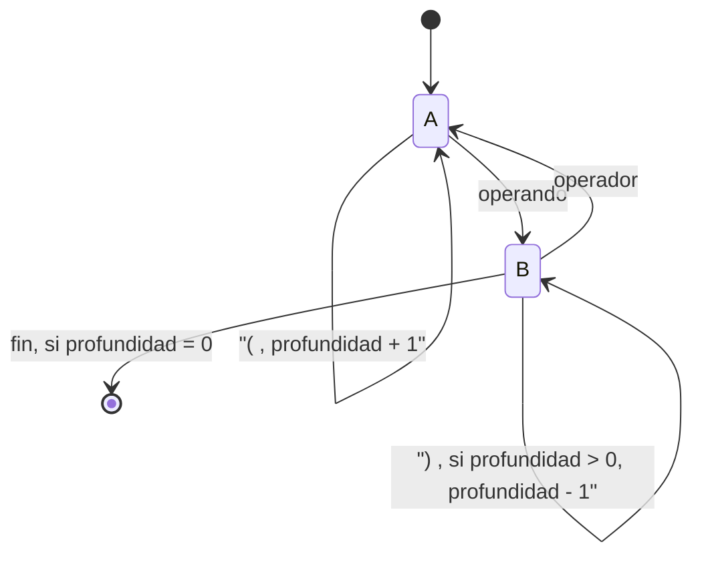

# Lenguajes de Programación - Fundamentos

## 2.1 Herramientas matemáticas: definiciones inductivas; inducción estructural; reglas de inferencia; sistemas de transición.

---

Para estudiar los lenguajes de programación con precisión se usan cuatro herramientas matemáticas que aparecen en todo el resto del curso. Las **definiciones inductivas** describen conjuntos infinitos, como las expresiones de un lenguaje, con un número finito de reglas. La **inducción estructural** demuestra propiedades de todos los elementos de esos conjuntos. Las **reglas de inferencia** definen relaciones, como la que asigna un tipo a cada expresión, mediante derivaciones. Los **sistemas de transición** describen la ejecución como una sucesión de pasos entre configuraciones. Este tema presenta cada herramienta con ejemplos que el programa implementa.

### Definiciones inductivas

Una **definición inductiva** de un conjunto $S$ da un conjunto de **reglas**, unas **básicas**, que afirman que ciertos elementos están en $S,$ y otras **inductivas**, que construyen elementos nuevos de $S$ a partir de otros que ya están. $S$ es el **menor** conjunto cerrado bajo las reglas: contiene exactamente los elementos que se obtienen aplicando las reglas un número finito de veces. Los naturales son el menor conjunto con

$$\frac{}{0 \in \mathbb{N}} \qquad \frac{n \in \mathbb{N}}{\mathsf{suc}(n) \in \mathbb{N}},$$

y las expresiones aritméticas con números y sumas son el menor conjunto con

$$\frac{n \in \mathbb{Z}}{n \in \mathsf{Exp}} \qquad \frac{e_1 \in \mathsf{Exp} \quad e_2 \in \mathsf{Exp}}{e_1 + e_2 \in \mathsf{Exp}}.$$

Que sea el menor conjunto es lo que excluye objetos infinitos o circulares: un término como $1 + (1 + (1 + \dots))$ no está en $\mathsf{Exp},$ porque no se construye en un número finito de pasos. En los lenguajes funcionales, una definición inductiva es una declaración de tipo, como `data Exp = Num Int | Suma Exp Exp`, y una función sobre ella se define por **recursión estructural**: un caso por regla, con llamadas recursivas sobre las partes.

### Inducción estructural

**Principio.** Sea $S$ definido inductivamente y $P$ una propiedad. Si $P$ se cumple para los elementos de las reglas básicas, y para cada regla inductiva se cumple en el elemento construido siempre que se cumpla en sus partes, entonces $P$ se cumple para todo elemento de $S.$

*Justificación.* El conjunto de elementos de $S$ que cumplen $P$ es cerrado bajo las reglas, por las dos hipótesis, y $S$ es el menor conjunto cerrado; por lo tanto, $S$ está contenido en él. $\blacksquare$

La inducción sobre los naturales es el caso particular de $\mathbb{N}.$ Para las expresiones, el principio dice: si $P(n)$ para todo número $n,$ y $P(e_1)$ y $P(e_2)$ implican $P(e_1 + e_2),$ entonces $P(e)$ para toda expresión. Por ejemplo, el número de números de una expresión es uno más que su número de sumas: $\mathsf{nums}(n) = 1 = \mathsf{sumas}(n) + 1,$ y si se cumple para $e_1$ y $e_2,$ entonces

$$\mathsf{nums}(e_1 + e_2) = \mathsf{nums}(e_1) + \mathsf{nums}(e_2) = \mathsf{sumas}(e_1) + \mathsf{sumas}(e_2) + 2 = \mathsf{sumas}(e_1 + e_2) + 1.$$

### Reglas de inferencia

Una **regla de inferencia** tiene premisas sobre la línea y una conclusión debajo; se lee: si las premisas se cumplen, la conclusión también. Una regla sin premisas es un **axioma**. Un **juicio** es una afirmación de la relación que se define, como $\Gamma \vdash e : T,$ que se lee: en el contexto $\Gamma,$ la expresión $e$ tiene tipo $T.$ Una **derivación** es un árbol de reglas cuyas hojas son axiomas y cuya raíz es el juicio derivado; el juicio vale si y solo si tiene una derivación. Las reglas de inferencia son una definición inductiva de una relación, así que se razona sobre ellas por **inducción sobre las derivaciones**. Un sistema de tipos para enteros y sumas:

$$\frac{}{\Gamma \vdash n : \mathsf{Int}}\;\text{T-Num} \qquad \frac{x : T \in \Gamma}{\Gamma \vdash x : T}\;\text{T-Var} \qquad \frac{\Gamma \vdash e_1 : \mathsf{Int} \quad \Gamma \vdash e_2 : \mathsf{Int}}{\Gamma \vdash e_1 + e_2 : \mathsf{Int}}\;\text{T-Suma}$$

### Sistemas de transición

Un **sistema de transición** es un par $(C, \to),$ con un conjunto $C$ de **configuraciones** y una relación $\to \;\subseteq C \times C$ de **pasos**. Algunas configuraciones son **iniciales** y otras **finales**; una **ejecución** es una sucesión $c_0 \to c_1 \to \dots$ que empieza en una inicial. La relación es **determinista** si cada configuración tiene a lo más un sucesor. La clausura reflexiva y transitiva $\to^*$ relaciona una configuración con todas las alcanzables en cero o más pasos.

Los autómatas finitos son sistemas de transición con un número finito de configuraciones; las máquinas de Turing, con configuraciones formadas por el estado, la cinta y la posición. La **semántica operacional** de un lenguaje (tema 2.3) es un sistema de transición cuyas configuraciones son programas, o programas con un estado, y cuyos pasos se definen con reglas de inferencia. Por ejemplo, para las sumas:

$$\frac{e_1 \to e_1'}{e_1 + e_2 \to e_1' + e_2} \qquad \frac{e_2 \to e_2'}{n_1 + e_2 \to n_1 + e_2'} \qquad \frac{n = n_1 + n_2}{n_1 + n_2 \to n}$$



### Implementación en Python

El programa representa las listas de naturales con su definición inductiva, con una lista vacía y un constructor, y define la concatenación y la longitud por recursión estructural. Para el ejercicio 2 comprueba la asociatividad en todas las ternas de listas de hasta tres elementos binarios, una verificación que acompaña a la demostración pero no la sustituye. Para el ejercicio 3 implementa un verificador de tipos para listas que construye e imprime la derivación de cada juicio. Para el ejercicio 4 implementa el sistema de transición del diagrama y lo ejecuta sobre seis cadenas.

```python
from itertools import product

# --- Ejercicio 1: listas de naturales, definidas inductivamente: Nil | Cons(n, l) ---
NIL = ("nil",)
def cons(n, l): return ("cons", n, l)
def desde(py):                                  # de una lista de Python a la representación inductiva
    l = NIL
    for n in reversed(py): l = cons(n, l)
    return l
def es_lista(t):                                # la definición inductiva, como predicado: base y paso
    return t == NIL or (t[0] == "cons" and isinstance(t[1], int) and t[1] >= 0 and es_lista(t[2]))
def concat(a, b):                               # definida por recursión estructural sobre a
    return b if a == NIL else cons(a[1], concat(a[2], b))
def longitud(a): return 0 if a == NIL else 1 + longitud(a[2])
def texto(l): return "[]" if l == NIL else f"{l[1]} :: {texto(l[2])}"
print("ejercicio 1:", texto(desde([3, 1, 4])), "| es lista:", es_lista(desde([3, 1, 4])), es_lista(cons(-1, NIL)), es_lista(cons(2, ("x",))))

# --- Ejercicio 2: asociatividad de concat, comprobada en todas las listas pequeñas (la demostración va en el texto) ---
pequeñas = [desde(list(p)) for k in range(4) for p in product(range(2), repeat=k)]
casos = [(a, b, c) for a in pequeñas for b in pequeñas for c in pequeñas]
print("ejercicio 2:", len(casos), "ternas; (a ++ b) ++ c = a ++ (b ++ c) en todas:",
      all(concat(concat(a, b), c) == concat(a, concat(b, c)) for a, b, c in casos),
      "| y longitud(a ++ b) = longitud(a) + longitud(b):",
      all(longitud(concat(a, b)) == longitud(a) + longitud(b) for a, b, _ in casos))

# --- Ejercicio 3: reglas de inferencia para listas, con la derivación como árbol ---
def tipo(e, amb):
    """Devuelve (tipo, derivación). Reglas: T-Num, T-Var, T-Nil (anotada), T-Cons, T-Concat."""
    k = e[0]
    if k == "num": return "Int", ("T-Num", f"Γ ⊢ {e[1]} : Int", [])
    if k == "bool": return "Bool", ("T-Bool", f"Γ ⊢ {e[1]} : Bool", [])
    if k == "var": return amb[e[1]], ("T-Var", f"Γ ⊢ {e[1]} : {amb[e[1]]}", [])
    if k == "nil": return f"List {e[1]}", ("T-Nil", f"Γ ⊢ [] : List {e[1]}", [])
    if k in ("cons", "concat"):
        t1, d1 = tipo(e[1], amb); t2, d2 = tipo(e[2], amb)
        if k == "cons" and t2 != f"List {t1}": raise TypeError(f"cons: {t1} con {t2}")
        if k == "concat" and (t1 != t2 or not t1.startswith("List")): raise TypeError(f"++: {t1} con {t2}")
        return t2, ("T-Cons" if k == "cons" else "T-Concat", f"Γ ⊢ {mostrar(e)} : {t2}", [d1, d2])
def mostrar(e):
    return {"num": lambda: str(e[1]), "bool": lambda: str(e[1]).lower(), "var": lambda: e[1], "nil": lambda: "[]",
            "cons": lambda: f"{mostrar(e[1])} :: {mostrar(e[2])}", "concat": lambda: f"({mostrar(e[1])}) ++ ({mostrar(e[2])})"}[e[0]]()
def imprime(d, sangria="   "):
    regla, juicio, premisas = d
    for p in premisas: imprime(p, sangria + "  ")
    print(f"{sangria}{juicio}   [{regla}]")
e = ("concat", ("cons", ("num", 1), ("nil", "Int")), ("cons", ("var", "x"), ("cons", ("num", 3), ("nil", "Int"))))
t, d = tipo(e, {"x": "Int"})
print("ejercicio 3:", mostrar(e), ":", t); imprime(d)
for malo in (("cons", ("bool", True), ("cons", ("num", 1), ("nil", "Int"))), ("concat", ("nil", "Int"), ("nil", "Bool"))):
    try: tipo(malo, {})
    except TypeError as err: print("   mal tipada:", mostrar(malo), "->", err)

# --- Ejercicio 4: sistema de transición para expresiones bien parentizadas ---
# configuración (estado, profundidad, resto). estados: A = espera un operando, B = acaba de leer un operando
def paso(conf):
    q, k, resto = conf
    if not resto: return None
    c, r = resto[0], resto[1:]
    if q == "A" and c == "(": return ("A", k + 1, r)
    if q == "A" and c.isalnum(): return ("B", k, r)
    if q == "B" and c in "+-*/": return ("A", k, r)
    if q == "B" and c == ")" and k > 0: return ("B", k - 1, r)
    return None
def acepta(cadena, traza=False):
    conf, camino = ("A", 0, cadena.replace(" ", "")), []
    while conf[2]:
        camino.append(conf); sig = paso(conf)
        if sig is None: return False, camino
        conf = sig
    camino.append(conf)
    return conf[0] == "B" and conf[1] == 0, camino
for s in ("(a+b)*c", "((x))", "(a+b", "a+)b(", "a+*b", "((a*(b-c))/d)"):
    ok, cam = acepta(s)
    print(f"ejercicio 4: {s!r}: {'acepta' if ok else 'rechaza'}, profundidad máxima {max(k for _, k, _ in cam)}, {len(cam) - 1} pasos")
print("   traza de '(a+b)*c':", " → ".join(f"({q},{k},{r or 'ε'})" for q, k, r in acepta("(a+b)*c")[1]))
```

Salida:

```text
ejercicio 1: 3 :: 1 :: 4 :: [] | es lista: True False False
ejercicio 2: 3375 ternas; (a ++ b) ++ c = a ++ (b ++ c) en todas: True | y longitud(a ++ b) = longitud(a) + longitud(b): True
ejercicio 3: (1 :: []) ++ (x :: 3 :: []) : List Int
       Γ ⊢ 1 : Int   [T-Num]
       Γ ⊢ [] : List Int   [T-Nil]
     Γ ⊢ 1 :: [] : List Int   [T-Cons]
       Γ ⊢ x : Int   [T-Var]
         Γ ⊢ 3 : Int   [T-Num]
         Γ ⊢ [] : List Int   [T-Nil]
       Γ ⊢ 3 :: [] : List Int   [T-Cons]
     Γ ⊢ x :: 3 :: [] : List Int   [T-Cons]
   Γ ⊢ (1 :: []) ++ (x :: 3 :: []) : List Int   [T-Concat]
   mal tipada: true :: 1 :: [] -> cons: Bool con List Int
   mal tipada: ([]) ++ ([]) -> ++: List Int con List Bool
ejercicio 4: '(a+b)*c': acepta, profundidad máxima 1, 7 pasos
ejercicio 4: '((x))': acepta, profundidad máxima 2, 5 pasos
ejercicio 4: '(a+b': rechaza, profundidad máxima 1, 4 pasos
ejercicio 4: 'a+)b(': rechaza, profundidad máxima 0, 2 pasos
ejercicio 4: 'a+*b': rechaza, profundidad máxima 0, 2 pasos
ejercicio 4: '((a*(b-c))/d)': acepta, profundidad máxima 3, 13 pasos
   traza de '(a+b)*c': (A,0,(a+b)*c) → (A,1,a+b)*c) → (B,1,+b)*c) → (A,1,b)*c) → (B,1,)*c) → (B,0,*c) → (A,0,c) → (B,0,ε)
```

### Ejercicios Propuestos

1. **Definición inductiva.** Define inductivamente el conjunto de las listas de números naturales.

2. **Inducción estructural.** Demuestra por inducción estructural que la concatenación de listas es asociativa: $(l_1 \mathbin{+\!\!+} l_2) \mathbin{+\!\!+} l_3 = l_1 \mathbin{+\!\!+} (l_2 \mathbin{+\!\!+} l_3).$

3. **Reglas de inferencia.** Define las reglas de un sistema de tipos para listas con la lista vacía, la adición de un elemento y la concatenación.

4. **Sistema de transición.** Modela como sistema de transición un reconocedor de expresiones aritméticas bien parentizadas.

### Soluciones

**Ejercicio 1.** $\mathsf{List}$ es el menor conjunto tal que

$$\frac{}{[\,] \in \mathsf{List}} \qquad \frac{n \in \mathbb{N} \quad l \in \mathsf{List}}{n :: l \in \mathsf{List}}.$$

La lista $[3, 1, 4]$ es $3 :: (1 :: (4 :: [\,])),$ construida con tres aplicaciones de la segunda regla sobre la primera. En el programa, la definición se escribe como un predicado que verifica cada regla, y rechaza una lista con $-1,$ que no es natural, y un término cuya cola no es una lista.

**Ejercicio 2.** La concatenación se define por recursión sobre el primer argumento: $[\,] \mathbin{+\!\!+} m = m$ y $(n :: l) \mathbin{+\!\!+} m = n :: (l \mathbin{+\!\!+} m).$ Se demuestra la propiedad $P(l_1),$ que dice que para todas las listas $l_2$ y $l_3,$ $(l_1 \mathbin{+\!\!+} l_2) \mathbin{+\!\!+} l_3 = l_1 \mathbin{+\!\!+} (l_2 \mathbin{+\!\!+} l_3),$ por inducción estructural sobre $l_1.$

- **Base,** $l_1 = [\,]:$ $([\,] \mathbin{+\!\!+} l_2) \mathbin{+\!\!+} l_3 = l_2 \mathbin{+\!\!+} l_3 = [\,] \mathbin{+\!\!+} (l_2 \mathbin{+\!\!+} l_3),$ aplicando dos veces la primera ecuación.
- **Paso,** $l_1 = n :: l$ con $P(l)$ como hipótesis:

$$ \begin{aligned} ((n :: l) \mathbin{+\!\!+} l_2) \mathbin{+\!\!+} l_3 &= (n :: (l \mathbin{+\!\!+} l_2)) \mathbin{+\!\!+} l_3 && \text{segunda ecuación} \\ &= n :: ((l \mathbin{+\!\!+} l_2) \mathbin{+\!\!+} l_3) && \text{segunda ecuación} \\ &= n :: (l \mathbin{+\!\!+} (l_2 \mathbin{+\!\!+} l_3)) && \text{hipótesis de inducción} \\ &= (n :: l) \mathbin{+\!\!+} (l_2 \mathbin{+\!\!+} l_3) && \text{segunda ecuación, al revés.} \end{aligned} $$

Por el principio de inducción estructural, $P(l_1)$ vale para toda lista. $\blacksquare$ La inducción va sobre $l_1$ porque la concatenación se define por recursión sobre su primer argumento; sobre $l_2$ o $l_3$ no se podría aplicar ninguna ecuación. El programa comprueba la igualdad en 3375 ternas de listas pequeñas, y también la propiedad $|a \mathbin{+\!\!+} b| = |a| + |b|,$ que se demuestra igual.

**Ejercicio 3.** Con tipos $T ::= \mathsf{Int} \mid \mathsf{Bool} \mid \mathsf{List}\; T$ y la lista vacía anotada con el tipo de sus elementos, para que su tipo sea único:

$$\frac{}{\Gamma \vdash [\,]_T : \mathsf{List}\; T}\;\text{T-Nil} \qquad \frac{\Gamma \vdash e_1 : T \quad \Gamma \vdash e_2 : \mathsf{List}\; T}{\Gamma \vdash e_1 :: e_2 : \mathsf{List}\; T}\;\text{T-Cons}$$

$$\frac{\Gamma \vdash e_1 : \mathsf{List}\; T \quad \Gamma \vdash e_2 : \mathsf{List}\; T}{\Gamma \vdash e_1 \mathbin{+\!\!+} e_2 : \mathsf{List}\; T}\;\text{T-Concat}$$

T-Cons exige que el elemento tenga el tipo de los elementos de la lista, y T-Concat, que ambas listas tengan el mismo tipo. El programa construye la derivación de $(1 :: [\,]) \mathbin{+\!\!+} (x :: 3 :: [\,]) : \mathsf{List}\; \mathsf{Int}$ con $x : \mathsf{Int}$ en el contexto, y rechaza `true :: 1 :: []` y la concatenación de una lista de enteros con una de booleanos. Sin la anotación en $[\,],$ la lista vacía tendría todos los tipos $\mathsf{List}\; T,$ y el sistema necesitaría polimorfismo (tema 3.7).

**Ejercicio 4.** Las expresiones bien parentizadas **no** las reconoce un autómata finito: tendría que recordar cuántos paréntesis están abiertos, y ese número no está acotado. Con el lema del bombeo, aplicado a las cadenas formadas por $k$ paréntesis que abren, un operando y $k$ paréntesis que cierran, cualquier autómata de $q$ estados termina confundiendo dos profundidades distintas mayores que $q.$ Lo que sí sirve es un sistema de transición con un número infinito de configuraciones $(q, k, w),$ donde $q \in \{A, B\}$ vale $A$ si se espera un operando y $B$ si se acaba de leer uno, $k \in \mathbb{N}$ es la profundidad de paréntesis y $w$ es la entrada que falta. Los pasos son:

$$(A, k, (\,w) \to (A, k + 1, w) \qquad (A, k, x\,w) \to (B, k, w) \qquad (B, k, \circ\, w) \to (A, k, w) \qquad (B, k + 1, )\,w) \to (B, k, w),$$

con $x$ un operando y $\circ$ un operador. La configuración inicial es $(A, 0, w),$ y se acepta si se llega a $(B, 0, \varepsilon).$ Es un **autómata de pila** con una pila de un solo símbolo, que equivale a un contador. El programa acepta `(a+b)*c`, `((x))` y `((a*(b-c))/d)`, y rechaza `(a+b`, que termina con profundidad 1; `a+)b(`, porque cierra un paréntesis en el estado $A,$ y `a+*b`, por dos operadores seguidos.

### Referencias

1. Pierce, B. C., _Types and Programming Languages_. MIT Press, 2002. Capítulos 2 y 3.
2. Harper, R., _Practical Foundations for Programming Languages_. Cambridge University Press, 2016. Capítulos 1 a 5.
3. Winskel, G., _The Formal Semantics of Programming Languages_. MIT Press, 1993. Capítulos 1, 3 y 4.
4. Hopcroft, J. E., Motwani, R., and Ullman, J. D., _Introduction to Automata Theory, Languages, and Computation_. Pearson, 2006. Capítulos 4 y 6.
