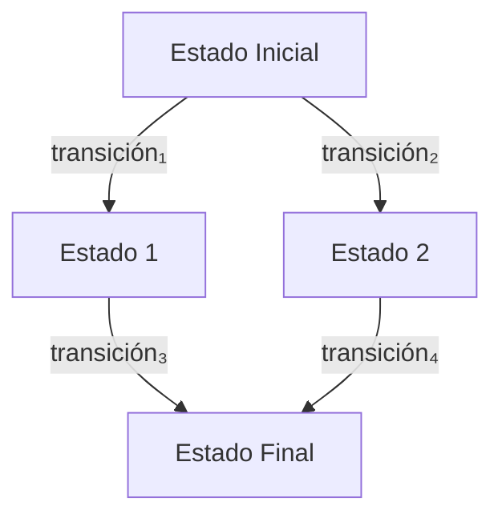

# Lenguajes de Programación - Fundamentos

## 2.1 Herramientas matemáticas: definiciones inductivas; inducción estructural; reglas de inferencia; sistemas de transición.

---

Las herramientas matemáticas son fundamentales para el estudio formal de los lenguajes de programación. Proporcionan mecanismos rigurosos para definir, analizar y verificar propiedades de los lenguajes. En esta guía exploraremos cuatro conceptos esenciales: definiciones inductivas, inducción estructural, reglas de inferencia y sistemas de transición.

### Definiciones Inductivas

#### Concepto Básico

Una definición inductiva especifica un conjunto mediante:

1. **Caso base**: Elementos mínimos que pertenecen al conjunto
2. **Paso inductivo**: Reglas para construir nuevos elementos a partir de elementos existentes

#### Estructura Formal

Una definición inductiva del conjunto $S$ tiene la forma:

$$ \begin{aligned} &\text{Base: } \frac{}{e \in S} \\\ &\text{Inducción: } \frac{e_1 \in S \quad \cdots \quad e_n \in S}{f(e_1, \ldots, e_n) \in S} \end{aligned} $$

#### Ejemplo: Números Naturales

Definición inductiva de los números naturales $\mathbb{N}$:

$$ \begin{aligned} &\text{Base: } \frac{}{0 \in \mathbb{N}} \\\ &\text{Inducción: } \frac{n \in \mathbb{N}}{s(n) \in \mathbb{N}} \end{aligned} $$

Donde $s(n)$ representa el sucesor de $n$.

### Inducción Estructural

#### Principio de Inducción Estructural

La inducción estructural es una técnica de demostración para estructuras definidas inductivamente. Para probar que una propiedad $P$ se cumple para todos los elementos de un conjunto definido inductivamente:

1. **Caso base**: Demostrar $P$ para todos los casos base
2. **Paso inductivo**: Para cada regla constructora, asumir $P$ para las premisas y demostrar $P$ para la conclusión

#### Esquema General

Dado un conjunto $S$ definido inductivamente, para probar $\forall x \in S, P(x)$:

$$ \begin{aligned} &\text{Para cada regla base: } \frac{}{e \in S} \Rightarrow P(e) \\\ &\text{Para cada regla inductiva: } \frac{e_1 \in S \quad \cdots \quad e_n \in S}{f(e_1, \ldots, e_n) \in S} \Rightarrow \\\ &\quad (P(e_1) \land \cdots \land P(e_n)) \Rightarrow P(f(e_1, \ldots, e_n)) \end{aligned} $$

#### Ejemplo: Expresiones Aritméticas

```haskell
-- Definición de expresiones aritméticas
data Expr = Num Int          -- Constante numérica
          | Add Expr Expr    -- Suma
          | Mul Expr Expr    -- Multiplicación

-- Función para evaluar expresiones
eval :: Expr -> Int
eval (Num n) = n
eval (Add e1 e2) = eval e1 + eval e2
eval (Mul e1 e2) = eval e1 * eval e2
```

**Demostración por inducción estructural**: Probar que para toda expresión $e$, `eval e` termina.

- **Caso base**: `eval (Num n)` = n (termina)
- **Paso inductivo**: Si `eval e₁` y `eval e₂` terminan, entonces `eval (Add e₁ e₂)` y `eval (Mul e₁ e₂)` también terminan

### Reglas de Inferencia

#### Concepto y Notación

Las reglas de inferencia son esquemas que permiten derivar conclusiones a partir de premisas. Se escriben como:

$$
\frac{\text{premisa}_1 \quad \text{premisa}_2 \quad \cdots \quad \text{premisa}_n}{\text{conclusión}}
$$

#### Sistema de Tipado Simple

Ejemplo de reglas de inferencia para un sistema de tipos:

$$ \begin{aligned} &\text{(T-Const): } \frac{}{\Gamma \vdash n : \text{int}} \\\ &\text{(T-Var): } \frac{x : \tau \in \Gamma}{\Gamma \vdash x : \tau} \\\ &\text{(T-Add): } \frac{\Gamma \vdash e_1 : \text{int} \quad \Gamma \vdash e_2 : \text{int}}{\Gamma \vdash e_1 + e_2 : \text{int}} \\\ &\text{(T-App): } \frac{\Gamma \vdash f : \tau \rightarrow \sigma \quad \Gamma \vdash e : \tau}{\Gamma \vdash f\ e : \sigma} \end{aligned} $$

#### Ejemplo: Derivación de Tipos

Derivar el tipo de la expresión `(λx: int. x + 1) 5`:

$$ \frac{ \frac{ \frac{}{x:\text{int} \in \Gamma'} \quad \frac{}{x:\text{int} \in \Gamma'}  }{ \Gamma' \vdash x + 1 : \text{int} } \quad \frac{}{\Gamma \vdash 5 : \text{int}} }{ \Gamma \vdash (\lambda x:\text{int}. x + 1)\ 5 : \text{int} } $$

Donde $\Gamma' = \Gamma, x:\text{int}$.

### Sistemas de Transición

#### Sistemas de Transición de Estado

Un sistema de transición es una tupla $(S, \rightarrow)$ donde:

- $S$ es un conjunto de estados
- $\rightarrow \subseteq S \times S$ es una relación de transición

#### Semántica Operacional

**Semántica de paso pequeño** para expresiones aritméticas:

$$ \begin{aligned} &\frac{}{(\text{Num}\ n, \sigma) \Downarrow n} \\\ &\frac{(e_1, \sigma) \Downarrow n_1 \quad (e_2, \sigma) \Downarrow n_2}{(e_1 + e_2, \sigma) \Downarrow n_1 + n_2} \\\ &\frac{(e_1, \sigma) \Downarrow n_1 \quad (e_2, \sigma) \Downarrow n_2}{(e_1 * e_2, \sigma) \Downarrow n_1 \times n_2} \end{aligned} $$

#### Diagrama de Transición



#### Ejemplo: Máquina de Estados

Sistema de transición para una calculadora simple:

```python
# Estados: (valor_actual, operación_pendiente)
transitions = {
    ('init', 'digit'): 'accumulate',
    ('accumulate', 'digit'): 'accumulate',
    ('accumulate', 'operator'): 'wait_operand',
    ('wait_operand', 'digit'): 'accumulate',
    ('wait_operand', 'equals'): 'result'
}
```

### Ejercicios Propuestos

#### Ejercicio 1: Definición Inductiva

Defina inductivamente el conjunto de listas de números naturales.

**Solución esperada:**
$$ \begin{aligned} &\text{Base: } \frac{}{[] \in \text{List}} \\\ &\text{Inducción: } \frac{n \in \mathbb{N} \quad l \in \text{List}}{n :: l \in \text{List}} \end{aligned} $$

#### Ejercicio 2: Inducción Estructural

Demuestre por inducción estructural que la concatenación de listas es asociativa:

$$(l_1 +\!\!+ l_2) +\!\!+ l_3 = l_1 +\!\!+ (l_2 +\!\!+ l_3)$$

#### Ejercicio 3: Reglas de Inferencia

Defina las reglas de inferencia para un sistema de tipos con listas, incluyendo:

- Construcción de lista vacía
- Adición de elemento a lista
- Concatenación de listas

#### Ejercicio 4: Sistema de Transición

Modele como sistema de transición un autómata que reconozca expresiones aritméticas bien parentizadas.

### Aplicaciones en Lenguajes de Programación

#### Análisis Estático

```haskell
-- Sistema de tipos con inferencia
inferType :: Context -> Expr -> Maybe Type
inferType ctx (Var x) = lookup x ctx
inferType ctx (Num n) = Just IntType
inferType ctx (Add e1 e2) = do
    t1 <- inferType ctx e1
    t2 <- inferType ctx e2
    if t1 == IntType && t2 == IntType
        then Just IntType
        else Nothing
```

#### Verificación Formal

Las herramientas matemáticas permiten verificar propiedades como:

- Corrección de type checkers
- Terminación de programas
- Equivalencia de programas
- Propiedades de seguridad

### Referencias

#### Bibliografía Básica

1. Mitchell J., _Concepts in Programming Languages_. Cambridge University Press 2003. (Capítulos 3-5)
2. Pierce B.C., _Types and Programming Languages_. MIT Press 2002. (Capítulos 2-4)

#### Bibliografía Complementaria

1. Harper R., _Practical Foundations for Programming Languages_. 2010. (Capítulos 1-3)
2. Mitchell J., _Foundations for Programming Languages_. MIT Press 1996. (Parte I)
3. Friedman D. P., Wand M., _Essentials of Programming Languages_. 3rd edition. MIT Press, 2008. (Capítulos 1-2)
4. Krishnamurthi S., _Programming Languages: Application and Interpretation_. 2007. (Capítulos 3-5)

#### Recursos Adicionales

- [Proof Assistant Comparison](https://proofassistants.stackexchange.com/)
- [Interactive Theorem Proving](https://www.cl.cam.ac.uk/teaching/1415/LogicProof/)
- [Formal Methods Resources](https://fm.csl.sri.com/)

### Conclusión

Las herramientas matemáticas presentadas proporcionan los fundamentos para el estudio riguroso de los lenguajes de programación. Su dominio es esencial para el diseño, implementación y verificación de lenguajes de programación modernos, permitiendo garantizar propiedades de corrección, seguridad y confiabilidad en sistemas software.
