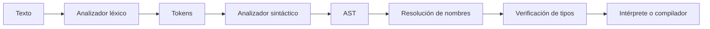

# Lenguajes de Programación - Fundamentos

## 2.2 Sintaxis: niveles de sintaxis (concreta y abstracta); manejo de variables (ligado y alcance); análisis sintáctico (parsing).

---

La **sintaxis** de un lenguaje determina qué textos son programas y cuál es su estructura. Se describe en dos niveles: la sintaxis **concreta**, que es el texto que escribe el programador, con paréntesis, palabras reservadas y reglas de precedencia, y la sintaxis **abstracta**, que es el árbol que captura la estructura sin los detalles de notación. Entre ambas está el **análisis sintáctico**, que convierte el texto en el árbol. Sobre el árbol se resuelve después qué declaración corresponde a cada uso de una variable: el **ligado** y el **alcance**. Este tema trata los tres asuntos y construye un analizador sintáctico.

### Sintaxis concreta

La sintaxis concreta se especifica con una **gramática libre de contexto**: un conjunto de producciones $A \to \alpha,$ donde $A$ es un no terminal y $\alpha$ una secuencia de terminales y no terminales, escrita normalmente en la notación **BNF** de ALGOL 60 o en su extensión **EBNF**, con `*` para la repetición y `?` para lo opcional. Antes del análisis sintáctico, un **analizador léxico** agrupa los caracteres en **tokens**: números, identificadores, operadores, palabras reservadas.

Una gramática es **ambigua** si un texto tiene dos árboles de derivación distintos. La gramática $E \to E + E \mid E * E \mid n$ es ambigua: $1 + 2 * 3$ se puede leer como $(1 + 2) * 3$ o como $1 + (2 * 3).$ La ambigüedad se elimina con un no terminal por **nivel de precedencia**, y la **asociatividad** se fija con la dirección de la recursión: $E \to E - T$ hace que $1 - 2 - 3$ sea $(1 - 2) - 3.$

### Sintaxis abstracta

La sintaxis abstracta es una definición inductiva de los árboles (tema 2.1), sin paréntesis ni precedencias, porque la estructura ya está en el árbol:

$$e ::= n \mid x \mid \ominus\, e \mid e_1 \oplus e_2.$$

El **árbol de sintaxis abstracta** (AST) es lo que procesan las demás fases: el verificador de tipos, el intérprete, el compilador. Varios textos concretos producen el mismo AST: `(x + 1)`, `x+1` y `((x)) + (1)`.

### Ligado y alcance

Una **declaración** liga un nombre a una entidad: `let x = 1` liga $x$ al valor 1, `function f(y)` liga $f$ a una función y $y$ a su parámetro. Una aparición de una variable es **ligada** si está dentro del alcance de una declaración de ese nombre, y **libre** si no. Las variables libres de una expresión se definen inductivamente; para el cálculo lambda,

$$\mathsf{VL}(x) = \{x\}, \qquad \mathsf{VL}(\lambda x.\, e) = \mathsf{VL}(e) \setminus \{x\}, \qquad \mathsf{VL}(e_1\, e_2) = \mathsf{VL}(e_1) \cup \mathsf{VL}(e_2).$$

El **alcance** de una declaración es la región del programa donde el nombre se refiere a ella. Dos reglas lo determinan:

- **Alcance léxico** o estático: un uso se resuelve con la declaración más cercana que lo **rodea en el texto**. Se decide leyendo el programa, sin ejecutarlo. Es la regla de casi todos los lenguajes desde ALGOL: C, Java, Python, JavaScript, Haskell.
- **Alcance dinámico:** un uso se resuelve con la declaración más reciente **en la ejecución**, buscando en la pila de llamadas. Lo usaban los primeros LISP, y lo conservan las variables especiales de Common Lisp, Emacs Lisp y Bash.

Una declaración interior con el mismo nombre **oculta** a la exterior dentro de su alcance. El **entorno** es la función que asigna a cada nombre visible su entidad; con alcance léxico, cada función guarda el entorno de su definición, y el par formado por el código y ese entorno es una **cerradura** (*closure*).

### Análisis sintáctico

- **Descendente** (*top-down*): construye el árbol desde la raíz, eligiendo una producción para cada no terminal según el siguiente token. La variante **recursiva descendente** escribe una función por no terminal y es la más fácil de programar a mano. Las gramáticas que admiten este análisis con un token de anticipación, sin retroceso, se llaman $LL(1).$ No admiten recursión izquierda: $E \to E + T$ haría que la función de $E$ se llamara a sí misma sin consumir nada. Se reescribe como $E \to T\, (+\, T)^*$ y se construye el árbol con asociatividad izquierda dentro de un ciclo.
- **Ascendente** (*bottom-up*): construye el árbol desde las hojas, **desplazando** tokens a una pila y **reduciendo** el lado derecho de una producción a su lado izquierdo. Las variantes $LR(1),$ $SLR$ y $LALR(1)$ aceptan más gramáticas, incluidas las recursivas por la izquierda; se generan con herramientas como Yacc y Bison.
- **Combinadores y generadores:** ANTLR genera analizadores $LL(*);$ las bibliotecas de combinadores, como Parsec, construyen analizadores componiendo funciones; las gramáticas de expresiones de análisis (PEG) eliminan la ambigüedad eligiendo siempre la primera alternativa que funciona.



### Implementación en Python

El programa define el AST de expresiones con clases de datos y un analizador recursivo descendente con un nivel por precedencia, que construye el árbol con asociatividad izquierda dentro de un ciclo; lo prueba con expresiones que muestran precedencia y asociatividad, y con tres entradas con errores. Para el ejercicio 2 dibuja el árbol de la expresión pedida. Para el ejercicio 3 simula el programa de JavaScript con entornos explícitos y lo ejecuta con las dos reglas de alcance. Para el ejercicio 4 extiende el analizador con las sentencias `if`, `while` y la asignación, con palabras reservadas.

```python
import re
from dataclasses import dataclass

# ---------- AST del ejercicio 2 ----------
@dataclass(frozen=True)
class Num: valor: int
@dataclass(frozen=True)
class Var: nombre: str
@dataclass(frozen=True)
class Unaria: op: str; e: object
@dataclass(frozen=True)
class Binaria: op: str; izq: object; der: object

RESERVADAS = {"if", "then", "else", "while", "do"}         # palabras reservadas: no pueden ser variables
def lexer(texto):
    tokens = re.findall(r"\d+|[A-Za-z_]\w*|&&|\|\||==|!=|<=|>=|[-+*/%<>!()=;{}]|\S", texto)
    return tokens + ["$"]

# ---------- Ejercicio 1: gramática por niveles de precedencia, sin recursión izquierda ----------
#   O -> A ('||' A)*      A -> N ('&&' N)*      N -> '!' N | C
#   C -> S (('<'|'>'|'=='|'!=') S)?            S -> T (('+'|'-') T)*
#   T -> U (('*'|'/'|'%') U)*                   U -> '-' U | P        P -> num | id | '(' O ')'
class Parser:
    def __init__(self, texto): self.t, self.i = lexer(texto), 0
    def ver(self): return self.t[self.i]
    def toma(self, esperado=None):
        tok = self.t[self.i]
        if esperado and tok != esperado: raise SyntaxError(f"se esperaba {esperado!r} y llegó {tok!r} en la posición {self.i}")
        self.i += 1; return tok
    def nivel(self, siguiente, ops):                 # izquierda (siguiente (ops siguiente)*): asociatividad izquierda
        e = siguiente()
        while self.ver() in ops: e = Binaria(self.toma(), e, siguiente())
        return e
    def O(self): return self.nivel(self.A, {"||"})
    def A(self): return self.nivel(self.N, {"&&"})
    def N(self): return Unaria(self.toma(), self.N()) if self.ver() == "!" else self.C()
    def C(self):
        e = self.S()
        if self.ver() in {"<", ">", "==", "!=", "<=", ">="}: e = Binaria(self.toma(), e, self.S())   # no asociativo
        return e
    def S(self): return self.nivel(self.T, {"+", "-"})
    def T(self): return self.nivel(self.U, {"*", "/", "%"})
    def U(self): return Unaria(self.toma(), self.U()) if self.ver() == "-" else self.P()
    def P(self):
        tok = self.ver()
        if tok == "(":
            self.toma(); e = self.O(); self.toma(")"); return e
        if tok.isdigit(): return Num(int(self.toma()))
        if re.fullmatch(r"[A-Za-z_]\w*", tok) and tok not in RESERVADAS: return Var(self.toma())
        raise SyntaxError(f"token inesperado {tok!r}")
    def todo(self):
        e = self.O(); self.toma("$"); return e

def dibuja(e, pre="", ultimo=True, raiz=True):
    etiqueta = {Num: lambda: str(e.valor), Var: lambda: e.nombre, Unaria: lambda: e.op, Binaria: lambda: e.op}[type(e)]()
    print(("   " if raiz else pre + ("└─ " if ultimo else "├─ ")) + etiqueta)
    hijos = [e.e] if isinstance(e, Unaria) else [e.izq, e.der] if isinstance(e, Binaria) else []
    for k, h in enumerate(hijos): dibuja(h, ("   " if raiz else pre + ("   " if ultimo else "│  ")), k == len(hijos) - 1, False)
def parentiza(e):
    if isinstance(e, Num): return str(e.valor)
    if isinstance(e, Var): return e.nombre
    if isinstance(e, Unaria): return f"({e.op}{parentiza(e.e)})"
    return f"({parentiza(e.izq)} {e.op} {parentiza(e.der)})"

for s in ("1 - 2 - 3", "a + b * c % d", "!x && y || z", "-x * -(y + 1) != 4"):
    print(f"ejercicio 1: {s!r} -> {parentiza(Parser(s).todo())}")
for malo in ("a < b < c", "(a + b", "a + * b"):
    try: Parser(malo).todo()
    except SyntaxError as e: print(f"   {malo!r}: error de sintaxis, {e}")

# --- Ejercicio 2 ---
ast = Parser("(x + 5) * (y - 3) < 10 || z == 0").todo()
print("ejercicio 2:", ast)
dibuja(ast)

# --- Ejercicio 3: alcance léxico frente a alcance dinámico ---
# cada función es (cuerpo, entorno de definición); un entorno es una lista de marcos, el primero el más interno
def ejecuta(dinamico):
    pila = [{"x": 1}]                                   # marco global
    def busca(nombre, entorno):
        for marco in entorno:
            if nombre in marco: return marco[nombre]
    def llamar(f, entorno_llamada):
        cuerpo, entorno_def = f
        marco = {}
        return cuerpo(marco, [marco] + (entorno_llamada if dinamico else entorno_def))
    def a(marco, ent):
        marco["x"] = 2
        marco["b"] = (lambda m, e: busca("x", e), ent)                      # function b() { return x; }
        def c(m, e):
            m["x"] = 3                                                     # let x = 3
            return llamar(busca("b", e), e)                                # return b();
        marco["c"] = (c, ent)
        return llamar(marco["c"], ent)
    return llamar((a, pila), pila)
print("ejercicio 3: con alcance léxico a() =", ejecuta(False), "| con alcance dinámico a() =", ejecuta(True))

# --- Ejercicio 4: S -> if E then S else S | while E do S | id = E ---
@dataclass(frozen=True)
class Si: cond: object; entonces: object; sino: object
@dataclass(frozen=True)
class Mientras: cond: object; cuerpo: object
@dataclass(frozen=True)
class Asigna: var: str; e: object
class ParserS(Parser):
    def Sent(self):
        tok = self.ver()
        if tok == "if":
            self.toma(); c = self.S(); self.toma("then"); s1 = self.Sent(); self.toma("else"); return Si(c, s1, self.Sent())
        if tok == "while":
            self.toma(); c = self.S(); self.toma("do"); return Mientras(c, self.Sent())
        nombre = self.toma()
        if not re.fullmatch(r"[A-Za-z_]\w*", nombre) or nombre in RESERVADAS: raise SyntaxError(f"se esperaba una sentencia y llegó {nombre!r}")
        self.toma("="); return Asigna(nombre, self.S())
    def programa(self):
        s = self.Sent(); self.toma("$"); return s
prog = "while n do if n then x = x * n else x = 0 - 1"
print("ejercicio 4:", ParserS(prog).programa())
for malo in ("if a then x = 1", "while do x = 2", "x = (1 + 2"):
    try: ParserS(malo).programa()
    except SyntaxError as e: print(f"   {malo!r}: {e}")
```

Salida:

```text
ejercicio 1: '1 - 2 - 3' -> ((1 - 2) - 3)
ejercicio 1: 'a + b * c % d' -> (a + ((b * c) % d))
ejercicio 1: '!x && y || z' -> (((!x) && y) || z)
ejercicio 1: '-x * -(y + 1) != 4' -> (((-x) * (-(y + 1))) != 4)
   'a < b < c': error de sintaxis, se esperaba '$' y llegó '<' en la posición 3
   '(a + b': error de sintaxis, se esperaba ')' y llegó '$' en la posición 4
   'a + * b': error de sintaxis, token inesperado '*'
ejercicio 2: Binaria(op='||', izq=Binaria(op='<', izq=Binaria(op='*', izq=Binaria(op='+', izq=Var(nombre='x'), der=Num(valor=5)), der=Binaria(op='-', izq=Var(nombre='y'), der=Num(valor=3))), der=Num(valor=10)), der=Binaria(op='==', izq=Var(nombre='z'), der=Num(valor=0)))
   ||
   ├─ <
   │  ├─ *
   │  │  ├─ +
   │  │  │  ├─ x
   │  │  │  └─ 5
   │  │  └─ -
   │  │     ├─ y
   │  │     └─ 3
   │  └─ 10
   └─ ==
      ├─ z
      └─ 0
ejercicio 3: con alcance léxico a() = 2 | con alcance dinámico a() = 3
ejercicio 4: Mientras(cond=Var(nombre='n'), cuerpo=Si(cond=Var(nombre='n'), entonces=Asigna(var='x', e=Binaria(op='*', izq=Var(nombre='x'), der=Var(nombre='n'))), sino=Asigna(var='x', e=Binaria(op='-', izq=Num(valor=0), der=Num(valor=1)))))
   'if a then x = 1': se esperaba 'else' y llegó '$' en la posición 6
   'while do x = 2': token inesperado 'do'
   'x = (1 + 2': se esperaba ')' y llegó '$' en la posición 6
```

### Ejercicios Propuestos

1. **Gramática.** Define una gramática para expresiones con los operadores aritméticos `+`, `-`, `*`, `/` y `%`, los de comparación `<`, `>`, `==` y `!=`, los lógicos `&&`, `||` y `!`, y paréntesis.

2. **AST.** Para `(x + 5) * (y - 3) < 10 || z == 0`, construye el árbol de sintaxis abstracta y define las estructuras de datos que lo representan.

3. **Alcance.** Determina el valor que se imprime:

    ```javascript
    let x = 1;
    function a() {
      let x = 2;
      function b() { return x; }
      function c() { let x = 3; return b(); }
      return c();
    }
    console.log(a());
    ```

4. **Analizador.** Implementa un analizador recursivo descendente para la gramática $S \to \texttt{if}\ E\ \texttt{then}\ S\ \texttt{else}\ S \mid \texttt{while}\ E\ \texttt{do}\ S \mid \mathit{id} = E,$ con $E \to E + T \mid E - T \mid T,$ $T \to T * F \mid T / F \mid F$ y $F \to (E) \mid \mathit{id} \mid \mathit{num}.$

### Soluciones

**Ejercicio 1.** De menor a mayor precedencia, en EBNF:

```text
O ::= A ("||" A)*
A ::= N ("&&" N)*
N ::= "!" N | C
C ::= S (("<" | ">" | "==" | "!=") S)?
S ::= T (("+" | "-") T)*
T ::= U (("*" | "/" | "%") U)*
U ::= "-" U | P
P ::= num | id | "(" O ")"
```

Cada nivel solo contiene operadores de una precedencia, así que la gramática no es ambigua, y las repeticiones `( ... )*` se construyen con asociatividad izquierda, de modo que `1 - 2 - 3` es `(1 - 2) - 3`. Las comparaciones son **no asociativas**: `a < b < c` es un error, como muestra el programa, porque en la mayoría de los lenguajes no significa lo que parece; en C se evalúa como `(a < b) < c`, comparando un booleano con un número, y en Python como `a < b and b < c`. Los operadores unarios `!` y `-` tienen la mayor precedencia de su nivel y son recursivos por la derecha: `!!x` es `!(!x)`. Es la jerarquía de C, Java y JavaScript.

**Ejercicio 2.** Las estructuras son un tipo de dato con cuatro variantes: números, variables, operaciones unarias con su operador y su operando, y binarias con su operador y sus dos operandos. En Haskell sería `data Exp = Num Int | Var String | Un String Exp | Bin String Exp Exp`; el programa usa clases de datos de Python. El árbol tiene `||` en la raíz, porque es el operador de menor precedencia; su hijo izquierdo es `<`, con `*` y `10`, y el `*` tiene a `x + 5` y `y - 3` como hijos; el derecho es `z == 0`. Los paréntesis del texto no aparecen en el árbol: su efecto ya está en la forma.

**Ejercicio 3.** Se imprime **2**. JavaScript tiene alcance léxico: la `x` de `b` se resuelve con la declaración que rodea a `b` en el texto, la `x = 2` de `a`, sin importar que `b` se llame desde `c`, donde hay otra `x`. Con alcance **dinámico**, `b` buscaría `x` en la pila de llamadas, encontraría primero la de `c` y devolvería 3. El programa reproduce ambos resultados con entornos explícitos: con alcance léxico, la llamada a `b` extiende el entorno de **definición** de `b`; con alcance dinámico, el de la **llamada**. La `x = 1` global no interviene en ningún caso, porque está oculta por la de `a`.

**Ejercicio 4.** La gramática de $E$ y $T$ tiene **recursión izquierda**, que un analizador descendente no puede usar directamente. Se reescribe como $E \to T\, ((+ \mid -)\, T)^*$ y $T \to F\, ((* \mid /)\, F)^*,$ que genera el mismo lenguaje, y se construye el árbol dentro del ciclo para conservar la asociatividad izquierda. Las sentencias se distinguen por su primer token: `if`, `while` o un identificador, así que la gramática es $LL(1)$ sin cambios. Las palabras `if`, `then`, `else`, `while` y `do` deben ser **reservadas**: si no, `while do x = 2` se leería con `do` como variable y el error se reportaría en un lugar confuso. La gramática tiene una particularidad: el `else` es obligatorio, así que no tiene el problema del **else colgante**, que aparece cuando es opcional y `if a then if b then s1 else s2` admite dos árboles; los lenguajes lo resuelven asociando el `else` con el `if` más cercano.

### Referencias

1. Aho, A. V., Lam, M. S., Sethi, R., and Ullman, J. D., _Compilers: Principles, Techniques, and Tools_. Pearson, 2006. Capítulos 2 a 4.
2. Pierce, B. C., _Types and Programming Languages_. MIT Press, 2002. Capítulos 3 y 5.
3. Krishnamurthi, S., _Programming Languages: Application and Interpretation_. 2007. Capítulos 2 a 6.
4. Scott, M. L., _Programming Language Pragmatics_. Morgan Kaufmann, 2015. Capítulos 2 y 3.
5. Naur, P. (ed.), Revised report on the algorithmic language ALGOL 60. _Communications of the ACM_ 6(1), 1963.
