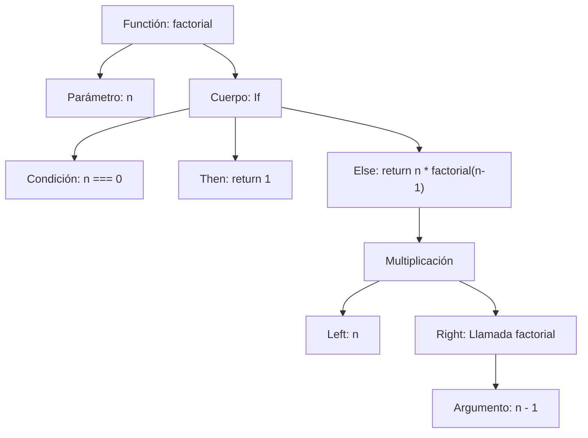
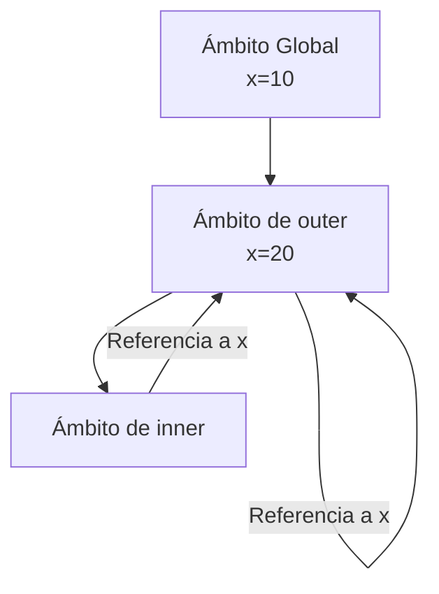

# Lenguajes de Programación - Fundamentos

## 2.2 Sintaxis: niveles de sintaxis (concreta y abstracta); manejo de variables (ligado y alcance); análisis sintáctico (parsing).

---

La sintaxis es el conjunto de reglas que define las combinaciones de símbolos que se consideran programas válidos en un lenguaje de programación. En esta guía exploraremos tres aspectos fundamentales: niveles de sintaxis, manejo de variables y análisis sintáctico.

### Niveles de Sintaxis

#### Sintaxis Concreta

La sintaxis concreta define la representación superficial de un programa, incluyendo todos los detalles léxicos como espacios, delimitadores y palabras clave.

**Ejemplo de sintaxis concreta en JavaScript:**

```javascript
function factorial(n) {
  if (n === 0) return 1;
  else return n * factorial(n - 1);
}
```

#### Sintaxis Abstracta

La sintaxis abstracta representa la estructura esencial de un programa, omitiendo detalles superficiales y enfocándose en la estructura jerárquica.

**Ejemplo de Árbol de Sintaxis Abstracta (AST):**



**Representación formal del AST:**

```
Factorial=Fun("n",If(Eq(Var("n"),0),Return(1),Return(Mul(Var("n"),Call("factorial",Sub(Var("n"),1))))))​
```

#### Gramáticas Formales

Las gramáticas formales definen la sintaxis mediante reglas de producción. Para expresiones aritméticas:

$$ \begin{aligned} E &\rightarrow E + T \mid E - T \mid T \\\ T &\rightarrow T * F \mid T / F \mid F \\\ F &\rightarrow ( E ) \mid \text{id} \mid \text{num} \end{aligned} $$

### Manejo de Variables

#### Ligado (Binding)

El ligado asocia identificadores con entidades del programa (variables, funciones, tipos).

**Tipos de ligado:**

- **Ligado estático**: Resuelto en tiempo de compilación
- **Ligado dinámico**: Resuelto en tiempo de ejecución

**Ejemplo de ligado en Python:**

```python
x = 5  # Ligado de 'x' al valor 5

def f(y):  # Ligado de 'f' a la función, 'y' al parámetro
    z = x + y  # Ligado de 'z' al resultado
    return z
```

#### Alcance (Scope)

El alcance define la región del programa donde un ligado es visible.

**Alcance léxico (estático):** El alcance se determina por la estructura del código
**Alcance dinámico:** El alcance se determina por el flujo de ejecución

**Ejemplo de ambigüedad de alcance:**

```javascript
let x = 10;

function outer() {
  let x = 20;

  function inner() {
    return x; // ¿Qué x se referencia?
  }

  return inner();
}
```

##### Reglas de alcance

**Árbol de alcance para el ejemplo anterior:**



#### Ambiente y Estados

**Ambiente $(\rho)$**: Mapeo de identificadores a ubicaciones
**Estado $(\sigma)$**: Mapeo de ubicaciones a valores

$$ \begin{aligned} \rho &: \text{Identifiers} \rightarrow \text{Locations} \\\ \sigma &: \text{Locations} \rightarrow \text{Values} \end{aligned} $$

### Análisis Sintáctico (Parsing)

#### Tipos de Parsers

**Parsers descendentes (top-down):**

- Recursive descent
- LL(k)

**Parsers ascendentes (bottom-up):**

- LR(0), SLR(1), LALR(1), LR(1)
- Operador-precedencia

#### Algoritmo de Parsing Recursivo Descendente

**Gramática para expresiones:**

$$ \begin{aligned} E &\rightarrow T E' \\\ E' &\rightarrow + T E' \mid \epsilon \\\ T &\rightarrow F T' \\\ T' &\rightarrow * F T' \mid \epsilon \\\ F &\rightarrow ( E ) \mid \text{id} \mid \text{num} \end{aligned} $$

**Implementación en Python:**

```python
class Parser:
    def __init__(self, tokens):
        self.tokens = tokens
        self.pos = 0

    def parse_E(self):
        # E → T E'
        left = self.parse_T()
        return self.parse_E_prime(left)

    def parse_E_prime(self, left):
        # E' → + T E' | ε
        if self.current_token() == '+':
            self.consume('+')
            right = self.parse_T()
            new_left = AddNode(left, right)
            return self.parse_E_prime(new_left)
        return left

    def parse_T(self):
        # T → F T'
        left = self.parse_F()
        return self.parse_T_prime(left)

    def parse_T_prime(self, left):
        # T' → * F T' | ε
        if self.current_token() == '*':
            self.consume('*')
            right = self.parse_F()
            new_left = MulNode(left, right)
            return self.parse_T_prime(new_left)
        return left

    def parse_F(self):
        # F → ( E ) | id | num
        if self.current_token() == '(':
            self.consume('(')
            expr = self.parse_E()
            self.consume(')')
            return expr
        elif self.current_token().type == 'ID':
            token = self.consume('ID')
            return VarNode(token.value)
        elif self.current_token().type == 'NUM':
            token = self.consume('NUM')
            return NumNode(token.value)
```

#### Tabla de Análisis LR

Para la gramática:

$$ \begin{aligned} S &\rightarrow E \\\ E &\rightarrow E + T \mid T \\\ T &\rightarrow T * F \mid F \\\ F &\rightarrow ( E ) \mid \text{id} \end{aligned} $$

**Tabla de parsing LR(1):**

| Estado | id  | +   | *   | (   | )   | $   | E   | T   | F   |
| ------ | --- | --- | --- | --- | --- | --- | --- | --- | --- |
| 0      | s5  |     |     | s4  |     |     | g1  | g2  | g3  |
| 1      |     | s6  |     |     |     | acc |     |     |     |
| 2      |     | r2  | s7  |     | r2  | r2  |     |     |     |
| 3      |     | r4  | r4  |     | r4  | r4  |     |     |     |
| 4      | s5  |     |     | s4  |     |     | g8  | g2  | g3  |
| 5      |     | r6  | r6  |     | r6  | r6  |     |     |     |
| 6      | s5  |     |     | s4  |     |     |     | g9  | g3  |
| 7      | s5  |     |     | s4  |     |     |     |     | g10 |
| 8      |     | s6  |     |     | s11 |     |     |     |     |
| 9      |     | r1  | s7  |     | r1  | r1  |     |     |     |
| 10     |     | r3  | r3  |     | r3  | r3  |     |     |     |
| 11     |     | r5  | r5  |     | r5  | r5  |     |     |     |

### Ejercicios Propuestos

#### Ejercicio 1: Gramática de Expresiones

Defina una gramática formal para expresiones que incluyan:

- Operadores aritméticos: +, -, *, /, %
- Operadores de comparación: <, >, ==, !=
- Operadores lógicos: &&, ||, !
- Paréntesis para agrupación

#### Ejercicio 2: Árbol de Sintaxis Abstracta

Para la expresión `(x + 5) * (y - 3) < 10 || z == 0`:

1. Construya el AST correspondiente
2. Defina las estructuras de datos para representar este AST

#### Ejercicio 3: Análisis de Alcance

Analice el siguiente código y determine el valor de cada referencia a x:

```javascript
let x = 1;

function a() {
  let x = 2;

  function b() {
    return x;
  }

  function c() {
    let x = 3;
    return b();
  }

  return c();
}

console.log(a()); // ¿Qué valor se imprime?
```

#### Ejercicio 4: Implementación de Parser

Implemente un parser recursivo descendente para la siguiente gramática:

$$ \begin{aligned} S &\rightarrow \text{if } E \text{ then } S \text{ else } S \mid \text{while } E \text{ do } S \mid \text{id} = E \\\ E &\rightarrow E + T \mid E - T \mid T \\\ T &\rightarrow T * F \mid T / F \mid F \\\ F &\rightarrow ( E ) \mid \text{id} \mid \text{num} \end{aligned} $$

### Aplicaciones Prácticas

#### Herramientas Modernas de Parsing

**ANTLR (ANother Tool for Language Recognition):**

```antlr
grammar Expr;

prog:   stat+ ;

stat:   expr NEWLINE
    |   ID '=' expr NEWLINE
    |   NEWLINE
    ;

expr:   expr ('*'|'/') expr
    |   expr ('+'|'-') expr
    |   INT
    |   ID
    |   '(' expr ')'
    ;

ID  :   [a-zA-Z]+ ;
INT :   [0-9]+ ;
NEWLINE:'\r'? '\n' ;
WS  :   [ \t]+ -> skip ;
```

**Parser generators modernos:**

- Yacc/Bison
- ANTLR
- PackCC (Parser generator para C)
- LALRPOP (Rust)

### Referencias

#### Bibliografía Básica

1. Mitchell J., _Concepts in Programming Languages_. Cambridge University Press 2003. (Capítulos 2-3)
2. Pierce B.C., _Types and Programming Languages_. MIT Press 2002. (Capítulos 1-2)

#### Bibliografía Complementaria

1. Harper R., _Practical Foundations for Programming Languages_. 2010. (Capítulos 1-2)
2. Aho A. V., et al. _Compilers: Principles, Techniques, and Tools_. 2nd edition. Pearson, 2006. (Capítulos 2-4)
3. Grune D., et al. _Modern Compiler Design_. 2nd edition. Springer, 2012. (Capítulos 2-3)

#### Recursos Adicionales

- [ANTLR Official Documentation](https://www.antlr.org/)
- [Bison Manual](https://www.gnu.org/software/bison/manual/)
- [AST Explorer](https://astexplorer.net/) - Herramienta interactiva para explorar ASTs

### Conclusión

El estudio de la sintaxis es fundamental para comprender cómo se estructuran y procesan los lenguajes de programación. La distinción entre sintaxis concreta y abstracta, el manejo adecuado de variables con sus reglas de ligado y alcance, y las técnicas de análisis sintáctico constituyen la base para el diseño e implementación de compiladores e intérpretes. El dominio de estos conceptos permite no solo entender mejor los lenguajes existentes sino también diseñar nuevos lenguajes de programación y herramientas de procesamiento de código.
