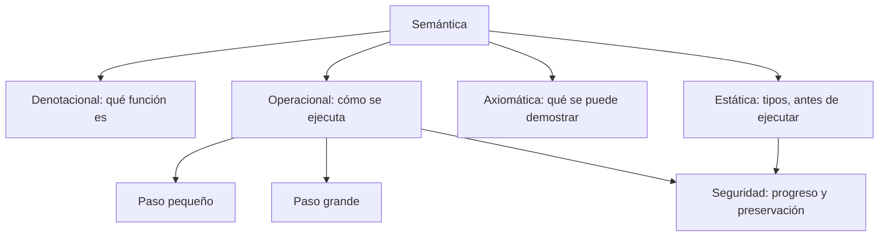

# Lenguajes de Programación - Fundamentos

## 2.3 Semántica: estilos de semántica (denotacional, operacional, axiomática); semántica estática y dinámica; sistemas de tipos.

---

La **semántica** de un lenguaje dice qué significa cada programa. Un manual en lenguaje natural la describe con ambigüedades que cada implementación resuelve a su manera; una semántica **formal** la fija con precisión matemática, y permite demostrar propiedades del lenguaje, como que un programa bien tipado no se atasca, y de los programas, como que un ciclo calcula lo que debe. Hay tres estilos: el **denotacional** asigna a cada programa un objeto matemático, el **operacional** describe cómo se ejecuta paso a paso y el **axiomático** da reglas para razonar sobre lo que se cumple antes y después. Este tema los presenta sobre un lenguaje imperativo pequeño, distingue la semántica estática de la dinámica y presenta los sistemas de tipos.

### El lenguaje

Expresiones $e ::= n \mid x \mid e_1 \oplus e_2$ y comandos

$$c ::= \mathbf{skip} \mid x := e \mid c_1; c_2 \mid \mathbf{if}\ e\ \mathbf{then}\ c_1\ \mathbf{else}\ c_2 \mid \mathbf{while}\ e\ \mathbf{do}\ c,$$

con **estados** $\sigma \in \Sigma = \mathsf{Var} \to \mathbb{Z}$ que asignan un valor a cada variable.

### Semántica denotacional

Asigna a cada construcción una **función** matemática, definida por recursión sobre la sintaxis, de modo que el significado de un todo depende solo del significado de sus partes (**composicionalidad**). Para las expresiones, $[\![ e ]\!] : \Sigma \to \mathbb{Z};$ para los comandos, $[\![ c ]\!] : \Sigma \rightharpoonup \Sigma,$ una función **parcial**, porque un comando puede no terminar:

$$[\![ x := e ]\!]\sigma = \sigma[x \mapsto [\![ e ]\!]\sigma], \qquad [\![ c_1; c_2 ]\!] = [\![ c_2 ]\!] \circ [\![ c_1 ]\!],$$

$$[\![ \mathbf{if}\ e\ \mathbf{then}\ c_1\ \mathbf{else}\ c_2 ]\!]\sigma = \begin{cases} [\![ c_1 ]\!]\sigma & \text{si } [\![ e ]\!]\sigma \ne 0, \\ [\![ c_2 ]\!]\sigma & \text{si no.} \end{cases}$$

El ciclo no se puede definir así, porque su significado aparece en su propia definición: $w = [\![ \mathbf{while}\ e\ \mathbf{do}\ c ]\!]$ debe cumplir $w\,\sigma = w([\![ c ]\!]\sigma)$ si $[\![ e ]\!]\sigma \ne 0,$ y $w\,\sigma = \sigma$ si no. Es decir, $w$ es un **punto fijo** del funcional

$$F(w) = \lambda \sigma.\; \text{si } [\![ e ]\!]\sigma \ne 0 \text{ entonces } w([\![ c ]\!]\sigma) \text{ si no } \sigma.$$

La teoría de **dominios** de Scott garantiza que $F$ tiene un **menor** punto fijo, $\bigsqcup_i F^i(\bot),$ donde $\bot$ es la función indefinida en todas partes: $F^i(\bot)$ da el resultado correcto para las ejecuciones que terminan en menos de $i$ vueltas y está indefinida en las demás, y el límite está definido exactamente donde el ciclo termina.

### Semántica operacional

Describe la ejecución como un sistema de transición (tema 2.1) definido con reglas de inferencia, en dos variantes.

**De paso pequeño** (Plotkin, 1981): $\langle c, \sigma \rangle \to \langle c', \sigma' \rangle$ es un paso de cómputo.

$$\frac{}{\langle x := e, \sigma \rangle \to \langle \mathbf{skip}, \sigma[x \mapsto [\![ e ]\!]\sigma] \rangle} \qquad \frac{\langle c_1, \sigma \rangle \to \langle c_1', \sigma' \rangle}{\langle c_1; c_2, \sigma \rangle \to \langle c_1'; c_2, \sigma' \rangle} \qquad \frac{}{\langle \mathbf{skip}; c_2, \sigma \rangle \to \langle c_2, \sigma \rangle}$$

$$\frac{}{\langle \mathbf{while}\ e\ \mathbf{do}\ c, \sigma \rangle \to \langle \mathbf{if}\ e\ \mathbf{then}\ (c; \mathbf{while}\ e\ \mathbf{do}\ c)\ \mathbf{else}\ \mathbf{skip}, \sigma \rangle}$$

Distingue un programa que no termina, una sucesión infinita de pasos, de uno que se **atasca**, una configuración que no es final y no tiene paso; permite describir la concurrencia por intercalación de pasos.

**De paso grande** o natural (Kahn, 1987): $\langle c, \sigma \rangle \Downarrow \sigma'$ relaciona un comando con el estado final, sin pasos intermedios:

$$\frac{\langle c_1, \sigma \rangle \Downarrow \sigma' \quad \langle c_2, \sigma' \rangle \Downarrow \sigma''}{\langle c_1; c_2, \sigma \rangle \Downarrow \sigma''} \qquad \frac{[\![ e ]\!]\sigma \ne 0 \quad \langle c, \sigma \rangle \Downarrow \sigma' \quad \langle \mathbf{while}\ e\ \mathbf{do}\ c, \sigma' \rangle \Downarrow \sigma''}{\langle \mathbf{while}\ e\ \mathbf{do}\ c, \sigma \rangle \Downarrow \sigma''}$$

Corresponde directamente a un intérprete recursivo.

### Semántica axiomática

La **lógica de Hoare** (1969) razona con **ternas** $\{P\}\; c\; \{Q\}:$ si $P$ se cumple antes de $c$ y $c$ termina, $Q$ se cumple después. Es **corrección parcial**; la **total** exige además demostrar la terminación. Las reglas:

$$\frac{}{\{Q[x := e]\}\; x := e\; \{Q\}}\;\text{Asig} \qquad \frac{\{P\}\, c_1\, \{R\} \quad \{R\}\, c_2\, \{Q\}}{\{P\}\; c_1; c_2\; \{Q\}}\;\text{Sec} \qquad \frac{\{I \land e\}\; c\; \{I\}}{\{I\}\; \mathbf{while}\ e\ \mathbf{do}\ c\; \{I \land \lnot e\}}\;\text{While}$$

$$\frac{P \Rightarrow P' \quad \{P'\}\, c\, \{Q'\} \quad Q' \Rightarrow Q}{\{P\}\; c\; \{Q\}}\;\text{Cons}$$

La regla de asignación se lee hacia atrás: para que $Q$ valga después de $x := e,$ antes debe valer $Q$ con $e$ en lugar de $x.$ La del ciclo usa un **invariante** $I$ que el cuerpo preserva; encontrarlo es la parte creativa de la demostración.

### Semántica estática y dinámica

La **semántica estática** es lo que se verifica antes de ejecutar, sobre el texto: que las variables estén declaradas, que los tipos concuerden, que las funciones reciban el número correcto de argumentos. La **dinámica** es lo que ocurre al ejecutar. La relación entre ambas es la **seguridad de tipos** (Milner, 1978: "los programas bien tipados no fallan"), que se demuestra con dos teoremas sobre la semántica de paso pequeño (Wright y Felleisen, 1994):

- **Progreso:** si $\vdash e : T,$ entonces $e$ es un valor o existe $e'$ con $e \to e'.$
- **Preservación:** si $\vdash e : T$ y $e \to e',$ entonces $\vdash e' : T.$

Juntos garantizan que un programa bien tipado nunca llega a una configuración atascada.

### Sistemas de tipos

Un **sistema de tipos** es un conjunto de reglas de inferencia para juicios $\Gamma \vdash e : T.$ Para el cálculo lambda con enteros, booleanos y funciones (tema 3.3):

$$\frac{x : T \in \Gamma}{\Gamma \vdash x : T} \qquad \frac{\Gamma, x : T_1 \vdash e : T_2}{\Gamma \vdash \lambda x.\, e : T_1 \to T_2} \qquad \frac{\Gamma \vdash e_1 : T_1 \to T_2 \quad \Gamma \vdash e_2 : T_1}{\Gamma \vdash e_1\, e_2 : T_2}$$

La **inferencia de tipos** de Hindley y Milner encuentra el tipo más general de una expresión sin anotaciones, resolviendo por unificación las ecuaciones entre tipos que generan las reglas, y **generaliza** el tipo de una variable ligada con `let` para que se use con varios tipos: es el **polimorfismo de let** (tema 3.7).



### Implementación en Python

El programa implementa la semántica denotacional del lenguaje como funciones de Python, y para el ciclo calcula las aproximaciones $F^i(\bot)$ con $\bot$ representado por `None`. Implementa también la semántica de paso pequeño con llamadas a función e imprime la sucesión de estados. Para el ejercicio 3 ejecuta el programa de multiplicación verificando el invariante en cada vuelta. Para los ejercicios 4 y 5 implementa la inferencia de Hindley y Milner con `let` polimórfico, pares y listas.

```python
from itertools import count, product

# ---------- un lenguaje imperativo pequeño: expresiones y comandos como tuplas ----------
def E(e, s):                                     # semántica denotacional de expresiones: Σ -> valor
    k = e[0]
    if k == "n": return e[1]
    if k == "v": return s[e[1]]
    a, b = E(e[1], s), E(e[2], s)
    return {"+": a + b, "-": a - b, "*": a * b, ">": a > b, "=": a == b}[k]

# --- Ejercicio 1: denotacional. [[while b do c]] es el menor punto fijo de F(w) = λs. si [[b]]s entonces w([[c]]s) si no s ---
FONDO = None                                     # ⊥: "todavía no definido"
def C(c, s):
    k = c[0]
    if k == ":=": return {**s, c[1]: E(c[2], s)}
    if k == ";": return C(c[2], C(c[1], s))
    if k == "if": return C(c[2], s) if E(c[1], s) else C(c[3], s)
    if k == "while": return C(c, C(c[2], s)) if E(c[1], s) else s
def aproximacion(c, i):                          # F^i(⊥): define el ciclo para las ejecuciones de menos de i vueltas
    def w(s):
        if i == 0: return FONDO
        if not E(c[1], s): return s
        r = C(c[2], s)
        return aproximacion(c, i - 1)(r)
    return w
cuenta = ("while", (">", ("v", "x"), ("n", 0)), (";", (":=", "z", ("+", ("v", "z"), ("v", "y"))), (":=", "x", ("-", ("v", "x"), ("n", 1)))))
s0 = {"x": 3, "y": 5, "z": 0}
print("ejercicio 1: aproximaciones F^i(⊥) del ciclo en x=3, y=5:", [aproximacion(cuenta, i)(s0) for i in range(6)])
print("   la función completa da", C(cuenta, s0), "| if x > 2 then z := 1 else z := 2 en x=3:",
      C(("if", (">", ("v", "x"), ("n", 2)), (":=", "z", ("n", 1)), (":=", "z", ("n", 2))), s0)["z"])

# --- Ejercicio 2: semántica operacional de paso pequeño, con llamadas a funciones ---
def paso(conf, funciones):
    c, s = conf
    k = c[0]
    if k == ":=": return ("skip",), {**s, c[1]: E(c[2], s)}
    if k == ";":
        if c[1] == ("skip",): return c[2], s
        c1, s1 = paso((c[1], s), funciones); return (";", c1, c[2]), s1
    if k == "if": return (c[2] if E(c[1], s) else c[3]), s
    if k == "while": return ("if", c[1], (";", c[2], c), ("skip",)), s
    if k == "call":                              # x := f(e): evalúa el argumento, ejecuta el cuerpo en un marco nuevo
        param, cuerpo, ret = funciones[c[2]]
        return ("ret", c[1], cuerpo, {param: E(c[3], s)}, ret), s
    if k == "ret":                               # ejecuta el cuerpo en su propio estado local; al terminar, copia el resultado
        destino, cuerpo, local, ret = c[1:]
        if cuerpo == ("skip",): return ("skip",), {**s, destino: local[ret]}
        cuerpo2, local2 = paso((cuerpo, local), funciones)
        return ("ret", destino, cuerpo2, local2, ret), s
def traza(c, s, funciones={}, max_pasos=60):
    pasos = [(c, s)]
    while pasos[-1][0] != ("skip",) and len(pasos) < max_pasos: pasos.append(paso(pasos[-1], funciones))
    return pasos
t = traza((";", (":=", "x", ("n", 2)), (":=", "y", ("*", ("v", "x"), ("n", 10)))), {})
print("ejercicio 2, x := 2; y := x * 10 en", len(t) - 1, "pasos:", [p[1] for p in t])
doble = {"doble": ("a", (":=", "r", ("+", ("v", "a"), ("v", "a"))), "r")}
t = traza((";", (":=", "a", ("n", 100)), ("call", "y", "doble", ("n", 21))), {}, doble)
print("   a := 100; y := doble(21):", t[-1][1], "en", len(t) - 1, "pasos; la 'a' local no cambió la global")

# --- Ejercicio 3: lógica de Hoare. Invariante I: z = (A - x) * y  ∧  y = B  ∧  x ≥ 0 ---
def ejecuta_con_invariante(A, B):
    s = {"x": A, "y": B, "z": 0}
    inv = lambda s: s["z"] == (A - s["x"]) * s["y"] and s["y"] == B and s["x"] >= 0
    if A >= 0: assert inv(s)                     # la precondición implica el invariante (solo si A ≥ 0)
    while s["x"] > 0:
        s = C(cuenta[2], s)
        assert inv(s)                            # el cuerpo preserva el invariante
    return s["z"] == A * B
print("ejercicio 3: postcondición z = A * B con A ≥ 0:", all(ejecuta_con_invariante(a, b) for a, b in product(range(0, 8), range(-5, 6))),
      "| con A < 0:", sorted({ejecuta_con_invariante(a, b) for a, b in product(range(-4, 0), range(1, 4))}))

# --- Ejercicios 4 y 5: tipos con pares y listas, e inferencia de Hindley-Milner con let polimórfico ---
class TV:
    c = count()
    def __init__(self): self.n = next(TV.c)
def res(t, s):
    while isinstance(t, TV) and t in s: t = s[t]
    return t
def ocurre(v, t, s):
    t = res(t, s)
    return t is v or (isinstance(t, tuple) and any(ocurre(v, a, s) for a in t[1:]))
def unif(a, b, s):
    a, b = res(a, s), res(b, s)
    if a is b: return s
    if isinstance(a, TV):
        if ocurre(a, b, s): raise TypeError("tipo infinito (falla la verificación de ocurrencia)")
        return {**s, a: b}
    if isinstance(b, TV): return unif(b, a, s)
    if a[0] != b[0] or len(a) != len(b): raise TypeError(f"no unifican {mt(a, s)} y {mt(b, s)}")
    for x, y in zip(a[1:], b[1:]): s = unif(x, y, s)
    return s
INT, BOOL = ("Int",), ("Bool",)
def libres(t, s):
    t = res(t, s)
    return {t} if isinstance(t, TV) else set().union(*(libres(a, s) for a in t[1:])) if len(t) > 1 else set()
def instancia(esq, s):
    vs, t = esq
    m = {v: TV() for v in vs}
    def sust(t):
        t = res(t, s)
        return m.get(t, t) if isinstance(t, TV) else (t[0],) + tuple(sust(a) for a in t[1:])
    return sust(t)
def W(e, amb, s):
    k = e[0]
    if k == "int": return INT, s
    if k == "bool": return BOOL, s
    if k == "var": return instancia(amb[e[1]], s), s
    if k == "lam":
        a = TV(); t, s = W(e[2], {**amb, e[1]: ((), a)}, s); return ("->", a, t), s
    if k == "app":
        tf, s = W(e[1], amb, s); tx, s = W(e[2], amb, s); r = TV(); return r, unif(tf, ("->", tx, r), s)
    if k == "let":                               # generaliza las variables que no están libres en el ambiente
        t1, s = W(e[2], amb, s)
        en_amb = set().union(*(libres(t, s) - set(vs) for vs, t in amb.values())) if amb else set()
        return W(e[3], {**amb, e[1]: (tuple(libres(t1, s) - en_amb), t1)}, s)
    if k == "par":
        a, s = W(e[1], amb, s); b, s = W(e[2], amb, s); return ("*", a, b), s
    if k in ("fst", "snd"):
        a, b = TV(), TV(); t, s = W(e[1], amb, s); s = unif(t, ("*", a, b), s); return (a if k == "fst" else b), s
    if k == "nil": return ("List", TV()), s
    if k == "cons":
        a, s = W(e[1], amb, s); l, s = W(e[2], amb, s); return l, unif(l, ("List", a), s)
def mt(t, s, nombres=None):
    nombres = {} if nombres is None else nombres
    t = res(t, s)
    if isinstance(t, TV): return nombres.setdefault(t, "abcdefgh"[len(nombres)])
    if t[0] == "->":
        izq = mt(t[1], s, nombres); izq = f"({izq})" if isinstance(res(t[1], s), tuple) and res(t[1], s)[0] == "->" else izq
        return f"{izq} -> {mt(t[2], s, nombres)}"
    if t[0] == "*": return f"({mt(t[1], s, nombres)}, {mt(t[2], s, nombres)})"
    if t[0] == "List": return f"[{mt(t[1], s, nombres)}]"
    return t[0]
def infiere(nombre, e):
    try:
        t, s = W(e, {}, {}); print(f"   {nombre} :: {mt(t, s)}")
    except TypeError as err: print(f"   {nombre}: error de tipos, {err}")
V = lambda x: ("var", x)
print("ejercicio 5:")
infiere("λx. x x", ("lam", "x", ("app", V("x"), V("x"))))
infiere("λf. λx. f (f x)", ("lam", "f", ("lam", "x", ("app", V("f"), ("app", V("f"), V("x"))))))
infiere("let id = λx. x in (id 5, id true)", ("let", "id", ("lam", "x", V("x")), ("par", ("app", V("id"), ("int", 5)), ("app", V("id"), ("bool", True)))))
infiere("(λid. (id 5, id true)) (λx. x)", ("app", ("lam", "id", ("par", ("app", V("id"), ("int", 5)), ("app", V("id"), ("bool", True)))), ("lam", "x", V("x"))))
print("ejercicio 4:")
infiere("λp. (snd p, fst p)", ("lam", "p", ("par", ("snd", V("p")), ("fst", V("p")))))
infiere("1 :: 2 :: []", ("cons", ("int", 1), ("cons", ("int", 2), ("nil",))))
infiere("true :: 2 :: []", ("cons", ("bool", True), ("cons", ("int", 2), ("nil",))))
infiere("λx. λxs. (x :: xs, xs)", ("lam", "x", ("lam", "xs", ("par", ("cons", V("x"), V("xs")), V("xs")))))
```

Salida:

```text
ejercicio 1: aproximaciones F^i(⊥) del ciclo en x=3, y=5: [None, None, None, None, {'x': 0, 'y': 5, 'z': 15}, {'x': 0, 'y': 5, 'z': 15}]
   la función completa da {'x': 0, 'y': 5, 'z': 15} | if x > 2 then z := 1 else z := 2 en x=3: 1
ejercicio 2, x := 2; y := x * 10 en 3 pasos: [{}, {'x': 2}, {'x': 2}, {'x': 2, 'y': 20}]
   a := 100; y := doble(21): {'a': 100, 'y': 42} en 5 pasos; la 'a' local no cambió la global
ejercicio 3: postcondición z = A * B con A ≥ 0: True | con A < 0: [False]
ejercicio 5:
   λx. x x: error de tipos, tipo infinito (falla la verificación de ocurrencia)
   λf. λx. f (f x) :: (a -> a) -> a -> a
   let id = λx. x in (id 5, id true) :: (Int, Bool)
   (λid. (id 5, id true)) (λx. x): error de tipos, no unifican Int y Bool
ejercicio 4:
   λp. (snd p, fst p) :: (a, b) -> (b, a)
   1 :: 2 :: [] :: [Int]
   true :: 2 :: []: error de tipos, no unifican Int y Bool
   λx. λxs. (x :: xs, xs) :: a -> [a] -> ([a], [a])
```

### Ejercicios Propuestos

1. **Denotacional.** Define la semántica denotacional de `if e1 then e2 else e3` y de `while e do c`.

2. **Operacional.** Define reglas de semántica operacional para la asignación `x := e`, la secuencia `c1; c2` y la llamada a función `f(e)`.

3. **Hoare.** Demuestra la corrección parcial de

    ```text
    { x = A ∧ y = B }
    z := 0;
    while x > 0 do
        z := z + y;
        x := x - 1
    end
    { z = A * B }
    ```

4. **Tipos.** Extiende el sistema de tipos simple con pares `(e1, e2)` y proyecciones `fst e` y `snd e`; con listas `[]` y `e1 :: e2`, y con tipos recursivos.

5. **Inferencia.** Infiere el tipo de `λx. x x` y explica por qué falla, de `λf. λx. f (f x)` y de `let id = λx. x in (id 5, id true)`.

### Soluciones

**Ejercicio 1.** El condicional es el caso de la sección de semántica denotacional, con $[\![ e_1 ]\!]$ evaluado en el mismo estado. El ciclo es el **menor punto fijo** de $F.$ El programa calcula las aproximaciones en el estado con $x = 3$ e $y = 5:$ $F^0(\bot),$ $F^1(\bot),$ $F^2(\bot)$ y $F^3(\bot)$ están indefinidas, porque la ejecución necesita 3 vueltas más la verificación final, y a partir de $F^4(\bot)$ dan el estado final con $z = 15.$ Para un ciclo que no termina, como $\mathbf{while}\ 1\ \mathbf{do}\ \mathbf{skip},$ todas las aproximaciones están indefinidas en todos los estados, y el menor punto fijo es la función indefinida: la semántica denotacional representa la no terminación con $\bot.$

**Ejercicio 2.** La asignación y la secuencia son las reglas de paso pequeño de la sección de semántica operacional. Para una llamada $y := f(e)$ con $f(a) = c_f$ que deja su resultado en $r,$ se evalúa el argumento y se ejecuta el cuerpo en un estado **local** nuevo; al terminar, se copia el resultado:

$$\frac{v = [\![ e ]\!]\sigma}{\langle y := f(e), \sigma \rangle \to \langle \mathbf{ret}\; y\; c_f\; [a \mapsto v], \sigma \rangle} \qquad \frac{\langle c, \rho \rangle \to \langle c', \rho' \rangle}{\langle \mathbf{ret}\; y\; c\; \rho, \sigma \rangle \to \langle \mathbf{ret}\; y\; c'\; \rho', \sigma \rangle}$$

$$\frac{}{\langle \mathbf{ret}\; y\; \mathbf{skip}\; \rho, \sigma \rangle \to \langle \mathbf{skip}, \sigma[y \mapsto \rho(r)] \rangle}$$

La configuración intermedia $\mathbf{ret}$ representa el marco de activación (tema 4.4). En el programa, `a := 100; y := doble(21)` termina con $y = 42$ y la $a$ global intacta, aunque el parámetro de `doble` también se llama $a:$ el estado local la oculta.

**Ejercicio 3.** La especificación del enunciado es **falsa** si $A \lt 0:$ el ciclo no se ejecuta, $z = 0$ y $0 \ne A \cdot B$ si $B \ne 0.$ El programa lo confirma. La precondición correcta es $x = A \land y = B \land A \ge 0.$ Con ella, el invariante es

$$I \equiv z = (A - x) \cdot y \;\land\; y = B \;\land\; x \ge 0.$$

- **Inicio:** después de $z := 0,$ por la regla de asignación basta $0 = (A - x) \cdot y,$ que se cumple porque $x = A;$ con $y = B$ y $x = A \ge 0,$ vale $I.$
- **Preservación:** se quiere $\{I \land x \gt 0\}\; z := z + y; x := x - 1\; \{I\}.$ Aplicando la regla de asignación dos veces hacia atrás, la precondición necesaria es $z + y = (A - (x - 1)) \cdot y \land y = B \land x - 1 \ge 0.$ De $I,$ $z + y = (A - x) \cdot y + y = (A - x + 1) \cdot y,$ y de $x \gt 0$ se sigue $x - 1 \ge 0.$
- **Salida:** $I \land \lnot(x \gt 0)$ da $x \ge 0$ y $x \le 0,$ es decir $x = 0,$ y entonces $z = A \cdot y = A \cdot B.$

Por la regla del ciclo y la de consecuencia, la terna es válida. $\blacksquare$ La terminación, para la corrección total, se demuestra con la **variante** $x,$ un entero no negativo que decrece en cada vuelta. El programa verifica el invariante en cada vuelta para 88 pares de valores con $A \ge 0.$

**Ejercicio 4.** Se agregan los tipos $T ::= \dots \mid T_1 \times T_2 \mid \mathsf{List}\; T \mid \mu\alpha.\, T,$ con las reglas

$$\frac{\Gamma \vdash e_1 : T_1 \quad \Gamma \vdash e_2 : T_2}{\Gamma \vdash (e_1, e_2) : T_1 \times T_2} \qquad \frac{\Gamma \vdash e : T_1 \times T_2}{\Gamma \vdash \mathsf{fst}\; e : T_1} \qquad \frac{\Gamma \vdash e : T_1 \times T_2}{\Gamma \vdash \mathsf{snd}\; e : T_2}$$

$$\frac{}{\Gamma \vdash [\,] : \mathsf{List}\; T} \qquad \frac{\Gamma \vdash e_1 : T \quad \Gamma \vdash e_2 : \mathsf{List}\; T}{\Gamma \vdash e_1 :: e_2 : \mathsf{List}\; T}$$

Un tipo recursivo $\mu\alpha.\, T$ es el tipo que se contiene a sí mismo donde aparece $\alpha:$ las listas de enteros son $\mu\alpha.\, \mathsf{Unit} + \mathsf{Int} \times \alpha,$ y se pasa de un tipo a su desdoblamiento con las operaciones $\mathsf{fold}$ y $\mathsf{unfold}$ (tema 3.6). En el programa, `λp. (snd p, fst p)` tiene tipo `(a, b) -> (b, a)` y `true :: 2 :: []` se rechaza.

**Ejercicio 5.**

- **`λx. x x` no tiene tipo.** Si $x : \alpha,$ la aplicación $x\, x$ exige $\alpha = \alpha \to \beta:$ un tipo que se contiene a sí mismo como argumento. La unificación lo rechaza por la **verificación de ocurrencia**. En los sistemas con tipos recursivos sí tendría tipo, y es la razón por la que el combinador $Y$ no se puede escribir en el cálculo lambda con tipos simples (tema 3.5).
- **`λf. λx. f (f x)` tiene tipo `(a -> a) -> a -> a`.** Con $f : \alpha$ y $x : \beta,$ la aplicación $f\, x$ da $\alpha = \beta \to \gamma,$ y $f\, (f\, x)$ da $\alpha = \gamma \to \delta;$ unificando, $\beta = \gamma = \delta.$ Es la función que aplica dos veces su argumento, el numeral de Church 2.
- **`let id = λx. x in (id 5, id true)` tiene tipo `(Int, Bool)`,** porque `let` **generaliza** el tipo de `id` a $\forall \alpha.\, \alpha \to \alpha,$ y cada uso lo instancia con un tipo distinto. La expresión equivalente con una lambda, `(λid. (id 5, id true)) (λx. x)`, **no** tiene tipo en Hindley y Milner: una variable ligada por lambda no se generaliza, y `id` tendría que ser a la vez `Int -> Int` y `Bool -> Bool`. El programa muestra los dos casos.

### Referencias

1. Winskel, G., _The Formal Semantics of Programming Languages_. MIT Press, 1993. Capítulos 2, 5 y 6.
2. Nielson, H. R., and Nielson, F., _Semantics with Applications: An Appetizer_. Springer, 2007.
3. Hoare, C. A. R., An axiomatic basis for computer programming. _Communications of the ACM_ 12(10), 1969.
4. Plotkin, G. D., A structural approach to operational semantics. Informe DAIMI FN-19, Universidad de Aarhus, 1981.
5. Pierce, B. C., _Types and Programming Languages_. MIT Press, 2002. Capítulos 8, 9 y 22.
