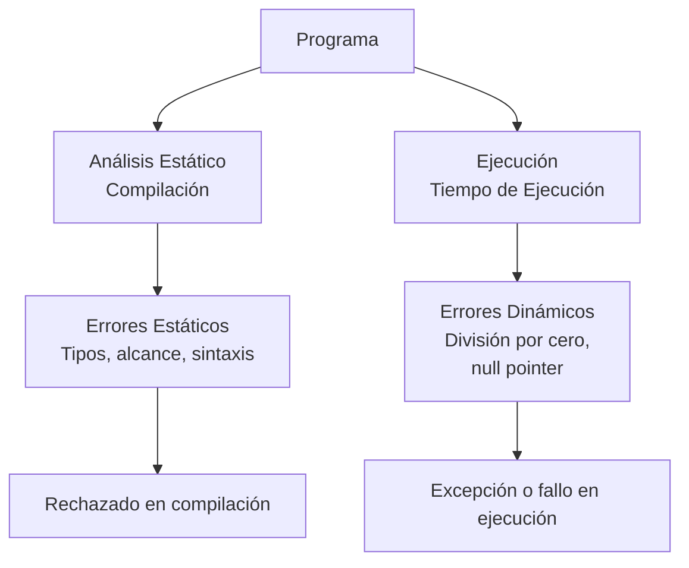

# Lenguajes de Programación - Fundamentos

## 2.3 Semántica: estilos de semántica (denotacional, operacional, axiomática); semántica estática y dinámica; sistemas de tipos.

---

La semántica estudia el significado de los programas, complementando la sintaxis que define su forma. En esta guía exploraremos los diferentes estilos de semántica, la distinción entre semántica estática y dinámica, y los sistemas de tipos.

### Estilos de Semántica

#### Semántica Denotacional

La semántica denotacional asigna significados matemáticos a construcciones del lenguaje mediante funciones.

**Estructura básica:**

$$ [\![\text{expresión}]\!] : \text{Environment} \rightarrow \text{Value} $$

**Ejemplo para expresiones aritméticas:**
$$ \begin{aligned} [\![n]\!]\rho &= n \\\ [\![x]\!]\rho &= \rho(x) \\\ [\![e_1 + e_2]\!]\rho &= [\![e_1]\!]\rho + [\![e_2]\!]\rho \\\ [\![\text{let } x = e_1 \text{ in } e_2]\!] rho &= [\![e_2]\!](\rho[x \mapsto [\![e_1]\!]\rho]) \end{aligned} $$

#### Semántica Operacional

Describe el significado mediante reglas de ejecución.

##### Semántica de Paso Pequeño (SOS)

$$ \begin{aligned} \frac{}{\langle n, \sigma \rangle \rightarrow n} \quad &\text{(E-Const)} \\\ \frac{}{\langle x, \sigma \rangle \rightarrow \sigma(x)} \quad &\text{(E-Var)} \\\ \frac{\langle e_1, \sigma \rangle \rightarrow v_1 \quad \langle e_2, \sigma \rangle \rightarrow v_2}{\langle e_1 + e_2, \sigma \rangle \rightarrow v_1 + v_2} \quad &\text{(E-Add)} \\\ \frac{\langle e_1, \sigma \rangle \rightarrow v}{\langle \text{let } x = e_1 \text{ in } e_2, \sigma \rangle \rightarrow \langle e_2, \sigma[x \mapsto v]  \rangle} \quad &\text{(E-Let)} \end{aligned} $$

##### Semántica de Paso Grande

$$ \frac{\langle e_1, \sigma \rangle \Downarrow v_1 \quad \langle e_2, \sigma[x \mapsto v_1] \rangle \Downarrow v_2}{\langle \text{let } x = e_1 \text{ in } e_2, \sigma \rangle \Downarrow v_2} \quad \text{(B-Let)} $$

#### Semántica Axiomática

Define el significado mediante pre y postcondiciones usando lógica de Hoare.

**Triplas de Hoare:**
$$ \{P\} \; C \; \{Q\} $$

**Reglas de inferencia:**
$$ \begin{aligned} &\text{(Asignación): } \frac{}{\{Q[e/x]\} \; x := e \; \{Q\}} \\\ &\text{(Secuencia): } \frac{\{P\} \; C_1 \; \{R\} \quad \{R\} \; C_2 \; \{Q\}}{\{P\} \; C_1; C_2 \; \{Q\}} \\\ &\text{(Condicional): } \frac{\{P \land b\} \; C_1 \; \{Q\} \quad \{P \land \neg b\} \; C_2 \; \{Q\}}{\{P\} \; \text{if } b \text{ then } C_1 \text{ else } C_2 \; \{Q\}} \\\ &\text{(Iteración): } \frac{\{P \land b\} \; C \; \{P\}}{\{P\} \; \text{while } b \text{ do } C \; \{P \land \neg b\}} \end{aligned} $$

### Semántica Estática vs. Dinámica

#### Semántica Estática

Se verifica en tiempo de compilación sin ejecutar el programa.

**Ejemplos:**

- Verificación de tipos
- Análisis de alcance
- Detección de variables no inicializadas

#### Semántica Dinámica

Se verifica durante la ejecución del programa.

**Ejemplos:**

- Verificación de límites de arrays
- Comprobación de tipos en tiempo de ejecución
- Manejo de excepciones

#### Comparación



### Sistemas de Tipos

#### Funciones Principales

1. **Detección de errores**
2. **Abstracción**
3. **Documentación**
4. **Optimización**

#### Sistema de Tipos Simple

**Sintaxis de tipos:**

$$
\tau ::= \text{int} \mid \text{bool} \mid \tau \rightarrow \tau
$$

**Reglas de tipado:**
$$ \begin{aligned} &\text{(T-Int): } \frac{}{\Gamma \vdash n : \text{int}} \\\ &\text{(T-Bool): } \frac{}{\Gamma \vdash \text{true} : \text{bool}} \quad \frac{}{\Gamma \vdash \text{false} : \text{bool}} \\\ &\text{(T-Var): } \frac{x : \tau \in \Gamma}{\Gamma \vdash x : \tau} \\\ &\text{(T-Add): } \frac{\Gamma \vdash e_1 : \text{int} \quad \Gamma \vdash e_2 : \text{int}}{\Gamma \vdash e_1 + e_2 : \text{int}} \\\ &\text{(T-If): } \frac{\Gamma \vdash e_1 : \text{bool} \quad \Gamma \vdash e_2 : \tau \quad \Gamma \vdash e_3 : \tau}{\Gamma \vdash \text{if } e_1 \text{ then } e_2 \text{ else } e_3 : \tau} \\\ &\text{(T-Abs): } \frac{\Gamma, x : \tau_1 \vdash e : \tau_2}{\Gamma \vdash \lambda x : \tau_1 . e : \tau_1 \rightarrow \tau_2} \\\ &\text{(T-App): } \frac{\Gamma \vdash e_1 : \tau_1 \rightarrow \tau_2 \quad \Gamma \vdash e_2 : \tau_1}{\Gamma \vdash e_1 e_2 : \tau_2} \end{aligned} $$

#### Polimorfismo

##### Polimorfismo Paramétrico

**Ejemplo en System F:**
$$ \begin{aligned} &\text{(T-TAbs): } \frac{\Gamma, X \vdash e : \tau}{\Gamma \vdash \Lambda X . e : \forall X . \tau} \\\ &\text{(T-TApp): } \frac{\Gamma \vdash e : \forall X . \tau}{\Gamma \vdash e [\tau'] : \tau[\tau'/X]} \end{aligned} $$

##### Polimorfismo Ad Hoc (Sobrecarga)

**Ejemplo en Haskell:**

```haskell
class Eq a where
    (==) :: a -> a -> Bool

instance Eq Int where
    (==) = primEqInt

instance Eq Bool where
    True == True = True
    False == False = True
    _ == _ = False
```

#### Inferencia de Tipos

**Algoritmo de Hindley-Milner:**
$$ \begin{aligned} &\text{(I-Var): } \frac{}{\Gamma \vdash x : \Gamma(x)} \quad \text{(I-Const): } \frac{}{\Gamma \vdash n : \text{int}} \\\ &\text{(I-App): } \frac{\Gamma \vdash e_1 : \tau_1 \rightarrow \tau_2 \quad \Gamma \vdash e_2 : \tau_1}{\Gamma \vdash e_1 e_2 : \tau_2} \\\ &\text{(I-Abs): } \frac{\Gamma, x : \alpha \vdash e : \tau}{\Gamma \vdash \lambda x . e : \alpha \rightarrow \tau} \\\ &\text{(I-Let): } \frac{\Gamma \vdash e_1 : \tau_1 \quad \Gamma, x : \tau_1 \vdash e_2 : \tau_2}{\Gamma \vdash \text{let } x = e_1 \text{ in } e_2 : \tau_2} \end{aligned} $$

### Ejercicios Propuestos

#### Ejercicio 1: Semántica Denotacional

Defina la semántica denotacional para las siguientes construcciones:

1. Expresión condicional: `if e1 then e2 else e3`
2. Ciclo while: `while e do c`

#### Ejercicio 2: Semántica Operacional

Defina reglas de semántica operacional para:

1. Asignación destructiva: `x := e`
2. Secuenciación: `c1; c2`
3. Llamada a función: `f(e)`

#### Ejercicio 3: Lógica de Hoare

Demuestre la corrección parcial del siguiente programa usando lógica de Hoare:

```pascal
{ x = A ∧ y = B }
z := 0;
while x > 0 do
    z := z + y;
    x := x - 1
end
{ z = A * B }
```

#### Ejercicio 4: Sistema de Tipos

Extienda el sistema de tipos simple con:

1. Tuplas: `(e1, e2)` y proyecciones: `fst e`, `snd e`
2. Listas: `[]`, `e1 : e2`, y operaciones sobre listas
3. Definiciones de tipos recursivos

#### Ejercicio 5: Inferencia de Tipos

Realice la inferencia de tipos para las siguientes expresiones:

1. `λx. x x` (¿Por qué falla?)
2. `λf. λx. f (f x)`
3. `let id = λx. x in (id 5, id true)`

### Implementación Práctica

#### Verificador de Tipos en Haskell

```haskell
data Type = TInt | TBool | TFun Type Type | TVar String
    deriving (Eq, Show)

data Expr = EInt Int | EBool Bool | EVar String
          | EAdd Expr Expr | EIf Expr Expr Expr
          | EAbs String Type Expr | EApp Expr Expr

type Context = [(String, Type)]

typeCheck :: Context -> Expr -> Either String Type
typeCheck ctx (EInt _) = Right TInt
typeCheck ctx (EBool _) = Right TBool
typeCheck ctx (EVar x) =
    case lookup x ctx of
        Just t -> Right t
        Nothing -> Left $ "Variable no definida: " ++ x
typeCheck ctx (EAdd e1 e2) = do
    t1 <- typeCheck ctx e1
    t2 <- typeCheck ctx e2
    if t1 == TInt && t2 == TInt
        then Right TInt
        else Left "Error de tipos en suma"
typeCheck ctx (EIf cond thenExpr elseExpr) = do
    tCond <- typeCheck ctx cond
    tThen <- typeCheck ctx thenExpr
    tElse <- typeCheck ctx elseExpr
    if tCond /= TBool
        then Left "La condición debe ser booleana"
        else if tThen == tElse
            then Right tThen
            else Left "Las ramas del if deben tener el mismo tipo"
typeCheck ctx (EAbs x paramType body) = do
    bodyType <- typeCheck ((x, paramType):ctx) body
    Right (TFun paramType bodyType)
typeCheck ctx (EApp fun arg) = do
    funType <- typeCheck ctx fun
    argType <- typeCheck ctx arg
    case funType of
        TFun paramType resultType ->
            if argType == paramType
                then Right resultType
                else Left "Tipo de argumento incorrecto"
        _ -> Left "Intento de aplicar no-función"
```

### Referencias

#### Bibliografía Básica

1. Mitchell J., _Concepts in Programming Languages_. Cambridge University Press 2003. (Capítulos 4-6)
2. Pierce B.C., _Types and Programming Languages_. MIT Press 2002. (Capítulos 2-4, 9-10, 22-23)

#### Bibliografía Complementaria

1. Winskel G., _The Formal Semantics of Programming Languages_. MIT Press 1993.
2. Nielson H.R., Nielson F., _Semantics with Applications: A Formal Introduction_. Wiley 1992.
3. Reynolds J.C., _Theories of Programming Languages_. Cambridge University Press 1998.

#### Recursos Adicionales

- [Software Foundations](https://softwarefoundations.cis.upenn.edu/) - Serie de libros sobre fundamentos formales
- [Programming Language Foundations in Agda](https://plfa.github.io/)
- [Semantics Resources](https://semantics-domain.github.io/)

### Conclusión

La semántica proporciona los fundamentos matemáticos para entender el significado de los programas más allá de su sintaxis. Los diferentes estilos semánticos (denotacional, operacional, axiomática) ofrecen perspectivas complementarias, mientras que los sistemas de tipos garantizan propiedades de seguridad y corrección. La distinción entre semántica estática y dinámica refleja el equilibrio entre verificación temprana y flexibilidad en tiempo de ejecución. El estudio de estos conceptos es esencial para el diseño, implementación y verificación de lenguajes de programación robustos y confiables.
