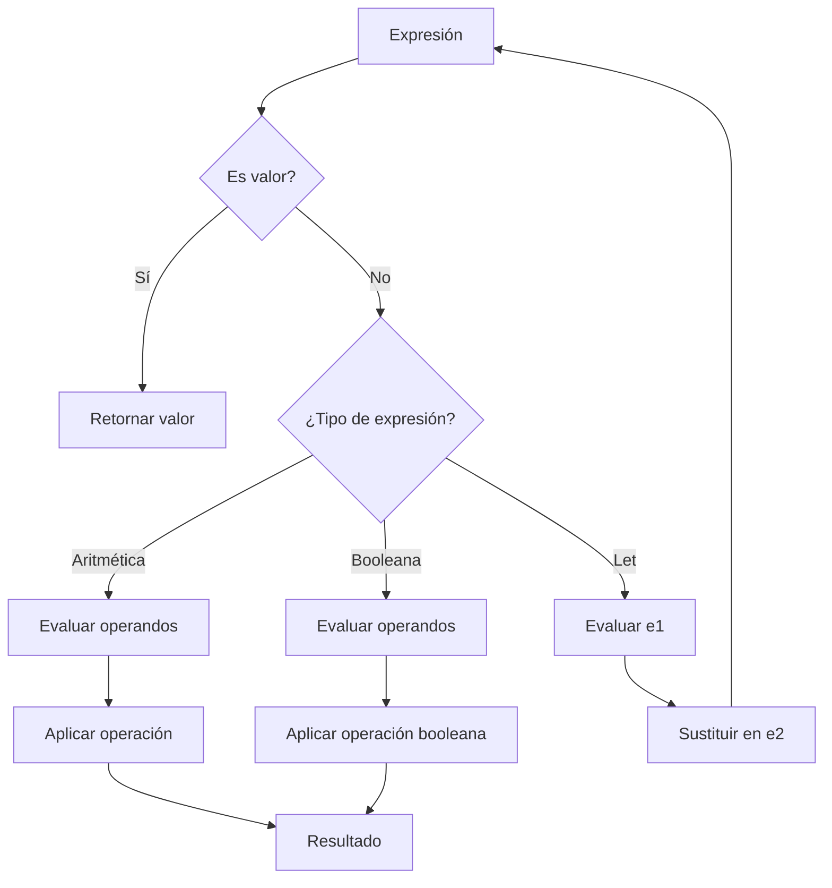

# Lenguajes de Programación - Fundamentos

## 2.4 Expresiones aritméticas y booleanas; expresiones let.

---

Las expresiones son los componentes fundamentales de los lenguajes de programación. En esta guía exploraremos tres tipos esenciales: expresiones aritméticas, booleanas y expresiones let, analizando su sintaxis, semántica y propiedades formales.

### Expresiones Aritméticas

#### Sintaxis Abstracta

Definición formal de expresiones aritméticas:

$$ \begin{aligned} e &::= n \mid x \mid e_1 + e_2 \mid e_1 - e_2 \mid e_1 \times e_2 \mid e_1 / e_2 \\\ n &::= \ldots, -2, -1, 0, 1, 2, \ldots \quad \text{(números enteros)} \\\ x &::= \text{identificadores} \end{aligned} $$

#### Semántica Operacional

**Reglas de evaluación (paso pequeño):**

$$ \begin{aligned} &\text{(E-Add1): } \frac{e_1 \rightarrow e_1'}{e_1 + e_2 \rightarrow e_1' + e_2} \\\ &\text{(E-Add2): } \frac{e_2 \rightarrow e_2'}{v_1 + e_2 \rightarrow v_1 + e_2'} \\\ &\text{(E-Add): } \frac{}{n_1 + n_2 \rightarrow n} \quad \text{donde } n = n_1 + n_2 \\\ &\text{(E-Sub): } \frac{}{n_1 - n_2 \rightarrow n} \quad \text{donde } n = n_1 - n_2 \\\ &\text{(E-Mul): } \frac{}{n_1 \times n_2 \rightarrow n} \quad \text{donde } n = n_1 \times n_2 \\\ &\text{(E-Div): } \frac{}{n_1 / n_2 \rightarrow n} \quad \text{donde } n_2 \neq 0 \text{ y } n = n_1 \div n_2 \end{aligned} $$

#### Implementación en Haskell

```haskell
data AExpr = Num Int
           | Var String
           | Add AExpr AExpr
           | Sub AExpr AExpr
           | Mul AExpr AExpr
           | Div AExpr AExpr

-- Evaluación de expresiones aritméticas
evalAExpr :: Env -> AExpr -> Maybe Int
evalAExpr env (Num n) = Just n
evalAExpr env (Var x) = lookupEnv x env
evalAExpr env (Add e1 e2) = do
    v1 <- evalAExpr env e1
    v2 <- evalAExpr env e2
    return (v1 + v2)
evalAExpr env (Sub e1 e2) = do
    v1 <- evalAExpr env e1
    v2 <- evalAExpr env e2
    return (v1 - v2)
evalAExpr env (Mul e1 e2) = do
    v1 <- evalAExpr env e1
    v2 <- evalAExpr env e2
    return (v1 * v2)
evalAExpr env (Div e1 e2) = do
    v1 <- evalAExpr env e1
    v2 <- evalAExpr env e2
    if v2 == 0 then Nothing else Just (v1 `div` v2)
```

### Expresiones Booleanas

#### Sintaxis Abstracta

$$ \begin{aligned} b &::= \text{true} \mid \text{false} \mid e_1 = e_2 \mid e_1 < e_2 \mid e_1 > e_2 \\\ &\mid \neg b \mid b_1 \land b_2 \mid b_1 \lor b_2 \end{aligned} $$

#### Semántica Operacional

**Reglas de evaluación:**

$$ \begin{aligned} &\text{(B-Not1): } \frac{b \rightarrow b'}{\neg b \rightarrow \neg b'} \\\ &\text{(B-Not): } \frac{}{\neg \text{true} \rightarrow \text{false}} \quad \frac{}{\neg \text{false} \rightarrow \text{true}} \\\ &\text{(B-And1): } \frac{b_1 \rightarrow b_1'}{b_1 \land b_2 \rightarrow b_1' \land b_2} \\\ &\text{(B-And2): } \frac{b_2 \rightarrow b_2'}{v_1 \land b_2 \rightarrow v_1 \land b_2'} \\\ &\text{(B-AndTrue): } \frac{}{\text{true} \land \text{true} \rightarrow \text{true}} \\\ &\text{(B-AndFalse): } \frac{}{\text{false} \land v_2 \rightarrow \text{false}} \quad \frac{}{\text{true} \land \text{false} \rightarrow \text{false}} \\\ &\text{(B-Eq): } \frac{}{n_1 = n_2 \rightarrow \text{true}} \quad \text{si } n_1 = n_2 \\\ &\text{(B-EqFalse): } \frac{}{n_1 = n_2 \rightarrow \text{false}} \quad \text{si } n_1 \neq n_2 \end{aligned} $$

#### Implementación en Haskell

```haskell
data BExpr = Bool Bool
           | Eq AExpr AExpr
           | Lt AExpr AExpr
           | Gt AExpr AExpr
           | Not BExpr
           | And BExpr BExpr
           | Or BExpr BExpr

-- Evaluación de expresiones booleanas
evalBExpr :: Env -> BExpr -> Maybe Bool
evalBExpr env (Bool b) = Just b
evalBExpr env (Eq e1 e2) = do
    v1 <- evalAExpr env e1
    v2 <- evalAExpr env e2
    return (v1 == v2)
evalBExpr env (Lt e1 e2) = do
    v1 <- evalAExpr env e1
    v2 <- evalAExpr env e2
    return (v1 < v2)
evalBExpr env (Not b) = do
    v <- evalBExpr env b
    return (not v)
evalBExpr env (And b1 b2) = do
    v1 <- evalBExpr env b1
    if not v1 then return False else evalBExpr env b2
evalBExpr env (Or b1 b2) = do
    v1 <- evalBExpr env b1
    if v1 then return True else evalBExpr env b2
```

### Expresiones Let

#### Sintaxis Abstracta

$$
e ::= \ldots \mid \text{let } x = e_1 \text{ in } e_2
$$

#### Semántica Operacional

**Reglas de evaluación:**

$$ \begin{aligned} &\text{(E-Let1): } \frac{e_1 \rightarrow e_1'}{\text{let } x = e_1 \text{ in } e_2 \rightarrow \text{let } x = e_1' \text{ in } e_2} \\\ &\text{(E-Let): } \frac{}{\text{let } x = v \text{ in } e_2 \rightarrow e_2[v/x]} \end{aligned} $$

#### Semántica Denotacional

$$
[\![\text{let } x = e_1 \text{ in } e_2]\!]\rho = [\![e_2]\!](\rho[x \mapsto [\![e_1]\!]\rho])
$$

#### Implementación en Haskell

```haskell
data Expr = AExpr AExpr
          | BExpr BExpr
          | Let String Expr Expr

-- Evaluación con expresiones let
evalExpr :: Env -> Expr -> Maybe Value
evalExpr env (AExpr a) = Int <$> evalAExpr env a
evalExpr env (BExpr b) = Bool <$> evalBExpr env b
evalExpr env (Let x e1 e2) = do
    v1 <- evalExpr env e1
    evalExpr ((x, v1):env) e2
```

### Sistema de Tipos

#### Reglas de Tipado

$$ \begin{aligned} &\text{(T-Num): } \frac{}{\Gamma \vdash n : \text{int}} \\\ &\text{(T-Bool): } \frac{}{\Gamma \vdash \text{true} : \text{bool}} \quad \frac{}{\Gamma \vdash \text{false} : \text{bool}} \\\ &\text{(T-Add): } \frac{\Gamma \vdash e_1 : \text{int} \quad \Gamma \vdash e_2 : \text{int}}{\Gamma \vdash e_1 + e_2 : \text{int}} \\\ &\text{(T-Eq): } \frac{\Gamma \vdash e_1 : \tau \quad \Gamma \vdash e_2 : \tau}{\Gamma \vdash e_1 = e_2 : \text{bool}} \\\ &\text{(T-Not): } \frac{\Gamma \vdash b : \text{bool}}{\Gamma \vdash \neg b : \text{bool}} \\\ &\text{(T-Let): } \frac{\Gamma \vdash e_1 : \tau_1 \quad \Gamma, x : \tau_1 \vdash e_2 : \tau_2}{\Gamma \vdash \text{let } x = e_1 \text{ in } e_2 : \tau_2} \end{aligned} $$

#### Verificación de Tipos

```haskell
data Type = TInt | TBool | TError

typeCheck :: Env -> Expr -> Type
typeCheck env (AExpr (Num _)) = TInt
typeCheck env (BExpr (Bool _)) = TBool
typeCheck env (AExpr (Add e1 e2)) =
    case (typeCheck env (AExpr e1), typeCheck env (AExpr e2)) of
        (TInt, TInt) -> TInt
        _ -> TError
typeCheck env (BExpr (Eq e1 e2)) =
    case (typeCheck env (AExpr e1), typeCheck env (AExpr e2)) of
        (TInt, TInt) -> TBool
        _ -> TError
typeCheck env (Let x e1 e2) =
    case typeCheck env e1 of
        TError -> TError
        t1 -> typeCheck ((x, t1):env) e2
```

### Diagrama de Flujo de Evaluación



### Ejemplos Prácticos

#### Ejemplo 1: Expresión Aritmética Compleja

$$
\text{let } x = 5 \text{ in } (x + 3) \times (x - 2)
$$

**Evaluación paso a paso:**

1. $\text{let } x = 5 \text{ in } (x + 3) \times (x - 2)$
2. $(5 + 3) \times (5 - 2)$
3. $8 \times 3$
4. $24$

#### Ejemplo 2: Expresión Booleana con Let

$$
\text{let } a = 10 \text{ in } \text{let } b = 5 \text{ in } (a > b) \land (a - b = 5)
$$

**Evaluación:**

1. $\text{let } a = 10 \text{ in } \text{let } b = 5 \text{ in } (a > b) \land (a - b = 5)$
2. $\text{let } b = 5 \text{ in } (10 > 5) \land (10 - 5 = 5)$
3. $(10 > 5) \land (10 - 5 = 5)$
4. $\text{true} \land (5 = 5)$
5. $\text{true} \land \text{true}$
6. $\text{true}$

### Ejercicios Propuestos

#### Ejercicio 1: Evaluación Paso a Paso

Evalúe paso a paso la siguiente expresión usando las reglas operacionales:

$$
\text{let } x = 2 + 3 \text{ in } \text{let } y = x \times 2 \text{ in } (x + y) / 5
$$

#### Ejercicio 2: Verificación de Tipos

Para cada expresión, determine si está bien tipada y su tipo:

1. $\text{let } x = 5 \text{ in } x + \text{true}$
2. $\text{let } b = (3 < 5) \text{ in } \text{if } b \text{ then } 1 \text{ else } 0$
3. $\text{let } x = 10 \text{ in } \text{let } y = x = 10 \text{ in } y$

#### Ejercicio 3: Semántica Denotacional

Calcule el significado denotacional de:

$$
[\![\text{let } x = 2 \text{ in } \text{let } y = x + 1 \text{ in } x \times y]\!]\emptyset
$$

#### Ejercicio 4: Implementación

Extienda el evaluador en Haskell para soportar:

- Expresiones de comparación adicionales ( $\leq$, $\geq$, $\neq$ )
- Expresiones condicionales: $\text{if } b \text{ then } e_1 \text{ else } e_2$
- Múltiples enlaces en un let: $\text{let } x = e_1, y = e_2 \text{ in } e_3$

#### Ejercicio 5: Propiedades Formales

Demuestre por inducción estructural que para cualquier expresión aritmética $e$ y ambiente $\rho$ bien formado, si $e$ tiene tipo $\text{int}$, entonces $[\![e]\!]\rho$ está definido y es un número entero.

### Referencias

#### Bibliografía Básica

1. Mitchell J., _Concepts in Programming Languages_. Cambridge University Press 2003. (Capítulos 2-4)
2. Pierce B.C., _Types and Programming Languages_. MIT Press 2002. (Capítulos 3-5)

#### Bibliografía Complementaria

1. Harper R., _Practical Foundations for Programming Languages_. 2010. (Capítulos 1-3)
2. Friedman D. P., Wand M., _Essentials of Programming Languages_. 3rd edition. MIT Press, 2008. (Capítulos 2-3)

#### Recursos Adicionales

- [PL Zoo](https://plzoo.andrej.com/) - Colección de pequeños lenguajes de programación
- [Semantics Examples](https://github.com/semantic-examples) - Ejemplos de semántica formal
- [Programming Language Theory](https://github.com/steshaw/plt) - Recursos sobre teoría de lenguajes

### Conclusión

Las expresiones aritméticas, booleanas y let constituyen los componentes fundamentales de los lenguajes de programación. Su estudio formal a través de sintaxis abstracta, semántica operacional y denotacional, y sistemas de tipos proporciona las bases para entender construcciones más complejas. El dominio de estos conceptos es esencial para el diseño, implementación y análisis de lenguajes de programación, así como para el desarrollo de herramientas como compiladores e intérpretes.
