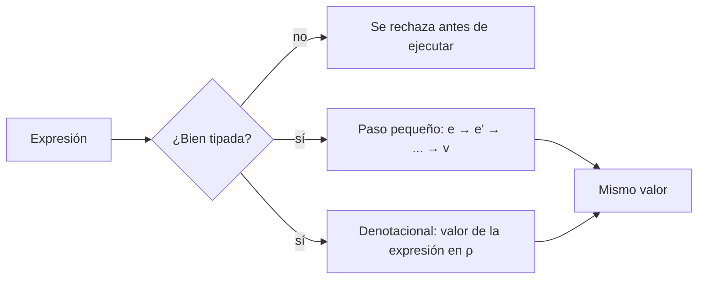

# Lenguajes de Programación - Fundamentos

## 2.4 Expresiones aritméticas y booleanas; expresiones let.

---

El lenguaje de expresiones aritméticas y booleanas con `let` es el primer lenguaje completo que se estudia con las herramientas de los temas anteriores: tiene una sintaxis abstracta definida inductivamente, una semántica denotacional, una semántica operacional de paso pequeño, un sistema de tipos y un teorema de seguridad. Es pequeño, pero ya contiene los dos conceptos centrales de los lenguajes reales: el **ligado** de variables, con su alcance y su sustitución, y la distinción entre expresiones **bien tipadas** y mal tipadas. Este tema define el lenguaje, sus semánticas y su sistema de tipos, y los relaciona entre sí.

### Sintaxis abstracta

$$e ::= n \mid \mathsf{true} \mid \mathsf{false} \mid x \mid e_1 \oplus e_2 \mid \mathsf{not}\; e \mid \mathsf{if}\; e_1\; \mathsf{then}\; e_2\; \mathsf{else}\; e_3 \mid \mathsf{let}\; x = e_1\; \mathsf{in}\; e_2,$$

con $n \in \mathbb{Z}$ y $\oplus$ un operador aritmético, como $+,$ $-,$ $\times$ y $/;$ de comparación, como $\lt,$ $\le,$ $=$ y $\ne,$ o lógico, como $\land$ y $\lor.$ En $\mathsf{let}\; x = e_1\; \mathsf{in}\; e_2,$ la variable $x$ queda ligada en $e_2,$ y su **alcance** es solo $e_2:$ en $e_1,$ una $x$ se refiere a una declaración exterior. Una declaración interior con el mismo nombre oculta a la exterior.

### Semántica denotacional

Con un **ambiente** $\rho : \mathsf{Var} \rightharpoonup \mathbb{Z} \cup \mathbb{B},$ el significado de una expresión es su valor:

$$[\![ n ]\!]\rho = n, \qquad [\![ x ]\!]\rho = \rho(x), \qquad [\![ e_1 + e_2 ]\!]\rho = [\![ e_1 ]\!]\rho + [\![ e_2 ]\!]\rho,$$

$$[\![ \mathsf{if}\; e_1\; \mathsf{then}\; e_2\; \mathsf{else}\; e_3 ]\!]\rho = \begin{cases} [\![ e_2 ]\!]\rho & \text{si } [\![ e_1 ]\!]\rho = \mathsf{true}, \\ [\![ e_3 ]\!]\rho & \text{si } [\![ e_1 ]\!]\rho = \mathsf{false}, \end{cases} \qquad [\![ \mathsf{let}\; x = e_1\; \mathsf{in}\; e_2 ]\!]\rho = [\![ e_2 ]\!](\rho[x \mapsto [\![ e_1 ]\!]\rho]).$$

La división es la excepción: $[\![ e_1 / e_2 ]\!]\rho$ no está definida si $[\![ e_2 ]\!]\rho = 0,$ así que $[\![ \cdot ]\!]$ es una función **parcial**. Hay que decidir además qué división entera se usa: Python redondea hacia $-\infty,$ de modo que $-1 / 3 = -1,$ y C y Java truncan hacia cero, con $-1 / 3 = 0.$

### Semántica operacional

De paso pequeño, con valores $v ::= n \mid \mathsf{true} \mid \mathsf{false}$ y orden de evaluación de izquierda a derecha:

$$\frac{e_1 \to e_1'}{e_1 \oplus e_2 \to e_1' \oplus e_2} \qquad \frac{e_2 \to e_2'}{v_1 \oplus e_2 \to v_1 \oplus e_2'} \qquad \frac{v = v_1 \oplus v_2}{v_1 \oplus v_2 \to v}$$

$$\frac{e_1 \to e_1'}{\mathsf{let}\; x = e_1\; \mathsf{in}\; e_2 \to \mathsf{let}\; x = e_1'\; \mathsf{in}\; e_2} \qquad \frac{}{\mathsf{let}\; x = v\; \mathsf{in}\; e_2 \to e_2[x := v]}$$

La **sustitución** $e[x := v]$ reemplaza las apariciones **libres** de $x$ en $e$ por $v;$ al llegar a un $\mathsf{let}\; x$ interior, se detiene en su cuerpo, porque ahí $x$ se refiere a otra declaración. Las dos semánticas coinciden: $e \to^* v$ si y solo si $[\![ e ]\!]\varnothing = v,$ lo que se demuestra por inducción sobre $e.$ Esta semántica es **ansiosa**: evalúa $e_1$ antes de sustituir. La alternativa **perezosa** sustituye $e_1$ sin evaluar (tema 3.2).

### Sistema de tipos

Con tipos $T ::= \mathsf{int} \mid \mathsf{bool}$ y contextos $\Gamma$ que asignan un tipo a cada variable:

$$\frac{}{\Gamma \vdash n : \mathsf{int}} \qquad \frac{x : T \in \Gamma}{\Gamma \vdash x : T} \qquad \frac{\Gamma \vdash e_1 : \mathsf{int} \quad \Gamma \vdash e_2 : \mathsf{int}}{\Gamma \vdash e_1 + e_2 : \mathsf{int}} \qquad \frac{\Gamma \vdash e_1 : \mathsf{int} \quad \Gamma \vdash e_2 : \mathsf{int}}{\Gamma \vdash e_1 \lt e_2 : \mathsf{bool}}$$

$$\frac{\Gamma \vdash e_1 : \mathsf{bool} \quad \Gamma \vdash e_2 : T \quad \Gamma \vdash e_3 : T}{\Gamma \vdash \mathsf{if}\; e_1\; \mathsf{then}\; e_2\; \mathsf{else}\; e_3 : T} \qquad \frac{\Gamma \vdash e_1 : T_1 \quad \Gamma, x : T_1 \vdash e_2 : T_2}{\Gamma \vdash \mathsf{let}\; x = e_1\; \mathsf{in}\; e_2 : T_2}$$

La igualdad $e_1 = e_2$ exige que ambos lados tengan el mismo tipo. En el condicional, las dos ramas deben tener el mismo tipo aunque solo se ejecute una: el tipo se decide sin ejecutar.



### Implementación en Python

El programa implementa las dos semánticas y el sistema de tipos. Para el ejercicio 1 imprime cada paso de la reducción y compara el resultado con la semántica denotacional; para el ejercicio 2 verifica los tipos de las tres expresiones; para el ejercicio 3 muestra los ambientes que construye la semántica denotacional. Para el ejercicio 4 agrega comparaciones, el condicional y un `let` con varios ligados simultáneos. Para el ejercicio 5 genera 2000 expresiones aleatorias de tipo `int` y comprueba la propiedad pedida, que falla con la división entre cero.

```python
import random

# expresiones: ("n", 5) ("b", True) ("v", "x") ("op", "+", e1, e2) ("not", e) ("if", c, e1, e2)
#              ("let", x, e1, e2)  ("lets", [(x1, e1), (x2, e2)], cuerpo)   -- ligado simultáneo, ejercicio 4
ARIT = {"+": lambda a, b: a + b, "-": lambda a, b: a - b, "*": lambda a, b: a * b, "/": lambda a, b: a // b}
COMP = {"<": lambda a, b: a < b, "<=": lambda a, b: a <= b, ">": lambda a, b: a > b, ">=": lambda a, b: a >= b,
        "==": lambda a, b: a == b, "!=": lambda a, b: a != b}
LOG = {"&&": lambda a, b: a and b, "||": lambda a, b: a or b}

def txt(e):
    k = e[0]
    if k == "n": return str(e[1])
    if k == "b": return str(e[1]).lower()
    if k == "v": return e[1]
    if k == "op": return f"({txt(e[2])} {e[1]} {txt(e[3])})"
    if k == "not": return f"not {txt(e[1])}"
    if k == "if": return f"if {txt(e[1])} then {txt(e[2])} else {txt(e[3])}"
    if k == "let": return f"let {e[1]} = {txt(e[2])} in {txt(e[3])}"
    return f"let {', '.join(f'{x} = {txt(d)}' for x, d in e[1])} in {txt(e[2])}"

# --- semántica denotacional: [[e]]ρ, por recursión sobre e ---
def ev(e, rho):
    k = e[0]
    if k in ("n", "b"): return e[1]
    if k == "v": return rho[e[1]]
    if k == "op":
        a, b = ev(e[2], rho), ev(e[3], rho)
        if e[1] == "/" and b == 0: raise ZeroDivisionError("división entre cero: [[e1 / e2]] no está definida")
        return {**ARIT, **COMP, **LOG}[e[1]](a, b)
    if k == "not": return not ev(e[1], rho)
    if k == "if": return ev(e[2], rho) if ev(e[1], rho) else ev(e[3], rho)
    if k == "let": return ev(e[3], {**rho, e[1]: ev(e[2], rho)})
    if k == "lets": return ev(e[2], {**rho, **{x: ev(d, rho) for x, d in e[1]}})   # todas en el ambiente de afuera

# --- semántica operacional de paso pequeño, por sustitución ---
def es_valor(e): return e[0] in ("n", "b")
def sust(e, x, v):
    k = e[0]
    if k == "v": return v if e[1] == x else e
    if k in ("n", "b"): return e
    if k == "op": return ("op", e[1], sust(e[2], x, v), sust(e[3], x, v))
    if k == "not": return ("not", sust(e[1], x, v))
    if k == "if": return ("if",) + tuple(sust(a, x, v) for a in e[1:])
    if k == "let": return ("let", e[1], sust(e[2], x, v), e[3] if e[1] == x else sust(e[3], x, v))  # x interior oculta a x
def paso(e):
    k = e[0]
    if k == "op":
        if not es_valor(e[2]): return ("op", e[1], paso(e[2]), e[3])
        if not es_valor(e[3]): return ("op", e[1], e[2], paso(e[3]))
        return ("n" if e[1] in ARIT else "b", ev(e, {}))
    if k == "not": return ("b", not e[1][1]) if es_valor(e[1]) else ("not", paso(e[1]))
    if k == "if": return (e[2] if e[1][1] else e[3]) if es_valor(e[1]) else ("if", paso(e[1]), e[2], e[3])
    if k == "let": return sust(e[3], e[1], e[2]) if es_valor(e[2]) else ("let", e[1], paso(e[2]), e[3])

N, B, V = (lambda n: ("n", n)), (lambda b: ("b", b)), (lambda x: ("v", x))
op = lambda o, a, b: ("op", o, a, b)
# --- Ejercicio 1 ---
e1 = ("let", "x", op("+", N(2), N(3)), ("let", "y", op("*", V("x"), N(2)), op("/", op("+", V("x"), V("y")), N(5))))
print("ejercicio 1:")
e = e1
while not es_valor(e):
    print("   ", txt(e)); e = paso(e)
print("    ", txt(e), "| denotacional:", ev(e1, {}))

# --- Ejercicio 2: verificación de tipos ---
def tipo(e, gamma):
    k = e[0]
    if k == "n": return "int"
    if k == "b": return "bool"
    if k == "v": return gamma[e[1]]
    if k == "op":
        t1, t2 = tipo(e[2], gamma), tipo(e[3], gamma)
        if e[1] in ARIT or e[1] in ("<", "<=", ">", ">="):
            if (t1, t2) != ("int", "int"): raise TypeError(f"{e[1]} espera int e int, recibió {t1} y {t2}")
            return "int" if e[1] in ARIT else "bool"
        if e[1] in ("==", "!="):
            if t1 != t2: raise TypeError(f"{e[1]} compara {t1} con {t2}")
            return "bool"
        if (t1, t2) != ("bool", "bool"): raise TypeError(f"{e[1]} espera bool")
        return "bool"
    if k == "not":
        if tipo(e[1], gamma) != "bool": raise TypeError("not espera bool")
        return "bool"
    if k == "if":
        if tipo(e[1], gamma) != "bool": raise TypeError("la condición debe ser bool")
        t1, t2 = tipo(e[2], gamma), tipo(e[3], gamma)
        if t1 != t2: raise TypeError(f"las ramas tienen tipos {t1} y {t2}")
        return t1
    if k == "let": return tipo(e[3], {**gamma, e[1]: tipo(e[2], gamma)})
    if k == "lets": return tipo(e[2], {**gamma, **{x: tipo(d, gamma) for x, d in e[1]}})
casos2 = [("let", "x", N(5), op("+", V("x"), B(True))),
          ("let", "b", op("<", N(3), N(5)), ("if", V("b"), N(1), N(0))),
          ("let", "x", N(10), ("let", "y", op("==", V("x"), N(10)), V("y")))]
for c in casos2:
    try: print(f"ejercicio 2: {txt(c)} : {tipo(c, {})} = {ev(c, {})}")
    except TypeError as err: print(f"ejercicio 2: {txt(c)} : mal tipada, {err}")

# --- Ejercicio 3: [[let x = 2 in let y = x + 1 in x * y]]∅, mostrando los ambientes ---
e3 = ("let", "x", N(2), ("let", "y", op("+", V("x"), N(1)), op("*", V("x"), V("y"))))
rho1 = {"x": ev(N(2), {})}; rho2 = {**rho1, "y": ev(op("+", V("x"), N(1)), rho1)}
print("ejercicio 3: ρ1 =", rho1, "| ρ2 =", rho2, "| [[x * y]]ρ2 =", ev(op("*", V("x"), V("y")), rho2), "=", ev(e3, {}))

# --- Ejercicio 4: comparaciones, if y let múltiple ---
e4 = ("let", "x", N(1), ("lets", [("x", N(10)), ("y", op("+", V("x"), N(1)))], ("if", op(">=", V("y"), N(5)), V("y"), op("-", N(0), V("y")))))
anidado = ("let", "x", N(1), ("let", "x", N(10), ("let", "y", op("+", V("x"), N(1)), V("y"))))
print("ejercicio 4:", txt(e4), "=", ev(e4, {}), ": y usa la x de afuera (ligado simultáneo)")
print("   con lets anidados, y usa la x nueva:", ev(anidado, {}), "| 3 != 4 && not (2 <= 1) =",
      ev(op("&&", op("!=", N(3), N(4)), ("not", op("<=", N(2), N(1)))), {}))

# --- Ejercicio 5: si e : int, [[e]]ρ es un entero... salvo por la división ---
rng = random.Random(5424)
def aleatoria(d, vars_):
    if d == 0 or rng.random() < 0.3: return N(rng.randint(-3, 3)) if not vars_ or rng.random() < 0.5 else V(rng.choice(vars_))
    if rng.random() < 0.2:
        x = rng.choice("xyz"); return ("let", x, aleatoria(d - 1, vars_), aleatoria(d - 1, vars_ + [x]))
    return op(rng.choice("+-*/"), aleatoria(d - 1, vars_), aleatoria(d - 1, vars_))
bien, indefinidas, ejemplo = 0, 0, None
for _ in range(2000):
    e = aleatoria(5, [])
    assert tipo(e, {}) == "int"
    try:
        assert isinstance(ev(e, {}), int); bien += 1
    except ZeroDivisionError:
        indefinidas += 1
        if ejemplo is None or len(txt(e)) < len(txt(ejemplo)): ejemplo = e
print("ejercicio 5: de 2000 expresiones de tipo int,", bien, "dan un entero y", indefinidas, "dividen entre cero")
print("   la más corta:", txt(ejemplo))
sin_div = [aleatoria(5, []) for _ in range(2000)]
print("   sin división, todas dan un entero:", all(isinstance(ev(e, {}), int) for e in sin_div if "/" not in txt(e)))
```

Salida:

```text
ejercicio 1:
    let x = (2 + 3) in let y = (x * 2) in ((x + y) / 5)
    let x = 5 in let y = (x * 2) in ((x + y) / 5)
    let y = (5 * 2) in ((5 + y) / 5)
    let y = 10 in ((5 + y) / 5)
    ((5 + 10) / 5)
    (15 / 5)
     3 | denotacional: 3
ejercicio 2: let x = 5 in (x + true) : mal tipada, + espera int e int, recibió int y bool
ejercicio 2: let b = (3 < 5) in if b then 1 else 0 : int = 1
ejercicio 2: let x = 10 in let y = (x == 10) in y : bool = True
ejercicio 3: ρ1 = {'x': 2} | ρ2 = {'x': 2, 'y': 3} | [[x * y]]ρ2 = 6 = 6
ejercicio 4: let x = 1 in let x = 10, y = (x + 1) in if (y >= 5) then y else (0 - y) = -2 : y usa la x de afuera (ligado simultáneo)
   con lets anidados, y usa la x nueva: 11 | 3 != 4 && not (2 <= 1) = True
ejercicio 5: de 2000 expresiones de tipo int, 1585 dan un entero y 415 dividen entre cero
   la más corta: (2 / 0)
   sin división, todas dan un entero: True
```

### Ejercicios Propuestos

1. **Paso a paso.** Evalúa paso a paso $\mathsf{let}\; x = 2 + 3\; \mathsf{in}\; \mathsf{let}\; y = x \times 2\; \mathsf{in}\; (x + y) / 5.$

2. **Tipos.** Determina si están bien tipadas, y su tipo: $\mathsf{let}\; x = 5\; \mathsf{in}\; x + \mathsf{true};$ $\mathsf{let}\; b = (3 \lt 5)\; \mathsf{in}\; \mathsf{if}\; b\; \mathsf{then}\; 1\; \mathsf{else}\; 0;$ $\mathsf{let}\; x = 10\; \mathsf{in}\; \mathsf{let}\; y = x = 10\; \mathsf{in}\; y.$

3. **Denotacional.** Calcula $[\![ \mathsf{let}\; x = 2\; \mathsf{in}\; \mathsf{let}\; y = x + 1\; \mathsf{in}\; x \times y ]\!]\varnothing.$

4. **Extensión.** Extiende el evaluador con las comparaciones $\le,$ $\ge$ y $\ne,$ con el condicional y con un $\mathsf{let}$ de varios ligados, $\mathsf{let}\; x = e_1, y = e_2\; \mathsf{in}\; e_3.$

5. **Propiedad.** Demuestra por inducción estructural que, si una expresión aritmética $e$ tiene tipo $\mathsf{int}$ y $\rho$ es un ambiente bien formado, $[\![ e ]\!]\rho$ está definido y es un entero.

### Soluciones

**Ejercicio 1.** Son los seis pasos del programa: se reduce $2 + 3$ a $5;$ se sustituye $x$ por $5$ en el cuerpo, de modo que aparecen $5 \times 2$ y $5 + y;$ se reduce $5 \times 2$ a $10;$ se sustituye $y,$ y quedan $(5 + 10) / 5,$ luego $15 / 5$ y finalmente $3.$ Cada paso aplica exactamente una regla: el valor de cada `let` se calcula antes de sustituir, por la semántica ansiosa. La semántica denotacional da directamente $3.$

**Ejercicio 2.**

1. **Mal tipada.** Con $x : \mathsf{int},$ la suma $x + \mathsf{true}$ exige que ambos operandos sean enteros, y $\mathsf{true} : \mathsf{bool}.$ No hay derivación.
2. **Bien tipada, con tipo entero.** $3 \lt 5 : \mathsf{bool},$ así que $b : \mathsf{bool};$ el condicional tiene condición booleana y dos ramas enteras. Su valor es $1.$
3. **Bien tipada, con tipo booleano.** La expresión es ambigua en el texto: se lee $\mathsf{let}\; y = (x = 10)\; \mathsf{in}\; y,$ porque la primera $=$ es la del $\mathsf{let}$ y la segunda la igualdad. Con $x : \mathsf{int},$ $x = 10 : \mathsf{bool},$ y el resultado es $y : \mathsf{bool},$ con valor $\mathsf{true}.$ Por esta ambigüedad, la mayoría de los lenguajes escriben la igualdad como `==`.

**Ejercicio 3.**

$$\begin{aligned} [\![ \mathsf{let}\; x = 2\; \mathsf{in}\; \dots ]\!]\varnothing &= [\![ \mathsf{let}\; y = x + 1\; \mathsf{in}\; x \times y ]\!]\rho_1, & \rho_1 &= [x \mapsto 2], \\ &= [\![ x \times y ]\!]\rho_2, & \rho_2 &= \rho_1[y \mapsto [\![ x + 1 ]\!]\rho_1] = [x \mapsto 2, y \mapsto 3], \\ &= \rho_2(x) \cdot \rho_2(y) = 2 \cdot 3 = 6. \end{aligned}$$

Cada $\mathsf{let}$ extiende el ambiente, y la expresión del ligado se evalúa en el ambiente **anterior**: $x + 1$ se evalúa en $\rho_1,$ donde $y$ todavía no existe.

**Ejercicio 4.** Las comparaciones y el condicional son casos nuevos de las dos semánticas y del sistema de tipos, con las reglas de este tema. El $\mathsf{let}$ múltiple admite dos significados, y hay que elegir uno: **simultáneo**, en el que todas las expresiones se evalúan en el ambiente de afuera, $[\![ \mathsf{let}\; x = e_1, y = e_2\; \mathsf{in}\; e_3 ]\!]\rho = [\![ e_3 ]\!](\rho[x \mapsto [\![ e_1 ]\!]\rho, y \mapsto [\![ e_2 ]\!]\rho]),$ como el `let` de Scheme; o **secuencial**, equivalente a $\mathsf{let}$ anidados, en el que $e_2$ ve a $x,$ como el `let*` de Scheme o una secuencia de declaraciones en ML. El programa implementa el simultáneo: con $x = 1$ afuera, $\mathsf{let}\; x = 10, y = x + 1$ da $y = 2,$ y el condicional devuelve $-2;$ con `let` anidados, $y = 11.$ El simultáneo permite intercambiar valores, $\mathsf{let}\; x = y, y = x\; \mathsf{in} \dots,$ y el secuencial permite usar un ligado en el siguiente.

**Ejercicio 5.** Tal como está enunciada, la propiedad es **falsa**: $2 / 0$ tiene tipo $\mathsf{int}$ y su significado no está definido. El programa encuentra 415 expresiones así entre 2000 aleatorias. El sistema de tipos no puede descartarlas, porque para saber si un divisor vale cero hay que evaluarlo. Hay dos formas de corregir el enunciado: excluir la división, o hacerla **total** definiendo $n / 0$ con algún valor, como hacen algunos asistentes de prueba, que usan $n / 0 = 0.$ Para el lenguaje sin división, sea $\rho$ **bien formado** respecto de $\Gamma$ si $\rho(x)$ es un entero para cada $x : \mathsf{int}$ en $\Gamma.$ Se demuestra, por inducción sobre la derivación de $\Gamma \vdash e : \mathsf{int},$ que $[\![ e ]\!]\rho$ está definido y es entero:

- **Constante:** $[\![ n ]\!]\rho = n \in \mathbb{Z}.$
- **Variable:** $x : \mathsf{int} \in \Gamma,$ y como $\rho$ es bien formado, $\rho(x) \in \mathbb{Z}.$
- **Operación:** $e_1 \oplus e_2$ con $\oplus \in \{+, -, \times\},$ y la regla exige $e_1, e_2 : \mathsf{int};$ por hipótesis de inducción, sus significados son enteros, y la suma, la resta y el producto de enteros son enteros.
- **Ligado local:** $\Gamma \vdash e_1 : T_1$ y $\Gamma, x : T_1 \vdash e_2 : \mathsf{int}.$ Si $T_1 = \mathsf{int},$ por hipótesis $v = [\![ e_1 ]\!]\rho \in \mathbb{Z},$ y $\rho[x \mapsto v]$ es bien formado respecto de $\Gamma, x : \mathsf{int};$ por hipótesis sobre $e_2,$ el resultado es entero. Si $T_1 = \mathsf{bool},$ se necesita la versión del enunciado para booleanos, que se demuestra a la vez: es una **inducción simultánea**.

Así queda demostrado. $\blacksquare$ El programa confirma la versión sin división en las expresiones generadas.

### Referencias

1. Pierce, B. C., _Types and Programming Languages_. MIT Press, 2002. Capítulos 3 y 8.
2. Harper, R., _Practical Foundations for Programming Languages_. Cambridge University Press, 2016. Capítulos 4 y 5.
3. Krishnamurthi, S., _Programming Languages: Application and Interpretation_. 2007. Capítulos 3 y 4.
4. Friedman, D. P., and Wand, M., _Essentials of Programming Languages_. MIT Press, 2008. Capítulo 3.
