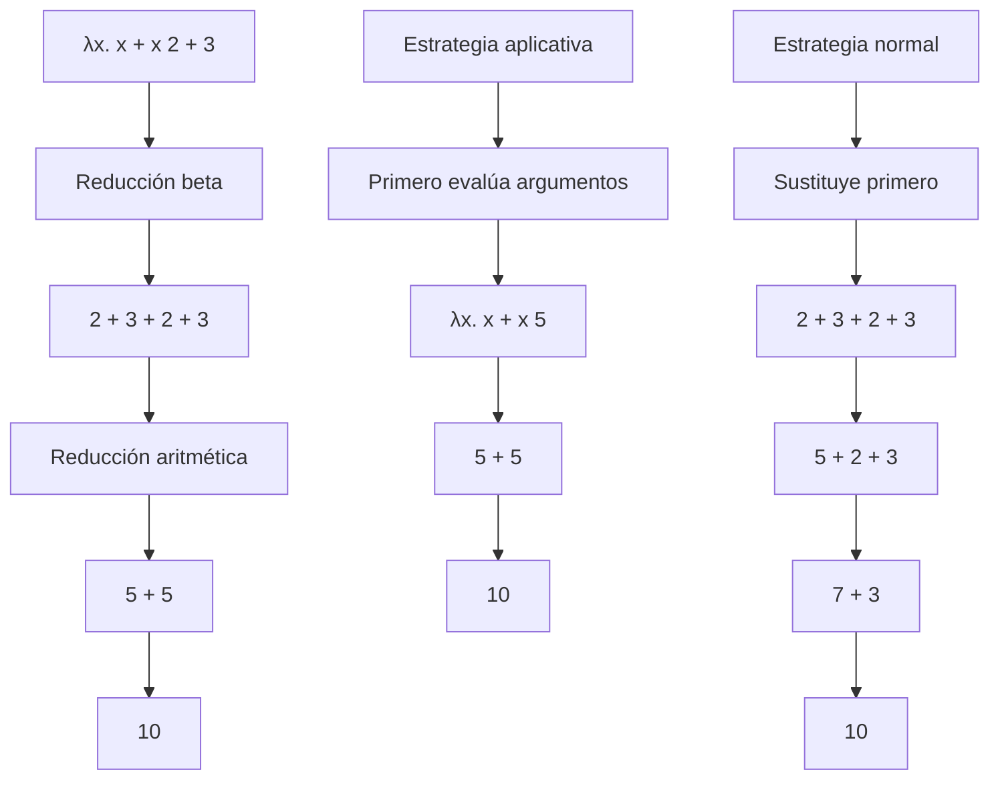

# Lenguajes de Programación - Paradigma funcional

## 3.1 Funciones anónimas, abstracción lambda y aplicación de funciones.

---

El paradigma funcional se caracteriza por el uso de funciones como elementos fundamentales de construcción. Dentro de este paradigma, las funciones anónimas y la abstracción lambda representan conceptos esenciales que permiten una mayor expresividad y flexibilidad en la programación.

### Funciones Anónimas

#### Definición

Las funciones anónimas, también conocidas como funciones lambda, son funciones que no están vinculadas a un identificador en el momento de su definición. Según Mitchell (2003), "las funciones anónimas permiten la creación de funciones 'al vuelo' sin necesidad de asignarles un nombre explícito".

#### Características

- No poseen nombre identificador
- Se definen en el punto donde se utilizan
- Son especialmente útiles como argumentos para funciones de orden superior

#### Expresión lambda

La expresión lambda sigue la forma general:

$$ \lambda x . e $$

donde:

- $\lambda$ indica el inicio de una función anónima
- $x$ es el parámetro formal
- $e$ es el cuerpo de la función

### Abstracción Lambda

#### Concepto fundamental

La abstracción lambda, introducida por Alonzo Church en el cálculo lambda, es el mecanismo fundamental para definir funciones en el paradigma funcional. Pierce (2002) señala que "la abstracción lambda permite capturar la noción de función de manera puramente sintáctica".

#### Sintaxis formal

En cálculo lambda puro, la abstracción se representa como:

$$ (\lambda x . M) $$

donde:

- $x$ es la variable ligada
- $M$ es el término lambda que representa el cuerpo de la función

#### Regla de reducción beta

La aplicación de funciones se formaliza mediante la reducción beta:

$$ (\lambda x . M) N \rightarrow_\beta M[x := N] $$

Esta regla establece que aplicar la función $(\lambda x . M)$ al argumento $N$ resulta en sustituir todas las ocurrencias libres de $x$ en $M$ por $N$.

### Aplicación de Funciones

#### Evaluación de aplicaciones

La aplicación de funciones puede seguir diferentes estrategias de evaluación:

##### Aplicación estricta (eager evaluation)

$$ (\lambda x . x + x) (2 + 3) \rightarrow (\lambda x . x + x) 5 \rightarrow 5 + 5 \rightarrow 10 $$

##### Aplicación no estricta (lazy evaluation)

$$ (\lambda x . x + x) (2 + 3) \rightarrow (2 + 3) + (2 + 3) \rightarrow 5 + 5 \rightarrow 10 $$

#### Currificación

La currificación permite transformar funciones que toman múltiples argumentos en funciones que toman un argumento a la vez:

$$ f(x, y) = x + y $$

$$ f_{curry} = \lambda x . \lambda y . x + y $$

La aplicación:

$$ f_{curry}\ 2\ 3 = (\lambda x . (\lambda y . x + y))\ 2\ 3 \rightarrow (\lambda y . 2 + y)\ 3 \rightarrow 2 + 3 = 5 $$

### Ejemplos en Diferentes Lenguajes

#### Haskell

```haskell
-- Función anónima que duplica su argumento
\x -> x * 2

-- Aplicación a una lista
map (\x -> x * 2) [1, 2, 3, 4]  -- Resultado: [2, 4, 6, 8]

-- Función con múltiples parámetros
\x y -> x + y

-- Ejemplo de currificación
suma = \x -> \y -> x + y
suma 3 5  -- Resultado: 8
```

#### JavaScript

```javascript
// Función anónima ES6
const duplicar = (x) => x * 2;

// Uso con map
[1, 2, 3, 4].map((x) => x * 2); // Resultado: [2, 4, 6, 8]

// Función con múltiples parámetros
const suma = (x, y) => x + y;

// Ejemplo de aplicación parcial
const sumaParcial = (x) => (y) => x + y;
sumaParcial(3)(5); // Resultado: 8
```

#### Python

```python
# Función anónima con lambda
lambda x: x * 2

# Uso con map
list(map(lambda x: x * 2, [1, 2, 3, 4]))  # Resultado: [2, 4, 6, 8]

# Función con múltiples parámetros
lambda x, y: x + y

# Ejemplo de aplicación con functools
from functools import partial
suma_parcial = partial(lambda x, y: x + y, 3)
suma_parcial(5)  # Resultado: 8
```

### Diagrama de Reducción Beta



### Ejercicios Propuestos

#### Ejercicio 1: Conversión a forma lambda

Convierte las siguientes expresiones matemáticas a notación lambda:

1. $f(x) = x^2 + 2x + 1$
2. $g(x, y) = 2x + 3y$
3. $h(x) = if\ x > 0\ then\ x\ else\ -x$

#### Ejercicio 2: Reducción beta

Evalúa las siguientes expresiones lambda mediante reducción beta:

1. $(\lambda x . x * x)\ (3 + 2)$
2. $(\lambda x . \lambda y . x * y)\ 4\ 5$
3. $(\lambda f . \lambda x . f\ (f\ x))\ (\lambda y . y + 1)\ 2$

#### Ejercicio 3: Implementación práctica

Implementa en el lenguaje de programación de tu preferencia:

1. Una función que tome una lista de números y devuelva una nueva lista con cada elemento elevado al cuadrado, usando funciones anónimas.
2. Una función curry que transforme una función de dos argumentos en su versión currificada.
3. Una función compose que tome dos funciones f y g y devuelva su composición $f \circ g$.

#### Ejercicio 4: Análisis de expresiones

Analiza las siguientes expresiones y determina si producirán error por capturing o si son equivalentes:

1. $(\lambda x . \lambda y . x + y)$ vs $(\lambda y . \lambda x . x + y)$
2. $(\lambda x . x + y)$ aplicada a diferentes contextos
3. $(\lambda f . \lambda x . f\ x)\ (\lambda y . y + z)$

### Aplicaciones Avanzadas

#### Clausuras (Closures)

Las funciones anónimas pueden capturar variables de su contexto circundante, creando clausuras:

```javascript
function crearContador() {
  let count = 0;
  return () => {
    count += 1;
    return count;
  };
}

const contador = crearContador();
contador(); // 1
contador(); // 2
```

#### Funciones de Orden Superior

El uso de funciones anónimas es fundamental en funciones de orden superior:

$$ map(f, [x_1, x_2, ..., x_n]) = [f(x_1), f(x_2), ..., f(x_n)] $$

$$ filter(p, [x_1, x_2, ..., x_n]) = [x_i\ |\ p(x_i) = verdadero] $$

$$ reduce(f, i, [x_1, x_2, ..., x_n]) = f(...f(f(i, x_1), x_2), ..., x_n) $$

### Referencias

1. Mitchell, J. (2003). _Concepts in Programming Languages_. Cambridge University Press. (Capítulo 4: Functional Programming)
2. Pierce, B.C. (2002). _Types and Programming Languages_. MIT Press. (Capítulo 5: The Lambda Calculus)
3. Harper, R. (2010). _Practical Foundations for Programming Languages_. http://www.cs.cmu.edu/~rwh/plbook/book.pdf
4. Friedman, D. P., & Wand, M. (2008). _Essentials of Programming Languages_ (3rd edition). MIT Press.
5. Krishnamurthi, S. (2007). _Programming Languages: Application and Interpretation_. http://www.cs.brown.edu/~sk/Publications/Books/ProgLangs/

### Conclusión

Las funciones anónimas y la abstracción lambda son conceptos fundamentales en el paradigma funcional que permiten una mayor expresividad y flexibilidad en la construcción de programas. Su comprensión es esencial para dominar no solo los lenguajes funcionales puros sino también las características funcionales presentes en lenguajes multiparadigma modernos.
