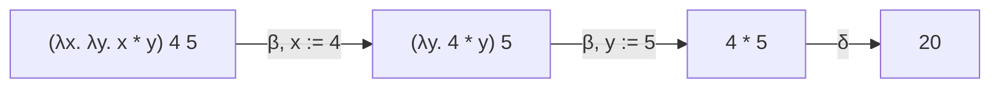

# Lenguajes de Programación - Paradigma funcional

## 3.1 Funciones anónimas, abstracción lambda y aplicación de funciones.

---

El **cálculo lambda**, creado por Alonzo Church en los años treinta para estudiar los fundamentos de la matemática, es el núcleo de la programación funcional. Tiene solo tres construcciones (variables, **abstracciones**, que definen funciones sin nombre, y **aplicaciones**, que las llaman) y una regla de cómputo, la **reducción beta**. Con ellas se puede expresar cualquier función computable: es equivalente a la máquina de Turing. Las **funciones anónimas** de los lenguajes actuales (`lambda` en Python, `=>` en JavaScript, `\x ->` en Haskell, las expresiones lambda de Java) son la misma idea. Este tema define el cálculo, la sustitución sin captura, la reducción y la currificación, y los usa para razonar sobre funciones anónimas.

### Sintaxis

$$t ::= x \mid \lambda x.\, t \mid t_1\; t_2$$

- $\lambda x.\, t$ es la función que a cada $x$ le asigna $t;$ $x$ es el **parámetro**, ligado en el **cuerpo** $t.$
- $t_1\; t_2$ aplica la función $t_1$ al argumento $t_2.$

Convenciones: la aplicación asocia a la izquierda, $f\; a\; b = (f\; a)\; b;$ el cuerpo de una abstracción se extiende lo más posible a la derecha, $\lambda x.\, x\; y = \lambda x.\, (x\; y);$ y $\lambda x\, y.\, t$ abrevia $\lambda x.\, \lambda y.\, t.$ Para los ejemplos se agregan números y operaciones primitivas, que se pueden codificar en el cálculo puro pero alargan las reducciones sin aclararlas.

### Variables libres y equivalencia alfa

Una variable es **libre** en un término si no está dentro de una abstracción que la ligue (tema 2.2): en $\lambda x.\, x + y,$ $x$ es ligada e $y$ es libre. Un término sin variables libres es **cerrado**, o un **combinador**. El nombre de una variable ligada no importa: $\lambda x.\, x$ y $\lambda y.\, y$ son la misma función. Dos términos son **alfa-equivalentes**, $t \equiv_\alpha t',$ si difieren solo en los nombres de sus variables ligadas, de forma coherente. $\lambda x.\, \lambda y.\, x + y$ y $\lambda a.\, \lambda b.\, a + b$ lo son, pero $\lambda x.\, \lambda y.\, x + y$ y $\lambda y.\, \lambda x.\, x + y$ **no**: en la primera, la suma toma primero el primer argumento, y en la segunda, el segundo.

### Sustitución sin captura

$t[x := s]$ reemplaza las apariciones libres de $x$ en $t$ por $s:$

$$x[x := s] = s, \qquad y[x := s] = y, \qquad (t_1\; t_2)[x := s] = t_1[x := s]\; t_2[x := s],$$

$$(\lambda x.\, t)[x := s] = \lambda x.\, t, \qquad (\lambda y.\, t)[x := s] = \lambda y.\, t[x := s] \quad \text{si } y \ne x \text{ y } y \notin \mathsf{VL}(s).$$

La última condición evita la **captura**: si $y$ aparece libre en $s,$ al entrar bajo $\lambda y$ esa $y$ quedaría ligada por error. En ese caso se renombra primero el parámetro con una variable fresca, por equivalencia alfa. Por ejemplo, $(\lambda z.\, f\; z)[f := \lambda y.\, y + z]$ sustituido ingenuamente da $\lambda z.\, (\lambda y.\, y + z)\; z,$ que reduce a $\lambda z.\, z + z:$ la $z$ libre del argumento quedó capturada. Renombrando antes, $\lambda z_1.\, (\lambda y.\, y + z)\; z_1$ reduce a $\lambda z_1.\, z_1 + z,$ que es el resultado correcto.

### Reducción

- **Beta:** $(\lambda x.\, t)\; s \to_\beta t[x := s].$ Un término de esta forma es un **redex**.
- **Delta:** reducción de operaciones primitivas, $3 + 2 \to_\delta 5.$
- **Eta:** $\lambda x.\, f\; x \to_\eta f$ si $x \notin \mathsf{VL}(f);$ expresa que una función es igual a la que solo la llama.

Un término sin redex está en **forma normal**. No todo término la tiene: $\Omega = (\lambda x.\, x\; x)\; (\lambda x.\, x\; x)$ se reduce a sí mismo para siempre. El **teorema de Church y Rosser** asegura que la forma normal, si existe, es única salvo equivalencia alfa: el orden en que se reduzca no cambia el resultado, aunque sí puede decidir si se llega a él (tema 3.2).

### Currificación

En el cálculo lambda toda función recibe **un** argumento; una función de dos se representa como una función que recibe el primero y devuelve otra función que espera el segundo: $g(x, y) = 2x + 3y$ se escribe $\lambda x.\, \lambda y.\, 2x + 3y,$ y $g\; 1\; 5 = ((\lambda x.\, \lambda y.\, \dots)\; 1)\; 5.$ Es la **currificación**, por Haskell Curry, aunque la usó antes Schönfinkel. Permite la **aplicación parcial**: $g\; 1$ es la función $\lambda y.\, 2 + 3y.$ En Haskell y ML todas las funciones están currificadas; en Python y JavaScript se currifica con funciones anidadas.

### Funciones anónimas y cerraduras

Una función anónima de un lenguaje de programación es una abstracción lambda. Si su cuerpo usa variables libres, como `lambda x: x + n` usa `n`, el valor de la función debe recordar el entorno en el que se creó: es una **cerradura** (tema 2.2). Las funciones anónimas son lo que hace prácticas las **funciones de orden superior**, que reciben o devuelven funciones: `map`, `filter`, `reduce`, `sorted(xs, key=...)`.



### Implementación en Python

El programa implementa el cálculo lambda con números, operaciones primitivas y condicional: variables libres, sustitución que evita la captura mediante renombramiento, un paso de reducción en orden normal y la impresión de términos. Con eso escribe las funciones del ejercicio 1 y las aplica, y muestra cada paso de las reducciones del ejercicio 2. Para el ejercicio 3 usa las funciones anónimas de Python, y para el ejercicio 4 implementa la equivalencia alfa y compara la sustitución ingenua con la correcta.

```python
from functools import reduce
from itertools import count

# ---------- cálculo lambda con números y operaciones primitivas ----------
# términos: ("var", x) ("lam", x, cuerpo) ("app", f, a) ("num", n) ("prim", op, a, b) ("if", c, a, b)
def libres(t):
    k = t[0]
    if k == "var": return {t[1]}
    if k == "lam": return libres(t[2]) - {t[1]}
    if k == "num": return set()
    return set().union(*(libres(s) for s in t[1:] if isinstance(s, tuple)))
nuevo = count(1)
def fresca(x, evitar):
    while True:
        y = f"{x}{next(nuevo)}"
        if y not in evitar: return y
def sust(t, x, s, ingenua=False):
    """t[x := s] evitando la captura: si el binder aparece libre en s, se renombra antes."""
    k = t[0]
    if k == "var": return s if t[1] == x else t
    if k == "num": return t
    if k == "lam":
        y, cuerpo = t[1], t[2]
        if y == x: return t                                      # x está ligada aquí: no se sustituye adentro
        if y in libres(s) and x in libres(cuerpo) and not ingenua:
            z = fresca(y, libres(s) | libres(cuerpo)); cuerpo, y = sust(cuerpo, y, ("var", z)), z   # conversión alfa
        return ("lam", y, sust(cuerpo, x, s, ingenua))
    return (k,) + tuple(sust(a, x, s, ingenua) if isinstance(a, tuple) else a for a in t[1:])
OPS = {"+": lambda a, b: a + b, "-": lambda a, b: a - b, "*": lambda a, b: a * b, ">": lambda a, b: int(a > b)}
def paso(t):
    """Un paso de reducción en orden normal (el redex más externo y a la izquierda); None si es forma normal."""
    k = t[0]
    if k == "app":
        f, a = t[1], t[2]
        if f[0] == "lam": return sust(f[2], f[1], a)              # reducción beta
        r = paso(f)
        if r is not None: return ("app", r, a)
        r = paso(a); return None if r is None else ("app", f, r)
    if k == "prim":
        if t[2][0] == "num" and t[3][0] == "num": return ("num", OPS[t[1]](t[2][1], t[3][1]))    # reducción delta
        r = paso(t[2])
        if r is not None: return ("prim", t[1], r, t[3])
        r = paso(t[3]); return None if r is None else ("prim", t[1], t[2], r)
    if k == "if":
        if t[1][0] == "num": return t[2] if t[1][1] else t[3]
        r = paso(t[1]); return None if r is None else ("if", r, t[2], t[3])
    if k == "lam":
        r = paso(t[2]); return None if r is None else ("lam", t[1], r)
    return None
def txt(t):
    k = t[0]
    if k == "var": return t[1]
    if k == "num": return str(t[1])
    if k == "lam": return f"λ{t[1]}. {txt(t[2])}"
    if k == "prim": return f"{par(t[2])} {t[1]} {par(t[3])}"
    if k == "if": return f"if {txt(t[1])} then {txt(t[2])} else {txt(t[3])}"
    f = txt(t[1]) if t[1][0] in ("var", "app") else f"({txt(t[1])})"
    return f"{f} {par(t[2])}"
def par(t): return txt(t) if t[0] in ("var", "num") else f"({txt(t)})"
def reduce_traza(t, maximo=30):
    pasos = [t]
    while len(pasos) <= maximo:
        r = paso(pasos[-1])
        if r is None: break
        pasos.append(r)
    return pasos

V, N = (lambda x: ("var", x)), (lambda n: ("num", n))
lam = lambda x, c: ("lam", x, c)
app = lambda f, *args: reduce(lambda acc, a: ("app", acc, a), args, f)
prim = lambda o, a, b: ("prim", o, a, b)

# --- Ejercicio 1: de funciones matemáticas a abstracciones ---
f = lam("x", prim("+", prim("+", prim("*", V("x"), V("x")), prim("*", N(2), V("x"))), N(1)))
g = lam("x", lam("y", prim("+", prim("*", N(2), V("x")), prim("*", N(3), V("y")))))
h = lam("x", ("if", prim(">", V("x"), N(0)), V("x"), prim("-", N(0), V("x"))))
for nombre, t, args in (("f", f, [N(4)]), ("g", g, [N(1), N(5)]), ("h", h, [N(-7)])):
    print(f"ejercicio 1: {nombre} = {txt(t)} | {nombre}({', '.join(txt(a) for a in args)}) = {txt(reduce_traza(app(t, *args))[-1])}")

# --- Ejercicio 2: reducción beta paso a paso ---
for t in (app(lam("x", prim("*", V("x"), V("x"))), prim("+", N(3), N(2))),
          app(lam("x", lam("y", prim("*", V("x"), V("y")))), N(4), N(5)),
          app(lam("f", lam("x", app(V("f"), app(V("f"), V("x"))))), lam("y", prim("+", V("y"), N(1))), N(2))):
    print("ejercicio 2:", "\n   → ".join(txt(p) for p in reduce_traza(t)))

# --- Ejercicio 3: funciones anónimas, currificación y composición en Python ---
cuadrados = lambda xs: list(map(lambda x: x * x, xs))
curry = lambda f: lambda x: lambda y: f(x, y)
uncurry = lambda f: lambda x, y: f(x)(y)
compose = lambda f, g: lambda x: f(g(x))
suma3 = curry(lambda a, b: a + b)(3)
print("ejercicio 3:", cuadrados([1, 2, 3, 4]), "| curry(+)(3)(4) =", suma3(4), "| uncurry(curry(pow))(2, 10) =",
      uncurry(curry(pow))(2, 10), "| compose(str, abs)(-42) =", repr(compose(str, abs)(-42)),
      "| (f ∘ g) ≠ (g ∘ f):", compose(lambda x: x + 1, lambda x: 2 * x)(5), compose(lambda x: 2 * x, lambda x: x + 1)(5))

# --- Ejercicio 4: equivalencia alfa y captura de variables ---
def alfa_eq(a, b, ma=None, mb=None):
    ma, mb = ma or {}, mb or {}
    if a[0] != b[0]: return False
    if a[0] == "var": return ma.get(a[1], a[1]) == mb.get(b[1], b[1]) if (a[1] in ma) == (b[1] in mb) else False
    if a[0] == "num": return a[1] == b[1]
    if a[0] == "lam":
        z = f"#{len(ma)}"; return alfa_eq(a[2], b[2], {**ma, a[1]: z}, {**mb, b[1]: z})
    return all(alfa_eq(x, y, ma, mb) if isinstance(x, tuple) else x == y for x, y in zip(a[1:], b[1:]))
e1 = lam("x", lam("y", prim("+", V("x"), V("y"))))
e2 = lam("y", lam("x", prim("+", V("x"), V("y"))))
e3 = lam("a", lam("b", prim("+", V("a"), V("b"))))
print("ejercicio 4.1: e1 ≡α e2:", alfa_eq(e1, e2), "| e1 ≡α λa. λb. a + b:", alfa_eq(e1, e3),
      "| e1 3 10 =", txt(reduce_traza(app(e1, N(3), N(10)))[-1]), "y e2 3 10 =", txt(reduce_traza(app(e2, N(3), N(10)))[-1]))
r1 = lam("x", lam("y", prim("-", V("x"), V("y")))); r2 = lam("y", lam("x", prim("-", V("x"), V("y"))))
print("   con resta: e1 3 10 =", txt(reduce_traza(app(r1, N(3), N(10)))[-1]), "y e2 3 10 =", txt(reduce_traza(app(r2, N(3), N(10)))[-1]))
fy = lam("x", prim("+", V("x"), V("y")))
print("ejercicio 4.2: libres(λx. x + y) =", libres(fy), "| en un contexto con y = 10:",
      txt(reduce_traza(app(lam("y", app(fy, N(1))), N(10)))[-1]))
e43 = app(lam("f", lam("x", app(V("f"), V("x")))), lam("y", prim("+", V("y"), V("z"))))
print("ejercicio 4.3:", " → ".join(txt(p) for p in reduce_traza(e43)))
captura = app(lam("f", lam("z", app(V("f"), V("z")))), lam("y", prim("+", V("y"), V("z"))))
mala, buena = sust(captura[1][2], "f", captura[2], ingenua=True), sust(captura[1][2], "f", captura[2])
print("   (λf. λz. f z) (λy. y + z) con sustitución ingenua:", txt(mala), "→*", txt(reduce_traza(mala)[-1]))
print("   evitando la captura:", txt(buena), "→*", txt(reduce_traza(buena)[-1]))
```

Salida:

```text
ejercicio 1: f = λx. ((x * x) + (2 * x)) + 1 | f(4) = 25
ejercicio 1: g = λx. λy. (2 * x) + (3 * y) | g(1, 5) = 17
ejercicio 1: h = λx. if x > 0 then x else 0 - x | h(-7) = 7
ejercicio 2: (λx. x * x) (3 + 2)
   → (3 + 2) * (3 + 2)
   → 5 * (3 + 2)
   → 5 * 5
   → 25
ejercicio 2: (λx. λy. x * y) 4 5
   → (λy. 4 * y) 5
   → 4 * 5
   → 20
ejercicio 2: (λf. λx. f (f x)) (λy. y + 1) 2
   → (λx. (λy. y + 1) ((λy. y + 1) x)) 2
   → (λy. y + 1) ((λy. y + 1) 2)
   → ((λy. y + 1) 2) + 1
   → (2 + 1) + 1
   → 3 + 1
   → 4
ejercicio 3: [1, 4, 9, 16] | curry(+)(3)(4) = 7 | uncurry(curry(pow))(2, 10) = 1024 | compose(str, abs)(-42) = '42' | (f ∘ g) ≠ (g ∘ f): 11 12
ejercicio 4.1: e1 ≡α e2: False | e1 ≡α λa. λb. a + b: True | e1 3 10 = 13 y e2 3 10 = 13
   con resta: e1 3 10 = -7 y e2 3 10 = 7
ejercicio 4.2: libres(λx. x + y) = {'y'} | en un contexto con y = 10: 11
ejercicio 4.3: (λf. λx. f x) (λy. y + z) → λx. (λy. y + z) x → λx. x + z
   (λf. λz. f z) (λy. y + z) con sustitución ingenua: λz. (λy. y + z) z →* λz. z + z
   evitando la captura: λz1. (λy. y + z) z1 →* λz1. z1 + z
```

### Ejercicios Propuestos

1. **Notación lambda.** Escribe en notación lambda $f(x) = x^2 + 2x + 1,$ $g(x, y) = 2x + 3y$ y $h(x) = x$ si $x \gt 0$ y $-x$ en otro caso.

2. **Reducción beta.** Reduce $(\lambda x.\, x \cdot x)\; (3 + 2),$ $(\lambda x.\, \lambda y.\, x \cdot y)\; 4\; 5$ y $(\lambda f.\, \lambda x.\, f\; (f\; x))\; (\lambda y.\, y + 1)\; 2.$

3. **Funciones anónimas.** Implementa una función que eleve al cuadrado cada elemento de una lista usando funciones anónimas, una función `curry` que convierta una función de dos argumentos en su versión currificada, y una función `compose` que devuelva la composición $f \circ g.$

4. **Captura y equivalencia.** Determina si son equivalentes $\lambda x.\, \lambda y.\, x + y$ y $\lambda y.\, \lambda x.\, x + y;$ analiza $\lambda x.\, x + y$ en distintos contextos, y reduce $(\lambda f.\, \lambda x.\, f\; x)\; (\lambda y.\, y + z),$ indicando si hay captura.

### Soluciones

**Ejercicio 1.** $f = \lambda x.\, x \cdot x + 2 \cdot x + 1;$ $g = \lambda x.\, \lambda y.\, 2 \cdot x + 3 \cdot y,$ currificada, y $h = \lambda x.\, \mathsf{if}\; x \gt 0\; \mathsf{then}\; x\; \mathsf{else}\; 0 - x,$ que es el valor absoluto. En el cálculo puro, el condicional y los números se codifican como funciones (los booleanos y numerales de Church); con primitivas, el programa calcula $f(4) = 25,$ $g\; 1\; 5 = 17$ y $h(-7) = 7.$

**Ejercicio 2.**

1. $(\lambda x.\, x \cdot x)\; (3 + 2) \to (3 + 2) \cdot (3 + 2) \to 5 \cdot (3 + 2) \to 5 \cdot 5 \to 25.$ En orden normal el argumento se copia sin evaluar y se evalúa dos veces; en orden aplicativo se evaluaría primero, $(\lambda x.\, x \cdot x)\; 5,$ con un paso menos (tema 3.2).
2. $(\lambda x.\, \lambda y.\, x \cdot y)\; 4\; 5 \to (\lambda y.\, 4 \cdot y)\; 5 \to 4 \cdot 5 \to 20.$ El paso intermedio es la aplicación parcial.
3. Con $s = \lambda y.\, y + 1,$ el término $(\lambda f.\, \lambda x.\, f\; (f\; x))\; s\; 2$ reduce a $(\lambda x.\, s\; (s\; x))\; 2,$ luego a $s\; (s\; 2),$ a $(s\; 2) + 1,$ a $(2 + 1) + 1$ y a $4.$ El término $\lambda f.\, \lambda x.\, f\; (f\; x)$ aplica dos veces su argumento: es el numeral de Church $\overline{2}.$

**Ejercicio 3.** En Python:

```python
cuadrados = lambda xs: list(map(lambda x: x * x, xs))
curry = lambda f: lambda x: lambda y: f(x, y)
compose = lambda f, g: lambda x: f(g(x))
```

`curry(lambda a, b: a + b)(3)` es la función que suma 3, una aplicación parcial; la inversa, `uncurry`, devuelve la función de dos argumentos. `compose(f, g)` aplica primero `g` y después `f`, como $f \circ g;$ la composición no es conmutativa, y el programa lo muestra con $x + 1$ y $2x$ aplicadas a 5, que dan 11 o 12 según el orden.

**Ejercicio 4.**

1. **No son alfa-equivalentes.** Renombrando, la segunda es $\lambda a.\, \lambda b.\, b + a:$ la primera suma sus argumentos en orden y la segunda al revés. Con la suma, que es conmutativa, dan el mismo resultado para todos los argumentos, como muestra el programa con 3 y 10: son **extensionalmente** iguales, pero como términos son distintos. Con la resta se ve la diferencia: $3 - 10 = -7$ y $10 - 3 = 7.$
2. **Tiene una variable libre.** En $\lambda x.\, x + y,$ la $y$ es libre, y su significado depende del contexto que ligue a $y.$ Con alcance léxico, es el de la definición; dentro de $\lambda y.\, \dots$ aplicado a 10, la función suma 10, y el programa da $1 + 10 = 11.$ Fuera de cualquier ligado de $y,$ el término no tiene valor numérico.
3. **No hay captura.** $(\lambda f.\, \lambda x.\, f\; x)\; (\lambda y.\, y + z) \to \lambda x.\, (\lambda y.\, y + z)\; x \to \lambda x.\, x + z:$ el argumento tiene a $z$ libre, pero el binder bajo el que entra se llama $x,$ no $z.$ La captura sí ocurre en la variante $(\lambda f.\, \lambda z.\, f\; z)\; (\lambda y.\, y + z),$ si se sustituye ingenuamente: da $\lambda z.\, z + z,$ que duplica el argumento, en lugar de $\lambda z_1.\, z_1 + z,$ que le suma la $z$ exterior. El programa muestra ambas reducciones.

### Referencias

1. Church, A., An unsolvable problem of elementary number theory. _American Journal of Mathematics_ 58(2), 1936.
2. Barendregt, H. P., _The Lambda Calculus: Its Syntax and Semantics_. North-Holland, 1984.
3. Pierce, B. C., _Types and Programming Languages_. MIT Press, 2002. Capítulo 5.
4. Hindley, J. R., and Seldin, J. P., _Lambda-Calculus and Combinators: An Introduction_. Cambridge University Press, 2008.
5. Abelson, H., and Sussman, G. J., _Structure and Interpretation of Computer Programs_. MIT Press, 1996. Sección 1.3.
