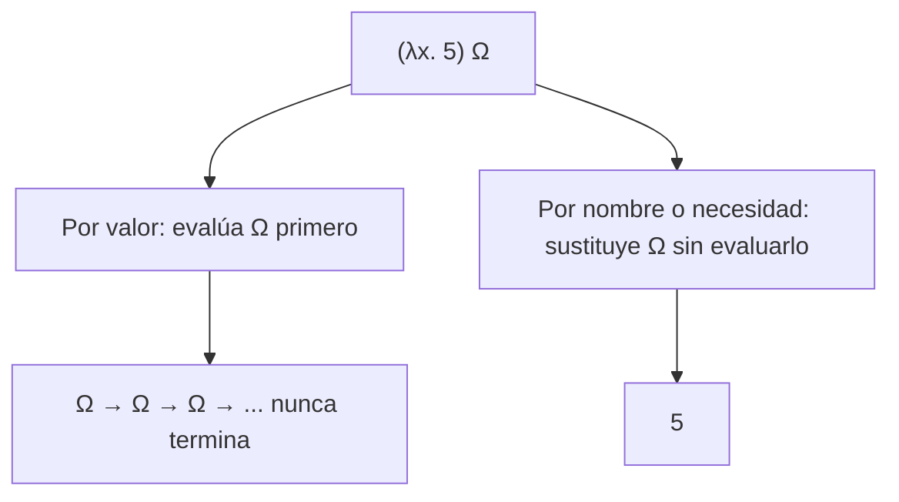

# Lenguajes de Programación - Paradigma funcional

## 3.2 Orden y estrategias de evaluación; evaluación ansiosa (eager) y perezosa (lazy).

---

Un término del cálculo lambda puede contener varios redex, y la reducción no dice cuál reducir primero. Una **estrategia de evaluación** lo decide. Por el teorema de Church y Rosser, todas las estrategias que llegan a una forma normal llegan a la misma, pero no todas llegan: una puede quedar atrapada en un cómputo infinito que otra evita. Además, el número de pasos cambia. Las dos familias principales son la evaluación **ansiosa** (*eager*), que evalúa los argumentos antes de llamar a la función, y la **perezosa** (*lazy*), que los evalúa solo si se necesitan. Este tema las define, compara sus propiedades y muestra cómo se implementa la pereza con **suspensiones**.

### Estrategias

- **Orden normal:** reduce siempre el redex más externo y a la izquierda. En una aplicación $(\lambda x.\, t)\; s,$ sustituye $s$ sin evaluarlo. Reduce también dentro de las abstracciones, hasta la forma normal.
- **Orden aplicativo:** reduce primero el redex más interno: los argumentos se evalúan antes de la sustitución.
- **Llamada por nombre** (*call-by-name*): el orden normal sin reducir dentro de las abstracciones; se detiene en la **forma normal débil de cabeza**, una abstracción o una constante. Es la de ALGOL 60 para los parámetros por nombre.
- **Llamada por valor** (*call-by-value*): el orden aplicativo sin reducir dentro de las abstracciones. Es la de la mayoría de los lenguajes: C, Java, Python, JavaScript, ML, Scheme.
- **Llamada por necesidad** (*call-by-need*): la llamada por nombre con **compartición**: un argumento se evalúa la primera vez que se usa, y su valor se guarda para los usos siguientes. Es la evaluación perezosa de Haskell.

Las reglas de la llamada por valor, con valores $v ::= \lambda x.\, t \mid n:$

$$\frac{t_1 \to t_1'}{t_1\; t_2 \to t_1'\; t_2} \qquad \frac{t_2 \to t_2'}{v_1\; t_2 \to v_1\; t_2'} \qquad \frac{}{(\lambda x.\, t)\; v \to t[x := v]},$$

y las de la llamada por nombre:

$$\frac{t_1 \to t_1'}{t_1\; t_2 \to t_1'\; t_2} \qquad \frac{}{(\lambda x.\, t)\; s \to t[x := s]}.$$

La diferencia está en la última regla: por valor, el argumento debe ser un valor; por nombre, puede ser cualquier término.

### Propiedades

- **Terminación.** Si un término tiene forma normal, el orden normal la encuentra: es el **teorema de estandarización**. La llamada por valor puede no terminar en un término que sí la tiene: $(\lambda x.\, 5)\; \Omega,$ con $\Omega = (\lambda y.\, y\; y)\; (\lambda y.\, y\; y),$ da 5 por nombre y se queda evaluando $\Omega$ por valor.
- **Duplicación.** Por nombre, un argumento usado $k$ veces se evalúa $k$ veces: $(\lambda x.\, x \cdot x)\; (3 + 2)$ calcula $3 + 2$ dos veces. Por valor y por necesidad, una sola.
- **Trabajo inútil.** Por valor, un argumento que no se usa se evalúa de todos modos; por nombre y por necesidad, no.
- **Efectos.** Con efectos secundarios, como imprimir o modificar variables, la estrategia cambia el resultado observable, y en la pereza el orden de los efectos es difícil de prever. Por eso los lenguajes perezosos son puros, y Haskell encapsula los efectos en el tipo `IO`.

La llamada por necesidad combina lo mejor de las otras dos: termina siempre que lo hace la llamada por nombre, y nunca evalúa un argumento más de una vez. Su costo es la administración de las suspensiones, y la dificultad para prever el uso de memoria: una suspensión no evaluada puede retener mucha memoria, lo que se llama una **fuga de espacio**.

### Pereza en los lenguajes ansiosos

Los lenguajes ansiosos usan la pereza en lugares concretos: los operadores lógicos `&&` y `||` y el condicional evalúan solo lo necesario; los generadores de Python y los iteradores producen elementos bajo demanda; las suspensiones explícitas, como `delay` y `force` de Scheme o `Lazy<T>` de C#, guardan un cálculo para después. Con ellas se pueden definir **estructuras infinitas**, como la lista de todos los naturales, de la que se consume solo lo necesario.



### Implementación en Python

El programa implementa dos funciones de paso para el cálculo lambda con números, una por valor y otra por nombre, y evalúa con ambas las expresiones de los ejercicios 1 y 3, con un límite de 40 pasos para detectar las que no terminan. Para el ejercicio 2 reproduce el error del ejemplo del enunciado y lo corrige con una clase `Thunk` que fuerza los argumentos y guarda el valor, y construye con ella una lista infinita. Para el ejercicio 4 cuenta cuántas veces se ejecuta un cálculo costoso con cada estrategia.

```python
from functools import reduce
from itertools import count

# ---------- cálculo lambda con números (la misma representación del tema 3.1) ----------
def libres(t):
    if t[0] == "var": return {t[1]}
    if t[0] == "lam": return libres(t[2]) - {t[1]}
    if t[0] == "num": return set()
    return set().union(*(libres(s) for s in t[1:] if isinstance(s, tuple)))
nuevo = count(1)
def sust(t, x, s):
    k = t[0]
    if k == "var": return s if t[1] == x else t
    if k == "num": return t
    if k == "lam":
        y, c = t[1], t[2]
        if y == x: return t
        if y in libres(s):
            z = f"{y}{next(nuevo)}"; c, y = sust(c, y, ("var", z)), z
        return ("lam", y, sust(c, x, s))
    return (k,) + tuple(sust(a, x, s) if isinstance(a, tuple) else a for a in t[1:])
OPS = {"+": lambda a, b: a + b, "*": lambda a, b: a * b}
def es_valor(t): return t[0] in ("num", "lam")

def paso_valor(t):
    """Orden aplicativo, llamada por valor: los argumentos se evalúan antes de sustituir; no se reduce bajo λ."""
    if t[0] == "app":
        f, a = t[1], t[2]
        if not es_valor(f): return ("app", paso_valor(f), a)
        if not es_valor(a): return ("app", f, paso_valor(a))
        return sust(f[2], f[1], a)
    if t[0] == "prim":
        if not es_valor(t[2]): return ("prim", t[1], paso_valor(t[2]), t[3])
        if not es_valor(t[3]): return ("prim", t[1], t[2], paso_valor(t[3]))
        return ("num", OPS[t[1]](t[2][1], t[3][1]))
def paso_nombre(t):
    """Orden normal, llamada por nombre: el argumento se sustituye sin evaluar."""
    if t[0] == "app":
        f, a = t[1], t[2]
        if f[0] == "lam": return sust(f[2], f[1], a)
        return ("app", paso_nombre(f), a)
    if t[0] == "prim":
        if not es_valor(t[2]): return ("prim", t[1], paso_nombre(t[2]), t[3])
        if not es_valor(t[3]): return ("prim", t[1], t[2], paso_nombre(t[3]))
        return ("num", OPS[t[1]](t[2][1], t[3][1]))
def evalua(t, paso, limite=40):
    pasos = [t]
    while not es_valor(pasos[-1]) and len(pasos) <= limite: pasos.append(paso(pasos[-1]))
    return pasos
def txt(t):
    k = t[0]
    if k == "var": return t[1]
    if k == "num": return str(t[1])
    if k == "lam": return f"λ{t[1]}. {txt(t[2])}"
    if k == "prim": return f"{par(t[2])} {t[1]} {par(t[3])}"
    return f"{txt(t[1]) if t[1][0] in ('var', 'app') else '(' + txt(t[1]) + ')'} {par(t[2])}"
def par(t): return txt(t) if t[0] in ("var", "num") else f"({txt(t)})"

V, N = (lambda x: ("var", x)), (lambda n: ("num", n))
lam = lambda x, c: ("lam", x, c)
app = lambda f, *a: reduce(lambda acc, b: ("app", acc, b), a, f)
prim = lambda o, a, b: ("prim", o, a, b)
OMEGA = app(lam("y", app(V("y"), V("y"))), lam("y", app(V("y"), V("y"))))

# --- Ejercicios 1 y 3 ---
casos = {"1.1": app(lam("x", prim("*", V("x"), V("x"))), prim("+", N(3), N(2))),
         "1.2": app(lam("x", N(5)), OMEGA),
         "1.3": app(lam("f", lam("x", app(V("f"), app(V("f"), V("x"))))), lam("y", prim("+", V("y"), N(1))), prim("*", N(2), N(3))),
         "3.1": app(lam("x", N(42)), OMEGA),
         "3.2": app(lam("f", app(V("f"), N(0))), lam("x", prim("+", V("x"), N(1)))),
         "3.3": app(lam("x", app(V("x"), V("x"))), lam("x", app(V("x"), V("x"))))}
for nombre, t in casos.items():
    linea = []
    for estrategia, paso in (("por valor", paso_valor), ("por nombre", paso_nombre)):
        p = evalua(t, paso)
        linea.append(f"{estrategia}: " + (f"{txt(p[-1])} en {len(p) - 1} pasos" if es_valor(p[-1]) else "no termina en 40 pasos"))
    print(f"ejercicio {nombre}: {txt(t)}\n   " + " | ".join(linea))
print("   traza por valor de 1.1:", " → ".join(txt(p) for p in evalua(casos["1.1"], paso_valor)))
print("   traza por nombre de 1.1:", " → ".join(txt(p) for p in evalua(casos["1.1"], paso_nombre)))

# --- Ejercicio 2: evaluación perezosa con suspensiones (thunks) ---
class Thunk:
    def __init__(self, f): self.f, self.evaluada, self.valor = f, False, None
    def force(self):
        if not self.evaluada: self.valor, self.evaluada, self.f = self.f(), True, None   # se calcula una sola vez
        return self.valor
def force(x): return x.force() if isinstance(x, Thunk) else x
# el ejemplo del enunciado pasa los thunks a la función sin forzarlos: x + y falla
class ThunkOriginal:
    def __init__(self, func, *args): self.func, self.args = func, args
    def force(self): return self.func(*self.args)
try:
    ThunkOriginal(lambda x, y: x + y, ThunkOriginal(lambda: 2), ThunkOriginal(lambda: 3)).force()
except TypeError as e:
    print("ejercicio 2, el ejemplo original:", e)
evaluaciones = []
def caro(n): evaluaciones.append(n); return n * n
a, b = Thunk(lambda: caro(2)), Thunk(lambda: caro(3))
suma = Thunk(lambda: force(a) + force(b))
antes = list(evaluaciones)
print("   corregido: al crear los thunks se evaluó", antes, "| suma =", suma.force(), "| otra vez:", suma.force(),
      "| evaluaciones en total:", evaluaciones)
def naturales(n=0): return (n, Thunk(lambda: naturales(n + 1)))           # lista infinita perezosa
def toma(k, s):
    out = []
    while k: out.append(s[0]); s = force(s[1]); k -= 1
    return out
print("   los primeros 8 naturales de una lista infinita:", toma(8, naturales()))

# --- Ejercicio 4: f(x, y) = if x > 0 then x * x else y * y ---
llamadas = []
def calculo_costoso(): llamadas.append(1); return 7
def f_estricta(x, y): return x * x if x > 0 else y * y                  # x e y ya evaluados
def f_nombre(x, y): return x() * x() if x() > 0 else y() * y()           # cada uso reevalúa
def f_necesidad(x, y):
    tx, ty = Thunk(x), Thunk(y)
    return force(tx) * force(tx) if force(tx) > 0 else force(ty) * force(ty)
pruebas = {"f(5, costoso())": (lambda: 5, calculo_costoso), "f(0, costoso())": (lambda: 0, calculo_costoso),
           "f(costoso(), 0)": (calculo_costoso, lambda: 0)}
print("ejercicio 4, llamadas a calculoCostoso:")
for nombre, (x, y) in pruebas.items():
    res = []
    for est, fn in (("valor", lambda: f_estricta(x(), y())), ("nombre", lambda: f_nombre(x, y)), ("necesidad", lambda: f_necesidad(x, y))):
        llamadas.clear(); r = fn(); res.append(f"{est} {len(llamadas)}")
    print(f"   {nombre} = {r}: " + ", ".join(res))
```

Salida:

```text
ejercicio 1.1: (λx. x * x) (3 + 2)
   por valor: 25 en 3 pasos | por nombre: 25 en 4 pasos
ejercicio 1.2: (λx. 5) ((λy. y y) (λy. y y))
   por valor: no termina en 40 pasos | por nombre: 5 en 1 pasos
ejercicio 1.3: (λf. λx. f (f x)) (λy. y + 1) (2 * 3)
   por valor: 8 en 7 pasos | por nombre: 8 en 7 pasos
ejercicio 3.1: (λx. 42) ((λy. y y) (λy. y y))
   por valor: no termina en 40 pasos | por nombre: 42 en 1 pasos
ejercicio 3.2: (λf. f 0) (λx. x + 1)
   por valor: 1 en 3 pasos | por nombre: 1 en 3 pasos
ejercicio 3.3: (λx. x x) (λx. x x)
   por valor: no termina en 40 pasos | por nombre: no termina en 40 pasos
   traza por valor de 1.1: (λx. x * x) (3 + 2) → (λx. x * x) 5 → 5 * 5 → 25
   traza por nombre de 1.1: (λx. x * x) (3 + 2) → (3 + 2) * (3 + 2) → 5 * (3 + 2) → 5 * 5 → 25
ejercicio 2, el ejemplo original: unsupported operand type(s) for +: 'ThunkOriginal' and 'ThunkOriginal'
   corregido: al crear los thunks se evaluó [] | suma = 13 | otra vez: 13 | evaluaciones en total: [2, 3]
   los primeros 8 naturales de una lista infinita: [0, 1, 2, 3, 4, 5, 6, 7]
ejercicio 4, llamadas a calculoCostoso:
   f(5, costoso()) = 25: valor 1, nombre 0, necesidad 0
   f(0, costoso()) = 49: valor 1, nombre 2, necesidad 1
   f(costoso(), 0) = 49: valor 1, nombre 3, necesidad 1
```

### Ejercicios Propuestos

1. **Seguimiento.** Traza la evaluación con ambas estrategias de $(\lambda x.\, x \cdot x)\; (3 + 2),$ de $(\lambda x.\, 5)\; ((\lambda y.\, y\; y)\; (\lambda y.\, y\; y))$ y de $(\lambda f.\, \lambda x.\, f\; (f\; x))\; (\lambda y.\, y + 1)\; (2 \cdot 3).$

2. **Evaluación perezosa.** Implementa un sistema simple de evaluación perezosa. Parte de este ejemplo:

    ```python
    class Thunk:
        def __init__(self, func, *args):
            self.func = func
            self.args = args
            self.evaluated = False
            self.value = None
        def force(self):
            if not self.evaluated:
                self.value = self.func(*self.args)
                self.evaluated = True
            return self.value

    lazy_add = Thunk(lambda x, y: x + y, Thunk(lambda: 2), Thunk(lambda: 3))
    result = lazy_add.force()
    ```

3. **Terminación.** Determina si terminan con evaluación ansiosa, perezosa, ambas o ninguna: $(\lambda x.\, 42)\; ((\lambda y.\, y\; y)\; (\lambda y.\, y\; y)),$ $(\lambda f.\, f\; 0)\; (\lambda x.\, x + 1)$ y $(\lambda x.\, x\; x)\; (\lambda x.\, x\; x).$

4. **Eficiencia.** Para $f(x, y) = \mathsf{if}\; x \gt 0\; \mathsf{then}\; x \cdot x\; \mathsf{else}\; y \cdot y,$ analiza qué estrategia es más eficiente en $f(5, \mathsf{costoso}()),$ $f(0, \mathsf{costoso}())$ y $f(\mathsf{costoso}(), 0).$

### Soluciones

**Ejercicio 1.**

1. **Por valor:** $(\lambda x.\, x \cdot x)\; (3 + 2) \to (\lambda x.\, x \cdot x)\; 5 \to 5 \cdot 5 \to 25,$ en 3 pasos. **Por nombre:** $(3 + 2) \cdot (3 + 2) \to 5 \cdot (3 + 2) \to 5 \cdot 5 \to 25,$ en 4 pasos, porque $3 + 2$ se evalúa dos veces. Por necesidad serían 3, porque la segunda vez se usaría el valor guardado.
2. **Por valor no termina:** antes de aplicar $\lambda x.\, 5$ hay que evaluar el argumento, y $(\lambda y.\, y\; y)\; (\lambda y.\, y\; y)$ se reduce a sí mismo para siempre. **Por nombre** da 5 en un paso, porque $x$ no aparece en el cuerpo y el argumento se descarta sin evaluarlo.
3. Ambas dan 8 en 7 pasos. Por valor se calcula primero $2 \cdot 3 = 6$ y después se aplica dos veces el sucesor; por nombre se sustituye $2 \cdot 3$ sin evaluar, pero como $x$ aparece una sola vez en $f\; (f\; x),$ no se duplica trabajo.

**Ejercicio 2.** El ejemplo del enunciado **no funciona**: `lazy_add.force()` llama a `func` con los objetos `Thunk` sin forzarlos, y `x + y` falla porque no se pueden sumar dos thunks, como muestra el programa. La corrección es que la función fuerce sus argumentos cuando los necesite, `Thunk(lambda: force(a) + force(b))`, o que `force` los fuerce antes de llamar. La versión del programa guarda solo una función sin argumentos, evalúa la primera vez que se pide el valor, lo guarda y libera la función, para que no retenga memoria. Al crear los thunks no se evalúa nada; al forzar la suma se evalúan los dos argumentos, y al forzarla otra vez no se evalúa nada más: es la llamada por necesidad. Con la misma clase, la lista de los naturales es un par formado por un número y un thunk con el resto, y `toma(8, ...)` construye solo los primeros 8 elementos.

**Ejercicio 3.**

1. **Solo la perezosa termina,** con 42, porque descarta el argumento divergente; la ansiosa no.
2. **Ambas terminan,** con 1: el argumento ya es un valor y las dos estrategias hacen los mismos pasos.
3. **Ninguna termina:** el término es $\Omega,$ que no tiene forma normal; es una aplicación cuya función y cuyo argumento ya son valores, y su reducción produce el mismo término.

En general, si la ansiosa termina, la perezosa también, con el mismo resultado; lo contrario no vale.

**Ejercicio 4.** Con un cálculo costoso que devuelve 7, el programa cuenta sus ejecuciones:

| Llamada              | Por valor | Por nombre | Por necesidad |
| -------------------- | --------- | ---------- | ------------- |
| $f(5, \mathsf{costoso}())$ | 1   | 0          | 0             |
| $f(0, \mathsf{costoso}())$ | 1   | 2          | 1             |
| $f(\mathsf{costoso}(), 0)$ | 1   | 3          | 1             |

En la primera, la rama elegida no usa $y,$ y las estrategias perezosas se ahorran el cálculo. En la segunda, $y$ se usa dos veces, en $y \cdot y:$ por nombre se calcula dos veces. En la tercera, $x$ se usa tres veces, en la condición y en $x \cdot x,$ y por nombre se calcula tres veces. La llamada por necesidad nunca es peor que las otras dos en número de evaluaciones: hace a lo más una por argumento y ninguna si no se usa. Si `costoso` tuviera efectos, como imprimir, las tres estrategias producirían salidas distintas.

### Referencias

1. Plotkin, G. D., Call-by-name, call-by-value and the λ-calculus. _Theoretical Computer Science_ 1(2), 1975.
2. Wadsworth, C. P., _Semantics and Pragmatics of the Lambda Calculus_. Tesis doctoral, Universidad de Oxford, 1971.
3. Hughes, J., Why functional programming matters. _The Computer Journal_ 32(2), 1989.
4. Pierce, B. C., _Types and Programming Languages_. MIT Press, 2002. Capítulo 5.
5. Abelson, H., and Sussman, G. J., _Structure and Interpretation of Computer Programs_. MIT Press, 1996. Sección 3.5.
