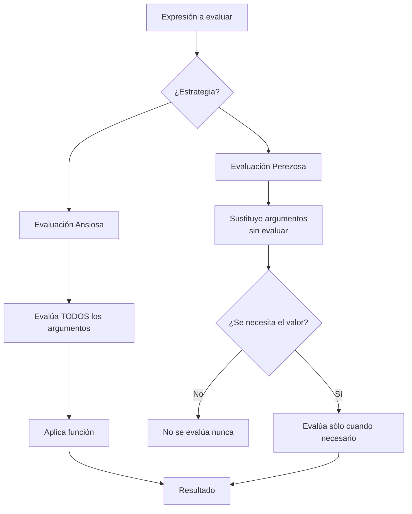

# Lenguajes de Programación - Paradigma funcional

## 3.2 Orden y estrategias de evaluación; evaluación ansiosa (eager) y perezosa (lazy).

---

Las estrategias de evaluación determinan **cuándo** y **cómo** se evalúan los argumentos de una función en lenguajes de programación funcionales. Según Mitchell (2003), "la elección de la estrategia de evaluación afecta profundamente la semántica, el rendimiento y las propiedades de terminación de los programas".

### Conceptos Fundamentales

#### Expresiones y Valores

- **Expresión**: Cualquier elemento computable (variables, aplicaciones de funciones, etc.)
- **Valor**: Expresión que no puede reducirse further (números, funciones, etc.)

#### Reducción

En el cálculo lambda, la evaluación se modela mediante reglas de reducción:

$$ (\lambda x . e_1)\ e_2 \rightarrow e_1 [x := e_2] $$

### Estrategias de Evaluación

#### Evaluación Ansiosa (Eager/Strict Evaluation)

##### Definición

La evaluación ansiosa evalúa **todos** los argumentos de una función **antes** de aplicar la función. También conocida como "aplicativa" o "call-by-value".

##### Regla formal

$$ \frac{e_1 \rightarrow e_1'}{e_1\ e_2 \rightarrow e_1'\ e_2} \quad \frac{e_2 \rightarrow e_2'}{v\ e_2 \rightarrow v\ e_2'} \quad \frac{}{(\lambda x . e)\ v \rightarrow e[x := v]} $$

##### Características

- Evalúa argumentos incluso si no se necesitan
- Puede causar bucles infinitos innecesarios
- Más fácil de implementar eficientemente

##### Ejemplo

```haskell
-- En evaluación ansiosa:
cuadrado (3+2)
→ cuadrado 5      -- Se evalúa el argumento primero
→ 5 * 5
→ 25

-- Con argumento que no termina:
cuadrado (bucleInfinito)
→ ¡bucle infinito! -- Evalúa el argumento aunque no se use
```

#### Evaluación Perezosa (Lazy Evaluation)

##### Definición

La evaluación perezosa **retrasa** la evaluación de argumentos hasta que su valor sea **estrictamente necesario**. También conocida como "call-by-need".

##### Regla formal

$$ \frac{e_1 \rightarrow e_1'}{e_1\ e_2 \rightarrow e_1'\ e_2} \quad \frac{}{(\lambda x . e_1)\ e_2 \rightarrow e_1[x := e_2]} $$

##### Características

- Evalúa argumentos solo cuando se necesitan
- Permite estructuras de datos infinitas
- Puede evitar cálculos innecesarios

##### Ejemplo

```haskell
-- En evaluación perezosa:
cuadrado (3+2)
→ (3+2) * (3+2)   -- Sustituye primero
→ 5 * (3+2)       -- Evalúa cuando es necesario
→ 5 * 5
→ 25

-- Con argumento que no termina:
cuadrado (bucleInfinito)
→ bucleInfinito * bucleInfinito  -- Pero si el resultado nunca se usa...
-- ¡Nunca se evalúa bucleInfinito!
```

### Comparación de Estrategias



#### Tabla Comparativa

| Característica        | Evaluación Ansiosa     | Evaluación Perezosa   |
| --------------------- | ---------------------- | --------------------- |
| Momento de evaluación | Antes de la aplicación | Cuando se necesita    |
| Argumentos no usados  | Se evalúan siempre     | No se evalúan         |
| Estructuras infinitas | No posibles            | Posibles              |
| Complejidad           | Más predecible         | Menos predecible      |
| Eficiencia            | Menos overhead         | Más overhead (thunks) |

### Implementación de Evaluación Perezosa

#### Thunks y Memoización

La evaluación perezosa se implementa mediante **thunks** (closures que encapsulan cálculos no evaluados):

```haskell
-- Representación conceptual de thunks
data Thunk a = Unevaluated (() -> a) | Evaluated a

force :: Thunk a -> a
force (Evaluated x) = x
force (Unevaluated f) = let x = f () in x  -- Evalúa y memoiza
```

#### Ejemplo de Estructuras Infinitas

```haskell
-- Lista infinita de números naturales
nats :: [Int]
nats = generarDesde 0
  where generarDesde n = n : generarDesde (n+1)

-- Solo evalúa lo necesario
primeros5 = take 5 nats  -- [0,1,2,3,4]
```

### Ejercicios Propuestos

#### Ejercicio 1: Seguimiento de Evaluación

Trace los pasos de evaluación para las siguientes expresiones usando ambas estrategias:

1. $(\lambda x . x * x)\ (3 + 2)$
2. $(\lambda x . 5)\ ((\lambda y . y\ y)\ (\lambda y . y\ y))$
3. $(\lambda f . \lambda x . f\ (f\ x))\ (\lambda y . y + 1)\ (2 * 3)$

#### Ejercicio 2: Implementación de Evaluación Perezosa

Implemente en Haskell o Python un sistema simple de evaluación perezosa:

```python
class Thunk:
    def __init__(self, func, *args):
        self.func = func
        self.args = args
        self.evaluated = False
        self.value = None

    def force(self):
        if not self.evaluated:
            self.value = self.func(*self.args)
            self.evaluated = True
        return self.value

# Ejemplo de uso
lazy_add = Thunk(lambda x, y: x + y, Thunk(lambda: 2), Thunk(lambda: 3))
result = lazy_add.force()  # Evalúa sólo aquí
```

#### Ejercicio 3: Análisis de Terminación

Para cada expresión, determine si termina con evaluación ansiosa, perezosa, ambas o ninguna:

1. $(\lambda x . 42)\ ((\lambda y . y\ y)\ (\lambda y . y\ y))$
2. $(\lambda f . f\ 0)\ (\lambda x . x + 1)$
3. $(\lambda x . x\ x)\ (\lambda x . x\ x)$

#### Ejercicio 4: Optimización de Evaluación

Dada la función:

$$ f(x, y) = \text{if } x > 0 \text{ then } x * x \text{ else } y * y $$

Analice qué estrategia de evaluación sería más eficiente para las llamadas:

1. $f(5, \text{calculoCostoso}())$
2. $f(0, \text{calculoCostoso}())$
3. $f(\text{calculoCostoso}(), 0)$

### Aplicaciones y Consideraciones Prácticas

#### Ventajas de la Evaluación Perezosa

- **Modularidad**: Separar el generador del consumidor de datos
- **Eficiencia**: Evitar cálculos innecesarios
- **Expresividad**: Trabajar con estructuras infinitas

#### Ventajas de la Evaluación Ansiosa

- **Predictibilidad**: Orden de evaluación claro
- **Rendimiento**: Menos overhead de thunks
- **Efectos secundarios**: Comportamiento más intuitivo con I/O

#### Estrategias Híbridas

Algunos lenguajes como R permiten ambos enfoques:

```r
# Evaluación ansiosa por defecto
f <- function(x) { x * 2 }
f(2+3)  # Evalúa 2+3 primero

# Evaluación perezosa con promesas
g <- function(x) {
  if (runif(1) > 0.5) x else 0
}
g(2+3)  # Puede que no evalúe 2+3
```

### Referencias

1. Mitchell, J. (2003). _Concepts in Programming Languages_. Cambridge University Press. (Capítulo 4: Functional Programming)
2. Pierce, B.C. (2002). _Types and Programming Languages_. MIT Press. (Capítulo 5: The Lambda Calculus)
3. Friedman, D. P., & Wand, M. (2008). _Essentials of Programming Languages_ (3rd edition). MIT Press. (Capítulo 4: State)
4. Harper, R. (2010). _Practical Foundations for Programming Languages_. http://www.cs.cmu.edu/~rwh/plbook/book.pdf (Capítulo 10: Evaluation Dynamics)

### Conclusión

La elección entre evaluación ansiosa y perezosa representa una dicotomía fundamental en el diseño de lenguajes de programación funcionales. Mientras la evaluación ansiosa ofrece simplicidad y predictibilidad, la evaluación perezosa permite mayor expresividad y eficiencia en ciertos casos. La comprensión de estas estrategias es esencial para dominar la semántica de los lenguajes funcionales y tomar decisiones informadas sobre el diseño y optimización de programas.
