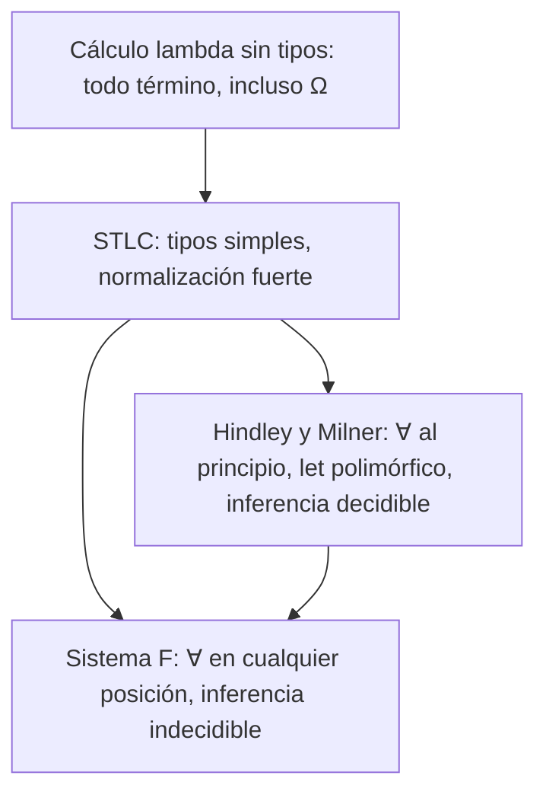

# Lenguajes de Programación - Paradigma funcional

## 3.3 Tipos función (cálculo lambda con tipos simples).

---

El cálculo lambda sin tipos admite términos sin sentido, como aplicar un número a otro, o $\Omega,$ que no termina. El **cálculo lambda con tipos simples** (STLC), propuesto por Church en 1940, asigna a cada término un tipo construido a partir de tipos básicos con el constructor de **funciones** $T_1 \to T_2,$ y descarta los términos que no lo tienen. A cambio de perder expresividad, gana dos garantías: los programas bien tipados no se atascan y siempre terminan. Este tema presenta sus tipos, sus reglas, sus propiedades y su extensión con polimorfismo, el Sistema F.

### Tipos y términos

$$T ::= \mathsf{Int} \mid \mathsf{Bool} \mid T_1 \to T_2, \qquad t ::= x \mid \lambda x{:}T.\, t \mid t_1\; t_2 \mid n \mid \mathsf{true} \mid \mathsf{false} \mid \mathsf{if}\; t_1\; \mathsf{then}\; t_2\; \mathsf{else}\; t_3.$$

El constructor $\to$ asocia a la derecha: $\mathsf{Int} \to \mathsf{Int} \to \mathsf{Int}$ es $\mathsf{Int} \to (\mathsf{Int} \to \mathsf{Int}),$ la función currificada de dos argumentos enteros. El parámetro de cada abstracción lleva una **anotación** de tipo: $\lambda x{:}\mathsf{Int}.\, x + 1.$ Un **contexto** $\Gamma = x_1{:}T_1, \dots, x_n{:}T_n$ asigna tipos a las variables libres.

### Reglas

$$\frac{x{:}T \in \Gamma}{\Gamma \vdash x : T}\;\text{T-Var} \qquad \frac{\Gamma, x{:}T_1 \vdash t : T_2}{\Gamma \vdash \lambda x{:}T_1.\, t : T_1 \to T_2}\;\text{T-Abs} \qquad \frac{\Gamma \vdash t_1 : T_1 \to T_2 \quad \Gamma \vdash t_2 : T_1}{\Gamma \vdash t_1\; t_2 : T_2}\;\text{T-App}$$

$$\frac{\Gamma \vdash t_1 : \mathsf{Bool} \quad \Gamma \vdash t_2 : T \quad \Gamma \vdash t_3 : T}{\Gamma \vdash \mathsf{if}\; t_1\; \mathsf{then}\; t_2\; \mathsf{else}\; t_3 : T}\;\text{T-If}$$

más un axioma para cada constante. T-Abs es la regla de **introducción** del tipo función: para mostrar que una abstracción tiene tipo $T_1 \to T_2,$ se supone $x{:}T_1$ y se muestra que el cuerpo tiene tipo $T_2.$ T-App es la de **eliminación**: el tipo del argumento debe coincidir **exactamente** con el dominio de la función. Las reglas están dirigidas por la sintaxis, una por construcción, así que verificar el tipo de un término es un recorrido recursivo, y cada término tiene a lo más un tipo.

### Propiedades

- **Unicidad:** si $\Gamma \vdash t : T$ y $\Gamma \vdash t : T',$ entonces $T = T'.$
- **Progreso:** si $\varnothing \vdash t : T,$ entonces $t$ es un valor o $t \to t'$ para algún $t'.$
- **Preservación:** si $\Gamma \vdash t : T$ y $t \to t',$ entonces $\Gamma \vdash t' : T.$ La demostración necesita el **lema de sustitución**: si $\Gamma, x{:}S \vdash t : T$ y $\Gamma \vdash s : S,$ entonces $\Gamma \vdash t[x := s] : T.$
- **Normalización fuerte:** todo término bien tipado termina, con cualquier estrategia (Tait, 1967). En consecuencia, $\Omega$ y el combinador $Y$ no tienen tipo, y la recursión general debe agregarse como primitiva (tema 3.5).
- **Correspondencia de Curry y Howard:** los tipos son proposiciones de la lógica intuicionista, con $\to$ como implicación, y los términos son demostraciones; T-App es el *modus ponens*. Que $\lambda x{:}A.\, \lambda y{:}B.\, x$ tenga tipo $A \to B \to A$ demuestra esa tautología.

### Polimorfismo: el Sistema F

En el STLC, la identidad necesita una versión por tipo: $\lambda x{:}\mathsf{Int}.\, x,$ $\lambda x{:}\mathsf{Bool}.\, x.$ El **Sistema F** (Girard, 1972; Reynolds, 1974) agrega **variables de tipo** y **cuantificación universal**:

$$T ::= \dots \mid \alpha \mid \forall \alpha.\, T, \qquad t ::= \dots \mid \Lambda \alpha.\, t \mid t\,[T],$$

$$\frac{\Gamma \vdash t : T \quad \alpha \notin \mathsf{VL}(\Gamma)}{\Gamma \vdash \Lambda \alpha.\, t : \forall \alpha.\, T}\;\text{T-TAbs} \qquad \frac{\Gamma \vdash t : \forall \alpha.\, T}{\Gamma \vdash t\,[S] : T[\alpha := S]}\;\text{T-TApp}$$

La identidad polimórfica es $\Lambda \alpha.\, \lambda x{:}\alpha.\, x : \forall \alpha.\, \alpha \to \alpha,$ y se **instancia** con un tipo: $\mathsf{id}\,[\mathsf{Int}]\; 5.$ El Sistema F es muy expresivo, porque permite pasar funciones polimórficas como argumentos, pero su inferencia de tipos es indecidible (Wells, 1994). Por eso ML y Haskell usan el fragmento de **Hindley y Milner**, en el que los $\forall$ solo aparecen al principio del tipo y solo `let` generaliza, y su inferencia es decidible (tema 3.7).



### Implementación en Python

El programa implementa un verificador de tipos para el STLC con enteros, booleanos, condicional, suma, comparación, negación y pares, extendido con abstracción e instanciación de tipos del Sistema F. Cada regla devuelve, además del tipo, la derivación, que el programa imprime como un árbol con las premisas sangradas sobre la conclusión. Lo aplica a los términos de los ejercicios 1 y 2, a los nuevos casos del ejercicio 3 y a los términos polimórficos del ejercicio 4.

```python
# ---------- tipos: "Int", "Bool", ("->", A, B), ("*", A, B), ("forall", a, T), ("tv", a) ----------
def tt(t):
    if isinstance(t, str): return t
    if t[0] == "tv": return t[1]
    if t[0] == "->": return f"{f'({tt(t[1])})' if isinstance(t[1], tuple) and t[1][0] in ('->', 'forall') else tt(t[1])} → {tt(t[2])}"
    if t[0] == "*": return f"{tt(t[1])} × {tt(t[2])}"
    return f"∀{t[1]}. {tt(t[2])}"
def tsust(t, a, s):                       # T[α := S] en tipos
    if isinstance(t, str): return t
    if t[0] == "tv": return s if t[1] == a else t
    if t[0] == "forall": return t if t[1] == a else ("forall", t[1], tsust(t[2], a, s))
    return (t[0], tsust(t[1], a, s), tsust(t[2], a, s))
def igual(a, b, m=()):                    # igualdad de tipos salvo renombramiento de variables ligadas
    if isinstance(a, str) or isinstance(b, str): return a == b
    if a[0] != b[0]: return False
    if a[0] == "tv": return dict(m).get(a[1], a[1]) == b[1]
    if a[0] == "forall": return igual(a[2], b[2], m + ((a[1], b[1]),))
    return igual(a[1], b[1], m) and igual(a[2], b[2], m)

# ---------- términos con anotaciones y derivaciones ----------
# ("var", x) ("int", n) ("bool", b) ("lam", x, T, e) ("app", e1, e2) ("if", c, a, b) ("add", a, b) ("not", e)
# ("gt", a, b) ("par", a, b) ("tlam", α, e) ("tapp", e, T) ("let", x, e1, e2)
def te(e):
    k = e[0]
    if k == "var": return e[1]
    if k in ("int",): return str(e[1])
    if k == "bool": return str(e[1]).lower()
    if k == "lam": return f"λ{e[1]}:{tt(e[2]) if isinstance(e[2], str) or e[2][0] == 'tv' else '(' + tt(e[2]) + ')'}. {te(e[3])}"
    if k == "app": return f"{te(e[1]) if e[1][0] in ('var', 'app', 'tapp') else '(' + te(e[1]) + ')'} {te(e[2]) if e[2][0] in ('var', 'int', 'bool') else '(' + te(e[2]) + ')'}"
    if k == "if": return f"if {te(e[1])} then {te(e[2])} else {te(e[3])}"
    if k == "add": return f"{te(e[1])} + {te(e[2])}"
    if k == "gt": return f"{te(e[1])} > {te(e[2])}"
    if k == "not": return f"not {te(e[1])}"
    if k == "par": return f"({te(e[1])}, {te(e[2])})"
    if k == "tlam": return f"Λ{e[1]}. {te(e[2])}"
    if k == "tapp": return f"{te(e[1])} [{tt(e[2])}]"
    return f"let {e[1]} = {te(e[2])} in {te(e[3])}"
def ctx(g): return ", ".join(f"{x}:{tt(t)}" for x, t in g) or "∅"
def tipo(e, g):
    """Devuelve (T, derivación) para Γ ⊢ e : T, o lanza TypeError."""
    k, gd = e[0], dict(g)
    def nodo(t, regla, *hijos): return t, (regla, f"{ctx(g)} ⊢ {te(e)} : {tt(t)}", list(hijos))
    if k == "int": return nodo("Int", "T-Int")
    if k == "bool": return nodo("Bool", "T-Bool")
    if k == "var":
        if e[1] not in gd: raise TypeError(f"variable libre {e[1]}")
        return nodo(gd[e[1]], "T-Var")
    if k == "lam":
        tc, d = tipo(e[3], [p for p in g if p[0] != e[1]] + [(e[1], e[2])]); return nodo(("->", e[2], tc), "T-Abs", d)
    if k == "app":
        tf, d1 = tipo(e[1], g); ta, d2 = tipo(e[2], g)
        if isinstance(tf, str) or tf[0] != "->": raise TypeError(f"se aplica {te(e[1])}, de tipo {tt(tf)}, que no es una función")
        if not igual(tf[1], ta): raise TypeError(f"{te(e[1])} espera {tt(tf[1])} y recibe {te(e[2])} : {tt(ta)}")
        return nodo(tf[2], "T-App", d1, d2)
    if k == "if":
        tc, d1 = tipo(e[1], g); t1, d2 = tipo(e[2], g); t2, d3 = tipo(e[3], g)
        if tc != "Bool": raise TypeError("la condición no es Bool")
        if not igual(t1, t2): raise TypeError(f"las ramas tienen tipos {tt(t1)} y {tt(t2)}")
        return nodo(t1, "T-If", d1, d2, d3)
    if k in ("add", "gt"):
        t1, d1 = tipo(e[1], g); t2, d2 = tipo(e[2], g)
        if (t1, t2) != ("Int", "Int"): raise TypeError(f"{k} espera Int e Int")
        return nodo("Int" if k == "add" else "Bool", "T-Add" if k == "add" else "T-Gt", d1, d2)
    if k == "not":
        t1, d1 = tipo(e[1], g)
        if t1 != "Bool": raise TypeError("not espera Bool")
        return nodo("Bool", "T-Not", d1)
    if k == "par":
        t1, d1 = tipo(e[1], g); t2, d2 = tipo(e[2], g); return nodo(("*", t1, t2), "T-Par", d1, d2)
    if k == "tlam":
        tc, d = tipo(e[2], g); return nodo(("forall", e[1], tc), "T-TAbs", d)
    if k == "tapp":
        tf, d = tipo(e[1], g)
        if isinstance(tf, str) or tf[0] != "forall": raise TypeError(f"{te(e[1])} no es polimórfica")
        return nodo(tsust(tf[2], tf[1], e[2]), "T-TApp", d)
    if k == "let":
        t1, d1 = tipo(e[2], g); t2, d2 = tipo(e[3], [p for p in g if p[0] != e[1]] + [(e[1], t1)]); return nodo(t2, "T-Let", d1, d2)
def imprime(d, s="   "):
    for h in d[2]: imprime(h, s + "  ")
    print(f"{s}{d[1]}   ({d[0]})")
def prueba(nombre, e, arbol=False):
    try:
        t, d = tipo(e, [])
        print(f"{nombre}: {te(e)} : {tt(t)}")
        if arbol: imprime(d)
    except TypeError as err: print(f"{nombre}: {te(e)} — mal tipada: {err}")

I2I = ("->", "Int", "Int")
V = lambda x: ("var", x)
# --- Ejercicio 1 ---
prueba("1.1", ("lam", "f", I2I, ("lam", "x", "Int", ("app", V("f"), ("app", V("f"), V("x"))))), arbol=True)
prueba("1.2", ("app", ("lam", "g", ("->", "Bool", "Int"), ("app", V("g"), ("bool", True))),
               ("lam", "b", "Bool", ("if", V("b"), ("int", 1), ("int", 0)))), arbol=True)
prueba("1.3", ("lam", "x", I2I, ("app", V("x"), ("app", V("x"), ("int", 5)))))
# --- Ejercicio 2 ---
prueba("2.1", ("app", ("lam", "f", ("->", "Int", "Bool"), ("app", V("f"), ("int", 5))), ("lam", "x", "Int", ("gt", V("x"), ("int", 0)))))
prueba("2.2", ("app", ("lam", "x", "Int", V("x")), ("lam", "y", "Bool", V("y"))))
prueba("2.3", ("lam", "f", I2I, ("app", V("f"), ("app", V("f"), ("bool", True)))))
# --- Ejercicio 3 ---
prueba("3", ("lam", "b", "Bool", ("if", ("not", V("b")), ("add", ("int", 1), ("int", 2)), ("int", 0))), arbol=True)
prueba("3", ("if", ("int", 1), ("int", 2), ("int", 3)))
prueba("3", ("if", ("bool", True), ("int", 2), ("bool", False)))
# --- Ejercicio 4: Sistema F ---
ID = ("tlam", "α", ("lam", "x", ("tv", "α"), V("x")))
prueba("4", ID)
prueba("4.1", ("lam", "x", ("forall", "α", ("->", ("tv", "α"), ("tv", "α"))),
               ("par", ("app", ("tapp", V("x"), "Int"), ("int", 1)), ("app", ("tapp", V("x"), "Bool"), ("bool", True)))))
prueba("4.1 aplicada", ("app", ("lam", "x", ("forall", "α", ("->", ("tv", "α"), ("tv", "α"))),
               ("par", ("app", ("tapp", V("x"), "Int"), ("int", 1)), ("app", ("tapp", V("x"), "Bool"), ("bool", True)))), ID))
prueba("4.2", ("let", "id", ID, ("par", ("app", ("tapp", V("id"), "Int"), ("int", 1)), ("app", ("tapp", V("id"), "Bool"), ("bool", True)))))
prueba("4.2 sin Λ", ("let", "id", ("lam", "x", "Int", V("x")), ("par", ("app", V("id"), ("int", 1)), ("app", V("id"), ("bool", True)))))
```

Salida:

```text
1.1: λf:(Int → Int). λx:Int. f (f x) : (Int → Int) → Int → Int
         f:Int → Int, x:Int ⊢ f : Int → Int   (T-Var)
           f:Int → Int, x:Int ⊢ f : Int → Int   (T-Var)
           f:Int → Int, x:Int ⊢ x : Int   (T-Var)
         f:Int → Int, x:Int ⊢ f x : Int   (T-App)
       f:Int → Int, x:Int ⊢ f (f x) : Int   (T-App)
     f:Int → Int ⊢ λx:Int. f (f x) : Int → Int   (T-Abs)
   ∅ ⊢ λf:(Int → Int). λx:Int. f (f x) : (Int → Int) → Int → Int   (T-Abs)
1.2: (λg:(Bool → Int). g true) (λb:Bool. if b then 1 else 0) : Int
         g:Bool → Int ⊢ g : Bool → Int   (T-Var)
         g:Bool → Int ⊢ true : Bool   (T-Bool)
       g:Bool → Int ⊢ g true : Int   (T-App)
     ∅ ⊢ λg:(Bool → Int). g true : (Bool → Int) → Int   (T-Abs)
         b:Bool ⊢ b : Bool   (T-Var)
         b:Bool ⊢ 1 : Int   (T-Int)
         b:Bool ⊢ 0 : Int   (T-Int)
       b:Bool ⊢ if b then 1 else 0 : Int   (T-If)
     ∅ ⊢ λb:Bool. if b then 1 else 0 : Bool → Int   (T-Abs)
   ∅ ⊢ (λg:(Bool → Int). g true) (λb:Bool. if b then 1 else 0) : Int   (T-App)
1.3: λx:(Int → Int). x (x 5) : (Int → Int) → Int
2.1: (λf:(Int → Bool). f 5) (λx:Int. x > 0) : Bool
2.2: (λx:Int. x) (λy:Bool. y) — mal tipada: λx:Int. x espera Int y recibe λy:Bool. y : Bool → Bool
2.3: λf:(Int → Int). f (f true) — mal tipada: f espera Int y recibe true : Bool
3: λb:Bool. if not b then 1 + 2 else 0 : Bool → Int
         b:Bool ⊢ b : Bool   (T-Var)
       b:Bool ⊢ not b : Bool   (T-Not)
         b:Bool ⊢ 1 : Int   (T-Int)
         b:Bool ⊢ 2 : Int   (T-Int)
       b:Bool ⊢ 1 + 2 : Int   (T-Add)
       b:Bool ⊢ 0 : Int   (T-Int)
     b:Bool ⊢ if not b then 1 + 2 else 0 : Int   (T-If)
   ∅ ⊢ λb:Bool. if not b then 1 + 2 else 0 : Bool → Int   (T-Abs)
3: if 1 then 2 else 3 — mal tipada: la condición no es Bool
3: if true then 2 else false — mal tipada: las ramas tienen tipos Int y Bool
4: Λα. λx:α. x : ∀α. α → α
4.1: λx:(∀α. α → α). (x [Int] 1, x [Bool] true) : (∀α. α → α) → Int × Bool
4.1 aplicada: (λx:(∀α. α → α). (x [Int] 1, x [Bool] true)) (Λα. λx:α. x) : Int × Bool
4.2: let id = Λα. λx:α. x in (id [Int] 1, id [Bool] true) : Int × Bool
4.2 sin Λ: let id = λx:Int. x in (id 1, id true) — mal tipada: id espera Int y recibe true : Bool
```

### Ejercicios Propuestos

1. **Derivaciones.** Construye derivaciones de tipos completas para $\lambda f{:}\mathsf{Int} \to \mathsf{Int}.\, \lambda x{:}\mathsf{Int}.\, f\; (f\; x),$ para $(\lambda g{:}\mathsf{Bool} \to \mathsf{Int}.\, g\; \mathsf{true})\; (\lambda b{:}\mathsf{Bool}.\, \mathsf{if}\; b\; \mathsf{then}\; 1\; \mathsf{else}\; 0)$ y para $\lambda x{:}\mathsf{Int} \to \mathsf{Int}.\, x\; (x\; 5).$

2. **Verificación.** Determina si están bien tipados y, si lo están, su tipo: $(\lambda f{:}\mathsf{Int} \to \mathsf{Bool}.\, f\; 5)\; (\lambda x{:}\mathsf{Int}.\, x \gt 0);$ $(\lambda x{:}\mathsf{Int}.\, x)\; (\lambda y{:}\mathsf{Bool}.\, y),$ y $\lambda f{:}\mathsf{Int} \to \mathsf{Int}.\, f\; (f\; \mathsf{true}).$

3. **Extensión.** Extiende el verificador con el condicional, la suma y la negación, y escribe sus reglas.

4. **Polimorfismo.** Analiza cómo extender el sistema para tipar $\lambda x{:}\forall\alpha.\, \alpha \to \alpha.\, (x\,[\mathsf{Int}]\; 1, x\,[\mathsf{Bool}]\; \mathsf{true})$ y $\mathsf{let}\; id = \lambda x{:}\alpha.\, x\; \mathsf{in}\; (id\; 1, id\; \mathsf{true}).$

### Soluciones

**Ejercicio 1.** Las tres derivaciones las construye el programa; la primera se lee de la raíz hacia las hojas, con $\Gamma = f{:}\mathsf{Int} \to \mathsf{Int}, x{:}\mathsf{Int},$ así:

1. Por T-Abs dos veces, basta mostrar $\Gamma \vdash f\; (f\; x) : \mathsf{Int}.$
2. Por T-App, se necesitan $\Gamma \vdash f : \mathsf{Int} \to \mathsf{Int},$ que es T-Var, y $\Gamma \vdash f\; x : \mathsf{Int}.$
3. Por T-App otra vez, $\Gamma \vdash f : \mathsf{Int} \to \mathsf{Int}$ y $\Gamma \vdash x : \mathsf{Int},$ ambos por T-Var.

El tipo es $(\mathsf{Int} \to \mathsf{Int}) \to \mathsf{Int} \to \mathsf{Int}.$ En la segunda, la función tiene tipo $(\mathsf{Bool} \to \mathsf{Int}) \to \mathsf{Int}$ y el argumento, $\mathsf{Bool} \to \mathsf{Int},$ que coincide con el dominio, así que el término tiene tipo $\mathsf{Int};$ su derivación incluye una de T-If. La tercera tiene tipo $(\mathsf{Int} \to \mathsf{Int}) \to \mathsf{Int}:$ la aplicación interior $x\; 5$ da un $\mathsf{Int},$ que es el argumento que la exterior necesita.

**Ejercicio 2.**

1. **Bien tipado,** de tipo $\mathsf{Bool}:$ la función espera $\mathsf{Int} \to \mathsf{Bool}$ y recibe exactamente eso.
2. **Mal tipado:** la función espera un $\mathsf{Int}$ y recibe una función $\mathsf{Bool} \to \mathsf{Bool}.$ T-App exige igualdad de tipos, y no hay ninguna regla que la relaje; en el cálculo sin tipos el término reduciría sin problemas a $\lambda y.\, y,$ que muestra que el sistema rechaza también términos inofensivos.
3. **Mal tipado:** la aplicación interior $f\; \mathsf{true}$ le da un $\mathsf{Bool}$ a una función que espera un $\mathsf{Int}.$ El error se detecta sin aplicar nunca el término.

**Ejercicio 3.** Las reglas son T-If, de la sección de reglas, y

$$\frac{\Gamma \vdash t_1 : \mathsf{Int} \quad \Gamma \vdash t_2 : \mathsf{Int}}{\Gamma \vdash t_1 + t_2 : \mathsf{Int}}\;\text{T-Add} \qquad \frac{\Gamma \vdash t : \mathsf{Bool}}{\Gamma \vdash \mathsf{not}\; t : \mathsf{Bool}}\;\text{T-Not}.$$

En el verificador son tres casos nuevos, cada uno con las comprobaciones de sus premisas. El programa construye la derivación de $\lambda b{:}\mathsf{Bool}.\, \mathsf{if}\; \mathsf{not}\; b\; \mathsf{then}\; 1 + 2\; \mathsf{else}\; 0$ y rechaza un condicional cuya condición es un entero y otro cuyas ramas tienen tipos distintos. Con las nuevas reglas, los teoremas de progreso y preservación siguen valiendo: cada regla nueva agrega un caso a sus demostraciones.

**Ejercicio 4.**

1. **Requiere el Sistema F.** El parámetro $x$ tiene un tipo **polimórfico**, $\forall \alpha.\, \alpha \to \alpha,$ y dentro del cuerpo se instancia dos veces. Con T-TApp, $x\,[\mathsf{Int}] : \mathsf{Int} \to \mathsf{Int}$ y $x\,[\mathsf{Bool}] : \mathsf{Bool} \to \mathsf{Bool},$ y el término tiene tipo $(\forall \alpha.\, \alpha \to \alpha) \to \mathsf{Int} \times \mathsf{Bool}.$ Es un tipo de **rango 2**, porque hay un $\forall$ a la izquierda de una flecha, y Hindley y Milner no puede inferirlo; Haskell lo acepta con la extensión `RankNTypes` y una anotación explícita.
2. **Requiere generalizar en el `let`.** Con la anotación $\lambda x{:}\alpha.\, x,$ la $\alpha$ es libre: hay que cuantificarla, $\mathsf{let}\; id = \Lambda \alpha.\, \lambda x{:}\alpha.\, x\; \mathsf{in}\; (id\,[\mathsf{Int}]\; 1, id\,[\mathsf{Bool}]\; \mathsf{true}),$ que tiene tipo $\mathsf{Int} \times \mathsf{Bool}.$ En ML y Haskell, el `let` hace esa generalización automáticamente y las instanciaciones se infieren, así que se escribe sin anotaciones. Con una identidad monomórfica, $\lambda x{:}\mathsf{Int}.\, x,$ la segunda aplicación es un error de tipos, como muestra el programa.

### Referencias

1. Church, A., A formulation of the simple theory of types. _Journal of Symbolic Logic_ 5(2), 1940.
2. Pierce, B. C., _Types and Programming Languages_. MIT Press, 2002. Capítulos 9, 12 y 23.
3. Girard, J.-Y., Lafont, Y., and Taylor, P., _Proofs and Types_. Cambridge University Press, 1989.
4. Reynolds, J. C., Towards a theory of type structure. _Programming Symposium, LNCS_ 19, 1974.
5. Wadler, P., Propositions as types. _Communications of the ACM_ 58(12), 2015.
