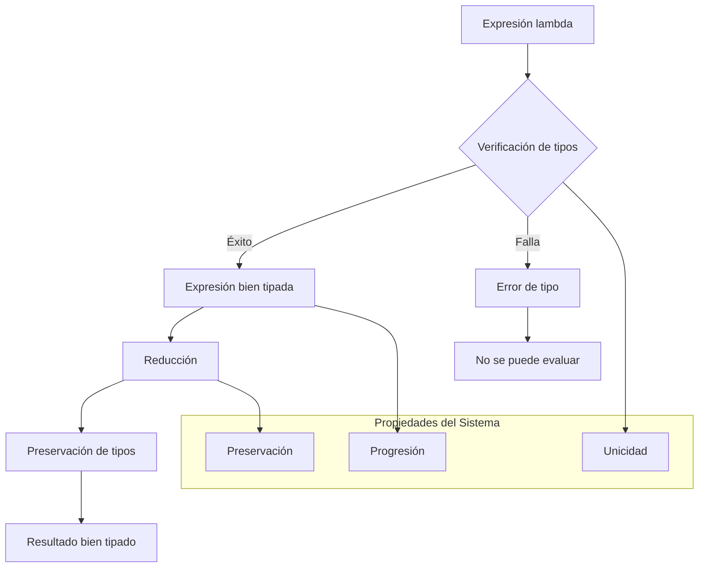

# Lenguajes de Programación - Paradigma funcional

## 3.3 Tipos función (cálculo lambda con tipos simples).

---

El cálculo lambda tipado extiende el cálculo lambda no tipado añadiendo un sistema de tipos que garantiza propiedades de seguridad y corrección. Según Pierce (2002), "los sistemas de tipos proporcionan un framework para verificar y garantizar la corrección de los programas, previniendo errores en tiempo de compilación".

### Cálculo Lambda Tipado (λ→)

#### Sintaxis del Cálculo Lambda Tipado

$$ \begin{aligned} \text{Tipos} &\quad \tau, \sigma ::= T \mid \tau \rightarrow \sigma \\\ \text{Términos} &\quad e ::= x \mid \lambda x:\tau . e \mid e_1\ e_2 \\ \text{Contextos} &\quad \Gamma ::= \emptyset \mid \Gamma, x:\tau \\\ \end{aligned} $$

#### Reglas de Tipado

##### Variable (VAR)

$$
\frac{(x:\tau) \in \Gamma}{\Gamma \vdash x : \tau}
$$

##### Abstracción (ABS)

$$
\frac{\Gamma, x:\tau_1 \vdash e : \tau_2}{\Gamma \vdash (\lambda x:\tau_1 . e) : \tau_1 \rightarrow \tau_2}
$$

##### Aplicación (APP)

$$
\frac{\Gamma \vdash e_1 : \tau_1 \rightarrow \tau_2 \quad \Gamma \vdash e_2 : \tau_1}{\Gamma \vdash e_1\ e_2 : \tau_2}
$$

### Sistema de Tipos Simples

#### Definición Formal

El sistema de tipos simples (también conocido como sistema F o sistema de Hindley-Milner restringido) asigna tipos a las expresiones lambda asegurando que las aplicaciones de funciones sean type-safe.

#### Propiedades Fundamentales

1. **Preservación de tipos**: Si $\Gamma \vdash e : \tau$ y $e \rightarrow e'$, entonces $\Gamma \vdash e' : \tau$
2. **Progresión**: Si $\emptyset \vdash e : \tau$, entonces $e$ es un valor o existe $e'$ tal que $e \rightarrow e'$
3. **Unicidad de tipos**: Cada término bien tipado tiene un tipo único

### Ejemplos de Derivaciones de Tipos

#### Ejemplo 1: Función Identidad

$$
\frac{
  \frac{
    \frac{(x:\tau) \in (x:\tau)}{(x:\tau) \vdash x : \tau}
  }{
    \emptyset \vdash (\lambda x:\tau . x) : \tau \rightarrow \tau
  }
}{
  \text{IDENT} : \forall \tau . \tau \rightarrow \tau
}
$$

#### Ejemplo 2: Aplicación de Función

Para la expresión $(\lambda f:\text{Int}\rightarrow\text{Int} . f\ 5)\ (\lambda x:\text{Int} . x + 1)$:

```haskell
-- Verificación de tipos
f: Int → Int ⊢ f: Int → Int     f: Int → Int ⊢ 5: Int
----------------------------------------------- APP
f: Int → Int ⊢ f 5: Int
----------------------------------------------- ABS
⊢ λf:Int→Int. f 5: (Int→Int) → Int

⊢ λx:Int. x+1: Int → Int
----------------------------------------------- APP
⊢ (λf:Int→Int. f 5) (λx:Int. x+1): Int
```

### Diagrama de Relaciones de Tipado



### Implementación de Verificación de Tipos

#### Algoritmo de Inferencia de Tipos

```haskell
data Type = TInt | TBool | TArrow Type Type
          | TVar String deriving (Eq, Show)

data Expr = Var String
          | Lam String Type Expr
          | App Expr Expr
          | LitInt Int
          | LitBool Bool

-- Función de verificación de tipos
typeCheck :: [(String, Type)] -> Expr -> Either String Type
typeCheck env (Var x) =
    case lookup x env of
        Just t -> Right t
        Nothing -> Left $ "Variable no definida: " ++ x

typeCheck env (Lam x t e) = do
    result <- typeCheck ((x, t):env) e
    return $ TArrow t result

typeCheck env (App e1 e2) = do
    t1 <- typeCheck env e1
    t2 <- typeCheck env e2
    case t1 of
        TArrow argType returnType ->
            if t2 == argType
            then Right returnType
            else Left $ "Error de tipo: esperado " ++ show argType ++
                       ", obtenido " ++ show t2
        _ -> Left $ "No es una función: " ++ show t1

typeCheck _ (LitInt _) = Right TInt
typeCheck _ (LitBool _) = Right TBool
```

### Ejercicios Propuestos

#### Ejercicio 1: Derivaciones de Tipos

Realice derivaciones de tipos completas para las siguientes expresiones:

1. $\lambda f:\text{Int}\rightarrow\text{Int} . \lambda x:\text{Int} . f\ (f\ x)$
2. $(\lambda g:\text{Bool}\rightarrow\text{Int} . g\ \text{true})\ (\lambda b:\text{Bool} . \text{if } b \text{ then } 1 \text{ else } 0)$
3. $\lambda x:\text{Int} \rightarrow \text{Int} . x\ (x\ 5)$

#### Ejercicio 2: Verificación de Tipos

Para cada expresión, determine si está bien tipada y, en caso afirmativo, encuentre su tipo:

1. $(\lambda f:\text{Int}\rightarrow\text{Bool} . f\ 5)\ (\lambda x:\text{Int} . x > 0)$
2. $(\lambda x:\text{Int} . x)\ (\lambda y:\text{Bool} . y)$
3. $\lambda f:\text{Int}\rightarrow\text{Int} . f\ (f\ \text{true})$

#### Ejercicio 3: Implementación de Type Checker

Extienda el algoritmo de verificación de tipos para soportar:

```haskell
data Expr = -- ... expresiones anteriores ...
          | If Expr Expr Expr
          | Add Expr Expr
          | Not Expr
```

Y escriba las reglas de tipado correspondientes.

#### Ejercicio 4: Polimorfismo Paramétrico

Analice cómo se podría extender el sistema para soportar polimorfismo:

1. $\lambda x:\forall\alpha.\alpha\rightarrow\alpha . (x[\text{Int}]\ 1, x[\text{Bool}]\ \text{true})$
2. $\text{let } id = \lambda x:\alpha . x \text{ in } (id\ 1, id\ \text{true})$

### Aplicaciones Prácticas

#### Funciones de Orden Superior con Tipos

```haskell
-- Map con anotaciones de tipos explícitas
map :: forall a b . (a -> b) -> [a] -> [b]
map f [] = []
map f (x:xs) = f x : map f xs

-- Fold con tipos
foldr :: forall a b . (a -> b -> b) -> b -> [a] -> b
foldr f z [] = z
foldr f z (x:xs) = f x (foldr f z xs)
```

#### Composición de Funciones Tipada

$$
\text{compose} : \forall \alpha\ \beta\ \gamma . (\beta \rightarrow \gamma) \rightarrow (\alpha \rightarrow \beta) \rightarrow (\alpha \rightarrow \gamma)
$$

$$
\text{compose} = \lambda f:\beta\rightarrow\gamma . \lambda g:\alpha\rightarrow\beta . \lambda x:\alpha . f\ (g\ x)
$$

### Teorema de Preservación y Progresión

#### Teorema de Preservación (Subject Reduction)

Si $\Gamma \vdash e : \tau$ y $e \rightarrow e'$, entonces $\Gamma \vdash e' : \tau$.

#### Teorema de Progresión

Si $\emptyset \vdash e : \tau$, entonces $e$ es un valor o existe $e'$ tal que $e \rightarrow e'$.

#### Corolario: Seguridad de Tipos

Ningún programa bien tipado se "pega" (no produce errores de tipo en tiempo de ejecución).

### Referencias

1. Pierce, B.C. (2002). _Types and Programming Languages_. MIT Press. (Capítulos 9-10: Simply Typed Lambda Calculus)
2. Mitchell, J. (2003). _Concepts in Programming Languages_. Cambridge University Press. (Capítulo 5: Types and Type Systems)
3. Harper, R. (2010). _Practical Foundations for Programming Languages_. http://www.cs.cmu.edu/~rwh/plbook/book.pdf (Capítulo 9: Function Types)
4. Hindley, R. (1969). The Principal Type-Scheme of an Object in Combinatory Logic.
5. Milner, R. (1978). A Theory of Type Polymorphism in Programming.

### Conclusión

El cálculo lambda con tipos simples proporciona las bases formales para los sistemas de tipos en lenguajes de programación funcionales. La verificación estática de tipos garantiza la corrección de los programas previniendo errores comunes y facilitando el razonamiento formal sobre el comportamiento de los programas. La comprensión de estos conceptos es fundamental para el diseño e implementación de lenguajes de programación modernos.
