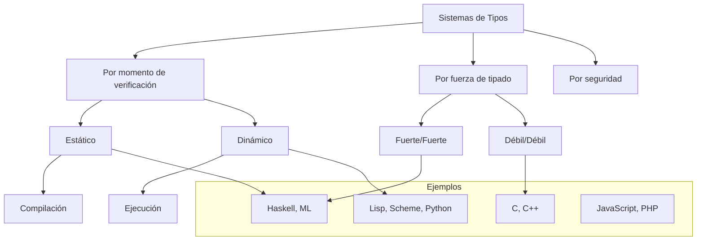

# Lenguajes de Programación - Paradigma funcional

## 3.4 Estilos de tipado: tipado dinámico vs. tipado estático.

---

Los sistemas de tipos son fundamentales en los lenguajes de programación funcionales, determinando cuándo y cómo se verifican las restricciones de tipos. Según Pierce (2002), "los sistemas de tipos proporcionan un framework disciplinado para verificar y garantizar propiedades de corrección en los programas".

### Conceptos Fundamentales

#### Sistema de Tipos

Un sistema de tipos es un conjunto de reglas que asignan tipos a las construcciones de un lenguaje de programación, con el objetivo de:

- Detectar ciertos tipos de errores
- Garantizar comportamiento seguro
- Facilitar la abstracción y modularidad
- Habilitar optimizaciones

#### Clasificación de Sistemas de Tipos



### Tipado Estático

#### Definición

El tipado estático verifica los tipos **en tiempo de compilación**, antes de la ejecución del programa. Mitchell (2003) lo define como: "Un sistema donde todas las expresiones tienen tipos que pueden determinarse sin ejecutar el programa".

#### Características

- Verificación en tiempo de compilación
- Mayor detección temprana de errores
- Mejor rendimiento en tiempo de ejecución
- Menos flexibilidad en ciertos patrones

#### Ventajas

1. **Detección temprana de errores**: Errores de tipo se capturan antes de la ejecución
2. **Mejor documentación**: Las anotaciones de tipos sirven como documentación
3. **Optimizaciones**: Compiladores pueden generar código más eficiente
4. **Mayor seguridad**: Menos errores en tiempo de ejecución

#### Desventajas

1. **Menos flexibilidad**: Dificulta ciertos patrones de programación
2. **Mayor verbosidad**: Puede requerir anotaciones explícitas de tipos
3. **Curva de aprendizaje**: Requiere entender el sistema de tipos

#### Ejemplo en Haskell (Estático)

```haskell
-- Anotaciones de tipo explícitas
add :: Int -> Int -> Int
add x y = x + y

-- El tipo se infiere automáticamente
multiply x y = x * y  -- Inferido como Num a => a -> a -> a

-- Error detectado en compilación
-- invalid = add "hello" 5  -- Error de tipo: [Char] no es Int
```

### Tipado Dinámico

#### Definición

El tipado dinámico verifica los tipos **en tiempo de ejecución**, durante la ejecución del programa. Harper (2010) señala que "en sistemas de tipos dinámicos, la verificación de tipos ocurre concomitantemente con la evaluación".

#### Características

- Verificación durante la ejecución
- Mayor flexibilidad y expresividad
- Potencialmente más errores en tiempo de ejecución
- Mayor overhead en ejecución

#### Ventajas

1. **Flexibilidad**: Facilita metaprogramación y patrones dinámicos
2. **Prototipado rápido**: Menos restricciones durante el desarrollo
3. **Polimorfismo ad-hoc**: Funciones pueden trabajar con múltiples tipos
4. **Menos verbosidad**: No requiere anotaciones de tipos explícitas

#### Desventajas

1. **Errores en runtime**: Errores de tipo solo se descubren al ejecutar
2. **Menor rendimiento**: Overhead por verificación en tiempo de ejecución
3. **Menor documentación**: Tipos menos evidentes en el código
4. **Refactorización más difícil**: Cambios de tipos pueden pasar desapercibidos

#### Ejemplo en Scheme (Dinámico)

```scheme
;; Función que trabaja con múltiples tipos
(define (add x y)
  (cond
    ((and (number? x) (number? y)) (+ x y))
    ((and (string? x) (string? y)) (string-append x y))
    (else (error "Tipos no compatibles"))))

;; Uso válido
(add 2 3)          ; → 5
(add "hello" " world") ; → "hello world"

;; Error en tiempo de ejecución
;; (add "hello" 5)  ; Error: Tipos no compatibles
```

### Comparación Técnica

#### Tabla Comparativa

| Característica       | Tipado Estático | Tipado Dinámico |
| -------------------- | --------------- | --------------- |
| Verificación         | Compilación     | Ejecución       |
| Detección de errores | Temprana        | Tardía          |
| Rendimiento          | Mejor           | Peor (overhead) |
| Flexibilidad         | Limitada        | Alta            |
| Verbosidad           | Mayor           | Menor           |
| Refactorización      | Más segura      | Más riesgosa    |
| Metaprogramación     | Limitada        | Amplia          |

#### Expresiones Formales

Para una función $f$ que toma argumento $x$ de tipo $\tau$ y retorna tipo $\sigma$:

**Estático**: $\vdash f: \tau \rightarrow \sigma$ verificado en compilación
**Dinámico**: $\text{typecheck}(f(x))$ verificado en ejecución

### Ejercicios Propuestos

#### Ejercicio 1: Identificación de Errores

Para cada fragmento, indique cuándo se detectaría el error y en qué sistema de tipos:

1. `"5" + 3` (concatenación vs. suma)
2. `función no definida()`
3. `array[10]` donde `array` tiene solo 5 elementos
4. `objeto.método_inexistente()`

#### Ejercicio 2: Conversión entre Sistemas

Convierta las siguientes funciones entre sistemas de tipos:

```python
# Python (dinámico)
def process_data(data):
    return data.upper() + str(len(data))

# Convierta a Haskell (estático) con anotaciones de tipos apropiadas
```

#### Ejercicio 3: Análisis de Casos

Analice ventajas y desventajas de cada sistema para:

1. Desarrollo de prototipos rápidos
2. Sistemas críticos de misión
3. Scripting y automatización
4. Grandes bases de código empresariales

#### Ejercicio 4: Implementación de Type Checking

Implemente un verificador de tipos simple para un subconjunto de expresiones:

```haskell
data Expr = LitInt Int | LitStr String
          | Add Expr Expr | Concat Expr Expr
          | If Expr Expr Expr

-- Implemente la función
checkType :: Expr -> Maybe Type
```

### Sistemas Híbridos y Avanzados

#### Inferencia de Tipos

Muchos lenguajes estáticos modernos usan inferencia de tipos:

$$ \frac{\Gamma \vdash e_1 : \tau \rightarrow \sigma \quad \Gamma \vdash e_2 : \tau}{\Gamma \vdash e_1 e_2 : \sigma} $$

#### Tipado Gradual

Sistemas que permiten mezclar tipado estático y dinámico:

```typescript
// TypeScript: estático con escape dinámico
function dynamicAdd(x: any, y: any): any {
  return x + y; // Verificación dinámica
}

function staticAdd(x: number, y: number): number {
  return x + y; // Verificación estática
}
```

#### Teorema de Seguridad

Para sistemas estáticos bien diseñados:

$$ \text{Si } \emptyset \vdash e : \tau \text{ y } e \rightarrow^* e', \text{ entonces } e' \text{ es un valor o } \exists e'' . e' \rightarrow e'' $$

### Referencias

1. Pierce, B.C. (2002). _Types and Programming Languages_. MIT Press. (Capítulos 1-4: Fundamentos de Sistemas de Tipos)
2. Mitchell, J. (2003). _Concepts in Programming Languages_. Cambridge University Press. (Capítulo 5: Types and Type Systems)
3. Harper, R. (2010). _Practical Foundations for Programming Languages_. http://www.cs.cmu.edu/~rwh/plbook/book.pdf (Capítulos 9-10: Type Systems)
4. Siek, J. & Taha, W. (2006). _Gradual Typing for Functional Languages_
5. Abadi, M. & Cardelli, L. (1996). _A Theory of Objects_ (Sistemas de tipos para OOP)

### Conclusión

La elección entre tipado estático y dinámico representa un trade-off fundamental en el diseño de lenguajes de programación. Mientras el tipado estático ofrece mayor seguridad, rendimiento y capacidad de verificación temprana, el tipado dinámico proporciona flexibilidad, expresividad y facilidad de prototipado. La tendencia moderna hacia sistemas híbridos y gradual typing demuestra que ambos enfoques tienen méritos y que la elección depende del contexto de aplicación, los requisitos del proyecto y las preferencias del equipo de desarrollo.
