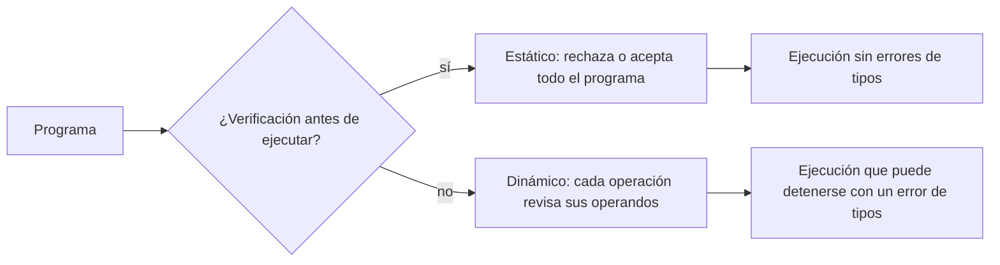

# Lenguajes de Programación - Paradigma funcional

## 3.4 Estilos de tipado: tipado dinámico vs. tipado estático.

---

Todo lenguaje de alto nivel distingue tipos de valores: no tiene sentido sumar una cadena con una función. La diferencia entre los lenguajes está en **cuándo** se verifica que las operaciones se apliquen a valores del tipo correcto. Con **tipado estático**, un verificador analiza el programa antes de ejecutarlo y rechaza los que podrían cometer un error de tipos. Con **tipado dinámico**, cada operación revisa el tipo de sus operandos al ejecutarse. Ambos estilos tienen ventajas reales, y los lenguajes actuales tienden a combinarlos. Este tema compara los dos estilos, aclara los términos que se suelen confundir con ellos y muestra con un mismo lenguaje qué detecta cada uno.

### Tipado estático

El tipo es una propiedad de las **expresiones** y las **variables**, que el compilador determina a partir del texto (temas 3.3 y 3.7). Un programa mal tipado no se ejecuta. Ejemplos: C, Java, C#, Go, Rust, ML, Haskell, Scala, TypeScript.

Ventajas:

- Los errores de tipos se detectan **antes** de ejecutar, en todas las ramas, incluidas las que las pruebas no cubren.
- Los tipos documentan las interfaces y permiten que las herramientas completen código, naveguen y refactoricen con seguridad.
- El compilador puede generar código más eficiente, porque conoce la representación de cada valor.

Desventajas:

- Rechaza algunos programas que no fallarían nunca, como un condicional con ramas de tipos distintos cuya rama "mala" nunca se toma. Todo sistema de tipos decidible es **conservador**, por el teorema de Rice.
- Exige anotaciones, menos con inferencia de tipos, y a veces formas indirectas de expresar código genérico.

### Tipado dinámico

El tipo es una propiedad de los **valores**: cada valor lleva una etiqueta con su tipo, y las operaciones la revisan. Ejemplos: LISP, Scheme, Smalltalk, Python, Ruby, JavaScript, Erlang.

Ventajas:

- Acepta todo programa que no falle al ejecutarse, y permite estructuras heterogéneas y metaprogramación con menos ceremonia.
- Es rápido de escribir y de modificar, y se presta a la exploración y a los prototipos.
- El **tipado de pato** (*duck typing*): un objeto sirve si tiene los métodos que se usan, sin declarar una interfaz.

Desventajas:

- Los errores aparecen solo al ejecutar la línea que los contiene, posiblemente en producción.
- Hay que compensar con más pruebas, y las herramientas saben menos del código.
- El costo de revisar las etiquetas en cada operación, que los compiladores en tiempo de ejecución reducen especializando el código.

### Términos que se confunden

- **Estático o dinámico** dice cuándo se verifica. **Fuerte o débil** dice si el lenguaje impide las operaciones sin sentido o las realiza con **conversiones implícitas**: Python es dinámico y fuerte, porque `"5" + 3` es un error; JavaScript es dinámico y débil, porque `"5" + 3` da `"53"` y `"5" - 3` da `2`; C es estático y débil, porque permite tratar cualquier memoria como cualquier tipo con un *cast*. Los términos fuerte y débil no tienen una definición única.
- **Seguro** (*type safe*) significa que ningún programa aceptado puede realizar una operación sin sentido sobre la memoria: Java, Python, Haskell y Rust lo son; C y C++ no.
- **Explícito o inferido** dice si el programador escribe los tipos: Haskell y OCaml son estáticos con inferencia casi completa; Java es estático con anotaciones obligatorias en las firmas.
- **Nominal o estructural** dice si dos tipos son compatibles por su nombre, como en Java, o por su forma, como en TypeScript y Go con sus interfaces.

### Tipado gradual

El **tipado gradual** (Siek y Taha, 2006) permite mezclar código con y sin tipos en un mismo programa: las partes anotadas se verifican estáticamente, y en la frontera con las no anotadas se insertan verificaciones dinámicas. TypeScript sobre JavaScript, las anotaciones de Python con verificadores como mypy, Hack sobre PHP y Typed Racket siguen esta idea, en distintas variantes: TypeScript y mypy borran los tipos al ejecutar y no insertan verificaciones, de modo que son verificadores opcionales y no garantizan la seguridad en la frontera.

| Error                                   | Estático (Java, Haskell)          | Dinámico (Python)           |
| --------------------------------------- | --------------------------------- | --------------------------- |
| `"5" + 3`                               | Haskell, al compilar; Java da `"53"` | Al ejecutar: `TypeError`    |
| Función no definida                     | Al compilar                       | Al ejecutar esa línea       |
| Índice fuera de rango                   | Al ejecutar, en ambos             | Al ejecutar: `IndexError`   |
| Método inexistente                      | Al compilar                       | Al ejecutar: `AttributeError` |



### Implementación en Python

El programa muestra cuándo detecta Python cada uno de los errores del ejercicio 1, incluida una llamada a una función inexistente que no falla si la rama no se ejecuta. Para el ejercicio 4 implementa, para un mismo lenguaje de enteros y cadenas, un verificador estático que analiza la expresión sin ejecutarla y un evaluador que verifica los tipos al ejecutarse, y compara sus veredictos sobre seis programas. Para el ejercicio 2 escribe `process_data` con anotaciones de tipos y la prueba con un objeto que imita a una cadena.

```python
# --- Ejercicio 1: cuándo detecta Python, que tiene tipado dinámico, cada error ---
def intenta(etiqueta, f):
    try: print(f"   {etiqueta}: {f()!r}")
    except Exception as e: print(f"   {etiqueta}: {type(e).__name__} al ejecutar, {e}")
print("ejercicio 1:")
intenta('"5" + 3', lambda: "5" + 3)
intenta('"5" + str(3) y int("5") + 3', lambda: ("5" + str(3), int("5") + 3))
def usa_funcion_inexistente(bandera):
    if bandera: return funcion_no_definida()          # el nombre solo se busca si se ejecuta esta línea
    return "la rama con el error no se ejecutó"
intenta("función no definida, rama no tomada", lambda: usa_funcion_inexistente(False))
intenta("función no definida, rama tomada", lambda: usa_funcion_inexistente(True))
arreglo = [1, 2, 3, 4, 5]
intenta("arreglo[10]", lambda: arreglo[10])
intenta("objeto.metodo_inexistente()", lambda: "texto".metodo_inexistente())

# --- Ejercicio 4: el mismo lenguaje con verificación estática y con verificación dinámica ---
# expresiones: ("int", n) ("str", s) ("add", a, b) ("concat", a, b) ("if", c, a, b), con c entero (0 es falso)
def check(e):
    """Verificación estática: devuelve "Int", "Str" o None, sin ejecutar nada."""
    k = e[0]
    if k == "int": return "Int"
    if k == "str": return "Str"
    if k in ("add", "concat"):
        a, b = check(e[1]), check(e[2])
        esperado = "Int" if k == "add" else "Str"
        return esperado if a == b == esperado else None
    if k == "if":
        c, a, b = check(e[1]), check(e[2]), check(e[3])
        return a if c == "Int" and a is not None and a == b else None
def evalua(e):
    """Verificación dinámica: cada operación revisa el tipo de sus operandos al ejecutarse."""
    k = e[0]
    if k in ("int", "str"): return e[1]
    if k in ("add", "concat"):
        a, b = evalua(e[1]), evalua(e[2])
        tipo = int if k == "add" else str
        if not (isinstance(a, tipo) and isinstance(b, tipo)): raise TypeError(f"{k} con {type(a).__name__} y {type(b).__name__}")
        return a + b
    if k == "if":
        c = evalua(e[1])
        if not isinstance(c, int): raise TypeError("condición no entera")
        return evalua(e[2]) if c else evalua(e[3])
def txt(e):
    k = e[0]
    if k == "int": return str(e[1])
    if k == "str": return repr(e[1])
    if k == "add": return f"{txt(e[1])} + {txt(e[2])}"
    if k == "concat": return f"{txt(e[1])} ++ {txt(e[2])}"
    return f"if {txt(e[1])} then {txt(e[2])} else {txt(e[3])}"
programas = [("add", ("int", 2), ("int", 3)),
             ("concat", ("str", "ab"), ("str", "cd")),
             ("add", ("int", 2), ("str", "3")),
             ("if", ("int", 1), ("int", 10), ("add", ("int", 1), ("str", "x"))),     # error en la rama que no se toma
             ("if", ("int", 0), ("int", 10), ("str", "diez")),                     # ramas de tipos distintos
             ("if", ("str", "sí"), ("int", 1), ("int", 2))]
print("ejercicio 4:")
for p in programas:
    estatico = check(p)
    try: dinamico = repr(evalua(p))
    except TypeError as err: dinamico = f"error: {err}"
    print(f"   {txt(p)}\n      estático: {estatico or 'rechazado'} | dinámico: {dinamico}")

# --- Ejercicio 2: process_data, con la anotación de tipos que tendría en un lenguaje estático ---
def process_data(data: str) -> str:
    return data.upper() + str(len(data))
print("ejercicio 2:", process_data("hola"), "| con una lista:", end=" ")
try: process_data(["a", "b"])
except AttributeError as e: print(e)
# duck typing: cualquier objeto con upper() y len() sirve, que es lo que el tipo String de Haskell no permite
class Grito:
    def __init__(self, s): self.s = s
    def upper(self): return self.s.upper() + "!"
    def __len__(self): return len(self.s)
print("   con un objeto que tiene upper y len:", process_data(Grito("hey")))
```

Salida:

```text
ejercicio 1:
   "5" + 3: TypeError al ejecutar, can only concatenate str (not "int") to str
   "5" + str(3) y int("5") + 3: ('53', 8)
   función no definida, rama no tomada: 'la rama con el error no se ejecutó'
   función no definida, rama tomada: NameError al ejecutar, name 'funcion_no_definida' is not defined
   arreglo[10]: IndexError al ejecutar, list index out of range
   objeto.metodo_inexistente(): AttributeError al ejecutar, 'str' object has no attribute 'metodo_inexistente'
ejercicio 4:
   2 + 3
      estático: Int | dinámico: 5
   'ab' ++ 'cd'
      estático: Str | dinámico: 'abcd'
   2 + '3'
      estático: rechazado | dinámico: error: add con int y str
   if 1 then 10 else 1 + 'x'
      estático: rechazado | dinámico: 10
   if 0 then 10 else 'diez'
      estático: rechazado | dinámico: 'diez'
   if 'sí' then 1 else 2
      estático: rechazado | dinámico: error: condición no entera
ejercicio 2: HOLA4 | con una lista: 'list' object has no attribute 'upper'
   con un objeto que tiene upper y len: HEY!3
```

### Ejercicios Propuestos

1. **Errores.** Para cada fragmento, indica cuándo se detectaría el error con tipado estático y con tipado dinámico: `"5" + 3`, la llamada a una función no definida, `array[10]` sobre un arreglo de 5 elementos y `objeto.metodo_inexistente()`.

2. **Conversión.** Escribe en Haskell, con tipos, la función de Python

    ```python
    def process_data(data):
        return data.upper() + str(len(data))
    ```

3. **Casos.** Analiza las ventajas y desventajas de cada estilo para prototipos, sistemas críticos, guiones de automatización y bases de código empresariales grandes.

4. **Verificador.** Implementa `checkType :: Expr -> Maybe Type` para `data Expr = LitInt Int | LitStr String | Add Expr Expr | Concat Expr Expr | If Expr Expr Expr`.

### Soluciones

**Ejercicio 1.** Es la tabla de la sección de tipado gradual, que el programa confirma para Python.

- **`"5" + 3`:** Python lo rechaza al ejecutar, con `TypeError`, porque no convierte implícitamente entre cadenas y números; la conversión se pide con `str(3)` o `int("5")`. Haskell lo rechaza al compilar. Java lo **acepta**: el operador `+` con una cadena convierte el otro operando y concatena, y da `"53"`, igual que JavaScript.
- **Función no definida:** un compilador estático la rechaza siempre. Python solo busca el nombre al ejecutar la línea: el programa muestra que la función que la contiene funciona mientras no se tome esa rama. Es la razón por la que en un lenguaje dinámico la cobertura de las pruebas importa tanto.
- **`array[10]`:** casi ningún sistema de tipos lo detecta, porque el tamaño del arreglo y el valor del índice se conocen al ejecutar; se detecta al ejecutar en Java, Python y Haskell, y en C no se detecta y el programa lee memoria ajena. Los **tipos dependientes**, como los de Idris o Agda, sí pueden expresar "un índice menor que la longitud".
- **Método inexistente:** el compilador estático lo rechaza, porque conoce la clase del objeto; Python lanza `AttributeError` al ejecutar.

**Ejercicio 2.**

```haskell
import Data.Char (toUpper)

processData :: String -> String
processData d = map toUpper d ++ show (length d)
```

La versión de Haskell fija el tipo del argumento como `String`; la de Python acepta cualquier objeto con un método `upper` que devuelva algo concatenable con una cadena, y con `len`. El programa lo muestra: falla con una lista al ejecutar, y funciona con un objeto propio que tiene esos dos métodos. Para expresar esa generalidad en un lenguaje estático hace falta una **clase de tipos** o una interfaz: en Haskell, `class Gritable a where upper :: a -> String`; en Python, con anotaciones, un `Protocol`.

**Ejercicio 3.**

- **Prototipos:** el dinámico es más rápido para explorar, porque el esquema de los datos y las interfaces cambian a cada paso. Con inferencia de tipos, como en OCaml o Haskell, la diferencia se reduce.
- **Sistemas críticos:** el estático, por las garantías antes de ejecutar; en el extremo, con herramientas de verificación, como SPARK Ada en aviación o Rust para la seguridad de la memoria. Las pruebas, por muchas que sean, no cubren todas las rutas.
- **Guiones de automatización:** el dinámico, por la brevedad y porque el programa es corto, lo usa su autor y un error se ve de inmediato.
- **Bases de código grandes:** el estático, o el gradual, porque los tipos son documentación verificada y permiten refactorizar con seguridad. La migración de grandes bases de JavaScript a TypeScript y de Python a Python con anotaciones muestra que, a partir de cierto tamaño, las organizaciones agregan tipos a sus lenguajes dinámicos.

**Ejercicio 4.**

```haskell
data Type = TInt | TStr deriving Eq

checkType :: Expr -> Maybe Type
checkType (LitInt _)   = Just TInt
checkType (LitStr _)   = Just TStr
checkType (Add a b)    = do { TInt <- checkType a; TInt <- checkType b; Just TInt }
checkType (Concat a b) = do { TStr <- checkType a; TStr <- checkType b; Just TStr }
checkType (If c a b)   = do { TInt <- checkType c; ta <- checkType a; tb <- checkType b
                            ; if ta == tb then Just ta else Nothing }
```

El enunciado no tiene booleanos, así que la condición se toma entera, con 0 como falso. La función del programa es la misma en Python. La comparación de los seis programas muestra las dos caras del tipado estático: rechaza `2 + '3'` y `if 'sí' then 1 else 2` sin ejecutarlos, igual que el evaluador dinámico al ejecutarlos; pero rechaza también `if 1 then 10 else 1 + 'x'`, cuya rama con error nunca se ejecuta, e `if 0 then 10 else 'diez'`, que el evaluador dinámico ejecuta sin problema. Son programas sin errores de tipos al ejecutarse que el verificador estático, conservador, no acepta.

### Referencias

1. Cardelli, L., Type systems. En _The Computer Science and Engineering Handbook_, A. B. Tucker (ed.). CRC Press, 2004.
2. Pierce, B. C., _Types and Programming Languages_. MIT Press, 2002. Capítulo 1.
3. Siek, J. G., and Taha, W., Gradual typing for functional languages. _Scheme and Functional Programming Workshop_, 2006.
4. Meijer, E., and Drayton, P., Static typing where possible, dynamic typing when needed. _OOPSLA Workshop on Revival of Dynamic Languages_, 2004.
5. Python Software Foundation, _PEP 484: Type Hints_ y _PEP 544: Protocols_, 2014 y 2017.
