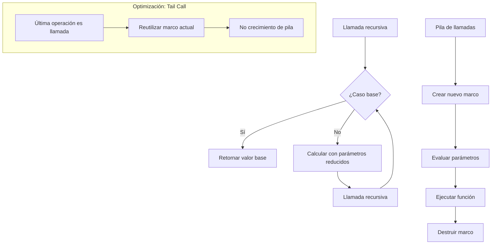

# Lenguajes de Programación - Paradigma funcional

## 3.5 Recursion: funciones con nombre, puntos fijos, definiciones con letrec o fix.

---

La recursión es un concepto fundamental en el paradigma funcional donde una función se define en términos de sí misma. Según Mitchell (2003), "la recursión permite expresar computaciones iterativas de manera elegante y matemáticamente precisa sin necesidad de constructs imperativos".

### Conceptos Fundamentales

#### Recursión Directa vs. Indirecta

**Recursión directa**: Una función se llama directamente a sí misma.
**Recursión indirecta**: Funciones que se llaman entre sí mutuamente.

#### Terminación y Correctitud

Para garantizar terminación, las funciones recursivas deben:

1. Tener al menos un **caso base** que no requiere recursión
2. Avanzar hacia el caso base en cada llamada recursiva

### Funciones con Nombre

#### Definición Recursiva Explícita

En lenguajes funcionales, las funciones pueden definirse recursivamente usando su nombre:

```haskell
-- Factorial con recursión explícita
factorial :: Integer -> Integer
factorial 0 = 1  -- Caso base
factorial n = n * factorial (n - 1)  -- Paso recursivo
```

#### Semántica Operacional

La evaluación sigue la regla:

$$ \text{factorial}(n) = \begin{cases} 1 & \text{si } n = 0 \\\ n \times \text{factorial}(n-1) & \text{si } n > 0 \end{cases} $$

### El Combinador de Punto Fijo (Fix)

#### Concepto Matemático

Un punto fijo de una función $f$ es un valor $x$ tal que:

$$ f(x) = x $$

El combinador de punto fijo encuentra este valor para funciones recursivas.

#### Combinador Y de Curry

$$ Y = \lambda f . (\lambda x . f (x x)) (\lambda x . f (x x)) $$

Propiedad fundamental:

$$ Y f = f (Y f) $$

#### Implementación del Combinador Fix

```haskell
-- Combinador de punto fijo en Haskell
fix :: (a -> a) -> a
fix f = f (fix f)

-- Uso para definir factorial
factorial' :: (Integer -> Integer) -> Integer -> Integer
factorial' self 0 = 1
factorial' self n = n * self (n - 1)

factorial = fix factorial'
```

### Letrec y Definiciones Recursivas Mutuas

#### Sintaxis de Letrec

El constructo `letrec` permite definiciones recursivas mutuas:

$$

\text{letrec } x_1 = e_1; x_2 = e_2; \ldots; x_n = e_n \text{ in } e

$$

#### Semántica Formal

Las variables $x_i$ están en scope en todas las expresiones $e_j$:

$$ \frac{\Gamma, x_1:\tau_1, \ldots, x_n:\tau_n \vdash e_i : \tau_i \quad \Gamma, x_1:\tau_1, \ldots, x_n:\tau_n \vdash e : \tau}{\Gamma \vdash \text{letrec } x_1 = e_1; \ldots; x_n = e_n \text{ in } e : \tau} $$

#### Ejemplo con Letrec

```scheme
;; Scheme con letrec
(letrec ((even? (lambda (n)
                 (if (= n 0)
                     #t
                     (odd? (- n 1)))))
         (odd? (lambda (n)
                (if (= n 0)
                    #f
                    (even? (- n 1))))))
  (even? 4))  ; → #t
```

### Diagrama de Evaluación Recursiva



### Ejercicios Propuestos

#### Ejercicio 1: Conversión a Forma Recursiva

Convierta las siguientes funciones iterativas a forma recursiva:

1. Función que calcula la suma de una lista:
   ```python
   def sum_list(lst):
       total = 0
       for item in lst:
           total += item
       return total
   ```

2. Función que encuentra el máximo elemento:
   ```javascript
   function findMax(arr) {
       let max = arr[0];
       for (let i = 1; i < arr.length; i++) {
           if (arr[i] > max) max = arr[i];
       }
       return max;
   }
   ```

#### Ejercicio 2: Implementación con Combinador Fix

Implemente las siguientes funciones usando el combinador de punto fijo:

1. Fibonacci: $fib(n) = fib(n-1) + fib(n-2)$ con $fib(0) = 0$, $fib(1) = 1$
2. Longitud de lista: $length([]) = 0$, $length(x:xs) = 1 + length(xs)$

#### Ejercicio 3: Análisis de Terminación

Para cada función, determine si termina siempre, a veces, o nunca:

1.
```haskell
f x = if x <= 0 then 0 else f (x + 1)
```

2.
```scheme
(define (g n)
  (if (= n 0)
      0
      (g (modulo n 2))))
```

3.
```haskell
h xs = if null xs then [] else h (tail xs) ++ [head xs]
```

#### Ejercicio 4: Definiciones Recursivas Mutuas

Implemente usando `letrec` o equivalente:

1. Par e impar mutuamente recursivos
2. Una función que determine si una lista es palíndromo usando funciones auxiliares mutuamente recursivas

### Recursión en Diferentes Lenguajes

#### Haskell (Recursión Explícita)

```haskell
-- Recursión sobre listas
map' :: (a -> b) -> [a] -> [b]
map' _ [] = []
map' f (x:xs) = f x : map' f xs

-- Recursión de cola con acumulador
factorialTail :: Integer -> Integer
factorialTail n = go n 1
  where go 0 acc = acc
        go n acc = go (n-1) (n * acc)
```

#### Scheme (Letrec)

```scheme
;; Definición recursiva con letrec
(letrec ((length (lambda (lst)
                   (if (null? lst)
                       0
                       (+ 1 (length (cdr lst)))))))
  (length '(a b c d)))  ; → 4
```

#### JavaScript (Combinador Y)

```javascript
// Combinador Y en JavaScript
const Y = f => (x => f(y => x(x)(y)))(x => f(y => x(x)(y)));

const factorial = Y(f => n => n === 0 ? 1 : n * f(n - 1));
console.log(factorial(5));  // → 120
```

### Optimizaciones de Recursión

#### Tail Call Optimization (TCO)

Las llamadas recursivas en cola no crean nuevos stack frames:

```haskell
-- Recursión de cola (optimizable)
sumTail :: [Int] -> Int -> Int
sumTail [] acc = acc
sumTail (x:xs) acc = sumTail xs (acc + x)

-- No tail recursion (no optimizable)
sumNormal :: [Int] -> Int
sumNormal [] = 0
sumNormal (x:xs) = x + sumNormal xs
```

#### Trampolines

Para lenguajes sin TCO nativo:

```javascript
// Trampoline en JavaScript
const trampoline = fn => (...args) => {
    let result = fn(...args);
    while (typeof result === 'function') {
        result = result();
    }
    return result;
};

const factorialTrampoline = trampoline(function f(n, acc = 1) {
    return n === 0 ? acc : () => f(n - 1, n * acc);
});
```

### Referencias

1. Pierce, B.C. (2002). *Types and Programming Languages*. MIT Press. (Capítulo 5: The Untyped Lambda Calculus)
2. Mitchell, J. (2003). *Concepts in Programming Languages*. Cambridge University Press. (Capítulo 4: Functional Programming)
3. Friedman, D. P., & Wand, M. (2008). *Essentials of Programming Languages* (3rd edition). MIT Press. (Capítulo 6: Recursion)
4. Harper, R. (2010). *Practical Foundations for Programming Languages*. http://www.cs.cmu.edu/~rwh/plbook/book.pdf (Capítulo 19: System F of Polymorphic Types)

### Conclusión

La recursión es un pilar fundamental del paradigma funcional que permite expresar computaciones iterativas de manera elegante y matemáticamente sólida. Los diferentes mecanismos—funciones con nombre, combinadores de punto fijo, y construcciones como letrec, ofrecen diversas formas de definir funciones recursivas, cada una con sus ventajas y aplicaciones específicas. La comprensión de estos conceptos es esencial para dominar la programación funcional y apreciar la elegancia matemática detrás de la definición recursiva de funciones.
