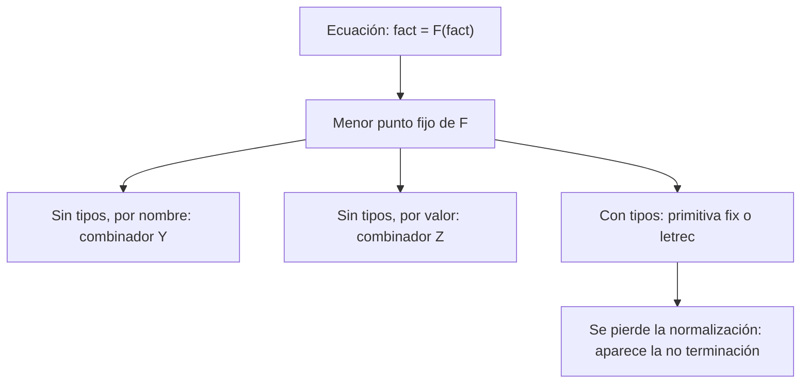

# Lenguajes de Programación - Paradigma funcional

## 3.5 Recursion: funciones con nombre, puntos fijos, definiciones con letrec o fix.

---

En el paradigma funcional, la **recursión** ocupa el lugar de los ciclos. Pero el cálculo lambda no tiene nombres: una función anónima no puede llamarse a sí misma. La recursión se obtiene de otra manera: una definición recursiva $f = F(f)$ es una **ecuación**, y su solución es un **punto fijo** de $F.$ El cálculo lambda sin tipos tiene combinadores que construyen ese punto fijo, como $Y;$ el cálculo con tipos simples no los tiene, porque todos sus términos terminan, y se le agrega la recursión como primitiva con `fix` o `letrec`. Este tema presenta esos mecanismos, la recursión de cola, la recursión mutua y el análisis de terminación.

### Recursión con nombre

En los lenguajes de programación, una definición con nombre puede usar su propio nombre en el cuerpo:

```haskell
fact :: Integer -> Integer
fact 0 = 1
fact n = n * fact (n - 1)
```

Para que esto funcione, el nombre debe estar en el alcance de su propio cuerpo. En ML y Scheme, `let` no lo permite y hay que usar `let rec` o `letrec`; en Haskell todas las definiciones son recursivas. Una función recursiva se razona por **inducción**: se demuestra que el caso base es correcto y que, si la llamada recursiva es correcta, la llamada actual también.

### Recursión de cola

Una llamada está **en posición de cola** si es lo último que hace la función, sin trabajo pendiente después. En `n * fact (n - 1)` no lo está, porque falta multiplicar; en `fact' (n - 1) (n * acc)`, con un **acumulador**, sí. Una llamada de cola no necesita guardar el marco de la función actual, y el compilador puede reemplazarla por un salto: es la **eliminación de llamadas de cola**, que hace que una recursión de cola use memoria constante, como un ciclo. Scheme la exige en su estándar, y la implementan los compiladores de ML, Haskell y, en muchos casos, C. Python y Java no la hacen, y una recursión profunda agota la pila.

### Puntos fijos

Un **punto fijo** de una función $F$ es un $x$ con $F(x) = x.$ La definición del factorial es la ecuación $\mathsf{fact} = F(\mathsf{fact})$ con

$$F = \lambda f.\, \lambda n.\, \mathsf{if}\; n = 0\; \mathsf{then}\; 1\; \mathsf{else}\; n \cdot f\,(n - 1),$$

un funcional que no es recursivo: recibe una aproximación del factorial y devuelve una mejor. Por el teorema de punto fijo de Kleene, la solución que corresponde al cómputo es el **menor** punto fijo, el límite de $F^0(\bot), F^1(\bot), F^2(\bot), \dots,$ donde $\bot$ es la función indefinida: $F^k(\bot)$ calcula correctamente el factorial de los $n \lt k$ y no está definida en los demás (tema 2.3).

En el cálculo lambda sin tipos, el **combinador** $Y$ de Curry calcula puntos fijos:

$$Y = \lambda f.\, (\lambda x.\, f\,(x\; x))\; (\lambda x.\, f\,(x\; x)), \qquad Y\; F \to (\lambda x.\, F\,(x\; x))\; (\lambda x.\, F\,(x\; x)) \to F\,((\lambda x.\, F\,(x\; x))\; (\lambda x.\, F\,(x\; x))),$$

así que $Y\; F$ y $F\,(Y\; F)$ reducen al mismo término. $Y$ funciona con orden normal; con llamada por valor no termina, porque el argumento $x\; x$ se evalúa antes de llamar a $F.$ La variante $Z,$ con una **expansión eta** que suspende la autoaplicación, sí funciona por valor:

$$Z = \lambda f.\, (\lambda x.\, f\,(\lambda v.\, x\; x\; v))\; (\lambda x.\, f\,(\lambda v.\, x\; x\; v)).$$

### fix y letrec

En el cálculo con tipos simples, $Y$ no tiene tipo, porque contiene la autoaplicación $x\; x$ (tema 3.3). Se agrega un operador primitivo con su regla de tipos y su regla de reducción:

$$\frac{\Gamma \vdash t : T \to T}{\Gamma \vdash \mathsf{fix}\; t : T} \qquad \frac{}{\mathsf{fix}\; (\lambda f{:}T.\, t) \to t[f := \mathsf{fix}\; (\lambda f{:}T.\, t)]}$$

y la forma $\mathsf{letrec}\; f = t_1\; \mathsf{in}\; t_2$ abrevia $\mathsf{let}\; f = \mathsf{fix}\; (\lambda f.\, t_1)\; \mathsf{in}\; t_2.$ Con $\mathsf{fix}$ se pierde la normalización fuerte: $\mathsf{fix}\; (\lambda x{:}T.\, x)$ no termina. Es el precio de la completitud de Turing. La **recursión mutua**, varias funciones que se llaman entre sí, se obtiene con un $\mathsf{letrec}$ de varias definiciones o con el punto fijo de una tupla de funciones.

### Terminación

Decidir si una función recursiva termina para toda entrada es indecidible, por el problema de la parada. En la práctica se demuestra con una **función de medida**: un valor natural, o de un orden bien fundado, que decrece estrictamente en cada llamada recursiva. La recursión **estructural**, que solo se llama sobre partes propias del argumento, como la cola de una lista, termina siempre sobre datos finitos; los asistentes de prueba como Coq y Agda solo aceptan funciones así, o con una medida demostrada.



### Implementación en Python

El programa convierte a recursión directa y de cola las dos funciones del ejercicio 1 y muestra el límite de profundidad de Python. Para el ejercicio 2 comprueba que $Y$ no termina con la evaluación ansiosa de Python, define Fibonacci y la longitud con $Z,$ escribe `fix` como función, verifica que el resultado es un punto fijo y calcula las aproximaciones de Kleene. Para el ejercicio 3 ejecuta las tres funciones con un límite de llamadas, y para el ejercicio 4 escribe funciones mutuamente recursivas con nombre y con un punto fijo sobre un par.

```python
import sys

# --- Ejercicio 1: de iteración a recursión, directa y de cola ---
def sum_list(lst): return 0 if not lst else lst[0] + sum_list(lst[1:])
def sum_cola(lst, acc=0): return acc if not lst else sum_cola(lst[1:], acc + lst[0])
def find_max(arr):
    if len(arr) == 1: return arr[0]
    resto = find_max(arr[1:])
    return arr[0] if arr[0] > resto else resto
def find_max_cola(arr, i=1, mejor=None):
    mejor = arr[0] if mejor is None else mejor
    return mejor if i == len(arr) else find_max_cola(arr, i + 1, arr[i] if arr[i] > mejor else mejor)
datos = [3, 9, -2, 7, 9, 1]
print("ejercicio 1:", sum_list(datos), sum_cola(datos), find_max(datos), find_max_cola(datos))
try: sum_list(list(range(5000)))
except RecursionError: print("   sum_list de 5000 elementos: RecursionError; Python no elimina las llamadas de cola, límite", sys.getrecursionlimit())

# --- Ejercicio 2: el combinador de punto fijo ---
# Y = λf. (λx. f (x x)) (λx. f (x x)) no sirve con llamada por valor: x x se evalúa antes de llamar a f
Y = lambda f: (lambda x: f(x(x)))(lambda x: f(x(x)))
try: Y(lambda yo: lambda n: 1 if n == 0 else n * yo(n - 1))
except RecursionError: print("ejercicio 2: Y en Python no termina: RecursionError al construir la función")
# Z = λf. (λx. f (λv. x x v)) (λx. f (λv. x x v)): la expansión eta retrasa x x hasta que se aplica
Z = lambda f: (lambda x: f(lambda v: x(x)(v)))(lambda x: f(lambda v: x(x)(v)))
fib = Z(lambda fib: lambda n: n if n < 2 else fib(n - 1) + fib(n - 2))
longitud = Z(lambda largo: lambda xs: 0 if not xs else 1 + largo(xs[1:]))
print("   con Z: fib(0..10) =", [fib(n) for n in range(11)], "| longitud([a, b, c, d]) =", longitud(list("abcd")))
# fix como función recursiva: fix f = f (fix f), con la misma expansión
def fix(f): return f(lambda v: fix(f)(v))
print("   fix f = f (λv. fix f v): 10! =", fix(lambda fact: lambda n: 1 if n == 0 else n * fact(n - 1))(10))
# un punto fijo es solución de la ecuación: la función obtenida cumple fact = F(fact)
F = lambda fact: lambda n: 1 if n == 0 else n * fact(n - 1)
fact = fix(F)
print("   fact y F(fact) coinciden en 0..12:", all(fact(n) == F(fact)(n) for n in range(13)))
# aproximaciones de Kleene: F^k(⊥) está definida para n < k
bot = lambda n: (_ for _ in ()).throw(RuntimeError("⊥"))
aprox = bot
definidas = []
for k in range(5):
    def definida(g, n):
        try: g(n); return True
        except RuntimeError: return False
    definidas.append([n for n in range(6) if definida(aprox, n)])
    aprox = F(aprox)
print("   valores de n donde F^k(⊥)(n) está definida, k = 0..4:", definidas)

# --- Ejercicio 3: terminación, con un límite de pasos ---
def corre(f, x, limite=200):
    pasos = 0
    def g(*a):
        nonlocal pasos
        pasos += 1
        if pasos > limite: raise TimeoutError
        return f(g, *a)
    try: return g(x)
    except TimeoutError: return "no termina en 200 llamadas"
f3 = lambda f, x: 0 if x <= 0 else f(x + 1)
g3 = lambda g, n: 0 if n == 0 else g(n % 2)
h3 = lambda h, xs: [] if not xs else h(xs[1:]) + [xs[0]]
print("ejercicio 3.1, f:", {x: corre(f3, x) for x in (-3, 0, 4)})
print("ejercicio 3.2, g:", {n: corre(g3, n) for n in (0, 6, 7, -3)}, "(en Python, -3 % 2 = 1 como modulo de Scheme)")
print("ejercicio 3.3, h:", corre(h3, [1, 2, 3, 4]), "| en una lista de 150:", corre(h3, list(range(150)))[:3], "...")

# --- Ejercicio 4: recursión mutua ---
def es_par(n): return True if n == 0 else es_impar(n - 1)
def es_impar(n): return False if n == 0 else es_par(n - 1)
print("ejercicio 4.1:", [(n, es_par(n), es_impar(n)) for n in range(5)])
# letrec con un par de funciones: el punto fijo de una función que devuelve las dos
par_impar = fix(lambda yo: lambda sel: (lambda n: True if n == 0 else yo(1)(n - 1)) if sel == 0
                                       else (lambda n: False if n == 0 else yo(0)(n - 1)))
print("   con fix sobre el par:", [par_impar(0)(n) for n in range(5)], [par_impar(1)(n) for n in range(5)])
def palindromo(xs):
    # letrec: dos funciones locales que se llaman entre sí; una decide el caso base, la otra compara y recorta
    def pal(s): return True if len(s) < 2 else compara(s)
    def compara(s): return s[0] == s[-1] and pal(s[1:-1])
    return pal(xs)
print("ejercicio 4.2:", {s: palindromo(s) for s in ("reconocer", "anilina", "radar", "lenguaje", "", "a")})
```

Salida:

```text
ejercicio 1: 27 27 9 9
   sum_list de 5000 elementos: RecursionError; Python no elimina las llamadas de cola, límite 1000
ejercicio 2: Y en Python no termina: RecursionError al construir la función
   con Z: fib(0..10) = [0, 1, 1, 2, 3, 5, 8, 13, 21, 34, 55] | longitud([a, b, c, d]) = 4
   fix f = f (λv. fix f v): 10! = 3628800
   fact y F(fact) coinciden en 0..12: True
   valores de n donde F^k(⊥)(n) está definida, k = 0..4: [[], [0], [0, 1], [0, 1, 2], [0, 1, 2, 3]]
ejercicio 3.1, f: {-3: 0, 0: 0, 4: 'no termina en 200 llamadas'}
ejercicio 3.2, g: {0: 0, 6: 0, 7: 'no termina en 200 llamadas', -3: 'no termina en 200 llamadas'} (en Python, -3 % 2 = 1 como modulo de Scheme)
ejercicio 3.3, h: [4, 3, 2, 1] | en una lista de 150: [149, 148, 147] ...
ejercicio 4.1: [(0, True, False), (1, False, True), (2, True, False), (3, False, True), (4, True, False)]
   con fix sobre el par: [True, False, True, False, True] [False, True, False, True, False]
ejercicio 4.2: {'reconocer': True, 'anilina': True, 'radar': True, 'lenguaje': False, '': True, 'a': True}
```

### Ejercicios Propuestos

1. **De iterativo a recursivo.** Convierte a forma recursiva una función de Python que suma una lista con un ciclo y una de JavaScript que encuentra el máximo de un arreglo con un ciclo.

2. **Combinador de punto fijo.** Implementa con un combinador de punto fijo $\mathsf{fib}(n) = \mathsf{fib}(n - 1) + \mathsf{fib}(n - 2),$ con $\mathsf{fib}(0) = 0$ y $\mathsf{fib}(1) = 1,$ y la longitud de una lista.

3. **Terminación.** Determina si terminan siempre, a veces o nunca:

    ```haskell
    f x = if x <= 0 then 0 else f (x + 1)
    ```

    ```scheme
    (define (g n) (if (= n 0) 0 (g (modulo n 2))))
    ```

    ```haskell
    h xs = if null xs then [] else h (tail xs) ++ [head xs]
    ```

4. **Recursión mutua.** Implementa con `letrec` o un equivalente las funciones par e impar mutuamente recursivas, y una función que determine si una lista es palíndromo con funciones auxiliares mutuamente recursivas.

### Soluciones

**Ejercicio 1.** La suma recursiva es $\mathsf{suma}([\,]) = 0$ y $\mathsf{suma}(x :: xs) = x + \mathsf{suma}(xs);$ el máximo, $\mathsf{max}([x]) = x$ y $\mathsf{max}(x :: xs) = \max(x, \mathsf{max}(xs)),$ que no está definido para la lista vacía, igual que la versión de JavaScript, que devolvería `undefined`. Las versiones directas dejan trabajo pendiente en cada nivel, la suma o la comparación, y usan una profundidad de pila proporcional a la longitud; las versiones de cola llevan el resultado parcial en un acumulador, y son exactamente el ciclo original escrito como recursión: el acumulador es la variable `total` o `max`, y el parámetro, el índice. En Python, la versión directa de la suma falla con una lista de 5000 elementos, porque el límite de recursión es 1000 y el intérprete no elimina las llamadas de cola; en Scheme o Haskell, la versión de cola correría en espacio constante.

**Ejercicio 2.** Con $Z,$ el funcional de Fibonacci es $\lambda \mathit{fib}.\, \lambda n.\, \mathsf{if}\; n \lt 2\; \mathsf{then}\; n\; \mathsf{else}\; \mathit{fib}\,(n - 1) + \mathit{fib}\,(n - 2),$ y el de la longitud, $\lambda \ell.\, \lambda xs.\, \mathsf{if}\; xs = [\,]\; \mathsf{then}\; 0\; \mathsf{else}\; 1 + \ell\,(\mathsf{tail}\; xs);$ ninguno de los dos se menciona a sí mismo. El programa muestra que $Y$ no sirve en Python: al construir $Y\; F,$ la autoaplicación $x\; x$ se evalúa de inmediato y se agota la pila. Con $Z,$ la autoaplicación queda dentro de $\lambda v.\, x\; x\; v$ y solo se evalúa cuando la función recursiva se llama. También se comprueba que el resultado es un punto fijo, porque $\mathsf{fact}$ y $F(\mathsf{fact})$ coinciden, y que las aproximaciones $F^k(\bot)$ están definidas exactamente en $0, \dots, k - 1.$ Esta versión de Fibonacci hace un número exponencial de llamadas; con un acumulador de dos valores es lineal.

**Ejercicio 3.**

1. **La primera termina a veces:** si $x \le 0,$ en un paso; si $x \gt 0,$ nunca, porque el argumento crece y la condición de salida no se alcanza. Una medida que decreciera tendría que ser $-x,$ que no está acotada inferiormente cuando $x$ crece.
2. **La segunda termina a veces:** si $n = 0,$ de inmediato; si $n$ es par, en un paso, porque $n \bmod 2 = 0;$ si $n$ es impar, $n \bmod 2 = 1$ y $g(1)$ llama a $g(1)$ para siempre. Para negativos, `modulo` de Scheme da un resultado no negativo, $-3 \bmod 2 = 1,$ como `%` en Python, así que los impares negativos tampoco terminan.
3. **La tercera termina para toda lista finita:** es recursión estructural, porque cada llamada recibe la cola, y la longitud es una medida que decrece. Invierte la lista, en tiempo cuadrático por las concatenaciones. Sobre una lista infinita de Haskell no termina, porque necesita llegar al final para producir el primer elemento.

**Ejercicio 4.** Con nombre:

```scheme
(letrec ((par?   (lambda (n) (if (= n 0) #t (impar? (- n 1)))))
         (impar? (lambda (n) (if (= n 0) #f (par? (- n 1))))))
  (par? 10))
```

En Python, dos funciones definidas en el mismo alcance pueden llamarse entre sí, porque los nombres se buscan al ejecutar. Sin nombres, la recursión mutua es el punto fijo de una función que devuelve las dos funciones; el programa la escribe con un selector, 0 para par y 1 para impar, y obtiene los mismos resultados. Para el palíndromo, `pal` resuelve los casos base, una cadena de longitud menor que 2, y en otro caso llama a `compara`, que verifica que los extremos sean iguales y llama a `pal` con el interior. La medida es la longitud de la cadena, que decrece en 2 cada dos llamadas, así que termina siempre.

### Referencias

1. Pierce, B. C., _Types and Programming Languages_. MIT Press, 2002. Capítulos 5 y 11.
2. Barendregt, H. P., _The Lambda Calculus: Its Syntax and Semantics_. North-Holland, 1984. Capítulo 6.
3. Steele, G. L., Debunking the "expensive procedure call" myth. _Proceedings of the ACM Annual Conference_, 1977.
4. Friedman, D. P., and Felleisen, M., _The Little Schemer_. MIT Press, 1996. Capítulo 9.
5. Winskel, G., _The Formal Semantics of Programming Languages_. MIT Press, 1993. Capítulos 5 y 9.
