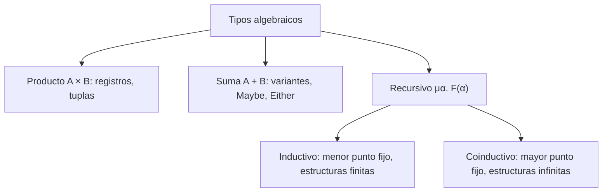

# Lenguajes de Programación - Paradigma funcional

## 3.6 Tipos de datos finitos e infinitos: registros (productos), variantes (sumas), tipos recursivos.

---

Los lenguajes funcionales construyen sus tipos de datos con tres operaciones: el **producto**, que agrupa varios valores a la vez (un registro, una tupla); la **suma**, que ofrece una de varias alternativas (una variante, una unión etiquetada), y la **recursión**, que permite que un tipo se contenga a sí mismo (una lista, un árbol). Los tipos que se forman así se llaman **algebraicos**, porque su número de valores sigue las reglas de la suma y el producto de números. Este tema presenta cada constructor, su uso con **coincidencia de patrones**, la diferencia entre los tipos recursivos finitos y los infinitos, y las decisiones de diseño que plantean.

### Productos

Un valor de tipo $A \times B$ contiene un $A$ **y** un $B.$ Se construye con un par $(a, b)$ y se usa con las proyecciones $\mathsf{fst}$ y $\mathsf{snd};$ un **registro** es un producto con campos con nombre, $\{\mathit{huesped} : \mathsf{String}, \mathit{noches} : \mathsf{Int}\}.$ El tipo **unidad**, $\mathsf{Unit},$ tiene un solo valor y es el neutro del producto. Si $|A|$ es el número de valores de $A,$ entonces $|A \times B| = |A| \cdot |B|.$

### Sumas

Un valor de tipo $A + B$ contiene un $A$ **o** un $B,$ con una **etiqueta** que dice cuál: se construye con $\mathsf{inl}\; a$ o $\mathsf{inr}\; b,$ y se usa con un **análisis de casos** que da una rama para cada etiqueta:

$$\frac{\Gamma \vdash t : A + B \quad \Gamma, x{:}A \vdash t_1 : C \quad \Gamma, y{:}B \vdash t_2 : C}{\Gamma \vdash \mathsf{case}\; t\; \mathsf{of}\; \mathsf{inl}\; x \Rightarrow t_1 \mid \mathsf{inr}\; y \Rightarrow t_2 : C}$$

$|A + B| = |A| + |B|.$ Los booleanos son $\mathsf{Unit} + \mathsf{Unit};$ un valor opcional es $\mathsf{Unit} + A,$ el `Maybe A` de Haskell o el `Option<A>` de Rust, que reemplaza con seguridad al puntero nulo. En los lenguajes, las sumas se escriben con constructores con nombre, `data Habitacion = Individual | Doble Int | Suite Bool`, y se analizan con **coincidencia de patrones**, que el compilador verifica que sea **exhaustiva**: si falta un caso, avisa. Las uniones de C y los `enum` de Java sin datos no son sumas etiquetadas seguras; Rust, Swift, Kotlin, Scala y, desde la versión 3.10, Python con `match`, sí las ofrecen.

### Tipos recursivos

Un tipo recursivo se define en términos de sí mismo: las listas de enteros son

$$\mathsf{ListaInt} = \mathsf{Unit} + \mathsf{Int} \times \mathsf{ListaInt},$$

la lista vacía o un entero seguido de otra lista, y los árboles binarios, $\mathsf{Arbol} = \mathsf{Unit} + \mathsf{Arbol} \times \mathsf{Int} \times \mathsf{Arbol}.$ Formalmente es la solución de una ecuación de tipos, $\mu\alpha.\, \mathsf{Unit} + \mathsf{Int} \times \alpha.$ Las funciones sobre ellos se definen por **recursión estructural** y sus propiedades se demuestran por **inducción estructural** (tema 2.1).

### Finitos e infinitos

La ecuación de un tipo recursivo tiene dos soluciones naturales:

- El **menor punto fijo**, o tipo **inductivo**, contiene solo las estructuras finitas: las listas que se construyen en un número finito de pasos. Es lo que da la definición inductiva, y lo que hay en los lenguajes ansiosos como ML.
- El **mayor punto fijo**, o tipo **coinductivo**, contiene también las estructuras infinitas: listas sin fin, árboles de profundidad infinita. No se construyen completas: se **observan** de a poco, y cada observación produce un elemento y el resto. Se razona sobre ellas por **coinducción**.

Los lenguajes perezosos como Haskell no distinguen ambas en el tipo: `[Int]` contiene listas finitas e infinitas, como `[1..]`. En los ansiosos, las estructuras infinitas se representan con **suspensiones**, un generador o un iterador: el valor siguiente se calcula solo cuando se pide (tema 3.2). Una función sobre una estructura infinita debe ser **productiva**: debe producir cada parte del resultado en un número finito de pasos, como `take 10` o `map`, mientras que `length` o `reverse` nunca terminan.



### Implementación en Python

El programa usa clases de datos inmutables para los productos, uniones de clases para las sumas y `match` para la coincidencia de patrones. Con ellos modela las reservas, el árbol de expresiones y las figuras del ejercicio 1 e implementa las funciones del ejercicio 2. Para el ejercicio 3 escribe tres estructuras infinitas como generadores perezosos: los primos, con una criba incremental; los dígitos de $\pi,$ con el algoritmo de la espita de Gibbons, y el árbol de jugadas del gato, del que solo se fuerzan los primeros niveles. Para el ejercicio 4 compara dos representaciones de las expresiones.

```python
import math
from dataclasses import dataclass, field
from itertools import count, islice
from typing import Union

# --- Ejercicio 1.1: reservas con tipos suma (variantes) y producto (registros) ---
@dataclass(frozen=True)
class Individual: pass
@dataclass(frozen=True)
class Doble: camas: int                                 # 1 matrimonial o 2 individuales
@dataclass(frozen=True)
class Suite: jacuzzi: bool
Habitacion = Union[Individual, Doble, Suite]           # suma: exactamente una de las tres
@dataclass(frozen=True)
class Reserva:                                         # producto: todos los campos a la vez
    huesped: str
    habitacion: Habitacion
    noches: int
    servicios: tuple = ()                              # lista de ("desayuno",) ("spa", horas) ("traslado", destino)
def tarifa(h: Habitacion) -> int:
    match h:                                           # coincidencia de patrones: un caso por variante
        case Individual(): return 900
        case Doble(camas=c): return 1300 + 100 * (c - 1)
        case Suite(jacuzzi=j): return 2500 + (400 if j else 0)
def costo_servicio(s) -> int:
    match s:
        case ("desayuno",): return 150
        case ("spa", horas): return 500 * horas
        case ("traslado", destino): return 350 if destino == "aeropuerto" else 200
def total(r: Reserva) -> int:
    return tarifa(r.habitacion) * r.noches + sum(costo_servicio(s) for s in r.servicios) * r.noches
r = Reserva("Ana", Suite(jacuzzi=True), 3, (("desayuno",), ("spa", 1)))
print("ejercicio 1.1:", r, "| total:", total(r), "| doble con 2 camas, 2 noches:", total(Reserva("Luis", Doble(2), 2)))

# --- Ejercicio 1.2 y 2.3: AST con variables, evaluación y búsqueda ---
@dataclass(frozen=True)
class Num: v: int
@dataclass(frozen=True)
class Var: x: str
@dataclass(frozen=True)
class Suma: a: object; b: object
@dataclass(frozen=True)
class Mult: a: object; b: object
def evalua(e, amb):
    match e:
        case Num(v): return v
        case Var(x): return amb[x]
        case Suma(a, b): return evalua(a, amb) + evalua(b, amb)
        case Mult(a, b): return evalua(a, amb) * evalua(b, amb)
def contiene(e, buscado):
    if e == buscado: return True
    match e:
        case Suma(a, b) | Mult(a, b): return contiene(a, buscado) or contiene(b, buscado)
        case _: return False
def variables(e):
    match e:
        case Var(x): return {x}
        case Suma(a, b) | Mult(a, b): return variables(a) | variables(b)
        case _: return set()
e = Suma(Mult(Num(2), Var("x")), Mult(Var("y"), Suma(Var("x"), Num(1))))
print("ejercicio 1.2:", "2x + y(x + 1) con x = 3, y = 4 vale", evalua(e, {"x": 3, "y": 4}), "| variables:", sorted(variables(e)))
print("ejercicio 2.3: contiene x + 1:", contiene(e, Suma(Var("x"), Num(1))), "| contiene 7:", contiene(e, Num(7)))

# --- Ejercicios 1.3 y 2.1: figuras ---
@dataclass(frozen=True)
class Circulo: r: float
@dataclass(frozen=True)
class Rectangulo: base: float; altura: float
@dataclass(frozen=True)
class Triangulo: a: float; b: float; c: float
    # el invariante del tipo (desigualdad del triángulo) no lo expresa la definición: se verifica al construir
def perimetro(f):
    match f:
        case Circulo(r): return 2 * math.pi * r
        case Rectangulo(b, h): return 2 * (b + h)
        case Triangulo(a, b, c):
            if not (a + b > c and a + c > b and b + c > a): raise ValueError("no es un triángulo")
            return a + b + c
@dataclass(frozen=True)
class Esfera: r: float
@dataclass(frozen=True)
class Cubo: lado: float
@dataclass(frozen=True)
class Cilindro: r: float; h: float
def volumen(s):
    match s:
        case Esfera(r): return 4 / 3 * math.pi * r ** 3
        case Cubo(l): return l ** 3
        case Cilindro(r, h): return math.pi * r * r * h
print("ejercicio 2.1:", [round(perimetro(f), 3) for f in (Circulo(1), Rectangulo(3, 4), Triangulo(3, 4, 5))],
      "| 1.3, volúmenes:", [round(volumen(s), 3) for s in (Esfera(1), Cubo(2), Cilindro(1, 2))])

# --- Ejercicio 2.2: profundidad de un árbol binario ---
@dataclass(frozen=True)
class Hoja: pass
@dataclass(frozen=True)
class Nodo: izq: object; valor: int; der: object
def profundidad(t): return 0 if isinstance(t, Hoja) else 1 + max(profundidad(t.izq), profundidad(t.der))
def inserta(t, v):
    if isinstance(t, Hoja): return Nodo(Hoja(), v, Hoja())
    return Nodo(inserta(t.izq, v), t.valor, t.der) if v < t.valor else Nodo(t.izq, t.valor, inserta(t.der, v))
arbol, degenerado = Hoja(), Hoja()
for v in (50, 30, 70, 20, 40, 60, 80, 35): arbol = inserta(arbol, v)
for v in range(8): degenerado = inserta(degenerado, v)
print("ejercicio 2.2: profundidad del ABB balanceado", profundidad(arbol), "| insertando 0..7 en orden:", profundidad(degenerado))

# --- Ejercicio 3: estructuras infinitas, como generadores perezosos ---
def primos():                                          # criba incremental: cada compuesto se marca con un primo que lo divide
    compuestos, n = {}, 2
    while True:
        if n not in compuestos: yield n; compuestos[n * n] = [n]
        else:
            for p in compuestos.pop(n): compuestos.setdefault(n + p, []).append(p)
        n += 1
def digitos_pi():                                      # algoritmo de la espita sin límite (Gibbons, 2006)
    q, r, t, k, n, l = 1, 0, 1, 1, 3, 3
    while True:
        if 4 * q + r - t < n * t:
            yield n
            q, r, n = 10 * q, 10 * (r - n * t), (10 * (3 * q + r)) // t - 10 * n
        else:
            q, r, t, k, n, l = q * k, (2 * q + r) * l, t * l, k + 1, (q * (7 * k + 2) + r * l) // (t * l), l + 2
print("ejercicio 3.1, primeros 15 primos:", list(islice(primos(), 15)), "| el primo 1000:", next(islice(primos(), 999, None)))
print("ejercicio 3.2, π:", "".join(map(str, islice(digitos_pi(), 30))), "| coincide con math.pi:",
      "".join(map(str, islice(digitos_pi(), 16))) == f"{math.pi:.15f}".replace(".", ""))
# 3.3: árbol de jugadas perezoso; el gato (tres en raya) en lugar del ajedrez, que necesita un generador de jugadas completo
def gana(t): return any(t[a] != "." and t[a] == t[b] == t[c] for a, b, c in
                        ((0,1,2),(3,4,5),(6,7,8),(0,3,6),(1,4,7),(2,5,8),(0,4,8),(2,4,6)))
def jugadas(t, turno):
    if gana(t): return
    for i, c in enumerate(t):
        if c == ".": yield t[:i] + turno + t[i + 1:]
def hijos(t, turno):                                 # cada hijo trae una suspensión con sus propios hijos
    return ((h, lambda h=h: hijos(h, "O" if turno == "X" else "X")) for h in jugadas(t, turno))
ARBOL = hijos("." * 9, "X")                            # el árbol completo, sin construir ningún nivel todavía
def nodos_por_nivel(arbol, n):                         # se fuerzan solo los primeros n niveles
    cuenta = [0] * n
    def visita(gen, d):
        if d == n: return
        for _, resto in gen:
            cuenta[d] += 1; visita(resto(), d + 1)
    visita(arbol, 0)
    return cuenta
print("ejercicio 3.3, posiciones del gato a profundidad 1..6:", nodos_por_nivel(ARBOL, 6))

# --- Ejercicio 4: dos representaciones del mismo AST ---
@dataclass(frozen=True)
class BinOp: op: str; a: object; b: object
OPS = {"+": lambda x, y: x + y, "*": lambda x, y: x * y}
def evalua2(e):
    match e:
        case Num(v): return v
        case BinOp(op, a, b): return OPS[op](evalua2(a), evalua2(b))
def a_v2(e):
    match e:
        case Num(_): return e
        case Suma(a, b): return BinOp("+", a_v2(a), a_v2(b))
        case Mult(a, b): return BinOp("*", a_v2(a), a_v2(b))
def tamano_v1(e): return 1 if isinstance(e, Num) else 1 + tamano_v1(e.a) + tamano_v1(e.b)
def tamano_v2(e): return 1 if isinstance(e, Num) else 1 + tamano_v2(e.a) + tamano_v2(e.b)
e1 = Suma(Num(1), Mult(Num(2), Num(3)))
OPS["-"] = lambda x, y: x - y                          # versión 2: un operador nuevo es una entrada más
print("ejercicio 4:", evalua(e1, {}), evalua2(a_v2(e1)), "| tamaños:", tamano_v1(e1), tamano_v2(a_v2(e1)),
      "| con el operador nuevo:", evalua2(BinOp("-", Num(10), a_v2(e1))))
```

Salida:

```text
ejercicio 1.1: Reserva(huesped='Ana', habitacion=Suite(jacuzzi=True), noches=3, servicios=(('desayuno',), ('spa', 1))) | total: 10650 | doble con 2 camas, 2 noches: 2800
ejercicio 1.2: 2x + y(x + 1) con x = 3, y = 4 vale 22 | variables: ['x', 'y']
ejercicio 2.3: contiene x + 1: True | contiene 7: False
ejercicio 2.1: [6.283, 14, 12] | 1.3, volúmenes: [4.189, 8, 6.283]
ejercicio 2.2: profundidad del ABB balanceado 4 | insertando 0..7 en orden: 8
ejercicio 3.1, primeros 15 primos: [2, 3, 5, 7, 11, 13, 17, 19, 23, 29, 31, 37, 41, 43, 47] | el primo 1000: 7919
ejercicio 3.2, π: 314159265358979323846264338327 | coincide con math.pi: True
ejercicio 3.3, posiciones del gato a profundidad 1..6: [9, 72, 504, 3024, 15120, 54720]
ejercicio 4: 7 7 | tamaños: 5 5 | con el operador nuevo: 3
```

### Ejercicios Propuestos

1. **Diseño.** Diseña tipos algebraicos para un sistema de reservas de hotel con habitaciones individuales, dobles y suites, y servicios adicionales; para el árbol de sintaxis de un lenguaje de expresiones aritméticas con variables, y para formas geométricas en tres dimensiones.

2. **Funciones.** Implementa el perímetro de círculos, rectángulos y triángulos; la profundidad máxima de un árbol binario, y la búsqueda de un elemento en un árbol de expresiones.

3. **Estructuras infinitas.** Construye estructuras infinitas para todos los números primos, para la expansión decimal de $\pi$ y para el árbol de todas las jugadas posibles de un juego hasta una profundidad $n.$

4. **Análisis.** Compara las dos representaciones siguientes:

    ```haskell
    -- Versión 1
    data Expr = Add Expr Expr | Mul Expr Expr | Lit Int
    -- Versión 2
    data Op = AddOp | MulOp
    data Expr = BinOp Op Expr Expr | Lit Int
    ```

### Soluciones

**Ejercicio 1.** Para el hotel, una **suma** de tipos de habitación, cada uno con sus datos propios, y un **producto** para la reserva:

```haskell
data Habitacion = Individual | Doble { camas :: Int } | Suite { jacuzzi :: Bool }
data Servicio   = Desayuno | Spa { horas :: Int } | Traslado { destino :: String }
data Reserva    = Reserva { huesped :: String, habitacion :: Habitacion, noches :: Int, servicios :: [Servicio] }

data Expr = Num Int | Var String | Suma Expr Expr | Mult Expr Expr

data Solido = Esfera Double | Cubo Double | Cilindro Double Double
```

Con la suma, una individual no puede tener un campo `jacuzzi`, y la función de tarifa debe considerar los tres casos, cosa que el compilador verifica. El programa calcula el total de una suite con jacuzzi, desayuno y una hora de spa por tres noches, 10,650 pesos. El AST con variables se evalúa en un ambiente; la expresión $2x + y(x + 1)$ vale 22 con $x = 3$ y $y = 4.$ Para los sólidos, el programa calcula los volúmenes.

**Ejercicio 2.** Cada función tiene un caso por constructor. El perímetro del triángulo necesita además verificar la **desigualdad del triángulo**: el tipo `Triangulo Double Double Double` admite ternas que no son triángulos, como 1, 1 y 5, un invariante que los tipos algebraicos simples no expresan y que se verifica al construir o al usar. La profundidad es $0$ para la hoja y $1 + \max(\mathit{izq}, \mathit{der})$ para un nodo: en el programa, un árbol binario de búsqueda con 8 valores insertados en un buen orden tiene profundidad 4, y con los valores en orden creciente, 8, porque degenera en una lista. La búsqueda compara el nodo actual y, si no es el buscado, busca en los hijos; encuentra $x + 1$ dentro de la expresión y no encuentra $7.$

**Ejercicio 3.** Las tres son generadores, que producen un valor cada vez que se piden:

1. **Primos.** Una criba de Eratóstenes incremental guarda, para cada próximo múltiplo compuesto, los primos que lo generan; el programa toma los primeros 15 y el primo número 1000, que es 7919.
2. **Dígitos de pi.** El enunciado sugería simularla, pero no hace falta: el algoritmo de la **espita sin límite** de Gibbons produce los dígitos de $\pi$ uno a uno, con aritmética entera exacta, sin fijar de antemano cuántos. Los 30 primeros son 314159265358979323846264338327, y los 16 primeros coinciden con `math.pi`.
3. **Árbol de jugadas.** Cada nodo es una posición con una suspensión que produce sus hijos. El árbol del ajedrez es enorme, con 20, 400, 8902 y 197,281 posiciones en los primeros cuatro niveles, y un generador de jugadas legales es un programa largo; el programa usa el gato, cuyo árbol tiene la misma estructura. El árbol completo se define con una sola expresión, y solo se construyen los niveles que se recorren: 9, 72, 504, 3024, 15,120 y 54,720 posiciones. Los últimos son menores que $9 \cdot 8 \cdot 7 \cdots$ porque una partida ganada no tiene hijos.

**Ejercicio 4.** Las dos representan las mismas expresiones, y el programa convierte de una a otra y obtiene el mismo valor y tamaño. La **versión 1** tiene un constructor por operador: es más directa para escribir casos particulares, como simplificar $e \cdot 1$ en un solo patrón, y cada operador puede tener una forma distinta, por ejemplo uno unario. La **versión 2** separa la forma, una operación binaria, del operador: las funciones que tratan todas las operaciones binarias igual, como el tamaño, la profundidad o la impresión, tienen un caso en lugar de uno por operador, y agregar un operador es agregar un constructor a `Op` y su significado a una tabla, como hace el programa con la resta. En la versión 1, agregar un operador obliga a modificar todas las funciones; en ambas, agregar una **función** nueva es fácil. Es una instancia del problema de la expresión del tema 1.2.

### Referencias

1. Pierce, B. C., _Types and Programming Languages_. MIT Press, 2002. Capítulos 11, 20 y 21.
2. Harper, R., _Practical Foundations for Programming Languages_. Cambridge University Press, 2016. Capítulos 10 a 15.
3. Bird, R., _Thinking Functionally with Haskell_. Cambridge University Press, 2014. Capítulos 4 y 9.
4. Gibbons, J., Unbounded spigot algorithms for the digits of pi. _The American Mathematical Monthly_ 113(4), 2006.
5. O'Neill, M. E., The genuine sieve of Eratosthenes. _Journal of Functional Programming_ 19(1), 2009.
