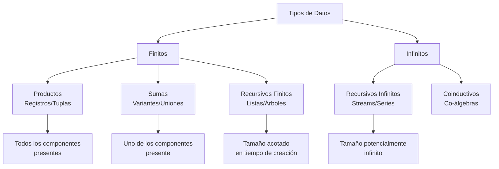

# Lenguajes de Programación - Paradigma funcional

## 3.6 Tipos de datos finitos e infinitos: registros (productos), variantes (sumas), tipos recursivos.

---

Los sistemas de tipos en programación funcional permiten definir estructuras de datos complejas mediante composición de tipos básicos. Según Pierce (2002), "los tipos algebraicos de datos proporcionan una forma elegante y type-safe de estructurar información compleja".

### Conceptos Fundamentales

#### Tipos Algebraicos de Datos (ADTs)

Los ADTs permiten construir tipos mediante dos operaciones fundamentales:

- **Productos**: Combinación de tipos (AND)
- **Sumas**: Alternativa entre tipos (OR)

### Tipos Producto (Registros)

#### Definición

Los tipos producto representan la combinación de múltiples valores donde **todos** los componentes deben estar presentes.

$$ \text{Producto} = A \times B \times C \times \ldots $$

#### Semántica Formal

Para tipos $A$, $B$, el tipo producto $A \times B$ contiene todos los pares $(a, b)$ donde $a \in A$, $b \in B$.

#### Ejemplos en Diferentes Lenguajes

##### Haskell

```haskell
-- Tipo producto como tupla
type Coordenada = (Double, Double)

-- Tipo producto como registro
data Persona = Persona {
    nombre :: String,
    edad :: Int,
    direccion :: String
}

-- Uso
punto :: Coordenada
punto = (3.5, 4.2)

persona :: Persona
persona = Persona "Ana" 30 "Calle Principal 123"
```

##### OCaml

```ocaml
(* Tipo registro *)
type persona = {
  nombre: string;
  edad: int;
  direccion: string;
}

let ana = {nombre = "Ana"; edad = 30; direccion = "Calle Principal 123"}
```

### Tipos Suma (Variantes)

#### Definición

Los tipos suma representan alternativas donde **exactamente uno** de los componentes está presente.

$$ \text{Suma} = A + B + C + \ldots $$

#### Semántica Formal

Para tipos $A$, $B$, el tipo suma $A + B$ contiene todos los valores de $A$ y todos los valores de $B$, etiquetados para indicar su origen.

#### Ejemplos

##### Haskell

```haskell
-- Tipo suma para formas geométricas
data Forma = Circulo Double          -- radio
           | Rectangulo Double Double -- ancho, alto
           | Triangulo Double Double  -- base, altura

-- Tipo suma para opciones optional
data Maybe a = Nothing | Just a

-- Uso
area :: Forma -> Double
area (Circulo r) = pi * r * r
area (Rectangulo w h) = w * h
area (Triangulo b h) = 0.5 * b * h
```

##### TypeScript

```typescript
// Tipo suma con discriminated unions
type Forma =
  | { tipo: 'circulo'; radio: number }
  | { tipo: 'rectangulo'; ancho: number; alto: number }
  | { tipo: 'triangulo'; base: number; altura: number };

function area(forma: Forma): number {
  switch (forma.tipo) {
    case 'circulo':
      return Math.PI * forma.radio * forma.radio;
    case 'rectangulo':
      return forma.ancho * forma.alto;
    case 'triangulo':
      return 0.5 * forma.base * forma.altura;
  }
}
```

### Tipos Recursivos

#### Definición

Tipos que se definen en términos de sí mismos, permitiendo estructuras de datos infinitas o de tamaño arbitrario.

#### Semántica Formal

Un tipo recursivo satisface una ecuación de la forma:

$$ T = F(T) $$

donde $F$ es un functor de tipos.

#### Ejemplos Comunes

##### Listas

$$ \text{Lista } A = \text{Nil} + \text{Cons } A \times (\text{Lista } A) $$

##### Árboles Binarios

$$ \text{Árbol } A = \text{Hoja } A + \text{Nodo } (\text{Árbol } A) \times (\text{Árbol } A) $$

#### Implementaciones

##### Haskell

```haskell
-- Listas recursivas
data Lista a = Nil | Cons a (Lista a)

-- Árboles binarios
data Arbol a = Hoja a
             | Nodo (Arbol a) a (Arbol a)
             | Vacio

-- Árbol de expresión
data Expr = Lit Int
          | Add Expr Expr
          | Mul Expr Expr
          | Var String
```

##### OCaml

```ocaml
(* Lista recursiva *)
type 'a lista =
  | Nil
  | Cons of 'a * 'a lista

(* Árbol binario *)
type 'a arbol =
  | Hoja of 'a
  | Nodo of 'a arbol * 'a * 'a arbol
```

### Estructuras de Datos Infinitas

#### Concepto

Estructuras que representan datos potencialmente infinitos, posibles gracias a la evaluación perezosa.

#### Ejemplos

##### Haskell

```haskell
-- Lista infinita de números naturales
nats :: [Integer]
nats = [0..]

-- Lista infinita de Fibonacci
fibs :: [Integer]
fibs = 0 : 1 : zipWith (+) fibs (tail fibs)

-- Árbol infinito
data Tree a = Node a (Tree a) (Tree a)

repeatTree :: a -> Tree a
repeatTree x = Node x (repeatTree x) (repeatTree x)
```

##### Streams en Scala

```scala
// Stream infinito
val fibs: Stream[BigInt] =
  BigInt(0) #:: BigInt(1) #:: fibs.zip(fibs.tail).map { case (a, b) => a + b }
```

### Diagrama de Relaciones entre Tipos



### Ejercicios Propuestos

#### Ejercicio 1: Diseño de Tipos Algebraicos

Diseñe tipos algebraicos para representar:

1. Un sistema de reservas de hotel con diferentes tipos de habitación (individual, doble, suite) y servicios adicionales
2. Un AST (Abstract Syntax Tree) para un lenguaje de expresiones aritméticas con variables
3. Una estructura de datos para representar formas geométricas en 3D

#### Ejercicio 2: Implementación de Funciones

Implemente funciones para:

1. Calcular el perímetro de formas geométricas (círculo, rectángulo, triángulo)
2. Profundidad máxima de un árbol binario
3. Búsqueda de un elemento en un árbol de expresión

#### Ejercicio 3: Estructuras Infinitas

Cree estructuras infinitas para:

1. Todos los números primos
2. Expansión decimal de π (simulada)
3. Árbol de todos los posibles movimientos en un juego de ajedrez (hasta profundidad n)

#### Ejercicio 4: Análisis de Tipos

Analice y compare las siguientes definiciones de tipos:

```haskell
-- Versión 1
data Expr = Add Expr Expr | Mul Expr Expr | Lit Int

-- Versión 2
data Op = AddOp | MulOp
data Expr = BinOp Op Expr Expr | Lit Int

-- ¿Cuáles son las ventajas/desventajas de cada enfoque?
```

### Patrones de Diseño con Tipos Algebraicos

#### Pattern Matching

El pattern matching es esencial para trabajar con tipos algebraicos:

```haskell
eval :: Expr -> Int
eval (Lit n) = n
eval (Add e1 e2) = eval e1 + eval e2
eval (Mul e1 e2) = eval e1 * eval e2

-- Pattern matching anidado
profundidad :: Arbol a -> Int
profundidad Vacio = 0
profundidad (Hoja _) = 1
profundidad (Nodo izq _ der) = 1 + max (profundidad izq) (profundidad der)
```

#### Funciones Genéricas

Funciones que trabajan sobre múltiples constructores:

```haskell
-- Función para contar nodos en cualquier estructura recursiva
class Contable a where
  contar :: a -> Int

instance Contable (Arbol a) where
  contar Vacio = 0
  contar (Hoja _) = 1
  contar (Nodo izq _ der) = 1 + contar izq + contar der
```

### Referencias

1. Pierce, B.C. (2002). _Types and Programming Languages_. MIT Press. (Capítulos 11, 20: Simple Types, Recursive Types)
2. Mitchell, J. (2003). _Concepts in Programming Languages_. Cambridge University Press. (Capítulo 5: Types and Type Systems)
3. Harper, R. (2010). _Practical Foundations for Programming Languages_. http://www.cs.cmu.edu/~rwh/plbook/book.pdf (Capítulos 15, 16: Inductive and Coinductive Types)
4. Gibbons, J. (2003). _Datatype-Generic Programming_. Spring School on Datatype-Generic Programming

### Conclusión

Los tipos algebraicos de datos, productos, sumas y tipos recursivos constituyen la base para la construcción de estructuras de datos complejas y type-safe en programación funcional. La capacidad de definir tanto tipos finitos como infinitos mediante composición y recursion proporciona una expresividad poderosa para modelar dominios problemáticos complejos. La comprensión de estos conceptos es fundamental para el diseño efectivo de programas funcionales y para apreciar la elegancia matemática detrás de los sistemas de tipos modernos.
