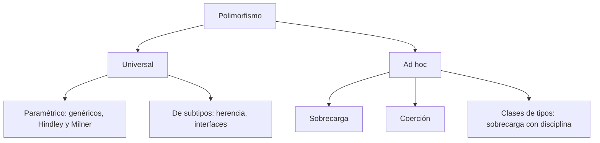

# Lenguajes de Programación - Paradigma funcional

## 3.7 Polimorfismo.

---

**Polimorfismo** significa que un mismo código trabaja con valores de varios tipos. Strachey distinguió en 1967 dos clases, y Cardelli y Wegner (1985) las refinaron: el polimorfismo **universal**, en el que una función trabaja de manera uniforme con una familia infinita de tipos, y el **ad hoc**, en el que un mismo nombre tiene implementaciones distintas para tipos distintos. Este tema presenta las cuatro formas principales (paramétrico, de subtipos, sobrecarga y coerción), las clases de tipos de Haskell, que dan una forma disciplinada al polimorfismo ad hoc, la inferencia de tipos polimórficos y la varianza.

### Polimorfismo paramétrico

Una función es **paramétrica** si su tipo tiene variables de tipo y su código no depende de cuáles sean: `length :: [a] -> Int` cuenta los elementos de una lista sin mirarlos, y sirve para listas de cualquier tipo. Es el polimorfismo del Sistema F (tema 3.3) y de los **genéricos** de Java, C#, Rust y TypeScript. En ML y Haskell se infiere: el tipo más general de una expresión se calcula con el algoritmo de Hindley y Milner, y las variables libres del tipo se cuantifican universalmente al ligar con `let`, de modo que

$$\mathsf{let}\; f = \lambda x.\, x\; \mathsf{in}\; (f\; 1, f\; \mathsf{true})$$

tiene tipo, porque $f : \forall \alpha.\, \alpha \to \alpha$ se instancia una vez con $\mathsf{Int}$ y otra con $\mathsf{Bool}.$ Las variables ligadas por $\lambda$ **no** se generalizan: es la restricción que hace decidible la inferencia.

La **parametricidad** (Reynolds, 1983; Wadler, 1989, "teoremas gratis") es una consecuencia notable: como una función paramétrica no puede inspeccionar los valores de tipo $\alpha,$ su tipo restringe mucho lo que puede hacer. Una función total de tipo $\forall \alpha.\, \alpha \to \alpha$ solo puede ser la identidad, y una de tipo $\forall \alpha\, \beta.\, \alpha \times \beta \to \beta \times \alpha$ solo puede intercambiar.

### Polimorfismo de subtipos

Un valor de un subtipo $S \le T$ se puede usar donde se espera un $T$ (el **principio de sustitución** de Liskov), y un método se despacha según la clase real del objeto. Es el polimorfismo de la programación orientada a objetos (tema 5.2): `toString()` en Java tiene una implementación por clase, elegida al ejecutar.

Con genéricos, la relación de subtipos entre `C<S>` y `C<T>` es la **varianza**: `C` es **covariante** si $S \le T$ implica $C\langle S \rangle \le C\langle T \rangle,$ **contravariante** si implica $C\langle T \rangle \le C\langle S \rangle,$ e **invariante** si no implica ninguna de las dos. Una colección que se puede modificar debe ser invariante: si `List<String>` fuera un `List<Object>`, se podría agregar un entero a una lista de cadenas. Los arreglos de Java son covariantes, y por eso `Object[] a = new String[1]; a[0] = 1;` compila y falla al ejecutar con `ArrayStoreException`. Las funciones son contravariantes en el argumento y covariantes en el resultado.

### Sobrecarga y coerción

La **sobrecarga** da a un nombre varias definiciones con tipos distintos, y el compilador elige una según los tipos de los argumentos: `operator+` de C++ para enteros, flotantes y cadenas. La **coerción** convierte automáticamente un valor a otro tipo para que una operación aplique: `1 + 2.5` convierte el 1 en flotante. Ambas son ad hoc: no hay un código común, sino varios.

Las **clases de tipos** de Haskell (Wadler y Blott, 1989) hacen sistemático el polimorfismo ad hoc. Una clase declara operaciones, y cada tipo que es **instancia** las implementa:

```haskell
class Show a where
  show :: a -> String

instance Show Int  where show n = ...
instance Show Bool where show b = if b then "True" else "False"
instance Show a => Show [a] where show xs = "[" ++ intercalate "," (map show xs) ++ "]"
```

Una función con la restricción `Show a => a -> String` funciona para todo tipo con instancia. La implementación es por **paso de diccionarios**: el compilador pasa a la función, como argumento oculto, un registro con las operaciones de la instancia. La instancia para listas recibe el diccionario de los elementos y construye el de la lista. Las interfaces de Java, los *traits* de Rust y los protocolos de Swift son mecanismos parecidos.

| Forma                        | Universal o ad hoc | Se resuelve        | Ejemplo                                   |
| ---------------------------- | ------------------ | ------------------ | ----------------------------------------- |
| Paramétrico                  | Universal          | Al compilar        | `length :: [a] -> Int`                    |
| De subtipos                  | Universal          | Al ejecutar        | `toString()` en Java                      |
| Sobrecarga                   | Ad hoc             | Al compilar        | `operator+` en C++                        |
| Coerción                     | Ad hoc             | Al compilar        | `1 + 2.5`                                 |
| Clases de tipos              | Ad hoc, acotado    | Al compilar        | `show :: Show a => a -> String`           |



### Implementación en Python

El programa escribe las funciones paramétricas del ejercicio 2 con variables de tipo de Python, que documentan el tipo pero no se verifican al ejecutar, y las usa con varios tipos. Para el ejercicio 3 implementa la inferencia de Hindley y Milner con `let` polimórfico y la aplica a las tres expresiones y a una variante. Para el ejercicio 4 implementa la clase `Show` por paso de diccionarios, con la instancia de listas construida a partir de la de los elementos. Al final reproduce el problema que la invarianza evita.

```python
from itertools import count
from typing import Callable, TypeVar

A, B, C = TypeVar("A"), TypeVar("B"), TypeVar("C")

# --- Ejercicio 2: funciones paramétricas; el mismo código sirve para cualquier tipo ---
def swap(p: tuple[A, B]) -> tuple[B, A]: return (p[1], p[0])
def compose(f: Callable[[B], C], g: Callable[[A], B]) -> Callable[[A], C]: return lambda x: f(g(x))
def filtra(p: Callable[[A], bool], xs: list[A]) -> list[A]: return [x for x in xs if p(x)]
print("ejercicio 2:", swap((1, "uno")), swap(([True], 2.5)), "|", compose(len, str)(12345), compose(str.upper, str.strip)("  hola "),
      "|", filtra(lambda n: n % 2 == 0, list(range(10))), filtra(str.isupper, list("aBcDE")))
# parametricidad: una función de tipo (A, B) -> (B, A) no puede inspeccionar sus argumentos; solo puede moverlos
print("   swap(swap(p)) == p para varios tipos:", all(swap(swap(p)) == p for p in ((1, 2), ("a", None), ((1,), [2]))))

# --- Ejercicio 3: inferencia de Hindley-Milner con let polimórfico ---
class TV:
    c = count()
    def __init__(self): self.n = next(TV.c)
def res(t, s):
    while isinstance(t, TV) and t in s: t = s[t]
    return t
def ocurre(v, t, s):
    t = res(t, s); return t is v or (isinstance(t, tuple) and any(ocurre(v, a, s) for a in t[1:]))
def unif(a, b, s):
    a, b = res(a, s), res(b, s)
    if a is b: return s
    if isinstance(a, TV):
        if ocurre(a, b, s): raise TypeError(f"tipo infinito: {mt(a, s)} = {mt(b, s)}")
        return {**s, a: b}
    if isinstance(b, TV): return unif(b, a, s)
    if a[0] != b[0]: raise TypeError(f"no unifican {mt(a, s)} y {mt(b, s)}")
    for x, y in zip(a[1:], b[1:]): s = unif(x, y, s)
    return s
def libres(t, s):
    t = res(t, s); return {t} if isinstance(t, TV) else set().union(*(libres(a, s) for a in t[1:]))
def instancia(esq, s):
    vs, t = esq; m = {v: TV() for v in vs}
    def sust(t):
        t = res(t, s); return m.get(t, t) if isinstance(t, TV) else (t[0],) + tuple(sust(a) for a in t[1:])
    return sust(t)
def W(e, amb, s):
    k = e[0]
    if k == "var": return instancia(amb[e[1]], s), s
    if k == "lam": a = TV(); t, s = W(e[2], {**amb, e[1]: ((), a)}, s); return ("->", a, t), s
    if k == "app": tf, s = W(e[1], amb, s); tx, s = W(e[2], amb, s); r = TV(); return r, unif(tf, ("->", tx, r), s)
    t1, s = W(e[2], amb, s)                                         # let: generalizar lo que no está libre en el ambiente
    en_amb = set().union(*(libres(t, s) - set(vs) for vs, t in amb.values())) if amb else set()
    return W(e[3], {**amb, e[1]: (tuple(libres(t1, s) - en_amb), t1)}, s)
def mt(t, s, nombres=None):
    nombres = {} if nombres is None else nombres
    t = res(t, s)
    if isinstance(t, TV): return nombres.setdefault(t, "abcdefgh"[len(nombres)])
    izq = mt(t[1], s, nombres)
    if isinstance(res(t[1], s), tuple): izq = f"({izq})"
    return f"{izq} -> {mt(t[2], s, nombres)}"
V = lambda x: ("var", x)
def infiere(texto, e):
    try: t, s = W(e, {}, {}); print(f"   {texto} :: {mt(t, s)}")
    except TypeError as err: print(f"   {texto}: error, {err}")
print("ejercicio 3:")
infiere(r"\f g x -> f (g x)", ("lam", "f", ("lam", "g", ("lam", "x", ("app", V("f"), ("app", V("g"), V("x")))))))
infiere(r"\x -> x x", ("lam", "x", ("app", V("x"), V("x"))))
infiere(r"let f = \x -> x in f f", ("let", "f", ("lam", "x", V("x")), ("app", V("f"), V("f"))))
infiere(r"(\f -> f f) (\x -> x)", ("app", ("lam", "f", ("app", V("f"), V("f"))), ("lam", "x", V("x"))))

# --- Ejercicio 4: clases de tipos como diccionarios de funciones ---
instancias = {}                                     # nombre del tipo -> diccionario con la implementación de show
def instancia_show(tipo, show): instancias[tipo] = {"show": show}
def show(dic, x): return dic["show"](x)             # la función de la clase recibe el diccionario de la instancia
instancia_show("Int", lambda n: str(n))
instancia_show("Bool", lambda b: "True" if b else "False")
def dic_lista(dic_elem):                            # instance Show a => Show [a]: construye un diccionario a partir de otro
    return {"show": lambda xs: "[" + ",".join(show(dic_elem, x) for x in xs) + "]"}
print("ejercicio 4:", show(instancias["Int"], 42), show(instancias["Bool"], False), show(dic_lista(instancias["Int"]), [1, 2, 3]),
      show(dic_lista(dic_lista(instancias["Bool"])), [[True], [False, True], []]))
try: show(dic_lista(instancias["Habitacion"]), ["suite"])
except KeyError: print("   sin instancia para Habitacion: en Haskell, 'No instance for (Show Habitacion)' es un error de compilación")

# --- Ejercicio 1.5: varianza. Si List<String> fuera un List<Object>, se podría meter un entero en una lista de cadenas ---
cadenas: list[str] = ["a", "b"]
objetos: list[object] = cadenas                     # Python lo ejecuta; mypy lo rechaza, porque list es invariante
objetos.append(3)
try: print("ejercicio 1.5:", [c.upper() for c in cadenas])
except AttributeError as e: print("ejercicio 1.5: la lista 'de cadenas' tiene un entero:", e)
```

Salida:

```text
ejercicio 2: ('uno', 1) (2.5, [True]) | 5 HOLA | [0, 2, 4, 6, 8] ['B', 'D', 'E']
   swap(swap(p)) == p para varios tipos: True
ejercicio 3:
   \f g x -> f (g x) :: (a -> b) -> (c -> a) -> c -> b
   \x -> x x: error, tipo infinito: a = a -> b
   let f = \x -> x in f f :: a -> a
   (\f -> f f) (\x -> x): error, tipo infinito: a = a -> b
ejercicio 4: 42 False [1,2,3] [[True],[False,True],[]]
   sin instancia para Habitacion: en Haskell, 'No instance for (Show Habitacion)' es un error de compilación
ejercicio 1.5: la lista 'de cadenas' tiene un entero: 'int' object has no attribute 'upper'
```

### Ejercicios Propuestos

1. **Clasificación.** Identifica el tipo de polimorfismo en `length :: [a] -> Int` de Haskell, el método `toString()` de Java, `function(x: number | string)` de TypeScript, `operator+` sobrecargado en C++ y `List<Object> list = new ArrayList<String>()` en Java.

2. **Funciones polimórficas.** Implementa `swap :: (a, b) -> (b, a)`, `compose :: (b -> c) -> (a -> b) -> a -> c` y `filter :: (a -> Bool) -> [a] -> [a]`.

3. **Inferencia.** Infiere los tipos de `\f g x -> f (g x)`, de `\x -> x x`, explicando por qué falla, y de `let f = \x -> x in f f`.

4. **Clases de tipos.** Define una clase `Show` con `show :: a -> String` e instancias para `Int`, `Bool` y `[a]`, suponiendo que `a` tiene instancia de `Show`.

### Soluciones

**Ejercicio 1.**

1. **`length`:** paramétrico. El mismo código cuenta listas de cualquier tipo.
2. **`toString()`:** de subtipos. Cada clase lo redefine y se despacha según la clase del objeto al ejecutar.
3. **`number | string`:** un **tipo unión**. La función acepta valores de dos tipos y, para operar con ellos, debe distinguirlos con `typeof`; es una forma de polimorfismo ad hoc dentro de una sola función, cercana a una suma no etiquetada.
4. **`operator+` sobrecargado:** sobrecarga, ad hoc, resuelta al compilar por los tipos de los operandos.
5. **`List<Object> list = new ArrayList<String>()`:** **no compila**. Los genéricos de Java son invariantes, y `ArrayList<String>` no es subtipo de `List<Object>`; `javac` responde "incompatible types: ArrayList<String> cannot be converted to List<Object>". Si lo fuera, `list.add(3)` metería un entero en una lista de cadenas. La forma correcta, si solo se va a leer, es `List<? extends Object>`, un comodín covariante. El programa muestra en Python, donde nada lo impide al ejecutar, lo que sucede: la lista "de cadenas" termina con un entero y el código que la recorre falla; mypy rechaza la asignación con el aviso de que `list` es invariante.

**Ejercicio 2.**

```haskell
swap :: (a, b) -> (b, a)
swap (x, y) = (y, x)

compose :: (b -> c) -> (a -> b) -> a -> c
compose f g x = f (g x)

filter :: (a -> Bool) -> [a] -> [a]
filter _ [] = []
filter p (x:xs) | p x = x : filter p xs
                | otherwise = filter p xs
```

Las tres son paramétricas: no inspeccionan los valores de tipo `a`, `b` o `c`, solo los mueven o los pasan a las funciones que reciben. Por parametricidad, `swap` aplicado dos veces es la identidad, cosa que el programa verifica con varios tipos; y `filter` solo puede devolver elementos de su lista de entrada, en su orden, posiblemente omitiendo algunos.

**Ejercicio 3.**

1. **`\f g x -> f (g x)`** tiene tipo `(a -> b) -> (c -> a) -> c -> b`: con $g : c \to a$ aplicada a $x : c,$ y $f : a \to b$ aplicada al resultado. Es la composición `f . g`, y coincide con el tipo de `compose` del ejercicio 2, con otros nombres para las variables.
2. **`\x -> x x` no tiene tipo:** si $x : a,$ aplicarlo a sí mismo exige $a = a \to b,$ y la unificación lo rechaza por la verificación de ocurrencia, porque la ecuación solo la resolvería un tipo infinito.
3. **`let f = \x -> x in f f`** tiene tipo `a -> a`. Como `f` se liga con `let`, su tipo se generaliza a $\forall a.\, a \to a,$ y cada aparición se instancia por separado: la primera con $(b \to b) \to (b \to b)$ y la segunda con $b \to b.$ La versión con lambda, `(\f -> f f) (\x -> x)`, falla igual que la anterior, porque la $f$ ligada por lambda tiene un solo tipo monomórfico. Ambos resultados los da el inferidor del programa.

**Ejercicio 4.** Es el código de la sección de sobrecarga y coerción, completado con `instance Show Int where show = showInt`, que usa la conversión de la biblioteca. La instancia de listas tiene la **restricción** `Show a =>`: solo existe para listas cuyos elementos se pueden mostrar, y su `show` llama al `show` de los elementos. El programa implementa la clase como el compilador de Haskell: cada instancia es un diccionario con la función, y la de listas es una **función** que recibe el diccionario de los elementos y construye el de la lista. Por eso funciona para listas de listas, componiendo diccionarios, y por eso pedir una instancia que no existe, como la de un tipo `Habitacion` sin `Show`, es un error que Haskell detecta al compilar.

### Referencias

1. Strachey, C., Fundamental concepts in programming languages. Notas de curso, 1967; reimpreso en _Higher-Order and Symbolic Computation_ 13, 2000.
2. Cardelli, L., and Wegner, P., On understanding types, data abstraction, and polymorphism. _ACM Computing Surveys_ 17(4), 1985.
3. Wadler, P., and Blott, S., How to make ad-hoc polymorphism less ad hoc. _Proceedings of POPL_, 1989.
4. Wadler, P., Theorems for free! _Proceedings of FPCA_, 1989.
5. Damas, L., and Milner, R., Principal type-schemes for functional programs. _Proceedings of POPL_, 1982.
