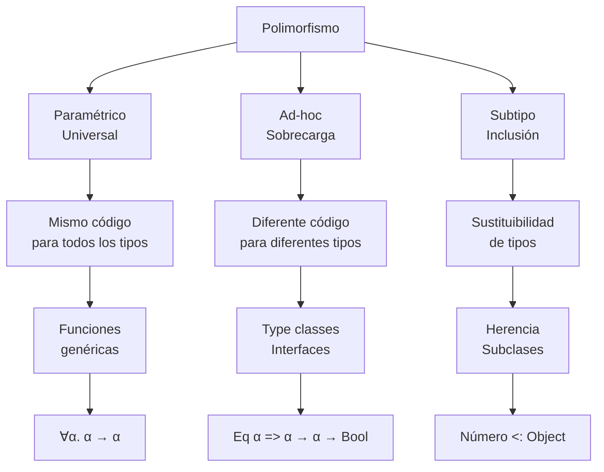

# Lenguajes de Programación - Paradigma funcional

## 3.7 Polimorfismo.

---

El polimorfismo es un concepto fundamental en los lenguajes de programación que permite escribir código genérico y reusable que puede trabajar con múltiples tipos. Según Pierce (2002), "el polimorfismo aumenta la expresividad de los sistemas de tipos mientras mantiene la seguridad estática".

### Conceptos Fundamentales

#### Definición de Polimorfismo

El polimorfismo permite que una función o tipo opere sobre valores de diferentes tipos mientras preserva la seguridad de tipos. Formalmente:

Una función polimórfica tiene un tipo que cuantifica sobre variables de tipo:

$$ \forall \alpha . \tau $$

### Tipos de Polimorfismo

#### 1. Polimorfismo Paramétrico (Genérico)

##### Definición

El mismo código funciona para cualquier tipo sin necesidad de conocer el tipo específico.

##### Firma de Tipos

$$ \text{map} : \forall \alpha \beta . (\alpha \rightarrow \beta) \rightarrow [\alpha] \rightarrow [\beta] $$

##### Ejemplo en Haskell

```haskell
-- Identidad polimórfica
id :: a -> a
id x = x

-- Lista polimórfica
length :: [a] -> Int
length [] = 0
length (_:xs) = 1 + length xs

-- Función polimórfica
map :: (a -> b) -> [a] -> [b]
map _ [] = []
map f (x:xs) = f x : map f xs
```

#### 2. Polimorfismo Ad-hoc (Sobrecarga)

##### Definición

Diferentes implementaciones para diferentes tipos, resuelto en tiempo de compilación.

##### Ejemplo con Type Classes

```haskell
-- Type class para igualdad
class Eq a where
    (==) :: a -> a -> Bool

-- Instancias para diferentes tipos
instance Eq Int where
    x == y = x `eqInt` y

instance Eq Bool where
    True == True = True
    False == False = True
    _ == _ = False

instance Eq a => Eq [a] where
    [] == [] = True
    (x:xs) == (y:ys) = x == y && xs == ys
    _ == _ = False
```

#### 3. Polimorfismo de Subtipos

##### Definición

Principio de sustitución de Liskov: si S es subtipo de T, entonces los objetos de tipo S pueden sustituir a objetos de tipo T.

##### Ejemplo Teórico

$$ \frac{\Gamma \vdash e : S \quad S <: T}{\Gamma \vdash e : T} $$

### Sistema F de Polimorfismo

#### Cálculo Lambda Polimórfico (System F)

##### Abstracción de Tipos

$$ \Lambda \alpha . e $$

##### Aplicación de Tipos

$$ e[\tau] $$

##### Reglas de Tipado

$$ \frac{\Gamma \vdash e : \forall \alpha . \tau}{\Gamma \vdash e[\sigma] : \tau[\alpha := \sigma]} $$

$$ \frac{\Gamma \vdash e : \tau \quad \alpha \notin \text{FTV}(\Gamma)}{\Gamma \vdash \Lambda \alpha . e : \forall \alpha . \tau} $$

### Inferencia de Tipos Hindley-Milner

#### Algorithm W

Unificación y generalización automática de tipos:

$$ \text{generalize}(\Gamma, \tau) = \forall \vec{\alpha} . \tau \quad \text{donde } \vec{\alpha} = \text{FTV}(\tau) - \text{FTV}(\Gamma) $$

#### Ejemplo de Inferencia

```haskell
-- El tipo se infiere como: ∀a. [a] → [a] → [a]
append xs ys = xs ++ ys

-- Es equivalente a:
append :: ∀a. [a] → [a] → [a]
append = Λa. λ(xs : [a]). λ(ys : [a]). xs ++ ys
```

### Diagrama de Relaciones de Polimorfismo



### Ejercicios Propuestos

#### Ejercicio 1: Identificación de Tipos de Polimorfismo

Para cada ejemplo, identifique el tipo de polimorfismo:

1. `length :: [a] -> Int` en Haskell
2. `toString()` método en Java
3. `function(x: number | string)` en TypeScript
4. `operator+` sobrecargado en C++
5. `List<Object> list = new ArrayList<String>()` en Java

#### Ejercicio 2: Implementación de Funciones Polimórficas

Implemente las siguientes funciones polimórficas:

1. `swap :: (a, b) -> (b, a)` que intercambia los elementos de una tupla
2. `compose :: (b -> c) -> (a -> b) -> a -> c` que compone dos funciones
3. `filter :: (a -> Bool) -> [a] -> [a]` que filtra una lista

#### Ejercicio 3: Inferencia de Tipos

Infiera los tipos de las siguientes expresiones:

1. `\f g x -> f (g x)`
2. `\x -> x x` (¿por qué falla la inferencia?)
3. `let f = \x -> x in f f`

#### Ejercicio 4: Type Classes

Defina una type class `Show` con la función `show :: a -> String` e implemente instancias para:

- `Int`
- `Bool`
- `[a]` (asumiendo que `a` también tiene instancia de `Show`)

### Polimorfismo en Diferentes Lenguajes

#### Haskell (Paramétrico + Ad-hoc)

```haskell
-- Polimorfismo paramétrico
reverse :: [a] -> [a]

-- Polimorfismo ad-hoc con type classes
sum :: Num a => [a] -> a

-- Restricciones múltiples
sort :: (Ord a, Show a) => [a] -> [a]
```

#### Java (Subtipo + Genérico)

```java
// Polimorfismo de subtipo
List<String> list = new ArrayList<String>();

// Polimorfismo paramétrico (genéricos)
public <T> T identity(T x) {
    return x;
}

// Polimorfismo ad-hoc (sobrecarga)
public String add(String a, String b) { return a + b; }
public int add(int a, int b) { return a + b; }
```

#### TypeScript (Paramétrico + Subtipo)

```typescript
// Polimorfismo paramétrico
function identity<T>(x: T): T {
  return x;
}

// Polimorfismo de subtipo con uniones
function processInput(input: string | number): string {
  return input.toString();
}
```

### Teoremas Fundamentales

#### Teorema de Parametrizidad (Reynolds)

Para cualquier función polimórfica $f : \forall \alpha . \tau$, y para cualquier tipo $A$, $B$ y relación $R$ entre ellos, se cumple que:

$$ (f[A], f[B]) \in \tau[R] $$

#### Teorema de Libre Teoremas

Las funciones polimórficas deben satisfacer ciertas leyes naturales. Por ejemplo, para:

$$ f : \forall \alpha . \alpha \rightarrow \alpha $$

Se cumple que $f$ debe ser la función identidad.

### Limitaciones y Extensiones

#### Existencial Types

$$ \exists \alpha . \tau $$

#### Higher-Kinded Polymorphism

```haskell
class Functor f where
    fmap :: (a -> b) -> f a -> f b

instance Functor Maybe where
    fmap _ Nothing = Nothing
    fmap f (Just x) = Just (f x)
```

#### Polymorphic Recursion

```haskell
data Tree a = Leaf a | Node [Tree a]

-- Polymorphic recursion
depth :: Tree a -> Int
depth (Leaf _) = 1
depth (Node ts) = 1 + maximum (map depth ts)  -- Recursive call has type Tree a -> Int
```

### Referencias

1. Pierce, B.C. (2002). _Types and Programming Languages_. MIT Press. (Capítulos 22, 23: Type Reconstruction, Universal Types)
2. Mitchell, J. (2003). _Concepts in Programming Languages_. Cambridge University Press. (Capítulo 5: Types and Type Systems)
3. Wadler, P. (1989). _Theorems for Free!_
4. Reynolds, J.C. (1983). _Types, Abstraction and Parametric Polymorphism_
5. Milner, R. (1978). _A Theory of Type Polymorphism in Programming_

### Conclusión

El polimorfismo es una herramienta poderosa en la programación funcional que permite escribir código genérico, reusable y type-safe. Los diferentes tipos de polimorfismo paramétrico, ad-hoc y de subtipos, ofrecen diversas formas de abstracción sobre tipos, cada una con sus ventajas y aplicaciones específicas. La comprensión de estos conceptos es esencial para dominar el diseño de programas funcionales y para apreciar los fundamentos teóricos de los sistemas de tipos modernos.
