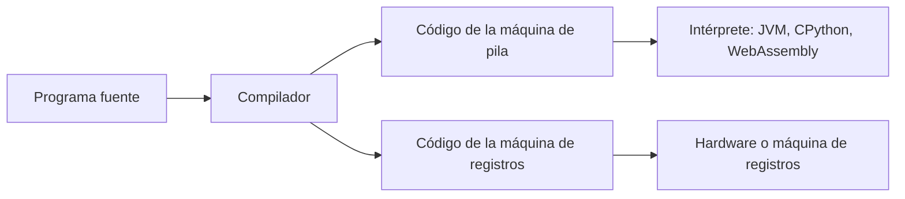

# Lenguajes de Programación - Paradigma imperativo

## 4.1 Máquinas abstractas.

---

Una **máquina abstracta** es un modelo de cómputo con un estado y un conjunto de instrucciones que lo transforman, a medio camino entre la semántica de un lenguaje y el hardware que lo ejecuta. Sirve para tres propósitos: **definir** la semántica de un lenguaje de forma ejecutable; **implementarlo**, compilando a las instrucciones de la máquina y escribiendo un intérprete para ella, como la máquina virtual de Java o la de Python, y **razonar** sobre la ejecución, por ejemplo sobre el costo o la memoria. Este tema presenta la definición general, las máquinas de pila y de registros, su relación con la semántica operacional, y algunas máquinas históricas e industriales.

### Definición

Una máquina abstracta es un sistema de transición (tema 2.1) $M = (\Sigma, \to, \sigma_0, F):$ un conjunto de **estados** $\Sigma,$ una relación de **transición** $\to \;\subseteq \Sigma \times \Sigma$ definida por las instrucciones, un estado inicial $\sigma_0$ y un conjunto $F$ de estados finales. En una máquina para un lenguaje imperativo, el estado contiene típicamente:

- el **programa** o el código que falta ejecutar, con un **contador de programa** que señala la instrucción siguiente;
- la **memoria**, que asigna valores a las direcciones o a las variables;
- estructuras de control, como una **pila** de operandos o de marcos de activación (tema 4.4).

Cada instrucción define un paso, y ejecutar un programa es aplicar pasos hasta llegar a un estado final o a un estado sin transición, que indica un error.

### Máquina de pila

El estado es un par $\langle c, S \rangle$ con el código $c$ y una pila $S$ de valores. Las instrucciones toman sus operandos de la cima y dejan ahí el resultado:

$$\langle \mathsf{push}\; n \cdot c,\; S \rangle \to \langle c,\; n \cdot S \rangle \qquad \langle \mathsf{add} \cdot c,\; n_2 \cdot n_1 \cdot S \rangle \to \langle c,\; (n_1 + n_2) \cdot S \rangle$$

Una expresión se compila a esta máquina por un recorrido en **postorden** de su árbol, que produce la notación polaca inversa: $(3 + 4) \times 2$ es `3 4 + 2 *`. La compilación es sencilla, porque no hay que asignar registros, y el código es compacto, porque las instrucciones no nombran sus operandos. Son máquinas de pila la de Java (JVM), la de .NET (CLR), la de Python (CPython), la de WebAssembly y la de Forth y PostScript.

### Máquina de registros

El estado es un conjunto finito de **registros** más una memoria, y las instrucciones nombran sus operandos: `ADD R3, R1, R2`. Corresponde a los procesadores reales, y también a máquinas virtuales como la de Lua y la Dalvik de Android. El código tiene menos instrucciones que el de pila, porque no hay que mover valores a la cima, pero cada instrucción es más larga, y el compilador debe **asignar registros**: decidir qué valores viven en qué registro, lo que se modela como un problema de coloración de grafos. Las **optimizaciones** clásicas sobre este código son la eliminación de subexpresiones comunes, la propagación de constantes, la reducción de fuerza (reemplazar una multiplicación por 2 con un desplazamiento) y la reutilización de registros que ya no se necesitan.

### Máquinas para lenguajes de alto nivel

- La **máquina SECD** de Landin (1964), con pila, entorno, código y volcado, fue la primera máquina abstracta para un lenguaje funcional, el cálculo lambda con llamada por valor.
- La **WAM** de Warren (1983) es la máquina de Prolog, con instrucciones de unificación y de retroceso.
- La **máquina CEK** de Felleisen y Friedman usa control, entorno y continuación (tema 4.6).
- La **JVM** ejecuta código de bytes verificado; su verificador garantiza, antes de ejecutar, que la pila no se desborda y que cada instrucción recibe operandos del tipo correcto.

### Relación con la semántica operacional

Una semántica operacional de paso pequeño es una máquina abstracta cuyo estado es el programa mismo. Una de paso grande, como la de este tema para `while` e `if`, es un **intérprete**. Una máquina con un estado explícito de pila o de registros es una semántica más cercana a la implementación, y demostrar que el compilador de expresiones a la máquina de pila es correcto, es decir, que ejecutar `compila(e)` deja en la pila el valor de $e,$ es el ejemplo clásico de corrección de un compilador, por inducción sobre $e.$



### Implementación en Python

El programa implementa una máquina de pila con aritmética, funciones trigonométricas, operadores lógicos y comparaciones, e imprime la pila después de cada instrucción; detecta los programas que dejan la pila en un estado inválido. Para el ejercicio 2 implementa la semántica de paso grande de un lenguaje imperativo con `while` e `if`, y registra qué regla se aplica en cada paso. Para el ejercicio 3 simula una máquina de registros con un costo estimado por instrucción y compara la secuencia del enunciado con una optimizada en 121 pares de valores.

```python
import math

# --- Ejercicio 1: máquina de pila extendida. Estado: (programa restante, pila) ---
BINARIAS = {"+": lambda a, b: a + b, "-": lambda a, b: a - b, "*": lambda a, b: a * b, "/": lambda a, b: a / b, "%": lambda a, b: a % b,
            ">": lambda a, b: a > b, "<": lambda a, b: a < b, "==": lambda a, b: a == b,
            "and": lambda a, b: bool(a) and bool(b), "or": lambda a, b: bool(a) or bool(b)}
UNARIAS = {"sin": math.sin, "cos": math.cos, "tan": math.tan, "not": lambda a: not a, "neg": lambda a: -a}
def ejecuta_pila(programa, traza=False):
    pila = []
    for ins in programa.split():
        if ins in BINARIAS:
            if len(pila) < 2: raise RuntimeError(f"{ins}: faltan operandos")
            b, a = pila.pop(), pila.pop(); pila.append(BINARIAS[ins](a, b))
        elif ins in UNARIAS:
            if not pila: raise RuntimeError(f"{ins}: falta el operando")
            pila.append(UNARIAS[ins](pila.pop()))
        elif ins == "pi": pila.append(math.pi)
        elif ins == "dup": pila.append(pila[-1])
        else: pila.append(float(ins))
        if traza: print(f"      {ins:>4}  {[round(x, 4) if isinstance(x, float) else x for x in pila]}")
    if len(pila) != 1: raise RuntimeError(f"la pila termina con {len(pila)} valores")
    return pila[0]
print("ejercicio 1: (3 + 4) * 2 > 10 and not (1 == 2):")
print("   resultado:", ejecuta_pila("3 4 + 2 * 10 > 1 2 == not and", traza=True))
print("   sin²(π/6) + cos²(π/6) =", round(ejecuta_pila("pi 6 / sin dup * pi 6 / cos dup * +"), 12),
      "| tan(π/4) =", round(ejecuta_pila("pi 4 / tan"), 12))
for malo in ("1 +", "1 2 3 +"):
    try: ejecuta_pila(malo)
    except RuntimeError as e: print(f"   {malo!r}: error de la máquina, {e}")

# --- Ejercicio 2: semántica de paso grande de while e if, como intérprete ---
def E(e, s):
    if isinstance(e, (int, bool)): return e
    if isinstance(e, str): return s[e]
    op, a, b = e
    return BINARIAS[op](E(a, s), E(b, s))
def C(c, s, regla=None):
    k = c[0]
    if k == ":=":
        regla is not None and regla.append("Asig"); return {**s, c[1]: E(c[2], s)}
    if k == ";": return C(c[2], C(c[1], s, regla), regla)
    if k == "if":
        cierto = E(c[1], s); regla is not None and regla.append("If-V" if cierto else "If-F")
        return C(c[2] if cierto else c[3], s, regla)
    if k == "while":
        if not E(c[1], s): regla is not None and regla.append("While-F"); return s
        regla is not None and regla.append("While-V"); return C(c, C(c[2], s, regla), regla)
prog = (";", (":=", "i", 0), (";", (":=", "suma", 0),
        ("while", ("<", "i", 4), (";", ("if", ("==", ("%", "i", 2), 0),
                                      (":=", "suma", ("+", "suma", "i")), (":=", "suma", "suma")),
                                 (":=", "i", ("+", "i", 1))))))
reglas = []
print("ejercicio 2: suma de los pares menores que 4:", C(prog, {}, reglas))
print("   reglas aplicadas:", " ".join(reglas))

# --- Ejercicio 3: máquina de registros y una optimización ---
def ejecuta_registros(codigo, memoria):
    R, mem, ciclos = {}, dict(memoria), 0
    COSTO = {"LOAD": 3, "STORE": 3, "ADD": 1, "MUL": 3, "SHL": 1}
    val = lambda x: int(x[1:]) if x.startswith("#") else R[x]
    for linea in codigo:
        op, *args = linea.replace(",", " ").split(); ciclos += COSTO[op]
        if op == "LOAD": R[args[0]] = mem[args[1]]
        elif op == "STORE": mem[args[0]] = R[args[1]]
        elif op == "ADD": R[args[0]] = val(args[1]) + val(args[2])
        elif op == "MUL": R[args[0]] = val(args[1]) * val(args[2])
        elif op == "SHL": R[args[0]] = val(args[1]) << val(args[2])
    return mem, ciclos, len({a for l in codigo for a in l.replace(",", " ").split()[1:] if a.startswith("R")})
original = ["LOAD R1, x", "LOAD R2, y", "ADD R3, R1, R2", "MUL R4, R3, #2", "STORE result, R4"]
optimizado = ["LOAD R1, x", "LOAD R2, y", "ADD R1, R1, R2", "SHL R1, R1, #1", "STORE result, R1"]
for nombre, cod in (("original", original), ("optimizado", optimizado)):
    mem, ciclos, regs = ejecuta_registros(cod, {"x": 7, "y": 5})
    print(f"ejercicio 3, {nombre}: result = {mem['result']}, {ciclos} ciclos estimados, {regs} registros")
print("   iguales para varios x, y:", all(ejecuta_registros(original, {"x": x, "y": y})[0] == ejecuta_registros(optimizado, {"x": x, "y": y})[0]
                                     for x in range(-5, 6) for y in range(-5, 6)))
```

Salida:

```text
ejercicio 1: (3 + 4) * 2 > 10 and not (1 == 2):
         3  [3.0]
         4  [3.0, 4.0]
         +  [7.0]
         2  [7.0, 2.0]
         *  [14.0]
        10  [14.0, 10.0]
         >  [True]
         1  [True, 1.0]
         2  [True, 1.0, 2.0]
        ==  [True, False]
       not  [True, True]
       and  [True]
   resultado: True
   sin²(π/6) + cos²(π/6) = 1.0 | tan(π/4) = 1.0
   '1 +': error de la máquina, +: faltan operandos
   '1 2 3 +': error de la máquina, la pila termina con 2 valores
ejercicio 2: suma de los pares menores que 4: {'i': 4, 'suma': 2}
   reglas aplicadas: Asig Asig While-V If-V Asig Asig While-V If-F Asig Asig While-V If-V Asig Asig While-V If-F Asig Asig While-F
ejercicio 3, original: result = 24, 13 ciclos estimados, 4 registros
ejercicio 3, optimizado: result = 24, 11 ciclos estimados, 2 registros
   iguales para varios x, y: True
```

### Ejercicios Propuestos

1. **Máquina de pila.** Extiende una máquina de pila con funciones trigonométricas, operadores lógicos y comparaciones.

2. **Semántica formal.** Define las reglas de transición de `while e do c` y de `if e then c1 else c2`. Parte de estas dos:

    $$\frac{\langle e, s \rangle \Downarrow \mathsf{true} \quad \langle c, s \rangle \Downarrow s' \quad \langle \mathsf{while}\; e\; \mathsf{do}\; c, s' \rangle \Downarrow s''}{\langle \mathsf{while}\; e\; \mathsf{do}\; c, s \rangle \Downarrow s''} \qquad \frac{\langle e, s \rangle \Downarrow \mathsf{false} \quad \langle c_2, s \rangle \Downarrow s'}{\langle \mathsf{if}\; e\; \mathsf{then}\; c_1\; \mathsf{else}\; c_2, s \rangle \Downarrow s'}$$

3. **Optimización.** Analiza y optimiza para una máquina de registros:

    ```text
    LOAD R1, x
    LOAD R2, y
    ADD R3, R1, R2
    MUL R4, R3, #2
    STORE result, R4
    ```

### Soluciones

**Ejercicio 1.** Las operaciones nuevas son de dos clases: **binarias**, como las comparaciones y `and` y `or`, que toman dos valores de la pila, y **unarias**, como `sin`, `cos`, `tan` y `not`, que toman uno. Las reglas son las de la sección de la máquina de pila, con el operador correspondiente; por ejemplo $\langle \mathsf{sin} \cdot c,\; x \cdot S \rangle \to \langle c,\; \sin x \cdot S \rangle$ y $\langle \mathsf{gt} \cdot c,\; n_2 \cdot n_1 \cdot S \rangle \to \langle c,\; (n_1 \gt n_2) \cdot S \rangle.$ El orden de los operandos importa en las operaciones no conmutativas: el segundo operando es el que está en la cima. La máquina del programa evalúa $(3 + 4) \times 2 \gt 10 \land \lnot(1 = 2)$ y comprueba la identidad $\sin^2 x + \cos^2 x = 1$ con $x = \pi/6;$ la instrucción `dup` duplica la cima para elevar al cuadrado. Una máquina real necesita además reglas de **error**: con menos operandos de los necesarios no hay transición, y el programa lo reporta en lugar de fallar con un error de Python; un programa que termina con más de un valor en la pila también está mal formado.

**Ejercicio 2.** Las dos reglas del enunciado son correctas; faltan las otras dos, para que cada construcción tenga una regla por cada valor de la condición:

$$\frac{\langle e, s \rangle \Downarrow \mathsf{false}}{\langle \mathsf{while}\; e\; \mathsf{do}\; c, s \rangle \Downarrow s}\;\text{While-F} \qquad \frac{\langle e, s \rangle \Downarrow \mathsf{true} \quad \langle c_1, s \rangle \Downarrow s'}{\langle \mathsf{if}\; e\; \mathsf{then}\; c_1\; \mathsf{else}\; c_2, s \rangle \Downarrow s'}\;\text{If-V}$$

Sin While-F, ningún ciclo podría terminar, porque la única regla del ciclo tiene otro ciclo entre sus premisas. El enunciado mezclaba $\to$ y $\Downarrow;$ en la semántica de paso grande todas las flechas son $\Downarrow.$ El programa implementa las cuatro reglas como un intérprete, y la lista de reglas aplicadas al calcular la suma de los pares menores que 4 muestra cuatro aplicaciones de While-V y una final de While-F. La regla While-V es recursiva en la conclusión: la definición es **inductiva** sobre la altura de la derivación, y un ciclo que no termina no tiene derivación.

**Ejercicio 3.** La secuencia calcula $2(x + y).$ Optimizaciones:

- **Reducción de fuerza:** `MUL R4, R3, #2` se reemplaza por un desplazamiento a la izquierda, `SHL R1, R1, #1`, o por `ADD R1, R1, R1`, que son más baratos que una multiplicación en casi todos los procesadores.
- **Reutilización de registros:** $x$ no se necesita después de la suma, así que el resultado se puede dejar en `R1`, y la secuencia usa 2 registros en lugar de 4. Eso libera registros para el código que sigue y reduce los accesos a memoria en un programa más grande.

Con los costos supuestos por el programa (3 ciclos por acceso a memoria o multiplicación y 1 por suma o desplazamiento), el costo baja de 13 a 11 ciclos, y el resultado es el mismo en los 121 pares probados. Los dos `LOAD` y el `STORE` dominan el costo y no se pueden eliminar en este fragmento aislado; en un programa real, si `x` o `y` ya estuvieran en registros por un cálculo anterior, el compilador los reutilizaría.

### Referencias

1. Diehl, S., Hartel, P., and Sestoft, P., Abstract machines for programming language implementation. _Future Generation Computer Systems_ 16(7), 2000.
2. Landin, P. J., The mechanical evaluation of expressions. _The Computer Journal_ 6(4), 1964.
3. Aho, A. V., Lam, M. S., Sethi, R., and Ullman, J. D., _Compilers: Principles, Techniques, and Tools_. Pearson, 2006. Capítulos 6 y 8.
4. Lindholm, T., Yellin, F., Bracha, G., and Buckley, A., _The Java Virtual Machine Specification_. Oracle, 2023. Capítulos 2 y 4.
5. Nielson, H. R., and Nielson, F., _Semantics with Applications: An Appetizer_. Springer, 2007. Capítulo 4.
