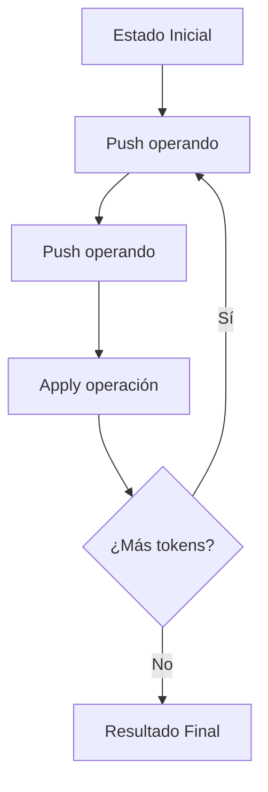
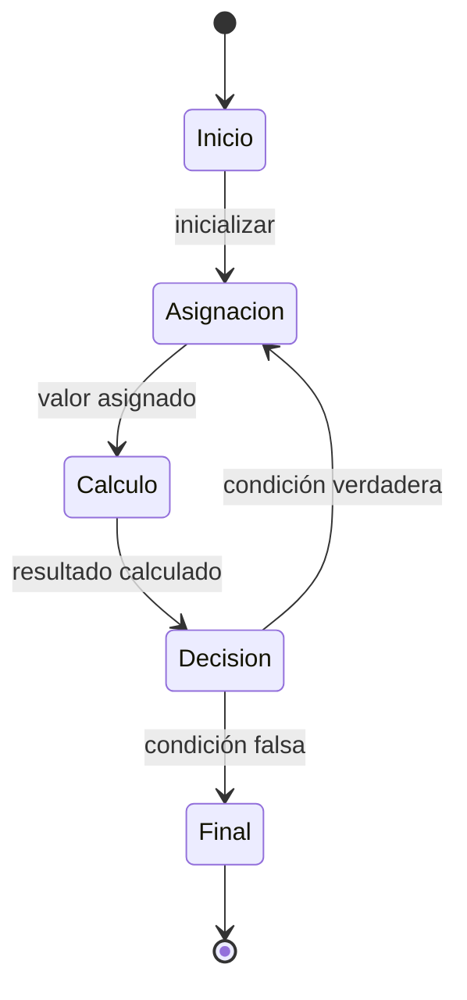
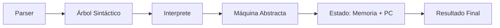

# Lenguajes de Programación - Paradigma imperativo

## 4.1 Máquinas abstractas.

---

El paradigma imperativo se caracteriza por describir la computación como una secuencia de instrucciones que modifican el estado de un programa. Las máquinas abstractas son modelos teóricos que nos permiten entender y formalizar la ejecución de programas en este paradigma.

### Concepto de Máquina Abstracta

Una máquina abstracta es un modelo computacional teórico que define las operaciones básicas y la estructura de estado para la ejecución de programas. Proporciona una semántica operacional para lenguajes de programación.

#### Definición Formal

Una máquina abstracta se puede definir como una tupla:

$$M = (S, I, \rightarrow, s_0)$$

Donde:

- $S$ es un conjunto de estados
- $I$ es un conjunto de instrucciones
- $\rightarrow \subseteq S \times I \times S$ es la relación de transición
- $s_0 \in S$ es el estado inicial

### Máquina de Pila para Expresiones Aritméticas



#### Implementación en Python

```python
class StackMachine:
    def __init__(self):
        self.stack = []

    def evaluate(self, expression):
        tokens = expression.split()
        for token in tokens:
            if token in '+-*/':
                self.apply_operation(token)
            else:
                self.stack.append(float(token))
        return self.stack.pop()

    def apply_operation(self, op):
        b = self.stack.pop()
        a = self.stack.pop()
        if op == '+': result = a + b
        elif op == '-': result = a - b
        elif op == '*': result = a * b
        elif op == '/': result = a / b
        self.stack.append(result)

# Ejemplo de uso
machine = StackMachine()
result = machine.evaluate("3 4 + 2 *")
print(f"Resultado: {result}")  # Output: 14.0
```

### Máquina de Registros

Las máquinas de registros son modelos que utilizan un conjunto finito de registros para almacenar valores temporales durante la ejecución.

#### Estructura de Estado

$$Estado = (PC, R_0, R_1, ..., R_n, Memoria)$$

Donde:

- $PC$ es el contador de programa
- $R_i$ son los registros
- $Memoria$ es el espacio de almacenamiento principal

### Semántica Operacional Estructural (SOS)

La semántica operacional estructural define las reglas de transición entre estados mediante reglas de inferencia.

#### Reglas para Asignación

$$
\frac{\langle e, s \rangle \Downarrow v}{\langle x := e, s \rangle \rightarrow s[x \mapsto v]}
$$

#### Reglas para Secuenciación

$$
\frac{\langle c_1, s \rangle \rightarrow s' \quad \langle c_2, s' \rangle \rightarrow s''}{\langle c_1; c_2, s \rangle \rightarrow s''}
$$

### Máquina Abstracta para un Lenguaje Imperativo Simple

#### Sintaxis Abstracta

$$
\begin{aligned}
e &::= n \mid x \mid e_1 + e_2 \mid e_1 - e_2 \\
c &::= x := e \mid c_1; c_2 \mid \texttt{if } e \texttt{ then } c_1 \texttt{ else } c_2 \mid \texttt{while } e \texttt{ do } c \\
\end{aligned}
$$

#### Implementación de la Máquina

```python
class ImperativeMachine:
    def __init__(self):
        self.memory = {}
        self.pc = 0

    def eval_expr(self, expr, env):
        if isinstance(expr, int):
            return expr
        elif isinstance(expr, str):  # variable
            return env.get(expr, 0)
        elif isinstance(expr, tuple):
            op, left, right = expr
            l_val = self.eval_expr(left, env)
            r_val = self.eval_expr(right, env)
            if op == '+': return l_val + r_val
            elif op == '-': return l_val - r_val
            elif op == '*': return l_val * r_val
            elif op == '/': return l_val // r_val

    def execute(self, program, env=None):
        if env is None:
            env = self.memory.copy()

        if not program:
            return env

        stmt, *rest = program

        if stmt[0] == 'assign':
            _, var, expr = stmt
            env[var] = self.eval_expr(expr, env)
            return self.execute(rest, env)

        elif stmt[0] == 'if':
            _, cond, then_branch, else_branch = stmt
            cond_val = self.eval_expr(cond, env)
            if cond_val:
                new_env = self.execute(then_branch, env.copy())
                return self.execute(rest, new_env)
            else:
                new_env = self.execute(else_branch, env.copy())
                return self.execute(rest, new_env)
```

### Máquina de Estados Finitos



### Ejercicios Propuestos

#### Ejercicio 1: Implementación de Máquina de Pila

Implemente una máquina de pila extendida que soporte operaciones adicionales como:

- Operaciones trigonométricas ( $sin$, $cos$, $tan$ )
- Operaciones lógicas ( $and$, $or$, $not$ )
- Operaciones de comparación ( $>$, $<$, $==$ )

#### Ejercicio 2: Semántica Formal

Defina las reglas formales de transición para las siguientes construcciones:

1. **While loop**:

   $$
   \frac{\langle e, s \rangle \Downarrow \text{true} \quad \langle c, s \rangle \rightarrow s' \quad \langle \texttt{while } e \texttt{ do } c, s' \rangle \rightarrow s''}{\langle \texttt{while } e \texttt{ do } c, s \rangle \rightarrow s''}
   $$

2. **If-then-else**:
   $$
   \frac{\langle e, s \rangle \Downarrow \text{false} \quad \langle c_2, s \rangle \rightarrow s'}{\langle \texttt{if } e \texttt{ then } c_1 \texttt{ else } c_2, s \rangle \rightarrow s'}
   $$

#### Ejercicio 3: Optimización de Máquina

Analice y optimice la siguiente secuencia de instrucciones para una máquina de registros:

```
LOAD R1, x
LOAD R2, y
ADD R3, R1, R2
MUL R4, R3, #2
STORE result, R4
```

### Referencias Bibliográficas

#### Bibliografía Básica

1. Mitchell, J. (2003). _Concepts in Programming Languages_. Cambridge University Press. (Capítulo 4: Imperative Programming)
2. Pierce, B.C. (2002). _Types and Programming Languages_. MIT Press. (Capítulo: Operational Semantics)

#### Bibliografía Complementaria

3. Harper, R. (2010). _Practical Foundations for Programming Languages_. http://www.cs.cmu.edu/~rwh/plbook/book.pdf
4. Friedman, D.P., Wand, M. (2008). _Essentials of Programming Languages_. 3rd edition. MIT Press. (Capítulo: Interpreters and Machines)

### Caso de Estudio: Máquina para un Subconjunto de C

Considere la implementación de una máquina abstracta para un subconjunto del lenguaje C que incluya:

- Asignaciones
- Estructuras de control
- Funciones simples
- Manipulación de memoria básica

#### Diagrama de Estados



### Conclusión

Las máquinas abstractas proporcionan una base formal para entender la ejecución de programas en el paradigma imperativo. Su estudio permite comprender cómo las construcciones de alto nivel se traducen en operaciones fundamentales y cómo el estado del programa evoluciona durante la ejecución.

### Evaluación del Tema

Para verificar la comprensión del tema, responda:

1. ¿Cómo difieren las máquinas de pila de las máquinas de registros en términos de eficiencia y complejidad de implementación?
2. ¿Qué ventajas ofrece la semántica operacional estructural para la definición formal de lenguajes de programación?
3. ¿Cómo manejaría una máquina abstracta la gestión de memoria dinámica y las estructuras de datos complejas?
