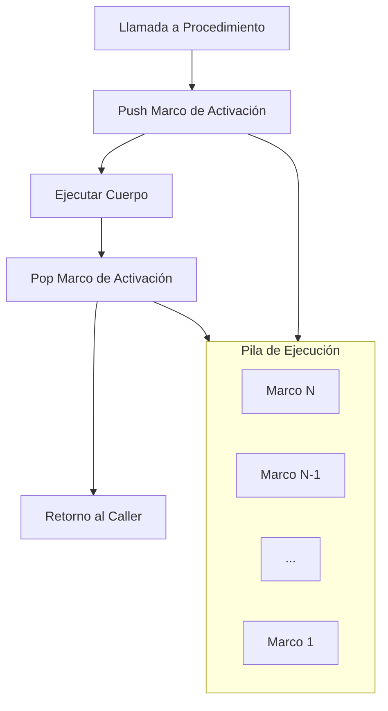
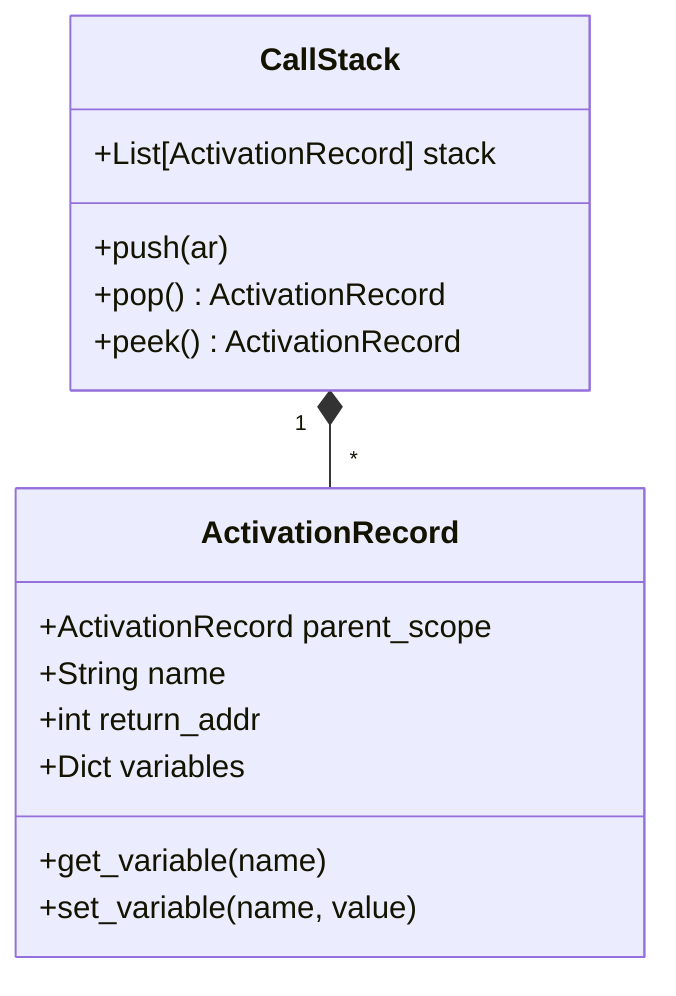

# Lenguajes de Programación - Paradigma imperativo

## 4.2 Procedimientos y bloques de programa.

---

Los procedimientos y bloques de programa son constructos fundamentales en el paradigma imperativo que permiten la estructuración y organización del código. Facilitan la abstracción, la reutilización y el control del ámbito de variables.

### Conceptos Fundamentales

#### Procedimientos

Un procedimiento es una secuencia de instrucciones con un nombre asociado que puede ser invocada desde diferentes partes del programa. Matemáticamente, podemos representar un procedimiento como:

$$P: \text{Args} \times \text{Estado} \rightarrow \text{Estado}$$

#### Bloques de Programa

Un bloque es una secuencia de declaraciones y sentencias agrupadas que definen un ámbito léxico. Formalmente:

$$ B ::= \{\ D ^ * \ S ^ * \ \} $$

donde $D$ son declaraciones y $S$ son sentencias.

### Estructura de Ámbitos y Visibilidad

#### Reglas de Scoping

El scoping estático (léxico) se define mediante la relación:

$$\text{visible}(x, L) = \exists B \in \text{bloquesAnidantes}(L) \mid x \in \text{declaraciones}(B)$$

#### Implementación con Environments

```python
class Environment:
    def __init__(self, parent=None):
        self.variables = {}
        self.parent = parent

    def declare(self, name, value):
        self.variables[name] = value

    def lookup(self, name):
        if name in self.variables:
            return self.variables[name]
        elif self.parent:
            return self.parent.lookup(name)
        else:
            raise NameError(f"Variable '{name}' no definida")
```

### Paso de Parámetros

#### Por Valor vs Por Referencia

**Paso por valor**:

$$\langle \text{call } f(e), s \rangle \rightarrow \langle f(v), s \rangle \text{ donde } \langle e, s \rangle \Downarrow v$$

**Paso por referencia**:

$$\langle \text{call } f(x), s \rangle \rightarrow \langle f(l), s \rangle \text{ donde } l = \text{loc}(x)$$

#### Semántica Formal

Para procedimiento con parámetros por valor:

$$
\frac{\langle e, s \rangle \Downarrow v \quad \langle body, s[x \mapsto v] \rangle \rightarrow s'}{\langle x := \text{proc}(y)\ body\ ;\ x(e), s \rangle \rightarrow s'}
$$

### Implementación de la Pila de Llamadas



### Ejemplo: Máquina Abstracta con Procedimientos

```python
class ActivationRecord:
    def __init__(self, name, return_addr, parent_scope):
        self.name = name
        self.return_addr = return_addr
        self.variables = {}
        self.parent_scope = parent_scope

    def __getitem__(self, key):
        if key in self.variables:
            return self.variables[key]
        elif self.parent_scope:
            return self.parent_scope[key]
        raise KeyError(key)

class ProcedureMachine:
    def __init__(self):
        self.call_stack = []
        self.global_env = {}
        self.procedures = {}

    def declare_procedure(self, name, params, body):
        self.procedures[name] = (params, body)

    def call_procedure(self, name, args):
        if name not in self.procedures:
            raise NameError(f"Procedimiento '{name}' no definido")

        params, body = self.procedures[name]
        ar = ActivationRecord(name, self.pc + 1, self.current_env())

        # Binding de parámetros
        for param, arg in zip(params, args):
            ar.variables[param] = arg

        self.call_stack.append(ar)
        self.execute_body(body)
        result = self.call_stack.pop()
        return result

    def execute_body(self, body):
        for stmt in body:
            self.execute_statement(stmt)

    def current_env(self):
        if self.call_stack:
            return self.call_stack[-1]
        return self.global_env
```

### Bloques y Ámbitos Anidados

#### Reglas Semánticas para Bloques

$$ \frac{\langle D ^ * , s \rangle \rightarrow s' \quad \langle S ^ *, s' \rangle \rightarrow s''}{\langle \{ D ^ * S ^ * \}, s \rangle \rightarrow s''} $$

#### Ejemplo de Bloques Anidados

```python
# Ámbito global
x = 10

def procedimiento():
    # Ámbito del procedimiento
    y = 20
    {
        # Bloque interno
        z = 30
        x = y + z  # Acceso a variables externas
    }
    # z no es visible aquí
    return x + y
```

### Gestión de Memoria para Procedimientos

#### Marco de Activación

Un marco de activación contiene:

- Parámetros formales
- Variables locales
- Dirección de retorno
- Enlace al ámbito padre

$$ AR = (\text{params}, \text{locals}, \text{return\_addr}, \text{static\_link}) $$

#### Diagrama de Marcos de Activación



### Recursión y Pila de Llamadas

#### Semántica de Llamadas Recursivas

Para procedimientos recursivos:

$$
\frac{\langle e, s \rangle \Downarrow v \quad \langle body, s[x \mapsto v, f \mapsto \text{proc}] \rangle \rightarrow s'}{\langle f = \text{proc}(x)\ body\ ;\ f(e), s \rangle \rightarrow s'}
$$

#### Ejemplo: Factorial Recursivo

```python
def factorial(n):
    if n == 0:
        return 1
    else:
        return n * factorial(n - 1)

# Implementación en máquina abstracta
machine = ProcedureMachine()
machine.declare_procedure('factorial', ['n'], [
    ('if', ('==', 'n', 0), [('return', 1)], [
        ('return', ('*', 'n', ('call', 'factorial', [('-', 'n', 1)])))
    ])
])
```

### Ejercicios Propuestos

#### Ejercicio 1: Implementación de Scoping Estático

Implemente una máquina abstracta que maneje correctamente el scoping estático con las siguientes características:

- Bloques anidados
- Procedimientos con acceso a variables externas
- Shadowing de variables

#### Ejercicio 2: Semántica Formal

Defina las reglas formales de transición para:

1. **Declaración de procedimiento**:

   $$
   \frac{\langle \text{proc } f(x)\ body, s \rangle \rightarrow s[f \mapsto \lambda x. body]}{\langle f = \text{proc}(x)\ body, s \rangle \rightarrow s'}
   $$

2. **Llamada a procedimiento**:
   $$
   \frac{\langle e, s \rangle \Downarrow v \quad s(f) = \lambda x. body \quad \langle body, s[x \mapsto v] \rangle \rightarrow s'}{\langle f(e), s \rangle \rightarrow s'}
   $$

#### Ejercicio 3: Optimización de Cola

Implemente una máquina que optimice las llamadas recursivas de cola:

```python
def factorial(n, acc=1):
    if n == 0:
        return acc
    else:
        return factorial(n - 1, n * acc)
```

### Casos de Estudio Especiales

#### Procedimientos como Parámetros

```python
def aplicar_funcion(f, x):
    return f(x)

def cuadrado(n):
    return n * n

resultado = aplicar_funcion(cuadrado, 5)
```

#### Clausuras (Closures)

```python
def crear_contador():
    count = 0
    def incrementar():
        nonlocal count
        count += 1
        return count
    return incrementar

contador = crear_contador()
print(contador())  # 1
print(contador())  # 2
```

### Referencias Bibliográficas

#### Bibliografía Básica

1. Mitchell, J. (2003). _Concepts in Programming Languages_. Cambridge University Press. (Capítulo 5: Procedures and Types)
2. Pierce, B.C. (2002). _Types and Programming Languages_. MIT Press. (Capítulo: Functional Programming)

#### Bibliografía Complementaria

3. Friedman, D.P., Wand, M. (2008). _Essentials of Programming Languages_. 3rd edition. MIT Press. (Capítulo: Procedures and Assignment)
4. Harper, R. (2010). _Practical Foundations for Programming Languages_. (Capítulo: Dynamic and Static Semantics)

### Evaluación del Tema

Para verificar la comprensión:

1. ¿Cómo se implementa el acceso a variables no locales en diferentes esquemas de scoping?
2. ¿Qué diferencias existen entre el paso de parámetros por valor y por referencia?
3. ¿Cómo maneja la pila de llamadas los casos de recursión múltiple?
4. ¿Qué ventajas ofrecen los bloques de programa en la estructuración del código?

### Conclusión

Los procedimientos y bloques son esenciales para la estructuración de programas imperativos, permitiendo la abstracción, el control de ámbito y la reutilización de código. Su comprensión es fundamental para el diseño e implementación de lenguajes de programación.
