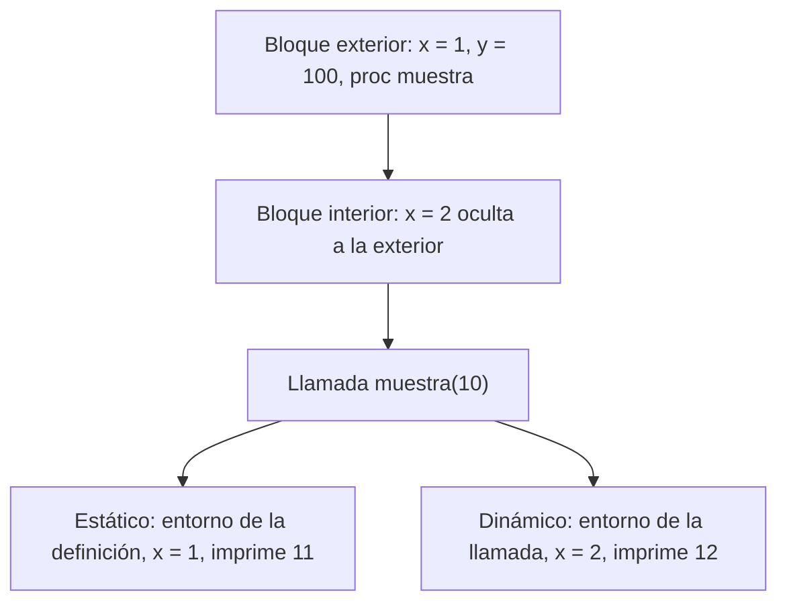

# Lenguajes de Programación - Paradigma imperativo

## 4.2 Procedimientos y bloques de programa.

---

Los **bloques** y los **procedimientos** son los dos mecanismos de abstracción básicos de los lenguajes imperativos desde ALGOL 60. Un bloque delimita una región del programa con sus propias declaraciones, que existen solo mientras se ejecuta; un procedimiento da nombre a un fragmento de código parametrizado para usarlo varias veces. Juntos determinan el **alcance** de los nombres y el **tiempo de vida** de las variables. Este tema presenta su semántica con dos estructuras separadas, el **entorno** y el **almacén**, la diferencia entre alcance estático y dinámico, la recursión y la eliminación de llamadas de cola.

### Bloques

Un bloque, `begin ... end` en ALGOL y Pascal, `{ ... }` en C y Java, contiene declaraciones y sentencias. Sus reglas:

- Una declaración es visible desde su punto de declaración hasta el fin del bloque, incluidos los bloques interiores.
- Una declaración interior con el mismo nombre **oculta** a la exterior en su alcance (*shadowing*).
- Las variables locales se crean al entrar al bloque y se destruyen al salir; su **tiempo de vida** es la ejecución del bloque. Por eso se pueden guardar en una **pila** (tema 4.4).

### Entorno y almacén

La semántica de un lenguaje imperativo con bloques separa dos funciones:

- El **entorno** $\rho : \mathsf{Nombre} \rightharpoonup \mathsf{Dir}$ asigna a cada nombre visible la **dirección** de la variable, un elemento de $\mathsf{Dir},$ o un procedimiento. Lo modifican las declaraciones, y es estático: depende de la posición en el texto.
- El **almacén** $\sigma : \mathsf{Dir} \rightharpoonup \mathsf{Valor}$ asigna valores a las direcciones. Lo modifican las asignaciones, y es dinámico.

Una declaración $\mathbf{var}\; x := e$ reserva una dirección nueva $\ell$ y extiende ambos: $\rho[x \mapsto \ell]$ y $\sigma[\ell \mapsto v].$ Una asignación $x := e$ cambia solo el almacén: $\sigma[\rho(x) \mapsto v].$ Al salir de un bloque se restaura el entorno anterior, pero no el almacén: una asignación a una variable exterior hecha dentro del bloque persiste. La separación también explica el **alias**: dos nombres con la misma dirección (tema 4.5).

### Procedimientos

Una declaración de procedimiento liga su nombre a una **cerradura**: el parámetro, el cuerpo y el entorno de la declaración. Una llamada evalúa el argumento, crea una dirección para el parámetro y ejecuta el cuerpo en el entorno de la cerradura extendido con el parámetro:

$$\frac{}{\langle \mathbf{proc}\; f(x) = c,\; \rho, \sigma \rangle \Downarrow \rho[f \mapsto \langle x, c, \rho \rangle], \sigma}$$

$$\frac{\rho(f) = \langle x, c, \rho_f \rangle \quad \langle e, \rho, \sigma \rangle \Downarrow v \quad \ell \notin \mathsf{dom}(\sigma) \quad \langle c,\; \rho_f[x \mapsto \ell],\; \sigma[\ell \mapsto v] \rangle \Downarrow \sigma'}{\langle f(e),\; \rho, \sigma \rangle \Downarrow \sigma'}$$

La llamada usa $\rho_f,$ el entorno de la **definición**: es el **alcance estático**. Si usara $\rho,$ el de la **llamada**, sería **alcance dinámico**: las variables libres del cuerpo se resolverían con las declaraciones activas en el momento de la llamada. Para que un procedimiento sea **recursivo**, su propio nombre debe estar en $\rho_f:$ el entorno de la cerradura debe incluir la cerradura misma, lo que se resuelve, como `letrec`, con un punto fijo o con una referencia que se completa después de crear la cerradura (tema 3.5).

Los procedimientos anidados, como en Pascal, necesitan acceder a las variables de los procedimientos que los contienen, que viven en marcos anteriores de la pila: es la función del **enlace estático** del registro de activación (tema 4.4). C no permite anidar funciones, y por eso sus funciones solo acceden a sus variables locales y a las globales.

### Llamadas de cola

Una llamada en posición de cola no necesita conservar el marco de quien llama, porque no queda nada por hacer después (tema 3.5). Una máquina que lo aprovecha **reutiliza** el marco: la recursión de cola se ejecuta en espacio constante, como un ciclo. Scheme lo exige y los compiladores de ML, Haskell y, con optimización, C y C++ lo hacen; Python, Java y JavaScript en la mayoría de sus motores no lo hacen. En esos lenguajes se puede simular con un **trampolín**: la función, en lugar de llamar, devuelve una descripción de la llamada pendiente, y un ciclo exterior la ejecuta.



### Implementación en Python

El programa implementa un intérprete con entorno y almacén separados, bloques anidados, declaraciones que ocultan a las exteriores, procedimientos con cerraduras y paso por valor; ejecuta el mismo programa con alcance estático y con alcance dinámico. Para el ejercicio 2 lo extiende con un condicional y ejecuta un procedimiento recursivo. Para el ejercicio 3 muestra que el factorial recursivo de cola agota la pila de Python y lo ejecuta con un trampolín, también con dos funciones mutuamente recursivas.

```python
import sys
from itertools import count

# ---------- Ejercicio 1: bloques, procedimientos y alcance estático ----------
# entorno: nombre -> dirección (o cerradura); almacén: dirección -> valor. Se separan para que la asignación
# modifique el almacén y los bloques solo extiendan el entorno.
direcciones = count()
class Cerradura:
    def __init__(self, param, cuerpo, entorno): self.param, self.cuerpo, self.entorno = param, cuerpo, entorno
def evalua(e, env, mem):
    if isinstance(e, int): return e
    if isinstance(e, str): return mem[env[e]]
    op, a, b = e
    return {"+": lambda x, y: x + y, "-": lambda x, y: x - y, "*": lambda x, y: x * y}[op](evalua(a, env, mem), evalua(b, env, mem))
def ejecuta(c, env, mem, salida, dinamico=False, pila=None):
    k = c[0]
    if k == "var":                                           # declaración: dirección nueva en el entorno local
        d = next(direcciones); mem[d] = evalua(c[2], env, mem); return {**env, c[1]: d}
    if k == ":=": mem[env[c[1]]] = evalua(c[2], env, mem); return env
    if k == "proc": return {**env, c[1]: Cerradura(c[2], c[3], None)}       # el entorno se fija abajo
    if k == "print": salida.append(evalua(c[1], env, mem)); return env
    if k == "bloque":                                        # el entorno interno se descarta al salir
        interno = env
        for s in c[1]:
            interno = ejecuta(s, interno, mem, salida, dinamico, pila)
            if s[0] == "proc": interno[s[1]].entorno = interno              # recursión: el procedimiento se ve a sí mismo
        return env
    if k == "call":
        f = env[c[1]]
        d = next(direcciones); mem[d] = evalua(c[2], env, mem)               # paso por valor
        base = env if dinamico else f.entorno                                 # el entorno de la llamada o el de la definición
        ejecuta(f.cuerpo, {**base, f.param: d}, mem, salida, dinamico, pila); return env
prog = ("bloque", [
    ("var", "x", 1), ("var", "y", 100),
    ("proc", "muestra", "n", ("bloque", [("print", ("+", "x", "n"))])),        # usa la x de afuera
    ("bloque", [("var", "x", 2),                                               # oculta a la x externa
                ("print", "x"),
                ("call", "muestra", 10),                                       # estático: 1 + 10; dinámico: 2 + 10
                (":=", "y", ("+", "y", "x"))]),                                # y es la de afuera: se modifica
    ("print", "x"), ("print", "y")])
for nombre, din in (("estático", False), ("dinámico", True)):
    salida = []; ejecuta(prog, {}, {}, salida, dinamico=din); print(f"ejercicio 1, alcance {nombre}:", salida)

# ---------- Ejercicio 2: las reglas, como intérprete con entorno y almacén separados ----------
# ⟨proc f(x) = c, ρ, σ⟩ ⇓ ρ[f ↦ ⟨x, c, ρ⟩], σ      y la llamada:
# ρ(f) = ⟨x, c, ρ'⟩   ⟨e, ρ, σ⟩ ⇓ v   ℓ nueva   ⟨c, ρ'[x ↦ ℓ], σ[ℓ ↦ v]⟩ ⇓ σ'   ⟹   ⟨f(e), ρ, σ⟩ ⇓ σ'
recursivo = ("bloque", [("var", "acc", 1),
    ("proc", "fact", "n", ("bloque", [(":=", "acc", ("*", "acc", "n")), ("si>0", ("-", "n", 1), ("call", "fact", ("-", "n", 1)))])),
    ("call", "fact", 5), ("print", "acc")])
def ejecuta2(c, env, mem, salida):                          # el mismo intérprete, con un condicional simple
    if c[0] == "si>0":
        if evalua(c[1], env, mem) > 0: ejecuta2(c[2], env, mem, salida)
        return env
    if c[0] == "bloque":
        interno = env
        for s in c[1]:
            interno = ejecuta2(s, interno, mem, salida)
            if s[0] == "proc": interno[s[1]].entorno = interno
        return env
    if c[0] == "call":
        f = env[c[1]]; d = next(direcciones); mem[d] = evalua(c[2], env, mem)
        ejecuta2(f.cuerpo, {**f.entorno, f.param: d}, mem, salida); return env
    return ejecuta(c, env, mem, salida)
salida = []; ejecuta2(recursivo, {}, {}, salida)
print("ejercicio 2: procedimiento recursivo que acumula 5! en una variable externa:", salida)

# ---------- Ejercicio 3: eliminación de llamadas de cola con un trampolín ----------
def factorial(n, acc=1): return acc if n == 0 else factorial(n - 1, n * acc)
try: factorial(1500)
except RecursionError: print("ejercicio 3: factorial(1500) recursivo: RecursionError, límite", sys.getrecursionlimit())
class Llamada:                                          # una llamada de cola pendiente: la máquina la ejecuta sin crecer la pila
    def __init__(self, f, *args): self.f, self.args = f, args
def trampolin(f, *args):
    r, saltos = f(*args), 0
    while isinstance(r, Llamada): r, saltos = r.f(*r.args), saltos + 1
    return r, saltos
def factorial_t(n, acc=1): return acc if n == 0 else Llamada(factorial_t, n - 1, n * acc)
r, saltos = trampolin(factorial_t, 1500)
print(f"   con trampolín: 1500! tiene {len(str(r))} dígitos, {saltos} saltos y profundidad de pila constante")
def es_par(n): return True if n == 0 else Llamada(es_impar, n - 1)
def es_impar(n): return False if n == 0 else Llamada(es_par, n - 1)
print("   también llamadas de cola mutuas: es_par(100001) =", trampolin(es_par, 100001)[0])
```

Salida:

```text
ejercicio 1, alcance estático: [2, 11, 1, 102]
ejercicio 1, alcance dinámico: [2, 12, 1, 102]
ejercicio 2: procedimiento recursivo que acumula 5! en una variable externa: [120]
ejercicio 3: factorial(1500) recursivo: RecursionError, límite 1000
   con trampolín: 1500! tiene 4115 dígitos, 1500 saltos y profundidad de pila constante
   también llamadas de cola mutuas: es_par(100001) = False
```

### Ejercicios Propuestos

1. **Alcance estático.** Implementa una máquina abstracta con bloques anidados, procedimientos que acceden a variables externas y ocultamiento de variables, con alcance estático.

2. **Semántica formal.** Define las reglas de la declaración y de la llamada a un procedimiento. Revisa estas:

    $$\frac{\langle \mathbf{proc}\; f(x)\; \mathit{body}, s \rangle \to s[f \mapsto \lambda x.\, \mathit{body}]}{\langle f = \mathbf{proc}(x)\; \mathit{body}, s \rangle \to s'} \qquad \frac{\langle e, s \rangle \Downarrow v \quad s(f) = \lambda x.\, \mathit{body} \quad \langle \mathit{body}, s[x \mapsto v] \rangle \to s'}{\langle f(e), s \rangle \to s'}$$

3. **Llamadas de cola.** Implementa una máquina que optimice las llamadas recursivas de cola de

    ```python
    def factorial(n, acc=1):
        if n == 0:
            return acc
        else:
            return factorial(n - 1, n * acc)
    ```

### Soluciones

**Ejercicio 1.** Es el intérprete del programa. El programa de prueba declara $x = 1$ e $y = 100$ y un procedimiento `muestra(n)` que imprime $x + n;$ en un bloque interior declara otra $x = 2,$ la imprime, llama a `muestra(10)` y suma $x$ a $y.$ Con alcance estático se imprime 2, después 11, porque `muestra` ve la $x$ de su definición, después 1, porque al salir del bloque la $x$ interior desaparece, y por último 102: la asignación a $y$ dentro del bloque modificó la variable exterior, porque $y$ no estaba oculta y el almacén no se restaura. Con alcance dinámico, la llamada imprime 12. El entorno se implementa con diccionarios que se extienden sin modificarse, de modo que salir de un bloque es simplemente volver a usar el diccionario anterior.

**Ejercicio 2.** Las reglas del enunciado tienen dos problemas. En la primera, la premisa ya es la conclusión con otra notación, y la conclusión tiene un estado $s'$ que no aparece en ninguna premisa: no define nada. En la segunda, el procedimiento se guarda en el mismo estado que las variables y como un término $\lambda x.\, \mathit{body}$ sin su entorno, y el cuerpo se ejecuta en el estado de la llamada: eso es **alcance dinámico**, y además el parámetro $x$ sobrescribe cualquier variable $x$ de quien llama. Las reglas correctas son las de la sección de procedimientos: separan entorno y almacén, guardan la **cerradura** con el entorno de la definición y crean una dirección nueva para el parámetro. Con ellas, una asignación al parámetro dentro del cuerpo no afecta las variables de quien llama, y las variables libres del cuerpo son las de la definición. El programa ejecuta un procedimiento recursivo que multiplica una variable exterior en cada llamada y deja $5! = 120.$

**Ejercicio 3.** En la recursión de cola, la llamada `factorial(n - 1, n * acc)` es lo último que hace la función, así que el marco actual ya no se necesita. Una máquina que lo aprovecha reemplaza los valores de los parámetros y salta al principio del cuerpo, que es exactamente el ciclo

```python
def factorial(n, acc=1):
    while n != 0:
        n, acc = n - 1, n * acc
    return acc
```

En Python, que no hace esta optimización, el programa muestra que `factorial(1500)` falla por profundidad de pila. Con un **trampolín**, la función devuelve un objeto `Llamada` en lugar de llamar, y un ciclo lo ejecuta: la pila nunca crece, y $1500!$ se calcula en 1500 saltos. El trampolín funciona también con llamadas de cola **mutuas**, como `es_par` y `es_impar`, que la transformación a un ciclo único no cubre directamente; el programa calcula `es_par(100001)` con más de cien mil saltos.

### Referencias

1. Naur, P. (ed.), Revised report on the algorithmic language ALGOL 60. _Communications of the ACM_ 6(1), 1963.
2. Friedman, D. P., and Wand, M., _Essentials of Programming Languages_. MIT Press, 2008. Capítulos 3 y 4.
3. Scott, M. L., _Programming Language Pragmatics_. Morgan Kaufmann, 2015. Capítulos 3 y 9.
4. Winskel, G., _The Formal Semantics of Programming Languages_. MIT Press, 1993. Capítulo 2.
5. Steele, G. L., and Sussman, G. J., Lambda: the ultimate imperative. MIT AI Memo 353, 1976.
