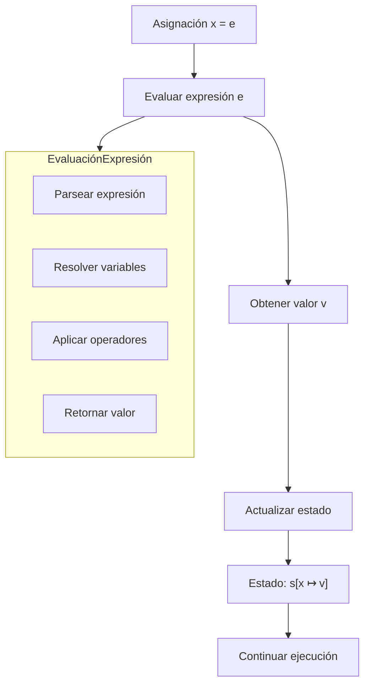
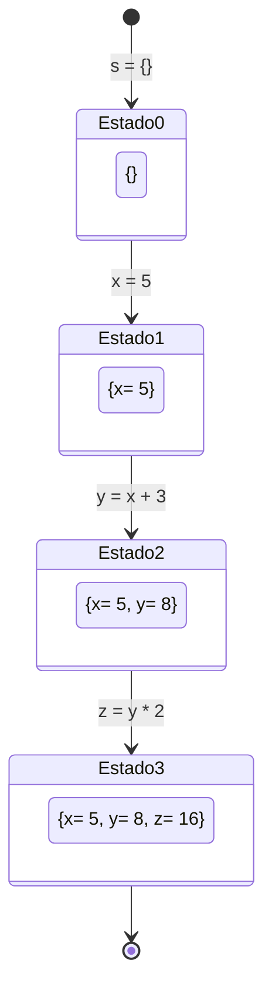

# Lenguajes de Programación - Paradigma imperativo

## 4.3 El enunciado de asignación.

---

El enunciado de asignación es la operación fundamental en programación imperativa. Permite modificar el estado del programa al cambiar los valores asociados a las variables. Es el mecanismo principal para implementar la mutabilidad y el cambio de estado.

### Conceptos Fundamentales

#### Definición Formal

Una asignación es una operación que asocia un valor a una variable en un entorno dado. Formalmente:

$$\langle x := e, s \rangle \rightarrow s[x \mapsto v]$$

donde:

- $x$ es el identificador de la variable
- $e$ es la expresión a evaluar
- $s$ es el estado actual (ambiente)
- $v$ es el valor resultante de evaluar $e$ en $s$
- $s[x \mapsto v]$ es el nuevo estado con $x$ actualizada a $v$

#### Semántica Operacional

La regla semántica para asignación:

$$
\frac{\langle e, s \rangle \Downarrow v}{\langle x := e, s \rangle \rightarrow s[x \mapsto v]}
$$

### Tipos de Asignación

#### Asignación Simple

```python
x = 5
y = x + 3
```

#### Asignación Múltiple

```python
# Asignación paralela
x, y = 1, 2
# Intercambio de valores
x, y = y, x
```

#### Asignación Compuesta

```python
# Operadores de asignación compuesta
x += 5    # equivalente a x = x + 5
y *= 2    # equivalente a y = y * 2
counter++ # incremento (en algunos lenguajes)
```

### Semántica Formal Detallada

#### Sistema de Transición de Estados

Definimos un sistema de transición para asignaciones:

$$(Statement \times State) \rightarrow State$$

#### Reglas de Inferencia

**Asignación a variable simple**:

$$
\frac{\langle e, s \rangle \Downarrow v}{\langle x := e, s \rangle \rightarrow s' \text{ donde } s' = s[x \mapsto v]}
$$

**Asignación a arreglos**:

$$
\frac{\langle e_1, s \rangle \Downarrow i \quad \langle e_2, s \rangle \Downarrow v}{\langle a[i] := e_2, s \rangle \rightarrow s' \text{ donde } s' = s[a \mapsto s(a)[i \mapsto v]]}
$$

### Implementación de la Máquina de Asignación

```python
class AssignmentMachine:
    def __init__(self):
        self.state = {}

    def evaluate_expression(self, expr, state):
        """Evalúa una expresión en el estado dado"""
        if isinstance(expr, int) or isinstance(expr, str):
            return expr
        elif isinstance(expr, tuple):
            op, left, right = expr
            left_val = self.evaluate_expression(left, state)
            right_val = self.evaluate_expression(right, state)

            if op == '+': return left_val + right_val
            elif op == '-': return left_val - right_val
            elif op == '*': return left_val * right_val
            elif op == '/': return left_val / right_val
            elif op == '==': return left_val == right_val
        elif isinstance(expr, str) and expr in state:
            return state[expr]
        return expr

    def execute_assignment(self, assignment, state):
        """Ejecuta una asignación y retorna nuevo estado"""
        var, expr = assignment
        value = self.evaluate_expression(expr, state)
        new_state = state.copy()
        new_state[var] = value
        return new_state

    def execute_sequence(self, statements):
        """Ejecuta una secuencia de asignaciones"""
        current_state = self.state.copy()
        for stmt in statements:
            current_state = self.execute_assignment(stmt, current_state)
        self.state = current_state
        return current_state
```

### Diagrama de Flujo de Ejecución



### Ejemplos y Casos de Estudio

#### Ejemplo 1: Asignación Básica

```python
# Estado inicial: s = {}
x = 5          # s' = {'x': 5}
y = x + 3      # s'' = {'x': 5, 'y': 8}
z = y * 2      # s''' = {'x': 5, 'y': 8, 'z': 16}
```

#### Ejemplo 2: Asignación con Efectos Laterales

```python
counter = 0
# Múltiples asignaciones que modifican el estado
counter = counter + 1
counter += 1
# Estado final: {'counter': 2}
```

#### Ejemplo 3: Asignación a Estructuras

```python
# Asignación a elementos de array
arr = [1, 2, 3]
arr[1] = 10    # arr = [1, 10, 3]

# Asignación a atributos de objetos
class Point:
    pass
p = Point()
p.x = 5
p.y = 10
```

### Semántica Axiomática

#### Regla de Hoare para Asignación

La regla de Hoare para el enunciado de asignación:

$$\{P[e/x]\}\ x := e\ \{P\}$$

Donde $P[e/x]$ significa sustituir $x$ por $e$ en la precondición $P$.

#### Ejemplo de Verificación

```python
# Queremos verificar: {y > 0} x = y + 1 {x > 1}
# Precondición: P = y > 0
# Asignación: x = y + 1
# Postcondición: x > 1

# Aplicando la regla: P[e/x] = (y + 1) > 1 = y > 0
# Coincide con la precondición, por lo tanto es correcto
```

### Ejercicios Propuestos

#### Ejercicio 1: Implementación de Máquina de Estados

Implemente una máquina que soporte:

- Asignaciones simples y múltiples
- Operadores compuestos (+=, -=, *=, /=)
- Verificación de tipos básica

#### Ejercicio 2: Semántica Formal

Demuestre formalmente las siguientes secuencias:

1. **Secuencia simple**:

   $$
   \langle x := 5; y := x + 3, s \rangle \rightarrow s'
   $$

   ¿Cuál es el estado final $s'$?

2. **Asignación múltiple**:
   $$
   \langle x := 1; y := 2; x, y := y, x, s \rangle \rightarrow s'
   $$
   Demuestre las transiciones de estado.

#### Ejercicio 3: Reglas de Hoare

Verifique usando la regla de Hoare:

```python
# {x > 5}
y = x * 2
# {y > 10}
```

### Aspectos Avanzados

#### Asignación con Efectos Laterales

```python
def get_value_and_increment():
    global counter
    result = counter
    counter += 1
    return result

# Asignación con efecto lateral
x = get_value_and_increment()
```

#### Asignación en Diferentes Lenguajes

```c
// En C: asignación como expresión
while ((c = getchar()) != EOF) {
    // procesar carácter
}
```

```python
# En Python: asignación como statement
# (no puede usarse en expresiones)
c = getchar()
while c != EOF:
    # procesar carácter
    c = getchar()
```

### Diagrama de Estados Múltiples



### Referencias Bibliográficas

#### Bibliografía Básica

1. Mitchell, J. (2003). _Concepts in Programming Languages_. Cambridge University Press. (Capítulo 3: Imperative Programming)
2. Pierce, B.C. (2002). _Types and Programming Languages_. MIT Press. (Capítulo: Operational Semantics)

#### Bibliografía Complementaria

3. Friedman, D.P., Wand, M. (2008). _Essentials of Programming Languages_. 3rd edition. MIT Press. (Capítulo: State and Assignment)
4. Harper, R. (2010). _Practical Foundations for Programming Languages_. (Capítulo: Imperative Programming)

### Evaluación del Tema

Para verificar la comprensión:

1. ¿Qué diferencia fundamental existe entre la asignación en matemáticas $(x = x + 1)$ y en programación?
2. ¿Cómo manejan diferentes lenguajes la asignación múltiple?
3. ¿Qué problemas pueden surgir con los efectos laterales en las asignaciones?
4. ¿Cómo se verifica formalmente la corrección de un programa con asignaciones?

### Conclusión

El enunciado de asignación es la piedra angular del paradigma imperativo, permitiendo la modificación del estado del programa. Su comprensión semántica es esencial para el diseño de lenguajes de programación y la verificación formal de programas.
