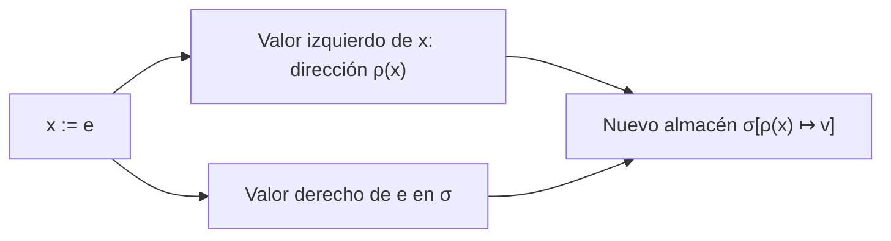

# Lenguajes de Programación - Paradigma imperativo

## 4.3 El enunciado de asignación.

---

La **asignación** es la instrucción que define al paradigma imperativo: cambia el valor guardado en una variable, y con ello el estado del programa. Parece trivial, pero tiene varios matices: qué denota una variable a cada lado del signo, en qué orden se evalúan las partes, qué significan las asignaciones múltiples y compuestas, cuándo una asignación es una expresión, y cómo se razona sobre ella. Este tema trata esos matices, su semántica formal y la regla de Hoare de la asignación.

### Valores izquierdos y derechos

En `x := x + 1`, la $x$ de la izquierda y la de la derecha no significan lo mismo. A la derecha, $x$ denota su **valor derecho** (*r-value*), el contenido de la variable. A la izquierda denota su **valor izquierdo** (*l-value*), la **dirección** donde se guarda el resultado. Con el entorno $\rho$ y el almacén $\sigma$ del tema 4.2, la asignación es

$$\frac{\langle e, \rho, \sigma \rangle \Downarrow v}{\langle x := e,\; \rho, \sigma \rangle \Downarrow \sigma[\rho(x) \mapsto v]}.$$

No toda expresión tiene valor izquierdo: `a[i]`, `p.campo` y `*p` lo tienen; `x + 1` y `f()` no. Las expresiones con valor izquierdo pueden tener efectos, y el orden de evaluación importa: en C, `a[i] = i++` tiene comportamiento indefinido, porque no se especifica si `i` se lee antes o después de incrementarse.

### Variantes

- **Asignación múltiple simultánea:** `x, y := e1, e2` evalúa **todas** las expresiones con el estado anterior y después asigna. `x, y := y, x` intercambia. Python, Go, Ruby y Lua la tienen; en otros lenguajes se escribe con una variable temporal.
- **Asignación compuesta:** `x += e` abrevia `x := x + e`, pero evalúa la expresión de la izquierda una sola vez: `a[f()] += 1` llama a `f` una vez, mientras que `a[f()] = a[f()] + 1` la llama dos veces.
- **Asignación como expresión:** en C, `x = e` es una expresión con el valor asignado, lo que permite `a = b = 0` y también el error clásico `if (x = 0)`. Python la separa: la asignación es una sentencia, y `:=` es una expresión aparte.
- **Asignación única:** en los lenguajes funcionales y en el estilo de asignación estática única (SSA) de los compiladores, cada variable se asigna una sola vez; un `let` liga un nombre a un valor, pero no lo modifica.

### Asignación y tipos

En un lenguaje con tipos estáticos, $x := e$ exige que el tipo de $e$ sea compatible con el declarado para $x:$ igual, un subtipo, o convertible implícitamente, como un entero a flotante. Las conversiones que pierden información, como de flotante a entero, son errores o requieren una conversión explícita. En un lenguaje dinámico, la variable no tiene tipo, y la verificación se traslada a las operaciones que usan el valor.

### La regla de Hoare

La regla de la asignación de la lógica de Hoare (tema 2.3) es

$$\{Q[x := e]\}\; x := e\; \{Q\}.$$

$Q[x := e]$ es la **precondición más débil**, $\mathsf{wp}(x := e, Q):$ la condición necesaria y suficiente sobre el estado inicial para que $Q$ valga al final. Se calcula **hacia atrás**: para $\{?\}\; y := 2x\; \{y \gt 10\},$ la precondición es $(y \gt 10)[y := 2x] = 2x \gt 10,$ es decir, $x \gt 5.$ La regla es correcta solo si $e$ no tiene efectos y si $x$ no tiene **alias**: si $y$ y $x$ son la misma variable con dos nombres, $\{y = 1\}\; x := 2\; \{y = 1\}$ es una terna válida según la regla y falsa al ejecutar. Para arreglos, la regla trata $a[i] := e$ como la asignación de todo el arreglo, $a := a[i \mapsto e].$



### Implementación en Python

El programa implementa una máquina con un estado inmutable, en la que cada paso produce un estado nuevo y queda registrado, con asignación simple, múltiple simultánea y compuesta, y verificación de tipos contra las declaraciones. Para el ejercicio 2 ejecuta las dos secuencias y compara el intercambio simultáneo con dos asignaciones sucesivas. Para el ejercicio 3 calcula con SymPy la precondición más débil y comprueba que es equivalente a la del enunciado.

```python
import sympy as sp

# ---------- Ejercicio 1: máquina de estados con asignación simple, múltiple y compuesta ----------
class Maquina:
    def __init__(self, tipos): self.tipos, self.estado, self.traza = tipos, {}, []
    def valor(self, e):
        return eval(e, {}, dict(self.estado)) if isinstance(e, str) else e        # expresiones de Python sobre el estado
    def verifica(self, x, v):
        t = self.tipos[x]
        if not (isinstance(v, t) and not (t is int and isinstance(v, bool))):
            raise TypeError(f"{x} es {t.__name__} y recibe {v!r}")
    def asigna(self, x, e):                                      # x := e
        v = self.valor(e); self.verifica(x, v); self.estado = {**self.estado, x: v}; self.traza.append((f"{x} := {e}", dict(self.estado)))
    def multiple(self, xs, es):                                  # x1, ..., xn := e1, ..., en: se evalúan todas antes de asignar
        vs = [self.valor(e) for e in es]
        for x, v in zip(xs, vs): self.verifica(x, v)
        self.estado = {**self.estado, **dict(zip(xs, vs))}
        self.traza.append((f"{', '.join(xs)} := {', '.join(map(str, es))}", dict(self.estado)))
    def compuesta(self, x, op, e):                               # x op= e  ≡  x := x op e, con x evaluado una vez
        v = self.valor(e)
        nuevo = {"+=": lambda a, b: a + b, "-=": lambda a, b: a - b, "*=": lambda a, b: a * b,
                 "/=": lambda a, b: a // b if self.tipos[x] is int else a / b}[op](self.estado[x], v)
        self.verifica(x, nuevo); self.estado = {**self.estado, x: nuevo}; self.traza.append((f"{x} {op} {e}", dict(self.estado)))

m = Maquina({"x": int, "y": int, "z": float, "nombre": str})
m.asigna("x", 7); m.asigna("y", "x * 3"); m.compuesta("x", "+=", "y"); m.compuesta("y", "/=", 2)
m.asigna("z", "x / 4"); m.compuesta("z", "*=", 2.0); m.asigna("nombre", "'ana'"); m.compuesta("nombre", "+=", "'lía'")
print("ejercicio 1:")
for paso, estado in m.traza: print(f"   {paso:20} {estado}")
for f in (lambda: m.asigna("x", "'diez'"), lambda: m.asigna("nombre", 3), lambda: m.compuesta("x", "/=", 2.5)):
    try: f()
    except TypeError as e: print("   rechazado:", e)

# ---------- Ejercicio 2: las secuencias, paso a paso ----------
m = Maquina({"x": int, "y": int})
m.asigna("x", 5); m.asigna("y", "x + 3")
print("ejercicio 2.1:", [e for _, e in m.traza])
m = Maquina({"x": int, "y": int})
m.asigna("x", 1); m.asigna("y", 2); m.multiple(["x", "y"], ["y", "x"])
print("ejercicio 2.2, simultánea:", [e for _, e in m.traza])
m2 = Maquina({"x": int, "y": int})
m2.asigna("x", 1); m2.asigna("y", 2); m2.asigna("x", "y"); m2.asigna("y", "x")
print("   la misma idea como dos asignaciones en secuencia:", [e for _, e in m2.traza], "-> no intercambia")

# ---------- Ejercicio 3: lógica de Hoare con la precondición más débil ----------
x, y = sp.symbols("x y", real=True)
# wp(y := x * 2, y > 10) = (y > 10)[y := x * 2]
post = y > 10
wp = post.subs(y, 2 * x)
conj_wp = sp.solve_univariate_inequality(wp, x, relational=False)
conj_pre = sp.solve_univariate_inequality(x > 5, x, relational=False)
print("ejercicio 3: wp(y := x * 2, y > 10) =", wp, "| como conjunto:", conj_wp, "| igual al de x > 5:", conj_wp == conj_pre)
# comprobación numérica, incluidos valores frontera y reales
print("   prueba con 2001 valores:", all((2 * v > 10) == (v > 5) for v in [k / 100 for k in range(-1000, 1001)]))
# una precondición más fuerte, como x > 6, también da una terna válida; una más débil, como x ≥ 5, no
print("   {x > 6} y := x * 2 {y > 10} también vale:", all(2 * v > 10 for v in range(7, 100)), "| {x ≥ 5} no:", 2 * 5 > 10)
```

Salida:

```text
ejercicio 1:
   x := 7               {'x': 7}
   y := x * 3           {'x': 7, 'y': 21}
   x += y               {'x': 28, 'y': 21}
   y /= 2               {'x': 28, 'y': 10}
   z := x / 4           {'x': 28, 'y': 10, 'z': 7.0}
   z *= 2.0             {'x': 28, 'y': 10, 'z': 14.0}
   nombre := 'ana'      {'x': 28, 'y': 10, 'z': 14.0, 'nombre': 'ana'}
   nombre += 'lía'      {'x': 28, 'y': 10, 'z': 14.0, 'nombre': 'analía'}
   rechazado: x es int y recibe 'diez'
   rechazado: nombre es str y recibe 3
   rechazado: x es int y recibe 11.0
ejercicio 2.1: [{'x': 5}, {'x': 5, 'y': 8}]
ejercicio 2.2, simultánea: [{'x': 1}, {'x': 1, 'y': 2}, {'x': 2, 'y': 1}]
   la misma idea como dos asignaciones en secuencia: [{'x': 1}, {'x': 1, 'y': 2}, {'x': 2, 'y': 2}, {'x': 2, 'y': 2}] -> no intercambia
ejercicio 3: wp(y := x * 2, y > 10) = 2*x > 10 | como conjunto: Interval.open(5, oo) | igual al de x > 5: True
   prueba con 2001 valores: True
   {x > 6} y := x * 2 {y > 10} también vale: True | {x ≥ 5} no: False
```

### Ejercicios Propuestos

1. **Máquina de estados.** Implementa una máquina con asignaciones simples y múltiples, operadores compuestos (`+=`, `-=`, `*=`, `/=`) y verificación básica de tipos.

2. **Secuencias.** Determina el estado final de $\langle x := 5; y := x + 3,\; s \rangle$ y muestra las transiciones de $\langle x := 1; y := 2; x, y := y, x,\; s \rangle.$

3. **Hoare.** Verifica $\{x \gt 5\}\; y := x \cdot 2\; \{y \gt 10\}.$

### Soluciones

**Ejercicio 1.** Es la clase `Maquina` del programa. La asignación compuesta lee el valor actual de la variable una sola vez y aplica la operación; la división compuesta es entera si la variable es entera, como en C, y por eso `x /= 2.5` sobre un entero produce un flotante que la verificación de tipos rechaza, igual que asignar una cadena a un entero o un número a una cadena. La concatenación de cadenas con `+=` funciona porque la operación está definida para cadenas. Cada paso guarda una copia del estado, de modo que la traza muestra la sucesión completa de estados, que es la ejecución vista como sistema de transición.

**Ejercicio 2.**

1. Con $s$ vacío: $\langle x := 5; y := x + 3,\; \varnothing \rangle \to \langle y := x + 3,\; [x \mapsto 5] \rangle \to [x \mapsto 5, y \mapsto 8].$ La segunda asignación lee $x$ en el estado producido por la primera.
2. Las dos primeras asignaciones llevan a $[x \mapsto 1, y \mapsto 2].$ La múltiple **evalúa primero** $y$ y $x$ en ese estado, obteniendo $2$ y $1,$ y después asigna ambas: el estado final es $[x \mapsto 2, y \mapsto 1].$ La regla es $\langle x_1, \dots, x_n := e_1, \dots, e_n,\; \sigma \rangle \to \sigma[x_1 \mapsto v_1, \dots, x_n \mapsto v_n]$ con cada $v_i = [\![ e_i ]\!]\sigma,$ todas calculadas en el mismo $\sigma.$ Si la misma variable aparece dos veces a la izquierda, la regla no tiene sentido y el lenguaje debe prohibirlo o fijar un orden. El programa muestra la diferencia con dos asignaciones sucesivas, $x := y$ y $y := x,$ que dejan $[x \mapsto 2, y \mapsto 2]:$ la segunda lee la $x$ ya modificada, y el intercambio necesita una variable temporal.

**Ejercicio 3.** Por la regla de asignación, la precondición más débil para $y \gt 10$ es $(y \gt 10)[y := x \cdot 2] = 2x \gt 10,$ que es equivalente a $x \gt 5.$ Por lo tanto, la terna $\{2x \gt 10\}\; y := x \cdot 2\; \{y \gt 10\}$ es un axioma, y como $x \gt 5$ implica $2x \gt 10,$ por la regla de consecuencia vale $\{x \gt 5\}\; y := x \cdot 2\; \{y \gt 10\}.$ $\blacksquare$ El programa calcula la sustitución con SymPy, obtiene el conjunto $(5, \infty)$ para la precondición más débil y verifica que coincide con el de $x \gt 5;$ es decir, la precondición del enunciado no solo es suficiente, es la más débil posible. Una precondición más fuerte, como $x \gt 6,$ también da una terna válida; una más débil, como $x \ge 5,$ no, porque con $x = 5$ se obtiene $y = 10.$ El razonamiento supone aritmética exacta; con enteros de tamaño fijo, $2x$ puede desbordarse, y la precondición correcta incluiría $x \le 2^{62} - 1$ en 64 bits.

### Referencias

1. Strachey, C., Fundamental concepts in programming languages. Notas de curso, 1967; reimpreso en _Higher-Order and Symbolic Computation_ 13, 2000.
2. Hoare, C. A. R., An axiomatic basis for computer programming. _Communications of the ACM_ 12(10), 1969.
3. Dijkstra, E. W., _A Discipline of Programming_. Prentice Hall, 1976. Capítulos 3 y 4.
4. Scott, M. L., _Programming Language Pragmatics_. Morgan Kaufmann, 2015. Capítulo 6.
5. Gries, D., _The Science of Programming_. Springer, 1981. Capítulo 9.
