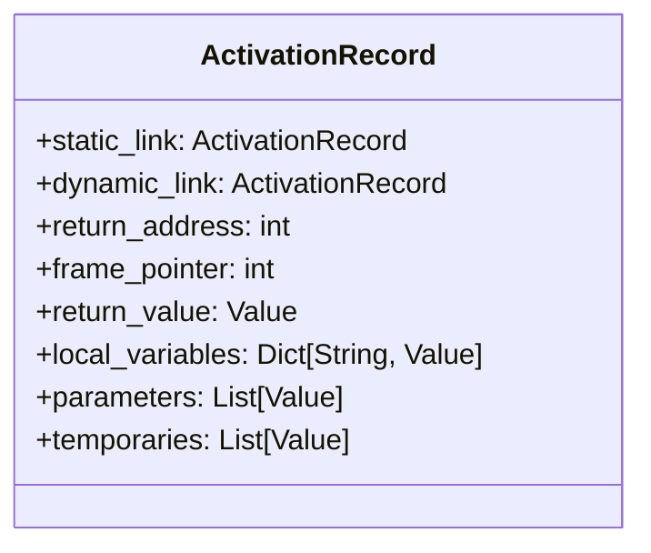
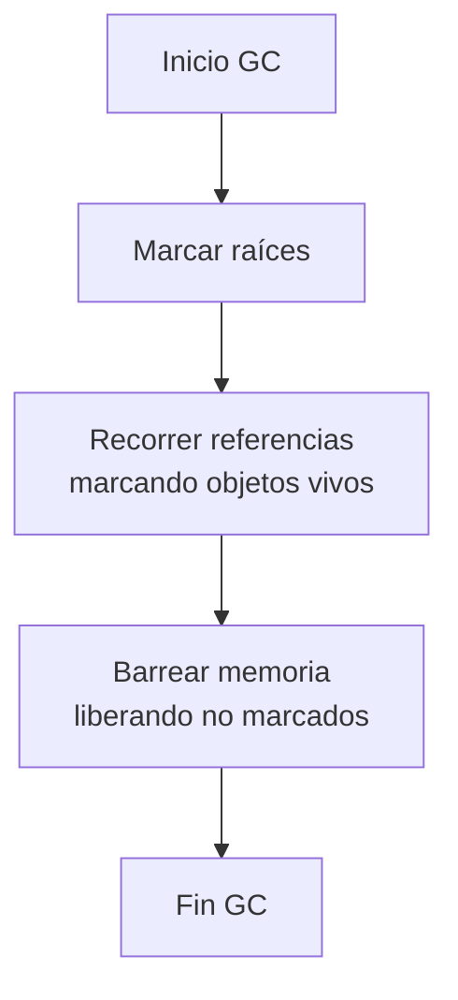
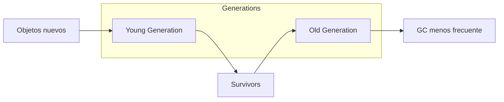

# Lenguajes de Programación - Paradigma imperativo

## 4.4 Registros de activación; manejo de memoria; recolección de basura.

---

La gestión de memoria es fundamental en el paradigma imperativo. Los registros de activación, el manejo de memoria dinámica y la recolección de basura son mecanismos esenciales para la ejecución eficiente y segura de programas.

### Registros de Activación

#### Definición Formal

Un registro de activación (activation record) es una estructura de datos que contiene la información necesaria para la ejecución de una subrutina. Formalmente:

$$AR = (PC, FP, SP, \text{parámetros}, \text{variables locales}, \text{valor de retorno})$$

donde:

- $PC$: Contador de programa
- $FP$: Puntero al marco (Frame Pointer)
- $SP$: Puntero de pila (Stack Pointer)

#### Estructura de un Registro de Activación



### Implementación de la Pila de Ejecución

```python
class ActivationRecord:
    def __init__(self, name, return_addr, static_link=None):
        self.name = name
        self.return_addr = return_addr
        self.variables = {}
        self.static_link = static_link  # Enlace estático para scoping
        self.dynamic_link = None       # Enlace dinámico para pila

    def __getitem__(self, key):
        # Búsqueda en cadena de ámbitos estáticos
        current = self
        while current is not None:
            if key in current.variables:
                return current.variables[key]
            current = current.static_link
        raise KeyError(f"Variable '{key}' no definida")

class CallStack:
    def __init__(self):
        self.stack = []
        self.heap = {}
        self.next_heap_address = 1000

    def push(self, ar):
        if self.stack:
            ar.dynamic_link = self.stack[-1]
        self.stack.append(ar)

    def pop(self):
        return self.stack.pop()

    def allocate_heap(self, size):
        address = self.next_heap_address
        self.next_heap_address += size
        self.heap[address] = [None] * size
        return address

    def current_ar(self):
        return self.stack[-1] if self.stack else None
```

### Manejo de Memoria

#### Modelo de Memoria

La memoria se divide en segmentos:

$$Memory = (Stack, Heap, Static, Code)$$

#### Asignación de Memoria

**Stack allocation**:

- Automática para variables locales
- Lifo (Last-In-First-Out)
- Direcciones relativas al frame pointer

**Heap allocation**:

- Manual o automática
- Direcciones absolutas
- Fragmentación potencial

#### Fórmulas de Direccionamiento

**Variable local**:

$$address = FP - offset$$

**Parámetro**:

$$address = FP + offset$$

### Recolección de Basura (Garbage Collection)

#### Algoritmos Principales

##### Reference Counting

$$RC(obj) = \sum_{\text{refs pointing to obj}} 1$$

##### Mark and Sweep



#### Implementación de Reference Counting

```python
class GarbageCollector:
    def __init__(self):
        self.object_table = {}  # address -> (object, ref_count)
        self.references = {}    # variable -> address

    def allocate(self, obj):
        address = id(obj)
        self.object_table[address] = (obj, 0)
        return address

    def add_reference(self, var_name, address):
        if address in self.object_table:
            obj, count = self.object_table[address]
            self.object_table[address] = (obj, count + 1)
            self.references[var_name] = address

    def remove_reference(self, var_name):
        if var_name in self.references:
            address = self.references[var_name]
            if address in self.object_table:
                obj, count = self.object_table[address]
                if count > 1:
                    self.object_table[address] = (obj, count - 1)
                else:
                    # Recolectar objeto
                    del self.object_table[address]
            del self.references[var_name]
```

### Ejemplo Completo: Gestión de Memoria

```python
def factorial(n):
    # Registro de activación creado aquí
    if n == 0:
        result = 1
    else:
        # Llamada recursiva - nuevo AR
        result = n * factorial(n - 1)
    # AR destruido al retornar
    return result

# Ejecución
call_stack = CallStack()

# Simulación de llamada
initial_ar = ActivationRecord("main", 0)
call_stack.push(initial_ar)

# Asignación en heap
array_addr = call_stack.allocate_heap(10)
initial_ar.variables["my_array"] = array_addr
```

### Semántica Formal de Gestión de Memoria

#### Reglas de Asignación

**Asignación en stack**:

$$
\frac{\langle e, s \rangle \Downarrow v \quad offset = \text{nextOffset}(currentAR)}{\langle x := e, s \rangle \rightarrow s[x \mapsto (currentAR, offset)]}
$$

**Asignación en heap**:

$$
\frac{\langle e, s \rangle \Downarrow v \quad addr = \text{alloc}(size)}{\langle x := \text{new}(e), s \rangle \rightarrow s[x \mapsto addr]}
$$

#### Reglas de Liberación

**Reference counting**:

$$
\frac{RC(obj) = 0}{\text{free}(obj)}
$$

### Ejercicios Propuestos

#### Ejercicio 1: Implementación de Call Stack

Implemente una pila de llamadas completa que maneje:

- Registros de activación con enlaces estáticos y dinámicos
- Variables locales y parámetros
- Valores de retorno

#### Ejercicio 2: Algoritmo de Mark and Sweep

Implemente el algoritmo mark and sweep:

```python
def mark_and_sweep(roots):
    # Fase de marcado
    marked = set()
    for root in roots:
        mark(root, marked)

    # Fase de barrido
    for obj in all_objects:
        if obj not in marked:
            free(obj)
```

#### Ejercicio 3: Análisis de Fragmentación

Analice un escenario de asignación/deallocación y calcule:

$$Fragmentation = \frac{\text{memoria libre total} - \text{bloque libre más grande}}{\text{memoria libre total}}$$

### Técnicas Avanzadas

#### Generational Garbage Collection



#### Copying GC

Divide el heap en dos espacios:

- From-space: Objetos activos
- To-space: Objetos copiados durante GC

$$Throughput = \frac{\text{tiempo de ejecución}}{\text{tiempo de ejecución + tiempo de GC}}$$

### Optimizaciones

#### Inline Expansion

Evita creación de AR para funciones pequeñas:

```python
# Antes de inline
def square(x):
    return x * x

result = square(5)

# Después de inline
result = 5 * 5
```

#### Stack Allocation de Objetos

Para objetos con ámbito limitado:

$$eligibleForStackAlloc(obj) = \text{escapeAnalysis}(obj) = \text{false}$$

### Referencias Bibliográficas

#### Bibliografía Básica

1. Mitchell, J. (2003). _Concepts in Programming Languages_. Cambridge University Press. (Capítulo 7: Memory Management)
2. Pierce, B.C. (2002). _Types and Programming Languages_. MIT Press. (Capítulo: Memory Safety)

#### Bibliografía Complementaria

3. Friedman, D.P., Wand, M. (2008). _Essentials of Programming Languages_. 3rd edition. MIT Press. (Capítulo: Memory Management)
4. Appel, A.W. (1998). _Modern Compiler Implementation in ML_. (Capítulo: Garbage Collection)

### Evaluación del Tema

1. ¿Cómo afecta la elección de estrategia de GC al rendimiento de aplicaciones?
2. Compare stack vs heap allocation en términos de rendimiento y flexibilidad
3. ¿Qué es el "escape analysis" y cómo optimiza la gestión de memoria?
4. Explique los trade-offs entre reference counting y mark-and-sweep

### Caso de Estudio: Python Memory Management

```python
# Python usa reference counting + generational GC
import gc

# Referencia cíclica - RC no basta
class Node:
    def __init__(self):
        self.next = None

a = Node()
b = Node()
a.next = b
b.next = a  # Ciclo de referencias

# Generational GC detecta y recolecta
gc.collect()  # Forzar recolección
```

### Conclusión

La gestión de memoria es crucial en programación imperativa. Los registros de activación permiten gestión automática de ámbito, el heap proporciona flexibilidad, y los algoritmos de GC aseguran uso eficiente de memoria. La elección de estrategias depende del tipo de aplicación y requisitos de rendimiento.
