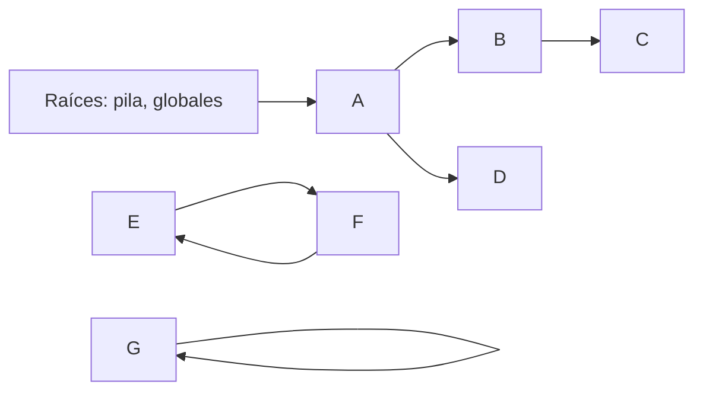

# Lenguajes de Programación - Paradigma imperativo

## 4.4 Registros de activación; manejo de memoria; recolección de basura.

---

Un programa en ejecución organiza su memoria en tres zonas: la **estática**, con el código y las variables globales, que existe durante toda la ejecución; la **pila**, con un **registro de activación** por cada llamada en curso, que crece y decrece con las llamadas, y el **montículo** (*heap*), con los objetos cuyo tiempo de vida no sigue el anidamiento de las llamadas. Este tema describe el contenido de un registro de activación y los enlaces que permiten el alcance léxico, el manejo del montículo y su fragmentación, y las técnicas de **recolección de basura** que liberan automáticamente la memoria que ya no se usa.

### Registros de activación

Cada llamada a un procedimiento crea un **registro de activación**, o **marco** (*frame*), que contiene:

- los **parámetros** y las **variables locales**;
- la **dirección de retorno**, a la que salta la ejecución al terminar;
- el **enlace dinámico**, que apunta al marco de quien llamó y permite restaurar la pila al regresar;
- el **enlace estático**, en los lenguajes con procedimientos anidados, que apunta al marco del procedimiento que **contiene textualmente** al actual;
- espacio para valores temporales, registros guardados y el valor de retorno.

La cadena de enlaces dinámicos es la historia de las llamadas; la de enlaces estáticos es la estructura del texto. Con alcance léxico, una variable no local declarada $k$ niveles hacia afuera se encuentra siguiendo $k$ enlaces estáticos, y el compilador conoce $k$ al compilar. El **display** es una alternativa: un arreglo con un apuntador al marco más reciente de cada nivel de anidamiento, que da acceso en tiempo constante. En un procedimiento recursivo, todas sus activaciones tienen el **mismo** enlace estático, el del procedimiento que lo contiene, y enlaces dinámicos distintos.

La pila funciona porque, en un lenguaje sin funciones de primera clase, una variable local no se usa después de que su procedimiento termina. Las **cerraduras** rompen esa propiedad: una función que se devuelve y usa una variable local de su definición necesita que esa variable sobreviva, y por eso los lenguajes con cerraduras guardan esas variables en el montículo.

### El montículo

Los objetos cuyo tamaño o tiempo de vida no se conoce al compilar se reservan en el montículo: `malloc` y `free` en C, `new` en Java y C++. Un asignador mantiene una lista de **huecos** libres y elige uno para cada petición: el **primero** que alcanza (*first fit*), el **mejor**, que deja el sobrante más pequeño (*best fit*), o por **clases de tamaño**. Al liberar, fusiona los huecos contiguos.

La **fragmentación externa** ocurre cuando la memoria libre está repartida en huecos pequeños: hay suficiente memoria en total, pero ningún hueco alcanza para una petición. Una medida es

$$F = \frac{\text{memoria libre total} - \text{hueco libre más grande}}{\text{memoria libre total}},$$

que vale 0 si toda la memoria libre está en un hueco y se acerca a 1 si está muy repartida. La **interna** es el espacio desperdiciado dentro de los bloques asignados, por redondear las peticiones. La **compactación**, que mueve los objetos para juntar los huecos, elimina la externa, pero exige actualizar todas las referencias a los objetos movidos, cosa que solo puede hacer un recolector que las conozca.

### Recolección de basura

Un objeto es **basura** si ya no es **alcanzable**: no se llega a él siguiendo referencias desde las **raíces**, que son las variables globales, la pila y los registros. Liberarlo a mano, con `free`, tiene dos riesgos: olvidarlo, y la memoria se **fuga**, o liberarlo antes de tiempo, y queda un **apuntador colgante** que después lee o corrompe memoria reutilizada. La recolección automática los evita. Las técnicas principales son:

- **Conteo de referencias:** cada objeto lleva un contador de referencias que apuntan a él, y se libera cuando llega a 0. Es incremental e inmediato, pero cuesta en cada asignación de referencias y **no libera los ciclos**: dos objetos que se apuntan mutuamente nunca llegan a 0. Lo usan CPython, que agrega un detector de ciclos, Swift y los `shared_ptr` de C++.
- **Marcar y barrer** (McCarthy, 1960, para LISP): se **marcan** todos los objetos alcanzables desde las raíces con un recorrido del grafo de referencias, y se **barren**, liberándolos, los no marcados. Libera los ciclos, pero detiene el programa durante la recolección y no compacta.
- **Copia** (Cheney, 1970): el montículo se divide en dos mitades; los objetos vivos se copian de una a la otra, y la vieja se descarta completa. Compacta y su costo es proporcional a los objetos vivos, no al tamaño del montículo, a cambio de usar el doble de memoria.
- **Generacional:** como la mayoría de los objetos mueren jóvenes, se recolecta con frecuencia una generación joven pequeña, y rara vez la vieja. Es la base de los recolectores de Java, .NET y JavaScript.
- **Incremental y concurrente:** recolectan en pasos pequeños o en paralelo con el programa, para reducir las pausas.

Rust sigue otro camino: su sistema de **propiedad** determina al compilar cuándo cada objeto deja de usarse, y libera en ese punto, sin recolector ni conteo, salvo que el programa use `Rc` explícitamente.



### Implementación en Python

El programa simula una pila de registros de activación con enlaces estáticos y dinámicos para un programa con un procedimiento anidado dentro de otro, y recursivo, y la imprime en la llamada más profunda junto con el número de saltos estáticos de cada acceso. Para el ejercicio 2 construye el grafo de objetos del diagrama, aplica marcar y barrer y lo compara con el conteo de referencias. Para el ejercicio 3 implementa un asignador de primer ajuste con fusión de huecos y calcula la fragmentación.

```python
# ---------- Ejercicio 1: pila de registros de activación con enlaces estático y dinámico ----------
class Marco:
    def __init__(self, nombre, nivel, estatico, dinamico, locales):
        self.nombre, self.nivel, self.estatico, self.dinamico, self.locales = nombre, nivel, estatico, dinamico, dict(locales)
        self.retorno = None
pila = []
def llama(nombre, nivel_def, args, cuerpo):
    """nivel_def: profundidad léxica de la definición. El enlace estático apunta al marco del procedimiento que
    contiene la definición, encontrado subiendo por los enlaces estáticos desde quien llama."""
    actual = pila[-1] if pila else None
    estatico = actual
    while estatico is not None and estatico.nivel >= nivel_def + 1: estatico = estatico.estatico
    m = Marco(nombre, nivel_def + 1, estatico, actual, args); pila.append(m)
    m.retorno = cuerpo(m); pila.pop(); return m.retorno
def busca(m, nombre):                                   # sube por los enlaces estáticos: alcance léxico
    saltos = 0
    while nombre not in m.locales: m, saltos = m.estatico, saltos + 1
    return m.locales[nombre], saltos
instantanea = []
def foto():
    instantanea.extend(f"{m.nombre}(nivel {m.nivel}, locales {m.locales}, estático → {m.estatico.nombre if m.estatico else '—'},"
                       f" dinámico → {m.dinamico.nombre if m.dinamico else '—'})" for m in reversed(pila))
# programa principal (nivel 0) con x = 10; dentro, proc externo(a) (nivel 1) con y = a * 2 y, dentro, proc interno(b)
# (nivel 2) que usa x, y y b; interno es recursivo
def principal(m):
    def externo(me):
        me.locales["y"] = me.locales["a"] * 2
        def interno(mi):
            b = mi.locales["b"]
            if b > 0: return llama("interno", 1, {"b": b - 1}, interno) + b
            x, sx = busca(mi, "x"); y, sy = busca(mi, "y")
            foto(); instantanea.append(f"acceso a x con {sx} saltos estáticos, a y con {sy}")
            return x + y
        return llama("interno", 1, {"b": 2}, interno)
    return llama("externo", 0, {"a": 3}, externo)
r = llama("principal", -1, {"x": 10}, principal)
print("ejercicio 1: resultado", r, "(x + y + 1 + 2 = 10 + 6 + 3); pila en la llamada más profunda, de la cima a la base:")
for linea in instantanea: print("   ", linea)

# ---------- Ejercicio 2: marcar y barrer, frente a conteo de referencias ----------
class Obj:
    def __init__(self, nombre): self.nombre, self.refs, self.cuenta = nombre, [], 0
def apunta(a, b): a.refs.append(b); b.cuenta += 1
heap = {n: Obj(n) for n in "ABCDEFG"}
H = heap
apunta(H["A"], H["B"]); apunta(H["B"], H["C"]); apunta(H["A"], H["D"])
apunta(H["E"], H["F"]); apunta(H["F"], H["E"])           # E y F forman un ciclo inalcanzable
apunta(H["G"], H["G"])                                   # G se apunta a sí mismo
raices = [H["A"]]
def marcar(raices):
    marcados, pendientes = set(), list(raices)          # recorrido con una pila explícita, sin recursión
    while pendientes:
        o = pendientes.pop()
        if o.nombre in marcados: continue
        marcados.add(o.nombre); pendientes.extend(o.refs)
    return marcados
def barrer(heap, marcados): return sorted(n for n in heap if n not in marcados)
marcados = marcar(raices)
print("ejercicio 2: marcados", sorted(marcados), "| barridos", barrer(heap, marcados))
# con conteo de referencias, se libera lo que tiene cuenta 0 sin contar las referencias desde raíces
for r_ in raices: r_.cuenta += 1
libres = sorted(n for n, o in heap.items() if o.cuenta == 0)
print("   con conteo de referencias se liberarían", libres or "ninguno", "| E, F y G tienen cuentas",
      [heap[n].cuenta for n in "EFG"], "y nunca bajan a 0: fuga por ciclos")
del H["A"].refs[1]; H["D"].cuenta -= 1                    # el programa suelta la referencia de A a D
print("   tras soltar A → D: conteo libera D de inmediato:", H["D"].cuenta == 0, "| marcar y barrer:", barrer(heap, marcar(raices)))

# ---------- Ejercicio 3: fragmentación con primer ajuste ----------
class Monticulo:
    def __init__(self, n): self.libres, self.usados = [(0, n)], {}          # huecos (inicio, tamaño)
    def pide(self, nombre, k):
        for i, (ini, tam) in enumerate(self.libres):
            if tam >= k:
                self.usados[nombre] = (ini, k)
                self.libres[i:i + 1] = [(ini + k, tam - k)] if tam > k else []
                return ini
        raise MemoryError(f"no hay un hueco de {k} para {nombre} aunque hay {sum(t for _, t in self.libres)} libres")
    def libera(self, nombre):
        ini, k = self.usados.pop(nombre)
        self.libres = sorted(self.libres + [(ini, k)])
        fusion = []
        for h in self.libres:                                               # fusiona huecos contiguos
            if fusion and fusion[-1][0] + fusion[-1][1] == h[0]: fusion[-1] = (fusion[-1][0], fusion[-1][1] + h[1])
            else: fusion.append(h)
        self.libres = fusion
    def fragmentacion(self):
        total = sum(t for _, t in self.libres); mayor = max((t for _, t in self.libres), default=0)
        return total, mayor, (total - mayor) / total if total else 0.0
m = Monticulo(100)
for nombre, k in (("a", 20), ("b", 10), ("c", 20), ("d", 10), ("e", 20), ("f", 10)): m.pide(nombre, k)
for nombre in ("b", "d", "f"): m.libera(nombre)
total, mayor, frag = m.fragmentacion()
print(f"ejercicio 3: huecos {m.libres}; libre {total}, mayor hueco {mayor}, fragmentación {frag:.2f}")
try: m.pide("g", 25)
except MemoryError as e: print("   pedir 25:", e)
m.libera("c")
total, mayor, frag = m.fragmentacion()
print(f"   tras liberar c: huecos {m.libres}; libre {total}, mayor hueco {mayor}, fragmentación {frag:.2f}; pedir 25 da la dirección {m.pide('g', 25)}")
```

Salida:

```text
ejercicio 1: resultado 19 (x + y + 1 + 2 = 10 + 6 + 3); pila en la llamada más profunda, de la cima a la base:
    interno(nivel 2, locales {'b': 0}, estático → externo, dinámico → interno)
    interno(nivel 2, locales {'b': 1}, estático → externo, dinámico → interno)
    interno(nivel 2, locales {'b': 2}, estático → externo, dinámico → externo)
    externo(nivel 1, locales {'a': 3, 'y': 6}, estático → principal, dinámico → principal)
    principal(nivel 0, locales {'x': 10}, estático → —, dinámico → —)
    acceso a x con 2 saltos estáticos, a y con 1
ejercicio 2: marcados ['A', 'B', 'C', 'D'] | barridos ['E', 'F', 'G']
   con conteo de referencias se liberarían ninguno | E, F y G tienen cuentas [1, 1, 1] y nunca bajan a 0: fuga por ciclos
   tras soltar A → D: conteo libera D de inmediato: True | marcar y barrer: ['D', 'E', 'F', 'G']
ejercicio 3: huecos [(20, 10), (50, 10), (80, 20)]; libre 40, mayor hueco 20, fragmentación 0.50
   pedir 25: no hay un hueco de 25 para g aunque hay 40 libres
   tras liberar c: huecos [(20, 40), (80, 20)]; libre 60, mayor hueco 40, fragmentación 0.33; pedir 25 da la dirección 20
```

### Ejercicios Propuestos

1. **Pila de llamadas.** Implementa una pila de llamadas completa con registros de activación, enlaces estáticos y dinámicos, variables locales, parámetros y valores de retorno.

2. **Marcar y barrer.** Implementa el algoritmo de marcar y barrer:

    ```python
    def mark_and_sweep(roots):
        marked = set()
        for root in roots:
            mark(root, marked)
        for obj in all_objects:
            if obj not in marked:
                free(obj)
    ```

3. **Fragmentación.** Analiza un escenario de reservas y liberaciones y calcula la fragmentación con la fórmula de la sección del montículo.

### Soluciones

**Ejercicio 1.** El programa principal declara $x = 10;$ dentro, `externo(a)` declara $y = 2a,$ y dentro de este, `interno(b)` se llama a sí mismo hasta $b = 0$ y entonces devuelve $x + y.$ Con `externo(3)` y `interno(2)`, el resultado es $10 + 6 + 1 + 2 = 19.$ En la llamada más profunda hay cinco marcos. Los tres de `interno` tienen el **mismo enlace estático**, el marco de `externo`, porque ahí está su definición, y enlaces dinámicos distintos: los dos más recientes apuntan a otra activación de `interno` y el primero a `externo`. Para acceder a $y,$ declarada un nivel afuera, se sigue un enlace estático; para $x,$ dos. El valor de retorno de cada llamada se suma en la anterior al desapilar el marco. El enlace estático de un marco nuevo se calcula al llamar: se parte del marco de quien llama y se suben enlaces estáticos hasta el nivel donde está la definición del procedimiento llamado.

**Ejercicio 2.** La función `mark` del enunciado es recursiva, y en un grafo con una cadena larga de referencias agotaría la pila del propio recolector; el programa marca con una **pila explícita**. En el grafo del diagrama, desde la raíz A se alcanzan A, B, C y D, y se barren E, F y G. El **conteo de referencias** no libera ninguno de los tres: E y F se apuntan mutuamente y G se apunta a sí mismo, así que sus contadores valen 1 aunque nadie pueda llegar a ellos. A cambio, cuando el programa suelta la referencia de A a D, el conteo libera D **de inmediato**, mientras que marcar y barrer lo detecta en la siguiente recolección. Los sistemas reales combinan ambos: CPython cuenta referencias y ejecuta periódicamente un detector de ciclos. El barrido recorre todo el montículo, y por eso su costo es proporcional a su tamaño, no a los objetos vivos.

**Ejercicio 3.** En un montículo de 100 unidades se reservan bloques de 20, 10, 20, 10, 20 y 10, y se liberan los tres de 10. Quedan los huecos de 10 en la dirección 20, de 10 en la 50 y de 20 en la 80, porque el último se fusiona con las 10 unidades que nunca se usaron. Hay 40 unidades libres y el mayor hueco es de 20:

$$F = \frac{40 - 20}{40} = 0.5.$$

Una petición de 25 **falla**, aunque haya 40 libres. Al liberar el bloque de 20 en la dirección 30, los huecos de las direcciones 20, 30 y 50 se fusionan en uno de 40: la fragmentación baja a $(60 - 40) / 60 \approx 0.33,$ y la petición de 25 se satisface en la dirección 20. El escenario muestra el patrón que más fragmenta: bloques de tamaños distintos intercalados que se liberan de forma alterna. Con clases de tamaño, o con un recolector que compacte, el problema se reduce.

### Referencias

1. Aho, A. V., Lam, M. S., Sethi, R., and Ullman, J. D., _Compilers: Principles, Techniques, and Tools_. Pearson, 2006. Capítulo 7.
2. Jones, R., Hosking, A., and Moss, E., _The Garbage Collection Handbook_. CRC Press, 2023.
3. McCarthy, J., Recursive functions of symbolic expressions and their computation by machine, part I. _Communications of the ACM_ 3(4), 1960.
4. Wilson, P. R., Johnstone, M. S., Neely, M., and Boles, D., Dynamic storage allocation: a survey and critical review. _International Workshop on Memory Management_, 1995.
5. Scott, M. L., _Programming Language Pragmatics_. Morgan Kaufmann, 2015. Capítulos 3 y 8.
