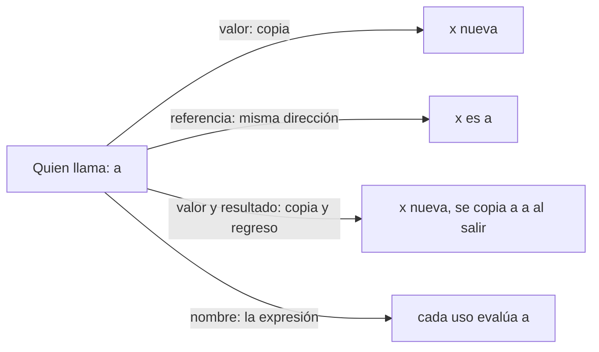

# Lenguajes de Programación - Paradigma imperativo

## 4.5 Mecanismos de paso de parámetros (por valor, por nombre, por referencia, por necesidad).

---

Cuando un procedimiento se llama con un argumento, el lenguaje debe decidir qué recibe el parámetro: una copia del valor, la dirección de la variable, o la expresión misma sin evaluar. La decisión determina si el procedimiento puede modificar las variables de quien llama, cuándo y cuántas veces se evalúa el argumento, y qué ocurre cuando dos parámetros nombran la misma variable. Este tema define los cinco mecanismos clásicos con el entorno y el almacén del tema 4.2, los compara con un mismo procedimiento, incluido el caso de **alias**, y relaciona los mecanismos con los lenguajes actuales.

### Mecanismos

Sea un procedimiento $f(x)$ llamado como $f(e).$

- **Por valor:** se evalúa $e,$ se reserva una dirección nueva $\ell$ para $x$ y se guarda en ella el valor: $\rho_f[x \mapsto \ell],$ $\sigma[\ell \mapsto v].$ Las asignaciones a $x$ no afectan a quien llama. Es el mecanismo de C, Java, Python y la mayoría de los lenguajes.
- **Por referencia:** $e$ debe tener valor izquierdo, y $x$ se liga a **su** dirección: $\rho_f[x \mapsto \rho(y)]$ si $e$ es la variable $y.$ Cada asignación a $x$ modifica $y.$ Es `var` en Pascal, `&` en C++, `ref` en C#.
- **Por valor y resultado** (*copy-in copy-out*): como por valor al entrar, y al **salir** se copia el valor final de $x$ a la variable original. Es `in out` en Ada para tipos simples, y la semántica de los parámetros de salida de algunas llamadas remotas.
- **Por nombre:** $x$ se liga a la **expresión** $e$ sin evaluar, junto con el entorno de quien llama; cada uso de $x$ la reevalúa, y una asignación a $x$ asigna al valor izquierdo de $e.$ Es el de ALGOL 60, y equivale a sustituir textualmente el argumento en el cuerpo, renombrando para evitar capturas. Se implementa con una **suspensión** (*thunk*), una función sin argumentos que evalúa $e$ en su entorno.
- **Por necesidad:** como por nombre, pero la expresión se evalúa la primera vez que se usa y el valor se guarda para los usos siguientes. Es la evaluación perezosa de Haskell (tema 3.2), y solo tiene sentido sin efectos secundarios.

Java y Python se describen a veces como "paso por referencia para los objetos". Es más preciso decir que pasan **por valor una referencia**, a veces llamado paso por compartición (*call by sharing*): el procedimiento puede modificar el objeto, pero asignar al parámetro un objeto nuevo no cambia la variable de quien llama.

### Alias

Hay **alias** cuando dos nombres denotan la misma dirección. Con paso por referencia, `f(a, a)` hace que los dos parámetros sean alias, y el resultado depende del orden de las asignaciones dentro del procedimiento. Con valor y resultado, los alias desaparecen dentro del procedimiento, pero el resultado final depende del orden en que se copian los valores de vuelta. Los alias invalidan el razonamiento local: la regla de Hoare de la asignación supone que asignar a $x$ no cambia otra variable (tema 4.3). Por eso algunos lenguajes los restringen: Ada prohíbe ciertos alias de parámetros, Fortran asume que no los hay para optimizar, y Rust los excluye con su regla de préstamo, que no admite una referencia mutable mientras exista otra referencia a lo mismo.

### El dispositivo de Jensen

El paso por nombre permite trucos que ningún otro mecanismo permite. Con `suma(i, 1, n, a[i])`, donde `i` y `a[i]` se pasan por nombre, el procedimiento asigna valores a `i` y reevalúa `a[i]` en cada iteración, de modo que calcula $\sum_i a_i;$ con `suma(i, 1, n, i * i)` calcula $\sum i^2.$ Es el **dispositivo de Jensen**, de 1960. La contraparte es que el paso por nombre es difícil de razonar y costoso de implementar, y el problema clásico de ALGOL de escribir un `intercambia(x, y)` correcto por nombre no tiene solución: `intercambia(i, a[i])` falla porque `a[i]` se reevalúa después de cambiar `i`.

| Mecanismo         | El parámetro es              | Evaluación del argumento     | Efectos en quien llama        |
| ----------------- | ---------------------------- | ---------------------------- | ----------------------------- |
| Valor             | Una copia                    | Una vez, antes de la llamada | Ninguno                       |
| Referencia        | Un alias de la variable      | Una vez, su dirección        | Inmediatos                    |
| Valor y resultado | Una copia, devuelta al final | Una vez                      | Al terminar                   |
| Nombre            | La expresión                 | En cada uso                  | En cada asignación            |
| Necesidad         | La expresión, memorizada     | A lo más una vez             | Sin efectos, por diseño       |



### Implementación en Python

El programa implementa una máquina con almacén explícito en la que cada mecanismo produce una **celda**, un par de funciones para leer y escribir el parámetro: por valor y por valor y resultado, una dirección nueva; por referencia, la del argumento; por nombre, una que vuelve a buscar la variable en el entorno de quien llama. Ejecuta el procedimiento del ejercicio 2 con los cuatro mecanismos, con argumentos distintos y con alias, y el dispositivo de Jensen. Para el ejercicio 3 implementa la suspensión con memoria y cuenta cuántas veces se evalúa una expresión.

```python
from itertools import count

# ---------- Ejercicio 1: una máquina con almacén explícito y cinco mecanismos ----------
class Maquina:
    def __init__(self): self.mem, self.dirs = {}, count()
    def nueva(self, v): d = next(self.dirs); self.mem[d] = v; return d
class Celda:                        # lo que recibe el procedimiento: algo que se puede leer y escribir
    def __init__(self, leer, escribir): self.leer, self.escribir = leer, escribir
def por_valor(maq, env, nombre):
    d = maq.nueva(maq.mem[env[nombre]])                    # copia en una dirección nueva
    return Celda(lambda: maq.mem[d], lambda v: maq.mem.__setitem__(d, v)), None
def por_referencia(maq, env, nombre):
    d = env[nombre]                                        # la misma dirección: alias
    return Celda(lambda: maq.mem[d], lambda v: maq.mem.__setitem__(d, v)), None
def por_valor_resultado(maq, env, nombre):
    d = maq.nueva(maq.mem[env[nombre]])
    return Celda(lambda: maq.mem[d], lambda v: maq.mem.__setitem__(d, v)), (lambda: maq.mem.__setitem__(env[nombre], maq.mem[d]))
def por_nombre(maq, env, nombre):                          # el argumento se reevalúa en el entorno de quien llama
    return Celda(lambda: maq.mem[env[nombre]], lambda v: maq.mem.__setitem__(env[nombre], v)), None
MECANISMOS = {"valor": por_valor, "referencia": por_referencia, "valor-resultado": por_valor_resultado, "nombre": por_nombre}

# --- Ejercicio 2: def misterio(x, y): x = x + 1; y = y * 2; return x + y ---
def misterio(x, y):
    x.escribir(x.leer() + 1)
    y.escribir(y.leer() * 2)
    return x.leer() + y.leer()
def corre(mecanismo, args):
    maq = Maquina(); env = {"a": maq.nueva(5), "b": maq.nueva(10)}
    celdas = [MECANISMOS[mecanismo](maq, env, n) for n in args]
    r = misterio(*(c for c, _ in celdas))
    for _, copia in celdas:
        if copia: copia()                                  # valor-resultado: copia de vuelta al terminar
    return r, maq.mem[env["a"]], maq.mem[env["b"]]
print("ejercicio 2, misterio(a, b) con a = 5, b = 10 -> (resultado, a, b):")
for m in MECANISMOS: print(f"   {m:16} {corre(m, ['a', 'b'])}")
print("   con alias, misterio(a, a):")
for m in MECANISMOS: print(f"   {m:16} {corre(m, ['a', 'a'])}")

# --- el paso por nombre reevalúa expresiones: el dispositivo de Jensen ---
def suma_por_nombre(i, inicio, fin, termino):              # i y termino se pasan por nombre (como funciones)
    total = 0
    for k in range(inicio, fin + 1):
        i.escribir(k); total += termino()
    return total
maq = Maquina(); env = {"i": maq.nueva(0)}; arreglo = [3, 1, 4, 1, 5, 9, 2, 6]
celda_i, _ = por_nombre(maq, env, "i")
print("dispositivo de Jensen: Σ a[i] =", suma_por_nombre(celda_i, 0, 7, lambda: arreglo[maq.mem[env["i"]]]),
      "| Σ i² =", suma_por_nombre(celda_i, 1, 10, lambda: maq.mem[env["i"]] ** 2))

# ---------- Ejercicio 3: paso por necesidad con memorización ----------
class MemoizedThunk:
    def __init__(self, expr): self.expr, self.cache, self.evaluated = expr, None, False
    def evaluate(self):
        if not self.evaluated:
            self.cache = self.expr()                        # si expr lanza una excepción, no se marca como evaluado
            self.evaluated, self.expr = True, None          # suelta la expresión: no retiene lo que esta capturaba
        return self.cache
evaluaciones = []
def costosa(): evaluaciones.append(1); return sum(range(10 ** 5))
def usa_tres_veces(x): return x() + x() + x()
usa_tres_veces(costosa); por_nombre_n = len(evaluaciones); evaluaciones.clear()
t = MemoizedThunk(costosa); usa_tres_veces(t.evaluate); por_necesidad_n = len(evaluaciones); evaluaciones.clear()
def no_la_usa(x): return 0
no_la_usa(MemoizedThunk(costosa).evaluate)
print("ejercicio 3: evaluaciones de la expresión usada tres veces: por nombre", por_nombre_n, "| por necesidad", por_necesidad_n,
      "| no usada:", len(evaluaciones))
fallas = [0]
def falla_una_vez():
    fallas[0] += 1
    if fallas[0] == 1: raise ValueError("falla transitoria")
    return "ok"
t = MemoizedThunk(falla_una_vez)
try: t.evaluate()
except ValueError as e: print("   primera evaluación:", e, "| evaluado:", t.evaluated)
print("   segunda evaluación:", t.evaluate(), "| la expresión se liberó:", t.expr is None)
```

Salida:

```text
ejercicio 2, misterio(a, b) con a = 5, b = 10 -> (resultado, a, b):
   valor            (26, 5, 10)
   referencia       (26, 6, 20)
   valor-resultado  (26, 6, 20)
   nombre           (26, 6, 20)
   con alias, misterio(a, a):
   valor            (16, 5, 10)
   referencia       (24, 12, 10)
   valor-resultado  (16, 10, 10)
   nombre           (24, 12, 10)
dispositivo de Jensen: Σ a[i] = 31 | Σ i² = 385
ejercicio 3: evaluaciones de la expresión usada tres veces: por nombre 3 | por necesidad 1 | no usada: 0
   primera evaluación: falla transitoria | evaluado: False
   segunda evaluación: ok | la expresión se liberó: True
```

### Ejercicios Propuestos

1. **Máquina.** Implementa una máquina que soporte paso por valor, por referencia, por valor y resultado, y por nombre.

2. **Análisis.** Para

    ```python
    def misterio(x, y):
        x = x + 1
        y = y * 2
        return x + y

    a = 5
    b = 10
    resultado = misterio(a, b)
    ```

    determina el resultado y los valores finales de `a` y `b` con cada mecanismo.

3. **Por necesidad.** Analiza y mejora esta implementación:

    ```python
    class MemoizedThunk:
        def __init__(self, expr):
            self.expr = expr
            self.cache = None
            self.evaluated = False
        def evaluate(self):
            if not self.evaluated:
                self.cache = self.expr()
                self.evaluated = True
            return self.cache
    ```

### Soluciones

**Ejercicio 1.** Es el programa. Representar el parámetro como una celda de lectura y escritura unifica los cuatro mecanismos: el cuerpo del procedimiento es el mismo, y solo cambia la celda que recibe. La de valor y resultado devuelve además una acción de copia que se ejecuta al terminar. La de nombre no guarda una dirección, sino el nombre y el entorno de quien llama, y lo resuelve en cada lectura; con un argumento que es una expresión más compleja que una variable, como `a[i]`, guardaría una función que la evalúa, y por eso el dispositivo de Jensen funciona en el programa: al cambiar `i`, el término `a[i]` cambia.

**Ejercicio 2.** Con argumentos distintos, `misterio(a, b)`:

| Mecanismo         | Resultado | `a` | `b` |
| ----------------- | --------- | --- | --- |
| Valor             | 26        | 5   | 10  |
| Referencia        | 26        | 6   | 20  |
| Valor y resultado | 26        | 6   | 20  |
| Nombre            | 26        | 6   | 20  |

El resultado es $6 + 20 = 26$ en todos los casos; solo cambia si `a` y `b` se modifican. Con argumentos distintos y simples, referencia, valor y resultado, y nombre son indistinguibles. La diferencia aparece con **alias**, `misterio(a, a)`:

- **Por valor:** $x = 6,$ $y = 10,$ resultado 16, y `a` sigue en 5.
- **Por referencia:** $x$ e $y$ son `a`. Tras $x := x + 1,$ `a` vale 6; tras $y := y \cdot 2,$ vale 12, y $x + y = 24.$
- **Por valor y resultado:** dentro, son copias independientes, con resultado 16, como por valor; al salir se copia $x = 6$ y después $y = 10$ a `a`, que termina en 10. Con el orden de copia inverso terminaría en 6: el resultado depende de un detalle que el lenguaje debe especificar.
- **Por nombre:** con una variable simple, coincide con referencia, con resultado 24 y `a` en 12.

**Ejercicio 3.** La implementación es correcta en lo esencial: evalúa la expresión a lo más una vez. Tres mejoras:

1. **Liberar la expresión** después de evaluarla, `self.expr = None`: la función puede retener, en su cerradura, estructuras grandes que ya no se necesitan, una causa de las fugas de espacio de los lenguajes perezosos.
2. **Excepciones:** si `expr()` lanza una excepción, `evaluated` queda en falso y la siguiente llamada vuelve a intentarlo. Es razonable para un error transitorio, como muestra el programa; otra política es guardar la excepción y relanzarla siempre, que es lo que hace Haskell.
3. **Concurrencia:** si dos hilos llaman a `evaluate` a la vez, ambos pueden evaluar la expresión. Hace falta un candado alrededor de la evaluación, o aceptar la evaluación doble si la expresión no tiene efectos.

Con la versión mejorada, el programa cuenta las evaluaciones de una expresión costosa: 3 por nombre si se usa tres veces, 1 por necesidad, y 0 si el procedimiento no la usa.

### Referencias

1. Scott, M. L., _Programming Language Pragmatics_. Morgan Kaufmann, 2015. Capítulo 9.
2. Sebesta, R. W., _Concepts of Programming Languages_. Pearson, 2019. Capítulo 9.
3. Naur, P. (ed.), Revised report on the algorithmic language ALGOL 60. _Communications of the ACM_ 6(1), 1963.
4. Liskov, B., et al., _CLU Reference Manual_. Springer, 1981.
5. Friedman, D. P., and Wand, M., _Essentials of Programming Languages_. MIT Press, 2008. Capítulo 4.
