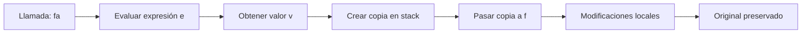
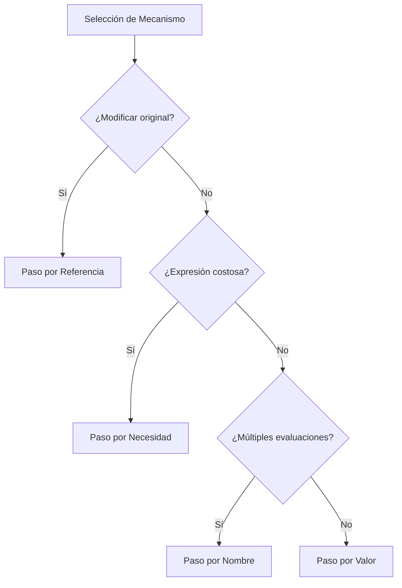

# Lenguajes de Programación - Paradigma imperativo

## 4.5 Mecanismos de paso de parámetros (por valor, por nombre, por referencia, por necesidad).

---

Los mecanismos de paso de parámetros definen cómo los argumentos se transfieren entre el código llamador y las subrutinas. Diferentes estrategias ofrecen trade-offs entre eficiencia, expresividad y seguridad.

### Conceptos Fundamentales

#### Definición Formal

Un mecanismo de paso de parámetros es una función:

$$Pass: \text{Actual} \times \text{Environment} \rightarrow \text{Formal} \times \text{Environment}$$

donde:

- $\text{Actual}$: Parámetro actual (argumento)
- $\text{Formal}$: Parámetro formal
- $\text{Environment}$: Ambiente de ejecución

### Paso por Valor (Call by Value)

#### Definición

El argumento se evalúa y se pasa una copia de su valor. Las modificaciones no afectan al original.

#### Semántica Formal

$$
\frac{\langle e, s \rangle \Downarrow v}{\langle f(e), s \rangle \rightarrow \langle f(v), s \rangle}
$$

#### Implementación

```python
def por_valor(x):
    x = x + 1  # Modifica la copia local
    return x

a = 5
resultado = por_valor(a)
print(a)  # 5 (inalterado)
print(resultado)  # 6
```

#### Diagrama de Memoria



### Paso por Referencia (Call by Reference)

#### Definición

Se pasa una referencia a la variable original. Las modificaciones afectan al original.

#### Semántica Formal

$$
\frac{l = \text{loc}(x)}{\langle f(x), s \rangle \rightarrow \langle f(l), s \rangle}
$$

#### Implementación

```python
def por_referencia(x):
    x[0] = x[0] + 1  # Modifica el objeto referenciado

a = [5]  # Variable empaquetada
por_referencia(a)
print(a[0])  # 6 (modificado)
```

#### Lenguajes que lo usan

- Fortran
- VAR parameters en Pascal
- `ref` en C#
- `&` en C++

### Paso por Nombre (Call by Name)

#### Definición

El argumento se pasa como una thunk (expresión no evaluada). Se evalúa cada vez que se usa.

#### Semántica Formal

$$
\frac{\langle e, s \rangle \rightarrow \text{thunk}}{\langle f(e), s \rangle \rightarrow \langle f(\text{thunk}), s \rangle}
$$

#### Implementación

```python
def por_nombre(expresion):
    # La expresión se evalúa cada vez que se usa
    resultado1 = expresion()  # Primera evaluación
    resultado2 = expresion()  # Segunda evaluación
    return resultado1 + resultado2

contador = 0
def expresion():
    nonlocal contador
    contador += 1
    return contador

# Pasar la función como thunk
suma = por_nombre(expresion)
print(suma)  # 3 (1 + 2)
```

#### Aplicaciones

- Macros en C
- lazy evaluation en Haskell
- callbacks en JavaScript

### Paso por Necesidad (Call by Need)

#### Definición

Variante lazy del paso por nombre. La expresión se evalúa máximo una vez (memoization).

#### Semántica Formal

$$
\frac{\langle e, s \rangle \rightarrow \text{thunk}}{\langle f(e), s \rangle \rightarrow \langle f(\text{memoized-thunk}), s \rangle}
$$

#### Implementación

```python
def por_necesidad(expresion):
    # Memoización de la expresión
    cache = None
    evaluado = False

    def thunk():
        nonlocal cache, evaluado
        if not evaluado:
            cache = expresion()
            evaluado = True
        return cache

    return thunk

def expresion_costosa():
    print("Evaluando expresión costosa...")
    return 42

# Solo se evalúa una vez
thunk = por_necesidad(expresion_costosa)
print(thunk())  # Evalúa y muestra 42
print(thunk())  # Usa cache, muestra 42
```

### Comparativa de Mecanismos

#### Tabla Comparativa

| Mecanismo  | Evaluación           | Modificaciones       | Eficiencia | Uso de Memoria |
| ---------- | -------------------- | -------------------- | ---------- | -------------- |
| Valor      | Una vez (en llamada) | No afectan original  | Alta       | Moderada       |
| Referencia | Una vez (en llamada) | Afectan original     | Alta       | Baja           |
| Nombre     | Múltiples (en uso)   | Depende del contexto | Baja       | Variable       |
| Necesidad  | Máximo una vez       | Depende del contexto | Media      | Moderada       |

#### Fórmulas de Costo

**Paso por valor**:

$$Costo_{valor} = C_{eval} + C_{copy} + n \times C_{access}$$

**Paso por referencia**:

$$Costo_{ref} = C_{addr} + n \times C_{deref}$$

**Paso por nombre**:

$$Costo_{nombre} = m \times C_{eval} + m \times C_{access}$$

donde $m$ es el número de usos del parámetro.

### Ejemplos en Diferentes Lenguajes

#### C: Por Valor y por Referencia (con punteros)

```c
// Por valor
void por_valor(int x) {
    x = x + 1;
}

// Por referencia (usando punteros)
void por_referencia(int *x) {
    *x = *x + 1;
}

int main() {
    int a = 5;
    por_valor(a);    // a sigue siendo 5
    por_referencia(&a); // a ahora es 6
    return 0;
}
```

#### Python: Por Asignación de Objeto

```python
# Python usa "pass by object reference"
def modificar_lista(lst):
    lst.append(4)  # Modifica el objeto original
    lst = [1, 2, 3]  # Crea nueva referencia local

mi_lista = [1, 2, 3]
modificar_lista(mi_lista)
print(mi_lista)  # [1, 2, 3, 4]
```

### Ejercicios Propuestos

#### Ejercicio 1: Implementación de Mecanismos

Implemente una máquina abstracta que soporte múltiples mecanismos:

```python
class ParameterPassingMachine:
    def __init__(self):
        self.environment = {}

    def call_by_value(self, func, arg):
        # Implementar paso por valor
        pass

    def call_by_reference(self, func, var_name):
        # Implementar paso por referencia
        pass

    def call_by_name(self, func, expr_thunk):
        # Implementar paso por nombre
        pass
```

#### Ejercicio 2: Análisis Semántico

Para el siguiente código, analice el comportamiento con diferentes mecanismos:

```python
def misterio(x, y):
    x = x + 1
    y = y * 2
    return x + y

a = 5
b = 10
resultado = misterio(a, b)
```

#### Ejercicio 3: Optimización de Paso por Necesidad

Implemente un sistema de memoization eficiente para paso por necesidad:

```python
class MemoizedThunk:
    def __init__(self, expr):
        self.expr = expr
        self.cache = None
        self.evaluated = False

    def evaluate(self):
        if not self.evaluated:
            self.cache = self.expr()
            self.evaluated = True
        return self.cache
```

### Diagrama de Flujo de Decisiones



### Semántica Formal Extendida

#### Reglas de Inferencia

**Paso por valor**:

$$
\frac{\langle e, s \rangle \Downarrow v}{\langle f(e), s \rangle \rightarrow \langle f(v), s \rangle}
$$

**Paso por referencia**:

$$
\frac{l = \text{loc}(x)}{\langle f(x), s \rangle \rightarrow \langle f(l), s \rangle}
$$

**Paso por nombre**:

$$
\frac{\langle e, s \rangle \rightarrow \text{thunk}}{\langle f(e), s \rangle \rightarrow \langle f(\lambda(). e), s \rangle}
$$

### Casos de Estudio Especiales

#### Parámetros OUT y INOUT

```pascal
// Pascal: parámetros out
procedure Procesar(var x: Integer; out y: Integer);
begin
    y := x * 2;
    x := x + 1;
end;
```

#### Parámetros con Valor Predeterminado

```python
# Python: parámetros con valor por defecto
def saludar(nombre, mensaje="Hola"):
    return f"{mensaje}, {nombre}"

# Uso con diferentes mecanismos
saludar("Juan")  # Paso por valor con default
saludar("Ana", "Buenos días")  # Paso por valor explícito
```

### Referencias Bibliográficas

#### Bibliografía Básica

1. Mitchell, J. (2003). _Concepts in Programming Languages_. Cambridge University Press. (Capítulo 5: Parameter Passing)
2. Pierce, B.C. (2002). _Types and Programming Languages_. MIT Press. (Capítulo: Evaluation Strategies)

#### Bibliografía Complementaria

3. Friedman, D.P., Wand, M. (2008). _Essentials of Programming Languages_. 3rd edition. MIT Press. (Capítulo: Parameter Passing)
4. Scott, M.L. (2009). _Programming Language Pragmatics_. (Capítulo: Parameter Passing)

### Evaluación del Tema

1. ¿Cuándo preferiría paso por valor sobre paso por referencia?
2. ¿Qué problemas de aliasing pueden ocurrir con paso por referencia?
3. Compare los costos computacionales de cada mecanismo
4. ¿Cómo implementaría paso por nombre en un lenguaje que no lo soporta nativamente?

### Conclusión

La elección del mecanismo de paso de parámetros afecta significativamente el comportamiento, rendimiento y seguridad de los programas. Cada estrategia tiene sus ventajas y desventajas, y la selección apropiada depende del contexto de uso y los requisitos específicos de la aplicación.
