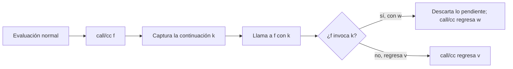

# Lenguajes de Programación - Paradigma imperativo

## 4.6 Continuaciones.

---

En cada punto de la ejecución de un programa hay un valor que se está calculando y un **resto del cálculo** que espera ese valor. En `1 + (2 * 3)`, mientras se evalúa `2 * 3`, el resto es "sumar 1 al resultado y terminar". Ese resto, visto como una función del valor que falta, es la **continuación** del punto. Hacer explícitas las continuaciones da una semántica uniforme de todas las estructuras de control: saltos, excepciones, retroceso, generadores y corrutinas son maneras de guardar, descartar o reanudar continuaciones. Este tema define las continuaciones, el estilo de paso de continuaciones (CPS), el operador `call/cc` y sus usos.

### Definición

Una continuación es una función $\kappa : \mathit{Valor} \to \mathit{Respuesta}$ que, dado el valor de la subexpresión actual, termina el cálculo del programa. En `1 + (2 * 3)`, la continuación de `2 * 3` es $\kappa = \lambda v.\, 1 + v,$ y la de todo el programa es la identidad. Una semántica con continuaciones evalúa configuraciones $\langle e, \rho, \kappa \rangle,$ en las que la expresión, en lugar de devolver su valor, se lo **pasa** a $\kappa:$

$$ \begin{aligned} \langle n, \rho, \kappa \rangle &\to \kappa(n) \\ \langle x, \rho, \kappa \rangle &\to \kappa(\rho(x)) \\ \langle e_1 + e_2, \rho, \kappa \rangle &\to \langle e_1, \rho, \lambda v_1.\, \langle e_2, \rho, \lambda v_2.\, \kappa(v_1 + v_2) \rangle \rangle \end{aligned} $$

La última regla fija el **orden de evaluación**, de izquierda a derecha, algo que la semántica de paso grande deja implícito. La continuación es, en una implementación, la **pila de control**: los marcos pendientes del tema 4.4 son exactamente lo que falta hacer con el valor actual.

### Estilo de paso de continuaciones

Un programa está en **estilo de paso de continuaciones** (CPS, *continuation-passing style*) si cada función recibe un argumento extra, su continuación, y en lugar de regresar la invoca con el resultado. La función `cuadrado(x) = x * x` en CPS es `cuadrado_k(x, k) = k(x * x)`. La transformación CPS de Plotkin (1975) convierte cualquier programa a este estilo, y tiene tres propiedades:

- todas las llamadas quedan en **posición de cola**, así que no hace falta una pila: la continuación la sustituye;
- el orden de evaluación queda explícito, y el programa transformado se comporta igual con evaluación por valor o por nombre;
- los resultados intermedios reciben nombre, como en la forma SSA de los compiladores.

Por eso varios compiladores, como el de Standard ML de Nueva Jersey, usan CPS como representación intermedia. La traducción de una expresión $e$ es una función de la continuación, de la forma $[\![ e ]\!] = \lambda k.\, \dots,$ definida por

$$ \begin{aligned} [\![ x ]\!] &= \lambda k.\, k\,x \\ [\![ e_1 + e_2 ]\!] &= \lambda k.\, [\![ e_1 ]\!]\,(\lambda v_1.\, [\![ e_2 ]\!]\,(\lambda v_2.\, k\,(v_1 + v_2))) \\ [\![ \mathsf{if}\ p\ \mathsf{then}\ a\ \mathsf{else}\ b ]\!] &= \lambda k.\, [\![ p ]\!]\,(\lambda v.\, \mathsf{if}\ v\ \mathsf{then}\ [\![ a ]\!]\,k\ \mathsf{else}\ [\![ b ]\!]\,k) \end{aligned} $$

En el condicional, $k$ se pasa a las dos ramas, pero solo una se ejecuta.

### call/cc

Scheme ofrece las continuaciones como valores con `call-with-current-continuation`, abreviado `call/cc`. `(call/cc f)` llama a `f` con la continuación actual $k$ como argumento; si `f` regresa normalmente con $v,$ el resultado es $v;$ si en algún momento se invoca $k(w),$ el cálculo en curso se **abandona** y `call/cc` regresa $w.$ Formalmente,

$$\langle \mathsf{callcc}\ f, \rho, \kappa \rangle \to \langle f\ \hat{\kappa}, \rho, \kappa \rangle,$$

donde $\hat{\kappa}$ es la continuación convertida en función, que al aplicarse descarta la continuación del punto de aplicación y continúa con $\kappa.$ En `(+ 1 (call/cc (lambda (k) (+ 10 (k 2)))))`, la llamada `(k 2)` descarta el `(+ 10 _)` pendiente y el resultado es $1 + 2 = 3.$

Las continuaciones se clasifican por lo que permiten:

- **De escape:** solo se invocan mientras `call/cc` está activo, para salir. Equivalen a `return`, `break` y a lanzar una excepción, y se implementan desenrollando la pila.
- **De un solo uso** (*one-shot*): se reanudan a lo más una vez, como las corrutinas.
- **De múltiples usos** (*multi-shot*): se pueden invocar varias veces, aun después de que `call/cc` terminó, y cada vez reanudan el mismo punto. Exigen copiar la pila o guardar los marcos en el montículo, y permiten retroceso.
- **Delimitadas:** capturan solo el resto del cálculo hasta un delimitador, con operadores como `shift` y `reset`, en lugar del programa entero. Componen como funciones ordinarias y son la base de los efectos algebraicos de OCaml 5.

Python no tiene continuaciones de primera clase. Con excepciones se implementan las de escape; con generadores, una forma de las de un solo uso: `yield` suspende la función, y `next` o `send` la reanudan.



### Aplicaciones

- **Salida temprana:** una búsqueda o un recorrido recursivo invoca la continuación de escape cuando encuentra la respuesta, y se salta todo el trabajo pendiente.
- **Excepciones:** un manejador es una continuación; lanzar una excepción es invocar la continuación del manejador más cercano, descartando la del punto donde ocurrió el error. En CPS, cada función recibe dos continuaciones, una de **éxito** y otra de **falla**.
- **Retroceso:** con continuaciones de éxito y de falla, la de falla es "probar la siguiente alternativa". Es la base de los intérpretes de Prolog y del operador `amb` de McCarthy.
- **Generadores, corrutinas e hilos ligeros:** cada uno guarda su continuación al suspenderse, y un planificador elige cuál reanudar.
- **Servidores web:** un servidor puede guardar la continuación de una interacción y reanudarla cuando llega la siguiente petición del usuario, como en Racket.

### Implementación en Python

El programa muestra el defecto de la versión de `call_cc` del ejercicio 1 e implementa una de escape correcta, con salida temprana, anidamiento y detección del uso después de terminar. Para el ejercicio 2 implementa la transformación CPS sobre un árbol de sintaxis, la aplica a las tres expresiones y ejecuta sus versiones CPS. Para el ejercicio 3 implementa el manejador de excepciones con continuaciones de éxito y falla, y una búsqueda con retroceso basada en el mismo par de continuaciones.

```python
from itertools import count

# ---------- Ejercicio 1: call/cc de escape con excepciones ----------
class ContinuationException(Exception):
    def __init__(self, cont, value): self.cont, self.value = cont, value
def call_cc_original(func):                         # la versión del enunciado
    def captured_cont(value): raise ContinuationException(captured_cont, value)
    try: return func(captured_cont)
    except ContinuationException as e: return e.cont(e.value)     # vuelve a lanzar: la excepción escapa
try: print("ejercicio 1: original, call_cc(lambda k: k(5)) =", call_cc_original(lambda k: k(5)))
except ContinuationException as e: print("ejercicio 1: la versión original no devuelve 5: escapa", type(e).__name__, "con valor", e.value)

class _Escape(Exception):
    def __init__(self, marca, valor): self.marca, self.valor = marca, valor
_marcas = count()
def call_cc(func):
    """Continuación de escape, de un solo uso y válida solo mientras call_cc no ha terminado."""
    marca, viva = next(_marcas), [True]
    def k(valor):
        if not viva[0]: raise RuntimeError("la continuación ya no es válida: su call_cc terminó")
        raise _Escape(marca, valor)
    try: return func(k)
    except _Escape as e:
        if e.marca != marca: raise                  # pertenece a un call_cc exterior: se deja pasar
        return e.valor
    finally: viva[0] = False
print("   corregida: call_cc(lambda k: k(5)) =", call_cc(lambda k: k(5)), "| 1 + call_cc(lambda k: 10 + k(2)) =", 1 + call_cc(lambda k: 10 + k(2)),
      "| sin usar k:", call_cc(lambda k: 7))
visitados = []
def producto(xs):                                   # salida temprana: un 0 abandona todas las multiplicaciones
    def cuerpo(salir):
        def rec(i):
            if i == len(xs): return 1
            visitados.append(xs[i])
            if xs[i] == 0: salir(0)
            return xs[i] * rec(i + 1)
        return rec(0)
    return call_cc(cuerpo)
r0 = producto([2, 3, 0, 5, 7]); vistos = list(visitados)
print("   producto([2, 3, 0, 5, 7]) =", r0, "visitando solo", vistos, "| producto([2, 3, 4]) =", producto([2, 3, 4]))
anidado = call_cc(lambda externo: 100 + call_cc(lambda interno: externo(1) + 50))
print("   anidado: el k exterior salta sobre el interior ->", anidado)
guardada = []
call_cc(lambda k: guardada.append(k) or 0)
try: guardada[0](3)
except RuntimeError as e: print("   reinvocar después:", e)

# ---------- Ejercicio 2: transformación CPS ----------
nuevo = count(1)
def cps(e, k):
    """e: ('var', x) | ('op', o, a, b) | ('if', p, a, b) | ('call', f, args). k: texto de la continuación."""
    if e[0] == "var": return f"{k}({e[1]})"
    if e[0] == "op":
        a, b = f"v{next(nuevo)}", f"v{next(nuevo)}"
        return cps(e[2], f"(λ{a}. " + cps(e[3], f"(λ{b}. {k}({a} {e[1]} {b}))") + ")")
    if e[0] == "if":
        p = f"v{next(nuevo)}"
        return cps(e[1], f"(λ{p}. if {p} then {cps(e[2], k)} else {cps(e[3], k)})")
    if e[0] == "call":
        nombres = [f"v{next(nuevo)}" for _ in e[2]]
        cuerpo = f"{e[1]}_cps({', '.join(nombres)}, {k})"
        for arg, n in reversed(list(zip(e[2], nombres))): cuerpo = cps(arg, f"(λ{n}. {cuerpo})")
        return cuerpo
V = lambda x: ("var", x)
for texto, e in (("x + y * z", ("op", "+", V("x"), ("op", "*", V("y"), V("z")))),
                 ("if p then a else b", ("if", V("p"), V("a"), V("b"))),
                 ("f(g(x), h(y))", ("call", "f", [("call", "g", [V("x")]), ("call", "h", [V("y")])]))):
    nuevo = count(1); print(f"ejercicio 2: {texto:20} ⇒ λk. {cps(e, 'k')}")
# las mismas tres en CPS ejecutable, con funciones que reciben su continuación
suma_k = lambda a, b, k: k(a + b); mult_k = lambda a, b, k: k(a * b)
expr1_k = lambda x, y, z, k: mult_k(y, z, lambda v: suma_k(x, v, k))
expr2_k = lambda p, a, b, k: k(a) if p else k(b)
g_k = lambda x, k: k(x + 1); h_k = lambda y, k: k(y * 10); f_k = lambda a, b, k: k(a - b)
expr3_k = lambda x, y, k: g_k(x, lambda v1: h_k(y, lambda v2: f_k(v1, v2, k)))
ident = lambda v: v
print("   ejecución: 2 + 3·4 =", expr1_k(2, 3, 4, ident), "| if False then 1 else 2 =", expr2_k(False, 1, 2, ident),
      "| f(g(5), h(2)) = (5+1) - 2·10 =", expr3_k(5, 2, ident))

# ---------- Ejercicio 3: excepciones con dos continuaciones ----------
class ExceptionHandler:
    """Cada bloque recibe la continuación de éxito y la de falla (lanzar). catch registra manejadores por tipo."""
    def __init__(self): self.handlers = {}
    def catch(self, tipo, handler): self.handlers[tipo] = handler; return self
    def try_block(self, block, cont, falla_externa=None):
        def lanzar(exc):
            for tipo in type(exc).__mro__:            # el manejador más específico según la jerarquía
                if tipo in self.handlers: return self.handlers[tipo](exc, cont)
            if falla_externa: return falla_externa(exc)   # sin manejador: se propaga al try exterior
            raise exc
        return block(cont, lanzar)
def divide_k(a, b, k, lanzar): return lanzar(ZeroDivisionError("división por cero")) if b == 0 else k(a / b)
h = ExceptionHandler().catch(ArithmeticError, lambda e, k: k(f"manejado ({type(e).__name__}: {e})"))
for b in (4, 0):
    print(f"ejercicio 3: 10 / {b} ->", h.try_block(lambda k, lanzar: divide_k(10, b, lambda v: k(v * 2), lanzar), ident))
interno = ExceptionHandler().catch(KeyError, lambda e, k: k("clave"))
externo = ExceptionHandler().catch(ValueError, lambda e, k: k(f"exterior atrapó: {e}"))
print("   anidado:", externo.try_block(lambda k_ext, lanzar_ext:
      interno.try_block(lambda k, lanzar: lanzar(ValueError("no es una clave")), k_ext, lanzar_ext), ident))

# --- continuaciones de éxito y falla: búsqueda con retroceso ---
def subconjunto(xs, objetivo, exito, falla):
    """exito(sol, reintenta) recibe también la falla, para pedir la siguiente solución."""
    if objetivo == 0: return exito([], falla)
    if not xs or objetivo < 0: return falla()
    x, resto = xs[0], xs[1:]
    return subconjunto(resto, objetivo - x, lambda sol, f: exito([x] + sol, f),
                       lambda: subconjunto(resto, objetivo, exito, falla))   # la falla retrocede y prueba sin x
xs = [8, 6, 7, 5, 3, 10, 9]
print("   subconjunto de suma 15, la primera:", subconjunto(xs, 15, lambda s, f: s, lambda: "ninguna"),
      "| sin solución para 2:", subconjunto([8, 6, 7], 2, lambda s, f: s, lambda: "ninguna"))
sols = []
subconjunto(xs, 15, lambda s, reintenta: (sols.append(s), reintenta())[1], lambda: None)  # cada éxito pide la siguiente
print("   todas, invocando la falla tras cada éxito:", sols)
```

Salida:

```text
ejercicio 1: la versión original no devuelve 5: escapa ContinuationException con valor 5
   corregida: call_cc(lambda k: k(5)) = 5 | 1 + call_cc(lambda k: 10 + k(2)) = 3 | sin usar k: 7
   producto([2, 3, 0, 5, 7]) = 0 visitando solo [2, 3, 0] | producto([2, 3, 4]) = 24
   anidado: el k exterior salta sobre el interior -> 1
   reinvocar después: la continuación ya no es válida: su call_cc terminó
ejercicio 2: x + y * z            ⇒ λk. (λv1. (λv3. (λv4. (λv2. k(v1 + v2))(v3 * v4))(z))(y))(x)
ejercicio 2: if p then a else b   ⇒ λk. (λv1. if v1 then k(a) else k(b))(p)
ejercicio 2: f(g(x), h(y))        ⇒ λk. (λv4. g_cps(v4, (λv1. (λv3. h_cps(v3, (λv2. f_cps(v1, v2, k))))(y))))(x)
   ejecución: 2 + 3·4 = 14 | if False then 1 else 2 = 2 | f(g(5), h(2)) = (5+1) - 2·10 = -14
ejercicio 3: 10 / 4 -> 5.0
ejercicio 3: 10 / 0 -> manejado (ZeroDivisionError: división por cero)
   anidado: exterior atrapó: no es una clave
   subconjunto de suma 15, la primera: [8, 7] | sin solución para 2: ninguna
   todas, invocando la falla tras cada éxito: [[8, 7], [6, 9], [7, 5, 3], [5, 10]]
```

### Ejercicios Propuestos

1. **call/cc.** Analiza y corrige esta implementación de `call/cc` con excepciones:

    ```python
    class ContinuationException(Exception):
        def __init__(self, cont, value):
            self.cont = cont
            self.value = value

    def call_cc(func):
        def captured_cont(value):
            raise ContinuationException(captured_cont, value)
        try:
            return func(captured_cont)
        except ContinuationException as e:
            return e.cont(e.value)
    ```

2. **CPS.** Transforma a CPS `x + y * z`, `if p then a else b` y `f(g(x), h(y))`.

3. **Excepciones.** Implementa un sistema de manejo de excepciones con continuaciones:

    ```python
    class ExceptionHandler:
        def __init__(self):
            self.handlers = {}
        def try_block(self, block, cont):
            pass
        def catch(self, exception_type, handler):
            pass
    ```

### Soluciones

**Ejercicio 1.** La versión del enunciado no funciona: cuando `func` invoca la continuación, se lanza la excepción, el `except` la atrapa y llama a `e.cont(e.value)`, que es otra vez `captured_cont`, y vuelve a lanzarla. Una excepción lanzada dentro de un `except` no la atrapa el mismo `try`, así que escapa de `call_cc`, y `call_cc(lambda k: k(5))` termina con un error en lugar de devolver 5. La corrección es que el `except` **devuelva** `e.value`: atrapar la excepción ya desenrolló la pila hasta el punto de `call_cc`, y eso es invocar la continuación. Hacen falta dos ajustes más:

- cada `call_cc` debe atrapar solo **su** excepción, identificada con una marca única, y dejar pasar las demás, para que una continuación exterior invocada dentro de un `call_cc` interior salte hasta el exterior;
- una vez que `call_cc` terminó, la pila que la continuación representaba ya no existe, y la versión con excepciones no puede reanudarla. El programa detecta ese uso y lo rechaza.

El resultado es una continuación de **escape**, que basta para la salida temprana: en `producto([2, 3, 0, 5, 7])`, al encontrar el 0 se sale con 0 sin visitar el 5 ni el 7 y sin hacer las multiplicaciones pendientes. Las continuaciones de múltiples usos no se pueden implementar así en Python; requieren escribir el programa en CPS o un intérprete que maneje la pila como dato.

**Ejercicio 2.** Aplicando la traducción, con un orden de izquierda a derecha y una función `f_cps` que recibe su continuación por cada función `f`:

1. $[\![ x + y \cdot z ]\!] = \lambda k.\, [\![ x ]\!](\lambda v_1.\, [\![ y ]\!](\lambda v_3.\, [\![ z ]\!](\lambda v_4.\, (\lambda v_2.\, k(v_1 + v_2))(v_3 \cdot v_4)))).$ Simplificando las aplicaciones de variables, $\lambda k.\, k(x + y \cdot z)$ si la suma y el producto son primitivas sin efectos; si son funciones en CPS, $\lambda k.\, \mathit{mult}_k(y, z, \lambda v.\, \mathit{suma}_k(x, v, k)).$
2. $[\![ \mathsf{if}\ p\ \mathsf{then}\ a\ \mathsf{else}\ b ]\!] = \lambda k.\, \mathsf{if}\ p\ \mathsf{then}\ k(a)\ \mathsf{else}\ k(b).$
3. $[\![ f(g(x), h(y)) ]\!] = \lambda k.\, g_k(x, \lambda v_1.\, h_k(y, \lambda v_2.\, f_k(v_1, v_2, k))).$ El orden de las llamadas, primero $g$ y después $h,$ queda fijado por el anidamiento, y la llamada a $f_k$ es de cola.

El programa genera las tres traducciones sin simplificar, con las aplicaciones a variables a la vista, y ejecuta las versiones simplificadas.

**Ejercicio 3.** Cada bloque recibe dos continuaciones: `k`, a la que pasa su resultado, y `lanzar`, que invoca con la excepción. `catch` registra un manejador por tipo, y `lanzar` busca el más específico recorriendo la jerarquía del tipo de la excepción, su MRO, de modo que un manejador de `ArithmeticError` atrapa `ZeroDivisionError`. Un manejador recibe la excepción y la continuación de éxito del `try`, y puede producir un valor de reemplazo. Si ningún manejador coincide, `lanzar` invoca la falla del `try` exterior, y así se forma la cadena de manejadores sin pila: en el programa, un `ValueError` lanzado dentro de un `try` que solo atrapa `KeyError` lo atrapa el exterior. La búsqueda de subconjuntos con suma dada usa el mismo par: la continuación de falla es "intentar sin este elemento", y al invocarla después de cada éxito se enumeran todas las soluciones.

### Referencias

1. Friedman, D. P., and Wand, M., _Essentials of Programming Languages_. MIT Press, 2008. Capítulos 5 y 6.
2. Plotkin, G. D., Call-by-name, call-by-value and the λ-calculus. _Theoretical Computer Science_ 1(2), 1975.
3. Reynolds, J. C., The discoveries of continuations. _Lisp and Symbolic Computation_ 6, 1993.
4. Appel, A. W., _Compiling with Continuations_. Cambridge University Press, 1992.
5. Danvy, O., and Filinski, A., Abstracting control. _LISP and Functional Programming_, 1990.
